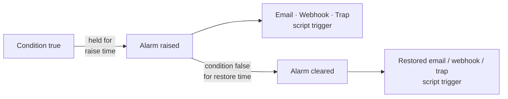
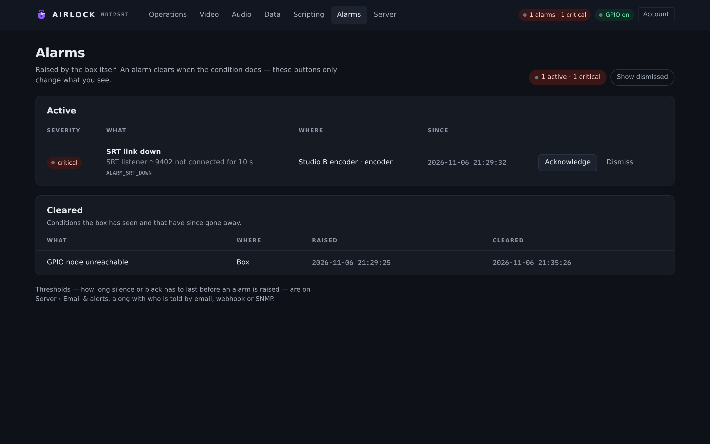
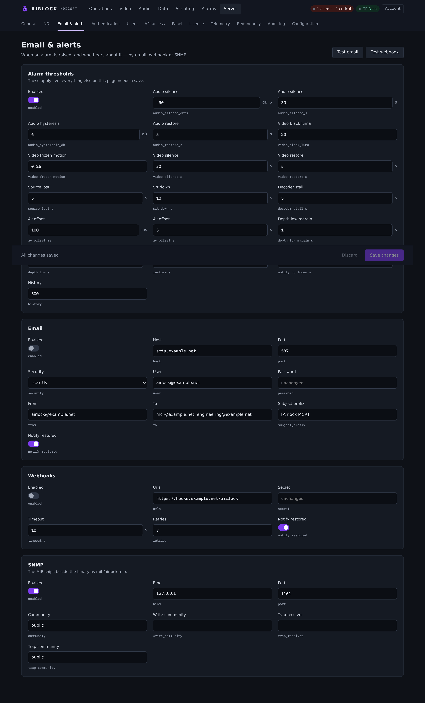
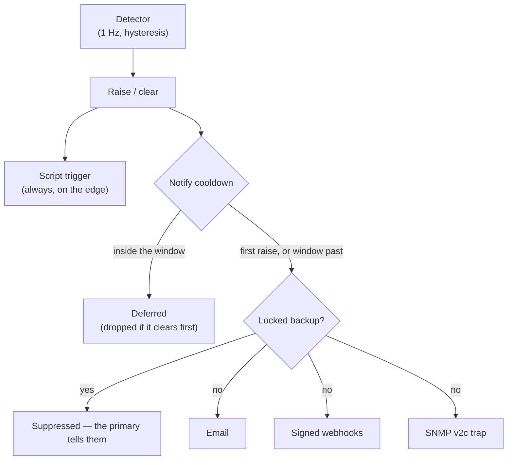

# Alarms

Airlock watches its own blocks once a second and raises an alarm when something
has been wrong long enough to matter. This page explains what an alarm is, how it
is raised and cleared, what the thresholds mean, and how an alarm reaches you.

## The model

An alarm is one condition on one place. Three things identify it:

| Part | What it is |
|---|---|
| **Kind** | the condition — audio silence, SRT down, depth eroded. Each kind has a fixed code (`ALARM_AUDIO_SILENCE`) and a fixed severity. |
| **Block** | which part of the box found it: `encoder`, `decoder` or `delay` for the engine; `gpio`, `redundancy`, `watchdog`, `licence` or `system` for the process. |
| **Channel** | the delay channel it is on. **Channel 0 means process-wide** — the GPIO node, redundancy, the licence. |

One alarm is one `(block, channel, kind)`. Channel 2 going silent therefore never
hides channel 1's silence, and the same kind can be active on an encoder and a
decoder at the same time.

Severity is **warning** or **critical**. It is a property of the kind, not of the
moment — see the [alarm catalogue](../reference/alarm-catalogue.md) for every one.

!!! note "Alarms are not persisted"
    The active list lives in memory. A restart starts with nothing alarming and
    the detectors rebuild their view over the next few seconds. The cleared
    history is a ring of the last `history` entries (500 by default).

## Raise and clear

The detector thread ticks once a second. It reads the counters and meters the
blocks already keep and the preview probe's luma grid, so detection costs nothing
on any frame path.

Every condition is hysteresised **both ways**:

* it must hold **continuously** for its raise time before the alarm is raised;
* it must be absent **continuously** for its restore time before the alarm clears.

A link that flaps for two seconds never raises anything. Audio adds a second
hysteresis on level: once silence is raised, restoring needs the peak above
`audio_silence_dbfs + audio_hysteresis_db`, not merely back above the threshold.



A few more rules worth knowing:

* **A stopped block carries no alarms.** Stopping the encoder clears everything
  the encoder had on that channel. Removing a channel clears everything on it.
* **A repeat raise changes nothing.** The first raise's time and message stand
  until the alarm clears.
* **Black and frozen are only judged on a live picture.** A feed that has gone
  away is source-lost, never also frozen.
* **Silence and black are measured on the block's input** — the encoder's and
  delay's NDI source, the decoder's output picture.

## The Alarms page

**Alarms** in the main menu is the list.

{ .shot }

The header carries a pill — *All clear*, or *N active · M critical* — and a
**Show dismissed** chip. Below it:

**Active** lists, per row: **Severity**, **What** (the friendly name, the detail
message and the code), **Where**, **Since**, and two buttons.

| Button | What it does |
|---|---|
| **Acknowledge** | marks the occurrence seen. The row stays. |
| **Dismiss** | hides the row from the console until the condition clears and raises again as a new occurrence. |

**Cleared** lists conditions the box has seen that have since gone away, newest
first, with when they were raised and when they cleared.

### Acknowledge and dismiss are a display overlay

This is the part people get wrong. Ack and dismiss change **what the console
shows**. They never change what the box reports:

* SNMP objects, alarm emails, webhooks and traps carry on reporting a dismissed
  alarm exactly as before;
* the raw counts — `active`, `critical`, `warning` — are untouched;
* only `visible`, `acked` and `dismissed` move.

Dismissing silences the page, not the plant. A dismissed alarm comes back the
moment the condition clears and returns, because that is a new occurrence with a
new id.

## The top-bar pill

Every page carries the alarm state in the top bar, next to the section menu.

{ .shot }

It reads **No alarms** (green), or **N alarms · M critical** — amber while only
warnings are active, red as soon as one critical is. Click it to go to the Alarms
page. The pill counts the box's raw active list, so it does not drop when you
dismiss a row.

## Thresholds

Thresholds are on **Server › Email & alerts**, in the **Alarm thresholds** card.
They are re-read every second, so a change applies live — unlike the rest of that
page, which needs a save.

{ .shot }

Numeric fields show their unit beside the box.

| Setting | Console label | Config key | Default | Meaning |
|---|---|---|---|---|
| Detection on | Enabled | `alarms.enabled` | `true` | Run the detectors at all. Off clears every engine alarm. |
| Audio silence level | Audio silence (dBFS) | `alarms.audio_silence_dbfs` | `-50` | Peak below this counts as silence. |
| Audio silence hold | Audio silence (s) | `alarms.audio_silence_s` | `30` | How long silence must last to raise. |
| Audio hysteresis | Audio hysteresis (dB) | `alarms.audio_hysteresis_db` | `6` | Restoring needs the peak above threshold **plus** this. |
| Audio restore | Audio restore (s) | `alarms.audio_restore_s` | `5` | How long audio must be back before the alarm clears. |
| Video black level | Video black luma | `alarms.video_black_luma` | `20` | Mean 8-bit luma below this is black (16 is black level). |
| Video frozen motion | Video frozen motion | `alarms.video_frozen_motion` | `0.25` | Mean absolute luma change per sample below this is a still picture. Camera noise is usually above 1. |
| Video hold | Video silence (s) | `alarms.video_silence_s` | `30` | How long black or frozen must last to raise. |
| Video restore | Video restore (s) | `alarms.video_restore_s` | `5` | How long a good picture must last before either clears. |
| Source lost | Source lost (s) | `alarms.source_lost_s` | `5` | No NDI video for this long. The block itself waits 3 s before it says so. |
| SRT down | Srt down (s) | `alarms.srt_down_s` | `10` | The SRT link is not connected for this long. |
| Decoder stall | Decoder stall (s) | `alarms.decoder_stall_s` | `5` | SRT connected but no decoded picture leaves for this long. |
| A/V offset limit | Av offset (ms) | `alarms.av_offset_ms` | `100` | Picture and sound this far apart, either way. |
| A/V offset hold | Av offset (s) | `alarms.av_offset_s` | `5` | How long the offset must stay outside the limit. |
| Depth margin | Depth low margin (s) | `alarms.depth_low_margin_s` | `1` | How far under target counts as eroded. |
| Depth hold | Depth low (s) | `alarms.depth_low_s` | `30` | How long the shortfall must last. |
| Restore | Restore (s) | `alarms.restore_s` | `5` | Restore time for the link, source, stall and depth detectors. |
| Notify cooldown | Notify cooldown (s) | `alarms.notify_cooldown_s` | `300` | Flap guard on **deliveries** — see below. |
| History kept | History | `alarms.history` | `500` | Cleared alarms kept in the ring. |

```json
"alarms": {
  "enabled": true,
  "audio_silence_dbfs": -50.0, "audio_silence_s": 30.0,
  "audio_hysteresis_db": 6.0,  "audio_restore_s": 5.0,
  "video_black_luma": 20.0,    "video_frozen_motion": 0.25,
  "video_silence_s": 30.0,     "video_restore_s": 5.0,
  "source_lost_s": 5.0, "srt_down_s": 10.0, "decoder_stall_s": 5.0,
  "av_offset_ms": 100.0, "av_offset_s": 5.0,
  "depth_low_margin_s": 1.0, "depth_low_s": 30.0, "restore_s": 5.0,
  "notify_cooldown_s": 300.0, "history": 500
}
```

!!! tip "Setting the A/V offset limit"
    The default sits well past the published lip-sync budgets — EBU R37 allows
    +40/−60 ms at an output, ITU-R BT.1359-1 +90/−185 ms end to end — on purpose.
    This alarm is meant to say *on air and wrong*, not *worth watching*. The
    message is signed: it names which rail is ahead, because sound late is far
    easier to live with than sound early.

## Delivery

Each transition is offered to three transports, each with its own switch and each
isolated from the others' failures.



**The flap guard.** The alarm *list* always tracks the plant exactly. *Deliveries*
are guarded: a re-raise of the same `(block, channel, kind)` within
`notify_cooldown_s` of the last delivered raise is held back, and sent only if it
is still active when the window ends. If it clears first, nothing goes out. A
"restored" message is only ever delivered for an occurrence whose raise was
delivered. Each `(block, channel, kind)` has its own cooldown, so a flapping
channel 2 does not spend channel 1's.

**Standby suppression.** While this instance is a locked backup, deliveries are
suppressed: the primary is raising the same alarm and telling the same people.
The alarm is still raised and still listed here. See
[Operating a standby](../redundancy/standby.md).

**Scripts.** Every raise and clear fires the `alarm` script trigger on the edge
the detector found — before the notify cooldown, which is about email and
webhooks, not about what the plant did. See
[Triggers](../scripting/triggers.md).

Set the transports up on:

* [Email and webhooks](email.md) — SMTP and signed HTTP POSTs;
* [SNMP](snmp.md) — the v2c agent, the MIB and traps.

[Dump clips and alerts](clips.md) use the same senders but are **not** alarms:
a dump is one-shot, with no restored counterpart and nothing to clear.

## REST and TCP

```bash
# the active list, the cleared history and the counts
curl -s http://host:8090/api/alarms

# mark one occurrence seen, or hide it until it re-raises
curl -s -X POST http://host:8090/api/alarms/42/ack
curl -s -X POST http://host:8090/api/alarms/42/dismiss

# the summary rides the state feed
curl -s http://host:8090/api/state | jq .alarms
```

`GET /api/alarms` answers `{summary, active, recent, enabled}`. The summary
separates raw truth from the overlay:

| Field | Meaning |
|---|---|
| `active`, `critical`, `warning` | raw — what the box found |
| `visible` | active minus dismissed |
| `dismissed`, `acked` | the overlay |
| `worst` | `ok`, `warning` or `critical` |

Reading alarms needs the `viewer` role; ack and dismiss are allowed even on a
locked backup, because seeing to a row is not driving the plant.

Over TCP control, `ALARMS ALL` answers one line of raw truth:

```
OK 1 ACTIVE=2 CRITICAL=1 WARNING=1 encoder@1:srt_down,delay@2:audio_silence
OK 1 ACTIVE=0
```

`ALARMS <channel>` does the same for one channel, with the block names unsuffixed
because the line is already about one channel.

## Troubleshooting

**Nothing ever alarms.** Check `alarms.enabled` on Server › Email & alerts. With
detection off, every engine alarm is cleared and none is raised. Also check the
block is actually running — a stopped block carries no alarms by design.

**An alarm I dismissed is still emailing people.** That is correct. Dismiss is a
console overlay. To stop the deliveries, fix the condition, raise
`notify_cooldown_s`, or switch the transport off.

**The same fault raises twice.** It is on two blocks or two channels. Look at the
**Where** column: `delay · ch 2` and `encoder · ch 2` are two alarms about one
cable.

**Audio silence on a channel with no audio.** The silence detector only runs when
the block is configured for audio and the source is connected. If a channel has
`audio.enabled: false`, it is never evaluated.

**Video frozen on a legitimately static source.** A slate, a caption card or a
locked-off camera on a still subject will read as frozen. Lower
`video_frozen_motion` toward 0, or lengthen `video_silence_s`.

**Alarms vanish after a restart.** Expected — the list is in memory. Use the
audit log, the emails or your trap receiver for history across restarts.
