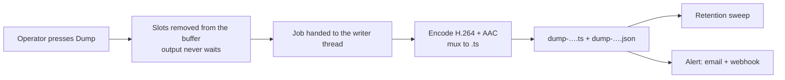
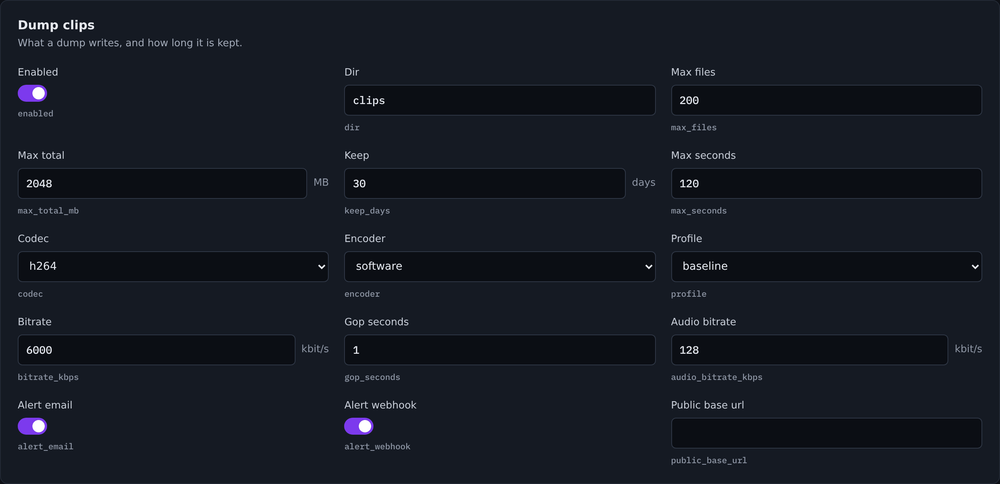

# Dump clips and alerts

Every Dump removes the newest seconds from a delay's buffer. Those seconds are
the material that never aired — which is exactly the material a compliance
review wants. Airlock writes them to a file, records who dumped what, and tells
whoever needs to know.

## What happens on a dump



Three rules shape it:

* **The flush is never delayed by the write.** The removed slots are *moved* into
  a job and handed to a writer thread. Nothing is copied on the output thread and
  nothing blocks on the disk. The dump always happens, on time.
* **One record per clip.** `dump-….json` sits beside `dump-….ts`. The directory
  is the index — there is no shared file to corrupt, and retention removes the
  pair together.
* **A dump alert is an event, not an alarm.** It is one-shot: no hold-off, no
  flap guard, no "restored" counterpart and nothing to clear. It uses the same
  senders as alarms, so the same SMTP settings and the same webhook signature.

If the writer is still busy with an earlier dump, the new job is dropped with a
logged warning and a `dropped` record. The dump itself still happened.

## Where clips go

By default, a `clips` directory beside the configuration — which for an
installed service is the data directory:

| Platform | Default clips directory |
|---|---|
| Linux (service) | `/var/lib/ndi2srt/clips` |
| Windows (service) | `%ProgramData%\ndi2srt\clips` |
| Run from a folder | `clips` beside `ndi2srt.json` |

Set `clips.dir` to put them anywhere else — a compliance volume, a NAS mount.
The path is machine-local and is never mirrored to a backup.

### File names

```
dump-ch2-20261106-140103-5s.ts
dump-ch2-20261106-140103-5s.json
```

Channel, then **local** date and time, then the seconds removed — local time so
it lines up with the audit log. Two dumps in one second on one channel get `-2`,
`-3` and so on.

## Settings

The **Dump clips** card is on **Server › General**.

{ .shot }

| Setting | Console label | Config key | Default | Meaning |
|---|---|---|---|---|
| Write clips | Enabled | `clips.enabled` | `true` | Off, the dump still happens and is still recorded — with no file. |
| Directory | Dir | `clips.dir` | `""` | Empty = `<config dir>/clips`. |
| Keep at most | Max files | `clips.max_files` | `200` | Files kept. `0` switches this cap off. |
| Keep at most | Max total (MB) | `clips.max_total_mb` | `2048` | Total size. `0` switches this cap off. |
| Keep for | Keep (days) | `clips.keep_days` | `30` | Age. `0` switches this cap off. |
| Longest clip | Max seconds | `clips.max_seconds` | `120` | A longer dump keeps its **last** `max_seconds`. |
| Codec | Codec | `clips.codec` | `h264` | `h264` or `h265`. |
| Encoder | Encoder | `clips.encoder` | `software` | `software`, `auto` or `nvenc`. |
| Profile | Profile | `clips.profile` | `baseline` | `baseline`, `main` or `high`. |
| Video bitrate | Bitrate (kbit/s) | `clips.bitrate_kbps` | `6000` | |
| GOP | Gop seconds | `clips.gop_seconds` | `1.0` | Seconds between IDRs. |
| Audio bitrate | Audio bitrate (kbit/s) | `clips.audio_bitrate_kbps` | `128` | AAC-LC. |
| Email the alert | Alert email | `clips.alert_email` | `true` | Also needs `email.enabled` and recipients. |
| POST the alert | Alert webhook | `clips.alert_webhook` | `true` | Also needs `webhooks.enabled` and URLs. |
| Console address | Public base url | `clips.public_base_url` | `""` | e.g. `https://airlock.example.com:8090` — puts a link to the clip in the alert. |

```json
"clips": {
  "enabled": true, "dir": "", "max_files": 200, "max_total_mb": 2048,
  "keep_days": 30, "max_seconds": 120.0,
  "codec": "h264", "encoder": "software", "profile": "baseline",
  "bitrate_kbps": 6000, "gop_seconds": 1.0, "audio_bitrate_kbps": 128,
  "alert_email": true, "alert_webhook": true, "public_base_url": ""
}
```

!!! tip "Leave the codec defaults alone unless you have a reason"
    **software** so a clip never competes with the live encoder for the GPU, and
    **H.264 baseline** so Airlock's own decoder reads the clip back. That second
    one matters: a dump clip can be pointed at directly as a delay fill
    (`delay.fill.clip_path`) with nothing in between.

!!! note "Audio formats a clip can carry"
    AAC-LC at the source's rate and channel count — 48 or 44.1 kHz, mono or
    stereo. Anything else produces a video-only clip and says so in the record.

### Retention

The sweep runs after every write. Oldest out first, until every cap is
satisfied. A cap set to `0` is off. Setting all three to `0` keeps clips for
ever — which is a decision about disk, not about compliance.

`max_seconds` is different: it bounds a **single** clip, and it is applied at the
hand-off, so a Dump-all of a deep buffer passes one clip's worth to the writer
and frees the rest at once instead of holding the whole buffer twice.

## The record

`dump-….json` carries, for each dump:

| Group | Fields |
|---|---|
| When | `ts` (local), `utc`, `unix` |
| Who | `origin` and `principal` — the same actor the audit log names |
| Where | `channel`, `channel_name` |
| What | `requested_s`, `seconds`, `frames`, `clip_frames`, `clip_s` |
| Depth | `depth_before_s`, `depth_after_s` |
| Format | `width`, `height`, `fps`, `audio_rate`, `audio_channels`, `codec` |
| File | `name`, `bytes`, `write_s` |
| Outcome | `status`, `note` |

| `status` | Meaning |
|---|---|
| `written` | The whole removed span is in the file. |
| `truncated` | Longer than `max_seconds`: the **last** `max_seconds` are in the file. |
| `skipped` | Clips are disabled, or the buffer was empty. |
| `dropped` | The writer was still busy; the frames were discarded. |
| `failed` | The encode or the write failed — `note` says why. |

Each dump also leaves two [audit log](../server/audit.md) entries with the same
principal: `delay.dump` (who pressed it, at what depth) and `delay.clip` (what
became of the material).

## The alert

### Email

```
Subject: [ndi2srt] DUMP on ch 2 · Studio A delay at 14:01:03 UTC

ndi2srt DUMP alert

Channel:  ch 2 · Studio A delay (mcr-airlock-1)
When:     2026-11-06 14:01:03 UTC
By:       dan via web
Flushed:  125 frames (5.0 s)
Depth:    10.0 s → 5.0 s
Clip:     dump-ch2-20261106-140103-5s.ts (3.8 MB)

View the dumped content (sign-in required):
https://airlock.example.com:8090/api/clips/dump-ch2-20261106-140103-5s.ts
```

Without `public_base_url` the last two lines are replaced by a note saying to set
it. The HTML part carries the same table and a **View dumped content** button.

The link is not a back door: it goes through the normal console authentication,
so only someone who can sign in can fetch the clip.

### Webhook

```json
{ "event": "dump", "oneShot": true, "code": "DUMP", "friendlyName": "Dump",
  "category": "delay", "severity": "info", "channel": 2,
  "channelName": "Studio A delay",
  "whenUtc": "2026-11-06T14:01:03Z", "instance": "mcr-airlock-1",
  "principal": "dan", "origin": "web", "seconds": 5.0, "frames": 125,
  "depthBeforeSeconds": 10.0, "depthAfterSeconds": 5.0,
  "clip": "dump-ch2-20261106-140103-5s.ts", "clipBytes": 3981234,
  "clipStatus": "written",
  "dump": { "…": "the whole record" } }
```

It is signed and retried exactly like an alarm webhook — same
`X-Airlock-Signature`, same 1 s / 3 s / 9 s backoff. See
[Email and webhooks](email.md).

!!! warning "There is deliberately no `active` field"
    An alarm receiver keys on `active: true` and then waits for `active: false`.
    A dump never sends one, so a receiver that assumes it would wait for ever.
    Tell the two apart by `event`: `"alarm"` or `"dump"`. `"oneShot": true` says
    the same thing.

A locked backup sends no dump alerts — its primary does.

## Viewing and downloading

```bash
# every clip with its record, newest first
curl -s http://host:8090/api/clips | jq '.clips[] | {name, ts, principal, seconds, status}'

# download one
curl -sOJ http://host:8090/api/clips/dump-ch2-20261106-140103-5s.ts

# remove one and its record
curl -s -X DELETE http://host:8090/api/clips/dump-ch2-20261106-140103-5s.ts
```

| Route | Role | Does |
|---|---|---|
| `GET /api/clips` | viewer | Every clip on disk with its record, newest first, **plus** this run's dumps that wrote no file — so the list never hides a dump that happened. Also returns `dir`, `enabled`, `bytes`, `written`, `dropped` and the three caps. |
| `GET /api/clips/{name}` | viewer | The transport stream, as an attachment. |
| `DELETE /api/clips/{name}` | operator | Removes the clip and its record. Audited as `clip.delete`. |

Deleting is an operator job, not an admin one: it is the operator who dumps, so
it is the operator who tidies up.

Names are validated hard — only `[A-Za-z0-9._-]`, ending `.ts`, no `..`. Nothing
can escape the clips directory.


## Troubleshooting

**A dump happened but there is no clip.** Look at the record's `status`.
`skipped` means `clips.enabled` is off or the buffer was empty; `dropped` means
two dumps landed close together and the writer was still busy; `failed` means the
encode or the write failed and `note` says why.

**Clips keep disappearing.** That is retention. Check `max_files`,
`max_total_mb` and `keep_days` — the sweep runs after every write, and a tight
cap removes the oldest immediately. The log says `clips: retention removed N`.

**A long dump only produced two minutes.** `max_seconds`. The record reads
`truncated`, and what is kept is the **last** `max_seconds` — the moment the
operator reacted to, not the start of the span.

**The alert email has no link.** Set `clips.public_base_url` to this console's
address, including the scheme and port.

**No alert at all.** `clips.alert_email` needs `email.enabled` and recipients;
`clips.alert_webhook` needs `webhooks.enabled` and URLs. Each transport is
switched on under [Email and webhooks](email.md), not here.

**A clip will not play in a fill.** Fills are played by Airlock's own decoders.
Keep `codec: h264` and `profile: baseline` — a High-profile clip with B-frames
will not decode cleanly for a fill.
