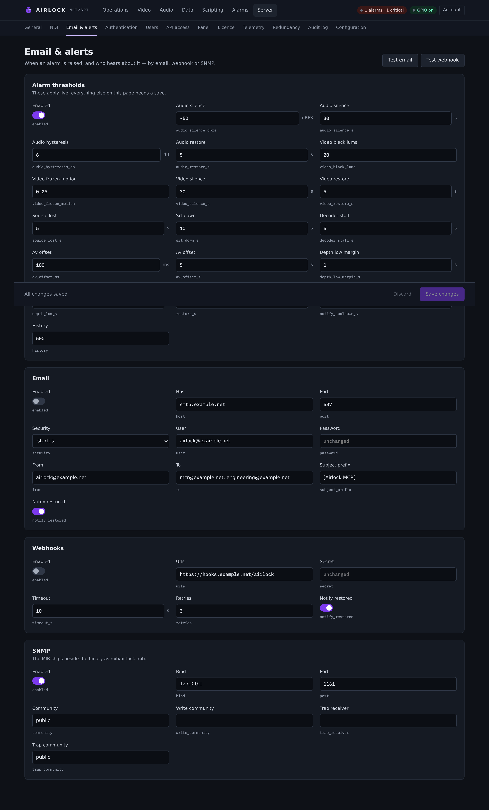

# Email and webhooks

Two of the three ways an alarm leaves the box. Email goes to people; webhooks go
to whatever you point them at. Both are configured on **Server › Email & alerts**
and both have a test button that uses the saved settings.

{ .shot }

## Email

### Settings

| Setting | Console label | Config key | Default | Meaning |
|---|---|---|---|---|
| Send alarm email | Enabled | `email.enabled` | `false` | Master switch. Off, nothing is sent and the test button refuses. |
| SMTP server | Host | `email.host` | `""` | Host name or address of the relay. |
| Port | Port | `email.port` | `587` | 587 for STARTTLS, 465 for implicit TLS, 25 for plain. |
| Security | Security | `email.security` | `starttls` | `starttls`, `tls` or `none`. |
| User | User | `email.user` | `""` | SMTP user name. Empty sends without authentication. |
| Password | Password | `email.password` | `""` | Shown as dots; leave it alone and it stays unchanged. |
| From | From | `email.from` | `""` | Sender address. Empty falls back to **User**. |
| To | To | `email.to` | `""` | Recipients, comma-separated. Anything without an `@` is ignored. |
| Subject prefix | Subject prefix | `email.subject_prefix` | `[ndi2srt]` | Leads every subject line. Useful as a mail-rule anchor. |
| Email on restore | Notify restored | `email.notify_restored` | `true` | Also send when an alarm clears, with how long it was active. |

```json
"email": { "enabled": false, "host": "", "port": 587, "security": "starttls",
           "user": "", "password": "", "from": "", "to": "",
           "subject_prefix": "[ndi2srt]", "notify_restored": true }
```

### Security modes

| Mode | What happens | Usual port |
|---|---|---|
| `starttls` | Connect in the clear, upgrade with STARTTLS. The default, and what most relays expect. | 587 |
| `tls` | TLS from the first byte (implicit / SMTPS). | 465 |
| `none` | No encryption at all. Only for a relay on the same trusted LAN. | 25 |

TLS is rustls. There is no OpenSSL to install and the Windows build is the same
binary as every other platform.

### Set it up

1. Open **Server › Email & alerts**.
2. Fill in the **Email** card: host, port, security, credentials, from, to.
3. Save.
4. Press **Test email** in the page header. A banner says *Test email sent* or
   *Test email refused*; the log carries the SMTP error when it refuses.

The test message is a plain "SMTP settings are working" through the saved
settings, subject `<prefix> SMTP test`.

```bash
curl -s -X POST http://host:8090/api/alarms/test-email
```

### What an alarm email contains

One multipart message per transition — plain text and the same table as HTML.

```
Subject: [ndi2srt] ALARM ACTIVE: SRT link down — encoder@1

ndi2srt alarm active

Alarm:    SRT link down (ALARM_SRT_DOWN)
Where:    encoder@1 (mcr-airlock-1)
Severity: critical
When:     2026-11-06 14:26:40 UTC
Detail:   SRT caller 10.0.4.9:9000 not connected for 10 s — connection refused
```

A restored message uses the subject `[ndi2srt] RESTORED: …`, stamps the time the
alarm cleared, and adds one more field:

```
Duration: 4 min 12 s
```

| Field | What it carries |
|---|---|
| Alarm | The friendly name and the code. |
| Where | `block@channel` and this instance's host name. `block` alone for a process-wide alarm. |
| Severity | `warning` or `critical`. |
| When | UTC — raised for an active message, cleared for a restored one. |
| Detail | The detector's own message: the measured level and threshold, the SRT address and error, the depth and target. |
| Duration | Restored messages only. |

## Webhooks

One JSON POST per transition to every URL, optionally signed.

### Settings

| Setting | Console label | Config key | Default | Meaning |
|---|---|---|---|---|
| Send webhooks | Enabled | `webhooks.enabled` | `false` | Master switch. |
| URLs | Urls | `webhooks.urls` | `""` | `http(s)` endpoints, comma-separated. Every one gets every transition. |
| Signing secret | Secret | `webhooks.secret` | `""` | Set it and each POST is signed. Empty sends unsigned. |
| Timeout | Timeout (s) | `webhooks.timeout_s` | `10` | Per attempt, connect to body. Minimum 1. |
| Attempts | Retries | `webhooks.retries` | `3` | Attempts per URL, not retries after the first. Minimum 1. |
| Post on restore | Notify restored | `webhooks.notify_restored` | `true` | Also POST when an alarm clears. |

```json
"webhooks": { "enabled": false, "urls": "", "secret": "",
              "timeout_s": 10, "retries": 3, "notify_restored": true }
```

### Retries

An attempt succeeds on any 2xx. Anything else — a non-2xx, a timeout, a refused
connection — is retried after a growing wait:

| Attempt | Waits before it |
|---|---|
| 1 | — |
| 2 | 1 s |
| 3 | 3 s |
| 4 | 9 s |

With the default `retries: 3`, a dead endpoint is given up on after about four
seconds and the failure is logged. Each URL is tried independently; one bad
endpoint does not stop the others.

### The payload

```json
{
  "event": "alarm",
  "active": true,
  "code": "ALARM_SRT_DOWN",
  "friendlyName": "SRT link down",
  "category": "encoder",
  "severity": "critical",
  "channel": 1,
  "channelName": "encoder@1",
  "whenUtc": "2026-11-06T14:26:40Z",
  "activeDurationSeconds": null,
  "instance": "mcr-airlock-1",
  "host": "mcr-airlock-1",
  "time": 1794493600.123,
  "alarm": { "id": 7, "kind": "srt_down", "code": "ALARM_SRT_DOWN", "…": "…" }
}
```

| Field | Meaning |
|---|---|
| `event` | Always `"alarm"` here. A [dump alert](clips.md) sends `"dump"` — key on this to tell them apart. |
| `active` | `true` on a raise, `false` on a clear. |
| `code` / `friendlyName` | The alarm, by code and by name. |
| `category` | The block: `encoder`, `decoder`, `delay`, `gpio`, `redundancy`, `watchdog`, `licence`, `system`. |
| `severity` | `warning` or `critical`. |
| `channel` | The delay channel. **0 means process-wide.** |
| `channelName` | `block@channel`, or just the block for a process-wide alarm. |
| `whenUtc` / `time` | ISO-8601 UTC and unix seconds. |
| `activeDurationSeconds` | Seconds the alarm was active. `null` on a raise. |
| `instance` / `host` | This box's host name. |
| `alarm` | The whole record, including `acked` and `dismissed` at the moment it was sent. |

### Signing

With a `secret` set, every POST carries:

```
X-Airlock-Signature: sha256=<lowercase hex HMAC-SHA256(raw body, secret)>
Content-Type: application/json
User-Agent: ndi2srt/<version>
```

Verify over the **raw request body**, before any JSON parsing or re-serialising.
A pretty-printer between the socket and your verifier will break the signature.

```python
import hmac, hashlib
expected = "sha256=" + hmac.new(secret.encode(), raw_body, hashlib.sha256).hexdigest()
ok = hmac.compare_digest(expected, request.headers["X-Airlock-Signature"])
```

### Test it

**Test webhook** in the page header fires a synthetic transition to every URL:
code `ALARM_TEST`, friendly name *Webhook test*, severity `warning`, block
`system`, channel 0, `active: true`. It is signed and retried exactly like a real
one, and it never touches the active alarm list.

```bash
curl -s -X POST http://host:8090/api/alarms/test-webhook
```

## What is not sent

* **Deliveries obey the flap guard.** A re-raise inside `notify_cooldown_s` of
  the last delivered raise is deferred, and dropped entirely if it clears first.
  "Restored" only goes out for an occurrence whose raise went out. See
  [Alarms](alarms.md#delivery).
* **A locked backup sends nothing.** Its primary is raising the same alarm and
  telling the same people. The alarm is still raised and listed locally.
* **Acknowledging or dismissing changes nothing here.** Those are console-only.

## Troubleshooting

**Test email refused.** The banner is short; the log is not. Look for
`alarm email failed:` — it carries the SMTP library's own words. Common causes:
the wrong security mode for the port, a relay that demands authentication, or a
`from` address the relay will not accept.

**No recipients.** `to` is filtered for addresses containing `@`. A list with a
typo silently loses that one recipient; a list with none refuses the send with
"no recipient addresses".

**Emails stop after the first.** That is `notify_cooldown_s` (300 s by default)
doing its job on a flapping condition. The alarm list still shows it active.

**Webhook endpoint never fires.** Check `webhooks.enabled`, check the URL has a
scheme, and check the log for `alarm webhook <url> failed:`. The console banner
only says whether the test was accepted locally.

**Signature never matches.** You are almost certainly hashing a re-serialised
body. Capture the raw bytes.

**Everything is configured and nothing arrives.** Check whether this box is a
locked backup — Server › Redundancy will say *Outputs: held (standby)*.
