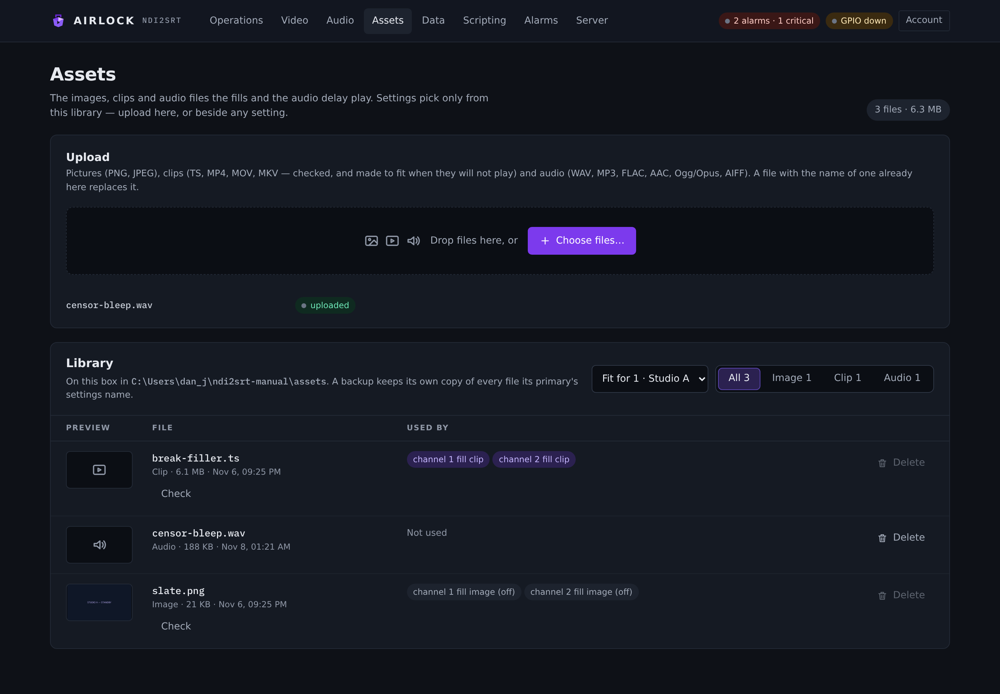

# The asset library

Every file a fill or a censor plays comes from the box's **asset library**: the
`assets` folder beside the configuration. Video slates and clips, video daypart
slates and clips, and an audio delay's fill, censor and pair files are all lists
of the files already uploaded, of the right kind. Nothing anywhere takes a typed
path.

The **Assets** page, in the main nav between **Audio** and **Data**, is where
the library is managed: upload files, see what each one is and which settings
use it, play or preview it, check a clip, and delete what nothing needs.

{ .shot }

## What the library holds

| Kind | Files | Used by |
|---|---|---|
| Image | `.png`, `.jpg`, `.jpeg` | a still-image fill, on its own or in a daypart |
| Clip | `.ts`, `.m2ts`, `.mts`, `.mp4`, `.mov`, `.mkv` | a clip fill, on its own or in a daypart. Each is checked, and can be made to fit |
| Audio | `.wav`, `.mp3`, `.flac`, `.aac`, `.m4a`, `.ogg`, `.opus`, `.aif`, `.aiff` | an audio delay's fill and censor files, their schedules, and its pairs' fills |

Any other file can be uploaded, but it is listed as **Other** and no setting
offers it.

## To upload files

1. Open **Assets**.
2. Drop one or more files on **Upload**, or select **Choose files…** and pick
   them.
3. Read each file's line in the queue under the drop zone. A file is uploaded
   in its turn, with a progress bar, and then shows:
    - **uploaded**: an image or audio file that is now in the library.
    - **will play**: a clip the engine plays as it is.
    - **will not play as it is**: a clip to **Check** and **Make it fit** in
      the library below. See
      [Clips: what the engine will play](../video/fills.md#clips-what-the-engine-will-play).
    - The server's reason, if it refused the file.

A file with the name of one already in the library replaces it. Every image,
clip and audio setting also has **Upload…** beside it. That uploads the file to
the same library and selects it.

## The library

Each row is one file:

| Column | What it shows |
|---|---|
| **Preview** | A thumbnail of an image; a play button for an audio file (one plays at a time, press again to stop); an icon for a clip. |
| **File** | The name, kind, size and when it was uploaded. An image or clip has **Check**: the engine's own verdict on the file, with **Make it fit** when a clip will not play and the box has `ffmpeg`. |
| **Used by** | Every setting that names the file. A setting that is not in force — a daypart that is switched off, a slate while the picture is a clip, a censor file while the censor plays a tone — is marked **(off)**. |
| **Delete** | Press **Delete**, then **Delete for good** within four seconds. |

When the box has more than one channel, **Fit for** picks the channel whose
frame rate **Check** and **Make it fit** use. The filter beside it shows one
kind at a time, with a count of each.

### Deleting a file

A file that any setting names cannot be deleted, even when that setting is off,
because switching the setting back on would air a missing file. Its **Delete**
is greyed out. Point those settings at another file first, save, and then
delete it. The server refuses the same thing with `409` and the list of
settings.

## The rule a save follows

A save that names a fill or censor file outside the library is refused. The
message names the setting and the file. Only the files a setting actually uses
are checked: a clip path left behind while the picture is a slate is not, and a
disabled daypart is not checked until it is switched on.

An older configuration that names a file elsewhere still loads and airs, so a
box is never stopped by it. The console marks the setting **not in the asset
library**, and nothing on that page saves until it is fixed. **Import into
library** copies the file in and points the setting at the copy.

## A primary and its backups

A backup adopting its primary's configuration is never refused. The asset sync
copies every file the primary's settings name into the backup's own library,
and the backup's **Assets** page shows them like any other.
See [Setting up a pair](../redundancy/setup.md#step-6-check-the-assets).

## Who can do what

| | viewer | operator | admin |
|---|---|---|---|
| See the library, preview a file, read its uses | | yes | yes |
| Upload, check, make a clip fit, import, delete | | yes | yes |
| Point a setting at a file (save the configuration) | | | yes |

The library is closed to a viewer, as the configuration is: the page says
so instead of listing files.

On a backup, uploads and deletes are refused like every other control. Its
library follows the primary's.

## REST

| Method | Path | Body / parameters | Does |
|---|---|---|---|
| `GET` | `/api/assets` | — | the library: `dir`, and per file `name`, `path`, `kind`, `bytes`, `modified` and `used_by` (`[{setting, active}]`) |
| `POST` | `/api/assets` | `?name=<file>`, body = the file | upload into the library; a clip is probed and the verdict returned |
| `POST` | `/api/assets/import` | `{path}` | copy a file on the box into the library |
| `GET` | `/api/assets/file/{name}` | — | the file itself (previews) |
| `DELETE` | `/api/assets/item/{name}` | — | delete it; `409 {error, used_by}` while a setting names it |

The per-channel routes under `/api/channels/{n}/fill/assets` (upload, `probe`,
`convert`, `job`) check and convert at that channel's frame rate. See the
[REST API](../control/rest.md#asset-library-operator).
