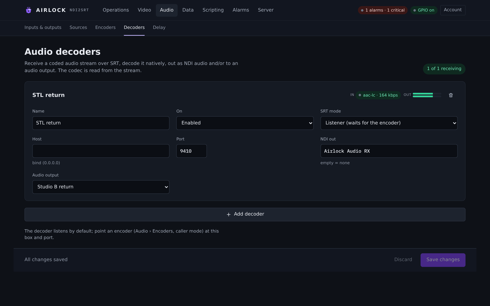
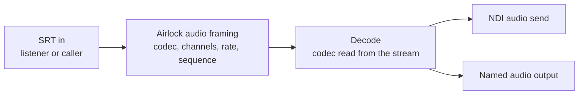

# Audio decoders

An audio decoder receives a coded audio stream over SRT, decodes it on this box, and puts the result out as NDI audio, to a named audio output, or both. It is the other half of an Airlock audio encoder: the codec, channel count and sample rate are read from the stream, so there is nothing to pick.

{ .shot }

## The chain



A decoder carries audio only. It never produces a picture, and an NDI receiver that expects video will see an audio-only sender. The input is always SRT — there is no RTP input.

!!! warning "The far end must be an Airlock audio encoder"
    Audio over SRT uses Airlock's own framing, not MPEG-TS. Each SRT message is one group — codec, channels, sample rate, a sequence number, then the coded frames. An audio decoder therefore cannot take an MPEG-TS stream from a third-party encoder, and a stream from an Airlock audio encoder means nothing to a third-party decoder. To decode a transport stream, use a video channel's decoder instead.

## Add a decoder

1. Go to **Audio › Decoders**.
2. Press **Add decoder**. A card appears, named `Decoder 1`, `Decoder 2` and so on.
3. Set **Name**. It identifies the block on the status API and in GPIO rows.
4. Choose the **SRT mode**:
    - **Listener (waits for the encoder)** — the default. Set **Host** to the address to bind (`0.0.0.0` for every interface) and **Port** to the port the encoder will dial.
    - **Caller (dials)** — set **Host** to the encoder's address and **Port** to the port it listens on.
5. Set **NDI out** to the name the decoded audio should appear under on the network, or leave it empty for no NDI send.
6. Set **Audio output** to one of this box's named outputs, or leave it at *none*.
7. Set **On** to *Enabled*, then press **Save**.

A decoder with neither an NDI name nor an output will connect and decode, but the audio goes nowhere — its target on the status API reads `—`.

!!! tip "Pairing the two ends"
    The simplest pair is a listening decoder and a calling encoder: leave the decoder on **Listener** at a known port, then on the other box set **Audio › Encoders** to **SRT**, **Caller (dials the decoder)**, with this box's address and that port. Either end can be the listener; make the end with the stable address the listener.

## What it decodes

Everything an Airlock audio encoder can send over SRT: AAC-LC, HE-AAC v1, HE-AAC v2, MP3, Opus, FLAC, aptX and aptX HD. The decoder rebuilds itself whenever the codec or channel count in the stream changes, so an encoder that is reconfigured and restarted is picked up without touching the decoder.

Decoded audio is conformed to the destination on the way out: the named output resamples and maps channels to whatever the playback device is running, while the NDI send carries the stream's own rate and channel count.

## Reading the card

Each card shows two states side by side.

**In** — the incoming coded stream:

| Pill | Meaning |
| --- | --- |
| **`<codec>` · `<n>` kbps** | Receiving. The codec is the one read from the stream; the rate is what the SRT link is actually pulling. |
| **`<codec>` · `<n>` kbps · `<n>` gaps** | Receiving, but groups have gone missing. See below. |
| **no stream** | Running, but nothing has arrived. |
| **stopped** | Not running — disabled, or it refused to start. |

**Out** — a level meter on the decoded audio. The *in* side has no meter: a coded stream has no level until it is decoded.

The counter at the top of the page reads *`n` of `m` receiving* — how many enabled decoders currently have a stream.

### Gaps

Every group carries a sequence number. When one does not follow the last, the decoder counts a gap and carries on. A handful of gaps after a reconnect is normal. A gap count that climbs steadily means packets are being lost beyond what SRT can recover — raise the SRT latency on both ends, or fix the path.

### Status API

`GET /api/audio-decoders` returns one row per block: `name`, `source`, `target`, `running`, `connected`, `codec`, `channels`, `rate`, `frames`, `gaps`, the meter, the block's recent log lines, and an `srt` object with the link's own view — `connected`, `peer`, `recv_mbps`, packets received, lost, dropped and retransmitted, `reconnects` and `last_error`.

`connected` on the row is the link's state, not the decoder's optimism: a listener that could not bind its port, or a caller nobody answers, reads `false` with the reason in `srt.last_error`.

## Control and automation

| Surface | What it does |
| --- | --- |
| GPIO | A mapping row targeting `adec:<name>` takes the actions **enable** and **disable**, and drives the lamps `running`, `connected` / `onAir` and `noStream`. |
| REST | `GET /api/audio-decoders` for status. |
| Configuration | Decoders are part of the replicated configuration, so a backup mirrors them exactly. |

## Redundancy

A decoder receives; it does not push anything out to the plant. A locked backup therefore keeps its audio decoders **running**, unlike its audio encoders, which are held on standby.

!!! caution "Two boxes, one NDI name"
    A backup mirrors the primary's configuration, including the decoder's **NDI out** name, and an audio decoder publishes under exactly the name configured — it does not take the backup suffix that delay channels use. On a redundant pair, expect both boxes to offer that NDI name, and choose which one receivers subscribe to deliberately.

## Licensing

Audio decoders are issued against the **ADECODE** feature. **Server › Licence** shows how many seats the licence on this box grants.


## Alarms

Alarm detectors watch delay channels and their video encoders and decoders. Standalone audio decoders do not raise alarms, so monitor them from the card or by polling `GET /api/audio-decoders` and watching `connected`, `gaps` and `srt.last_error`.

## Troubleshooting

| Symptom | Likely cause |
| --- | --- |
| **no stream**, encoder says **connecting** | Neither end is listening, or both are. One must be a listener and the other a caller. |
| **no stream**, and `srt.last_error` names the port | The listener could not bind — another process holds the port, or the bind address is not on this box. |
| Link connects, but still **no stream** | The far end is not an Airlock audio encoder. A third-party SRT sender will connect happily and send a payload this decoder cannot read. |
| Link connects and drops repeatedly | A passphrase set on one end only, or a mismatched passphrase. Both ends must agree. |
| Gap count climbing | Loss beyond SRT's recovery window. Raise the latency on both ends, or fix the path. |
| Decoding, but nothing is heard | No **NDI out** name and no **Audio output** is set. Or the chosen output is not open; check **Audio › Inputs & outputs**. |
| NDI send does not appear on the network | NDI sender creation can take a few seconds after the block starts. If it never appears, check the NDI settings on **Server › NDI** — the adapter and group list apply to sends as well as receives. |
| Audio is distorted or doubled | Two decoders pointed at the same named output. Outputs sum every voice fed to them. |

## Reference

| Setting | Console label | Config key | Default | Meaning |
| --- | --- | --- | --- | --- |
| Name | Name | `name` | empty | Identifies the block on the API and in GPIO rows. |
| Enabled | On | `enabled` | `false` | Whether the block runs. |
| Mode | SRT mode | `srt.mode` | `caller` | `listener` waits for the encoder; `caller` dials it. New cards start as `listener`. |
| Host | Host | `srt.host` | `127.0.0.1` | The address to bind (listener) or the encoder's address (caller). New cards start at `0.0.0.0`. |
| Port | Port | `srt.port` | `9001` | New cards start at `9400`. |
| Latency | — | `srt.latency_ms` | `200` | The SRT latency window. New cards start at `120`. Both ends should agree. |
| Passphrase | — | `srt.passphrase` | empty | AES passphrase. Empty means no encryption. Must match the encoder. |
| Key length | — | `srt.key_len` | `16` | `16`, `24` or `32` for AES-128, 192 or 256. `0` lets the library choose. |
| Stream ID | — | `srt.stream_id` | empty | Sent on connect, for gateways that route on it. |
| NDI name | NDI out | `ndi_name` | empty | NDI audio send name. Empty means no NDI send. |
| Output | Audio output | `output` | empty | Named audio output to play to. Empty means no device out. |
| Licence seat | — | `licence_assigned` | `false` | Whether the block is assigned a licence seat. |

### Worked example

A listening decoder that both airs to the network and feeds a monitor output:

```json
"audio_decoders": [
  {
    "name": "Sister site",
    "enabled": true,
    "srt": {
      "mode": "listener",
      "host": "0.0.0.0",
      "port": 9400,
      "latency_ms": 200,
      "passphrase": "",
      "key_len": 0,
      "stream_id": ""
    },
    "ndi_name": "Sister site audio",
    "output": "Monitor"
  }
]
```
