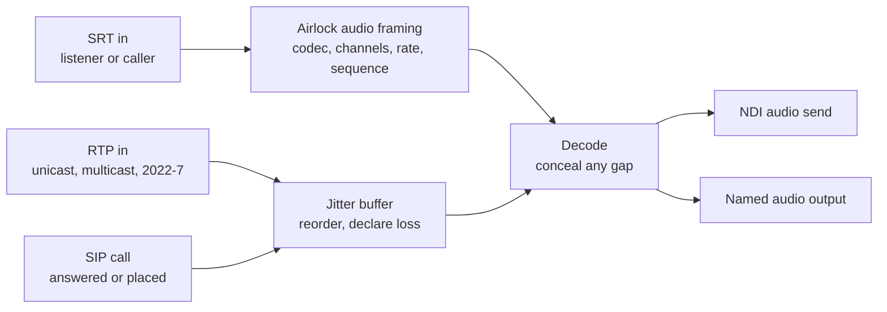

# Audio decoders

An audio decoder receives a coded audio stream, decodes it on this box, and puts the result out as NDI audio, to a named audio output, or both. It takes the stream three ways:

- **SRT**, from another Airlock audio encoder. The codec, channel count and sample rate are read from the stream, so there is nothing to pick.
- **RTP**, from anything that sends standard RTP. RTP says nothing about the stream, so you set the codec and channel count.
- **A SIP call**, answered or placed by the decoder's own SIP agent. The call agrees the codec and the port.

RTP and SIP have their own page — [RTP and SIP calls](rtp-sip.md).

{ .shot }

## The chain



A decoder carries audio only. It never produces a picture, and an NDI receiver that expects video will see an audio-only sender.

!!! warning "On SRT, the far end must be an Airlock audio encoder"
    Audio over SRT uses Airlock's own framing, not MPEG-TS. Each SRT message is one group — codec, channels, sample rate, a sequence number, then the coded frames. An audio decoder therefore cannot take an MPEG-TS stream from a third-party encoder, and a stream from an Airlock audio encoder means nothing to a third-party decoder. To take audio from someone else's encoder, use RTP or a SIP call. To decode a transport stream, use a video channel's decoder.

## Add a decoder

1. Go to **Audio › Decoders**.
2. Press **Add decoder**. A card appears, named `Decoder 1`, `Decoder 2` and so on.
3. Set **Name**. It identifies the block on the status API and in GPIO rows.
4. Choose the **Transport**. The steps below are for **SRT**; for RTP and SIP see [RTP and SIP calls](rtp-sip.md). Then choose the **SRT mode**:
    - **Listener (waits for the encoder)** — the default. Set **Host** to the address to bind (`0.0.0.0` for every interface) and **Port** to the port the encoder will dial.
    - **Caller (dials)** — set **Host** to the encoder's address and **Port** to the port it listens on.
5. Set **NDI out** to the name the decoded audio should appear under on the network, or leave it empty for no NDI send.
6. Set **Audio output** to one of this box's named outputs, or leave it at *none*.
7. Set **On** to *Enabled*, then press **Save**.

A decoder with neither an NDI name nor an output will connect and decode, but the audio goes nowhere — its target on the status API reads `—`.

!!! tip "Pairing the two ends"
    The simplest pair is a listening decoder and a calling encoder: leave the decoder on **Listener** at a known port, then on the other box set **Audio › Encoders** to **SRT**, **Caller (dials the decoder)**, with this box's address and that port. Either end can be the listener; make the end with the stable address the listener.

## What it decodes

On SRT, everything an Airlock audio encoder can send: AAC-LC, HE-AAC v1, HE-AAC v2, MP3, Opus, FLAC, aptX and aptX HD. On RTP and SIP, Opus and AAC-LC. The decoder rebuilds itself whenever the codec or channel count in the stream changes, so an encoder that is reconfigured and restarted is picked up without touching the decoder.

Decoded audio is conformed to the destination on the way out: the named output resamples and maps channels to whatever the playback device is running, while the NDI send carries the stream's own rate and channel count.

## Reading the card

Each card shows two states side by side.

**In** — the incoming coded stream:

| Pill | Meaning |
| --- | --- |
| **`<codec>` · `<n>` kbps** | Receiving. The codec is the one read from the stream; the rate is what the SRT link is actually pulling. |
| **`<codec>` · `<n>` kbps · `<n>` gaps** | Receiving, but groups have gone missing. See below. |
| **no stream** | Running, but nothing has arrived. |
| **stopped** | Not running — disabled, or it refused to start. |

**Out** — a level meter on the decoded audio. The *in* side has no meter: a coded stream has no level until it is decoded.

The counter at the top of the page reads *`n` of `m` receiving* — how many enabled decoders currently have a stream.

### Gaps

Every group — and every RTP packet — carries a sequence number. When one does not follow the last, the decoder counts a gap and **fills it** from the codec's own state, so a lost packet is concealed rather than heard as a click: Opus conceals properly, AAC writes silence. Concealment is capped at ten frames, because covering a long outage would be inventing audio. The status API counts the frames concealed.

A handful of gaps after a reconnect is normal. A gap count that climbs steadily means packets are being lost beyond what the link can recover — on SRT raise the latency on both ends, on RTP raise the jitter buffer, or fix the path.

### Status API

`GET /api/audio-decoders` returns one row per block: `name`, `source`, `target`, `transport`, `running`, `connected`, `codec`, `channels`, `rate`, `frames`, `gaps`, `concealed`, `watermarked`, the meter, an `rtp` object on RTP and SIP, a `sip` object on SIP, the block's recent log lines, and an `srt` object with the link's own view — `connected`, `peer`, `recv_mbps`, packets received, lost, dropped and retransmitted, `reconnects` and `last_error`.

`connected` on the row is the link's state, not the decoder's optimism: a listener that could not bind its port, or a caller nobody answers, reads `false` with the reason in `srt.last_error`.

## Control and automation

| Surface | What it does |
| --- | --- |
| GPIO | A mapping row targeting `adec:<name>` takes the actions **enable** and **disable**, and drives the lamps `running`, `connected` / `onAir` and `noStream`. |
| REST | `GET /api/audio-decoders` for status; `POST /api/audio-decoders/<name>/call/dial`, `/hangup` or `/answer` on a SIP decoder. |
| Configuration | Decoders are part of the replicated configuration, so a backup mirrors them exactly. |

## Redundancy

A decoder receives, so a locked backup keeps its audio decoders **running** and hot, unlike its audio encoders, which are held. Two things change on a standby so the pair never fights over the plant:

- **The NDI send takes the backup suffix**, as a delay channel's does, so the two boxes never claim one NDI name.
- **The device output is held.** The decoder keeps receiving and decoding, but it does not play into the plant beside the primary. The card's target says *(held)*.
- **A SIP decoder starts no agent.** The primary is registered under the same name and must be the one that answers the plant's calls.

All three return to normal the moment the backup takes over.

## Licensing

Audio decoders are issued against the **ADECODE** feature. **Server › Licence** shows how many seats the licence on this box grants and how many are in use. Seats go to the decoders in the order they are listed. A decoder without a seat still runs, but its decoded audio carries the unlicensed tone — a one-second burst every thirty seconds — and its card shows **unlicensed**.


## Alarms

Alarm detectors watch delay channels and their video encoders and decoders. Standalone audio decoders do not raise alarms, so monitor them from the card or by polling `GET /api/audio-decoders` and watching `connected`, `gaps` and `srt.last_error`.

## Troubleshooting

| Symptom | Likely cause |
| --- | --- |
| **no stream**, encoder says **connecting** | Neither end is listening, or both are. One must be a listener and the other a caller. |
| **no stream**, and `srt.last_error` names the port | The listener could not bind — another process holds the port, or the bind address is not on this box. |
| Link connects, but still **no stream** | The far end is not an Airlock audio encoder. A third-party SRT sender will connect happily and send a payload this decoder cannot read. |
| Link connects and drops repeatedly | A passphrase set on one end only, or a mismatched passphrase. Both ends must agree. |
| Gap count climbing | Loss beyond the link's recovery. On SRT raise the latency on both ends; on RTP raise the jitter buffer; or fix the path. |
| RTP packets arrive but nothing decodes | The **Codec** or **Channels** on the card do not match what is being sent. RTP cannot say. |
| A tone every thirty seconds | The decoder has no licence seat. |
| Decoding, but nothing is heard | No **NDI out** name and no **Audio output** is set. Or the chosen output is not open; check **Audio › Inputs & outputs**. |
| NDI send does not appear on the network | NDI sender creation can take a few seconds after the block starts. If it never appears, check the NDI settings on **Server › NDI** — the adapter and group list apply to sends as well as receives. |
| Audio is distorted or doubled | Two decoders pointed at the same named output. Outputs sum every voice fed to them. |

## Reference

| Setting | Console label | Config key | Default | Meaning |
| --- | --- | --- | --- | --- |
| Name | Name | `name` | empty | Identifies the block on the API and in GPIO rows. |
| Enabled | On | `enabled` | `false` | Whether the block runs. |
| Transport | Transport | `transport` | `srt` | `srt`, `rtp` or `sip`. The `rtp`, `sip`, `codec` and `channels` keys are on [RTP and SIP calls](rtp-sip.md#reference). |
| Mode | SRT mode | `srt.mode` | `caller` | `listener` waits for the encoder; `caller` dials it. New cards start as `listener`. |
| Host | Host | `srt.host` | `127.0.0.1` | The address to bind (listener) or the encoder's address (caller). New cards start at `0.0.0.0`. |
| Port | Port | `srt.port` | `9001` | New cards start at `9400`. |
| Latency | — | `srt.latency_ms` | `200` | The SRT latency window. New cards start at `120`. Both ends should agree. |
| Passphrase | — | `srt.passphrase` | empty | AES passphrase. Empty means no encryption. Must match the encoder. |
| Key length | — | `srt.key_len` | `16` | `16`, `24` or `32` for AES-128, 192 or 256. `0` lets the library choose. |
| Stream ID | — | `srt.stream_id` | empty | Sent on connect, for gateways that route on it. |
| NDI name | NDI out | `ndi_name` | empty | NDI audio send name. Empty means no NDI send. |
| Output | Audio output | `output` | empty | Named audio output to play to. Empty means no device out. |
| Licence seat | — | `licence_assigned` | `false` | Whether the block is assigned a licence seat. |

### Worked example

A listening decoder that both airs to the network and feeds a monitor output:

```json
"audio_decoders": [
  {
    "name": "Sister site",
    "enabled": true,
    "srt": {
      "mode": "listener",
      "host": "0.0.0.0",
      "port": 9400,
      "latency_ms": 200,
      "passphrase": "",
      "key_len": 0,
      "stream_id": ""
    },
    "ndi_name": "Sister site audio",
    "output": "Monitor"
  }
]
```
