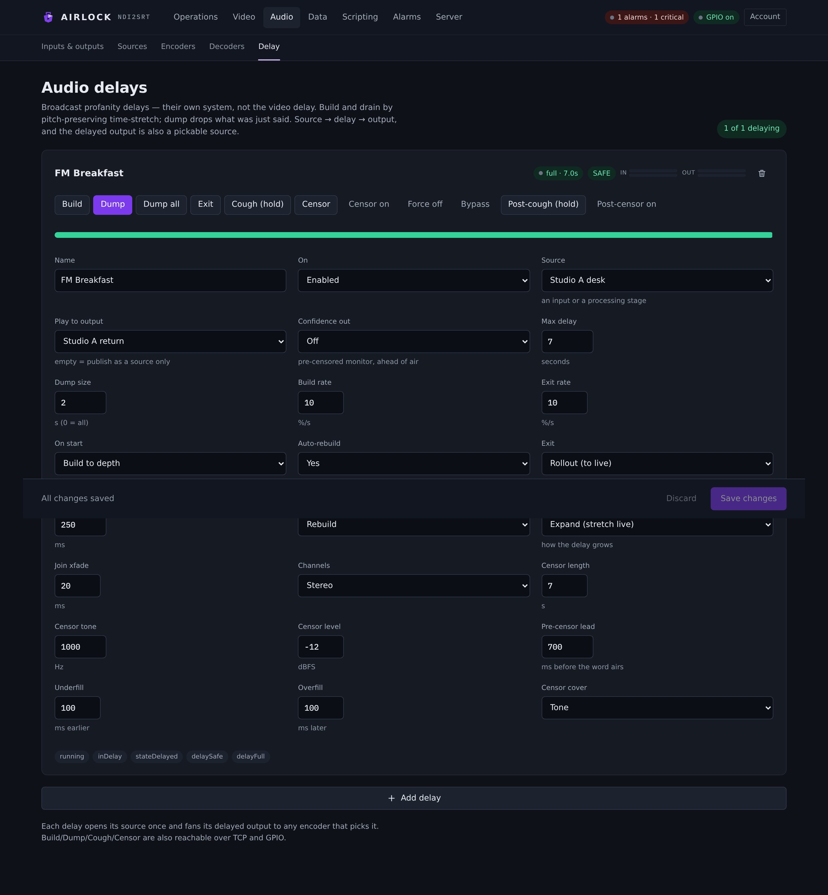
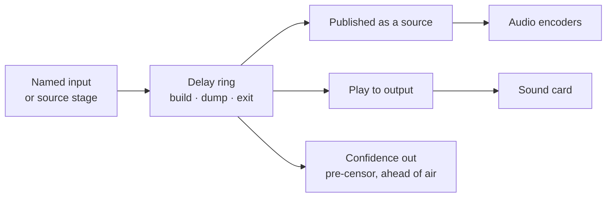
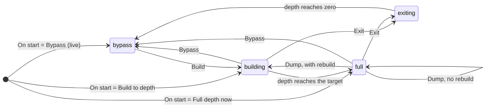

# Audio delay

An audio delay is a broadcast profanity delay: it holds your programme in a ring
so that an operator can drop what should never have gone out. It is its own
system, independent of the video delay — source in, delay, output — and its
delayed output is itself a pickable source, so encoders can take the as-aired
feed. **Audio › Delay** is where you build and drive them.

{ .shot }

## How it works

Audio goes into a ring buffer. The output reads the ring a few seconds behind
the input, and that gap is the **depth**.

- **Build** grows the depth. The output is played a touch slower than real time —
  pitch preserved — until the gap reaches the target.
- **Dump** throws away what was just said: the read head jumps forward by the
  dump size, with a short crossfade over the join, and the delay goes back to
  building if you asked it to.
- **Exit** returns you to live, either by draining the ring (the output plays a
  touch faster until the gap closes) or by crossfading to live.
- **Cough** and **Censor** cover a moment without spending the buffer.



The state machine is the same one every dump delay uses:



The card shows the state word (`bypass`, `building`, `full`, `exiting`) and the
current depth in seconds, with a depth gauge underneath.

## Create an audio delay

1. Open **Audio › Delay** and press **Add delay**.
2. Set the identity and the signal path:
    - **Name** — what every surface calls it: the card, REST, TCP, GPIO.
      Unique on the box, and stable — changing it breaks every reference.
    - **On** — **Enabled** or **Off**.
    - **Source** — a named input, or a processing stage (listed with
      *(processed)* beside it). You cannot feed one delay from another.
    - **Play to output** — the named output the delayed programme plays to.
      **Source only (no output)** leaves it published as a source without
      touching a sound card.
3. Set the depth behaviour:
    - **Max delay** — the target depth in seconds.
    - **Dump size** — what one **Dump** removes. `0` means *dump everything*.
    - **Build rate** and **Exit rate** — how fast it grows and drains.
    - **On start** — the state it comes up in.
4. Press **Save**.

The delay starts straight away. Its card shows the state pill, the **in** and
**out** meters, and the transport buttons.

!!! tip "Set the dump size before you go on air"
    **SAFE** on the card means the ring holds at least one whole dump. An
    operator who presses Dump without SAFE lit gets a partial dump — everything
    there is, which may not be the whole offending phrase. A ten-second max
    delay with a seven-second dump gives you one dump and a margin; a
    thirty-second delay with a seven-second dump gives you four.

## The controls

Every button on the card is also a REST call, a TCP verb and a GPIO action — see
[Driving it from elsewhere](#driving-it-from-elsewhere).

| Button | What it does |
|---|---|
| **Build** | Set the target to **Max delay** and start growing the depth. |
| **Dump** | Jump the read head forward by **Dump size**, crossfaded. Rebuilds afterwards if **After a dump** says so. |
| **Dump all** | Jump forward by the *whole* current depth — straight back to live. |
| **Exit** | Return to live by **Exit** mode: drain, or roll out. |
| **Cough (hold)** | Press and hold. The live input is withheld from the ring, so that moment never reaches air. On release the delay rebuilds. |
| **Censor** | One-shot cover, **Censor length** long, timed to land on the word as it emerges. |
| **Censor on** / **Censor off** | Latch the cover on, and release it. |
| **Force off** | Drop **both** the pre and post cover immediately. The escape hatch. |
| **Bypass** | Go straight to live with no drain and no crossfade. |
| **Post-cough (hold)** | Immediate dead air at the output. No timing, no buffer — it cuts now. |
| **Post-censor on** / **Post-censor off** | Immediate cover at the output. |

The pills beside the state tell you what is active: **SAFE**, **COUGH**,
**CENSOR**, **POST-COUGH**, **POST-CENSOR**.

### Pre and post

The pre controls (**Cough (hold)**, **Censor**, **Censor on/off**) act on the
*delayed* programme. They are scheduled: Airlock works out when the moment you
reacted to will reach the output and lands the cover on it. That is what
**Pre-censor lead** is for — you press when you hear the word in the confidence
feed, and the cover is placed that far *before* the word emerges on air.

The post controls (**Post-cough**, **Post-censor**) act at the output, now, with
no scheduling. They are the last resort when something is already going out.

**Force off** clears both at once. It exists because a stuck cover is worse than
a missed one: one button, both stages, immediately.

### The confidence monitor

Set **Confidence out** to a named output and **Ahead of air** to a number of
milliseconds, and the delay splits in two:

- air is delayed a further *Ahead of air* milliseconds;
- the confidence output carries the **pre-censored** programme — with the pre
  cover on it, without the post cover — running that far ahead of air.

That gives an operator who is listening to the confidence feed a real window to
catch something with **Post-cough** or **Post-censor** before it airs. Leave
**Ahead of air** at `0` and the confidence output is not created at all.

## Building and exiting

### Build mode

**Build mode** decides what the audience hears while the delay grows.

- **Expand (stretch live)** — the programme is played slightly slow until the
  gap opens. Nothing is lost, nothing is inserted, and at a 4 % build rate the
  pitch change is inaudible. The build takes *max delay ÷ build rate*: ten
  seconds of depth at 4 % takes about four minutes.
- **Insert (air a fill)** — the output holds while the input runs on, so the gap
  opens at real time: a ten-second delay is built in ten seconds. Meanwhile the
  output airs the **Fill**:
    - **Squeeze asset to span** — the fill asset, time-stretched to span exactly
      the build window and looped if it is short;
    - **Silence**.

  When the depth is reached, the output crossfades to the now-delayed live
  programme.

The fill asset is an audio file uploaded to the box's [asset library](../assets/library.md)
— pick it from the list beside **Fill asset**, or **Upload…** one; there is no
typed path. Any file the box's `ffmpeg` can decode plays. If it cannot be
decoded, the build is silent and the log says so.

**Fill schedule** dayparts the asset: the first row whose days and window match
the current local time overrides **Fill asset**. Rows are checked about every 30
seconds, and only re-decoded when the chosen asset changes.

### Exit mode

- **Compress (drain)** — the programme is played slightly fast until the gap
  closes, then the delay is live. Nothing is lost.
- **Rollout (to live)** — an equal-power crossfade from the delayed programme to
  live over **Rollout xfade** milliseconds, then a jump to live. Faster, and the
  overlap is audible as a brief double, so keep the window short (250 ms is the
  default).

**Bypass** is neither: it drops straight to live with no transition at all.

### After a dump

**Auto-rebuild** and **After a dump** together decide what happens once a dump
has fired:

| **After a dump** | Rebuilds after **Dump** | Rebuilds after **Dump all** |
|---|---|---|
| **Rebuild** | yes | yes |
| **Rebuild (dump only)** | yes | no |
| **Rebuild (dump-all only)** | no | yes |
| **Stay at depth** | no | no |

Setting **Auto-rebuild** to **No** overrides all four — nothing rebuilds.

Where a dump does not rebuild, the delay stays at whatever depth is left. That
can be deliberate (a short programme that is about to end) but it leaves the
operator with less than a dump in hand, so **SAFE** goes out.

## Cough and censor

**Cough** is a hold. While it is held, the live input is not written into the
ring at all, so that moment can never reach air — it is gone, not covered. The
depth drains while you hold it, and the delay rebuilds when you let go.

**Censor** covers the audio instead. **Censor cover** picks what is aired over
the covered span:

| **Censor cover** | What airs |
|---|---|
| **Tone** | A sine at **Censor tone** Hz at **Censor level** dBFS — the classic bleep. |
| **Silence** | Digital silence. |
| **File** | A looped asset — a bleep, a station ident, a bed. Dayparted by **Censor schedule** exactly as the fill is. |

The timing fields put the cover exactly where you want it:

| Field | What it does |
|---|---|
| **Censor length** | How long a one-shot **Censor** covers for, in seconds. |
| **Pre-censor lead** | How far *before* the press the cover starts, in ms — your reaction time. |
| **Underfill** | Widen the cover earlier, in ms. |
| **Overfill** | Widen the cover later, in ms. |

A press is placed at *(current depth − pre-censor lead − underfill)* from now,
and ends *(censor length + underfill + overfill)* later. If the depth is smaller
than the lead, the cover starts immediately.

**Censor on** latches the cover with no end; **Censor off** schedules its end on
the same timing, so the tail lands where the word finished rather than where you
released the button.

## Outputs, and the delayed feed as a source

A delay's output goes two places at once, and they are independent:

1. **Published as a source.** The delayed programme is always available on every
   source picker in the console, listed as a delay. Point an audio encoder at it
   and what you stream is exactly what aired, dumps and covers included.
2. **Played to a named output.** Set **Play to output** and the delay claims a
   voice on that output. Several blocks can feed one output — the registry mixes
   the voices — so one monitor speaker can carry two delays if that is what you
   want.

Rate and channel count are conformed on the way to the device, so a 44.1 kHz
source into a 48 kHz card is resampled for you. The delay itself runs at the
source's rate and carries however many channels the source delivers.

## Driving it from elsewhere

### REST

```
POST /api/audio-delays/{name}/{action}
```

| Action | Notes |
|---|---|
| `build`, `exit` (or `rollout`), `dump`, `dumpall`, `bypass` | — |
| `cough?down=true` / `cough?down=false` | press and release |
| `censor?seconds=4` | omit `seconds` for **Censor length** |
| `censor-on`, `censor-off`, `censor-force-off` | the latch and the escape hatch |
| `cough-post?down=true` / `cough-post?down=false`, `censor-post-on`, `censor-post-off` | the post stage |

`GET /api/audio-delays` returns every delay's state, depth, target, max, SAFE,
dumps available, dump count, the cough and censor flags, the in and out meters,
its consumers and its lamps.

### TCP

The control port drives a delay by name with the same verbs it uses for a
channel, addressed with `STAGE`:

```
BUILD STAGE Breakfast
DUMP STAGE Breakfast
DUMPALL STAGE Breakfast
ROLLOUT STAGE Breakfast
BYPASS STAGE Breakfast
COUGH STAGE Breakfast DOWN
COUGH STAGE Breakfast UP
CENSOR STAGE Breakfast 4
CENSORON STAGE Breakfast
CENSOROFF STAGE Breakfast
COUGHPOST STAGE Breakfast DOWN
CENSORPOSTON STAGE Breakfast
CENSORPOSTOFF STAGE Breakfast
FORCECENSOROFF STAGE Breakfast
STATE STAGE Breakfast
```

`STATE` answers with the state word, depth, max, SAFE, idle, the cough and censor
flags and the dumps available.

### Axia GPIO

A GPI row drives a delay instead of a channel by naming it as the row's stage
(or as a `stage:<name>` target, which lets one pin drive several blocks). The
actions valid on a delay are **build**, **dump**, **dumpall**, **rollout**,
**bypass**, **cough**, **censor**, **coughPost** and **censorPost**.

GPO lamp rows read the delay's own lamp model. Each lamp has a drive pattern —
steady, slow, fast or a wink — so a tally reads the way a studio expects:

| Lamp | Lit when |
|---|---|
| `running` | the delay is running |
| `inDelay` | building, delayed or exiting |
| `stateLive` | at zero depth and not building |
| `stateBuilding` | building (slow pulse) |
| `stateDelayed` | at depth |
| `stateRollingOut` | exiting (fast pulse) |
| `delaySafe` | the ring holds at least one whole dump |
| `delayFull` | the delay has reached its target |
| `delayEmpty` | the ring is empty |
| `delayIdle` | empty and not building |
| `dumping` | a dump fired in the last second (wink) |
| `coughActive`, `censorActive` | the pre stage is covering |
| `coughPostActive`, `censorPostActive` | the post stage is covering |

Alongside those, momentary **trig** lamps pulse on the event itself —
`buildtrig`, `exittrig`, `dumptrig`, `dumpalltrig`, `delayfulltrig`,
`delayemptytrig`, `coughtrig`, `censortrig`, `coughPosttrig`, `censorPosttrig`
and `rolloutoverlaptrig` — for panels that want an edge rather than a level.
The lit lamps also appear as pills at the bottom of the card, which is the
quickest way to check a GPO map without a meter in the rack.

A GPIO **relay** can ride a delay: a contact on the way in is re-driven on the
way out after the delay's *current* depth, so a studio closure lands with the
audio it belongs to.

### Scripting

The scripting host drives **channel** delays (`air.build`, `air.dump`,
`air.censor` and the rest take a channel number). Audio delays are driven from
REST, TCP and GPIO.


## Settings reference

| Setting | Console label | Config key | Default | Meaning |
|---|---|---|---|---|
| Name | **Name** | `audio_delays[].name` | — | Unique name; the address on every surface. |
| Enabled | **On** | `audio_delays[].enabled` | `true` | Whether the delay runs. |
| Source | **Source** | `audio_delays[].source` | `""` | A named input or a processing stage id. Required when enabled. |
| Output | **Play to output** | `audio_delays[].output` | `""` | Named output to play the delayed programme to. Empty = publish as a source only. |
| Confidence output | **Confidence out** | `audio_delays[].post_output` | `""` | Named output for the pre-censored monitor feed. Needs **Ahead of air** above zero. |
| Monitor lead | **Ahead of air** | `audio_delays[].post_censor_offset_ms` | `0` | Extra delay added to air (0–30000 ms); the confidence feed runs this far ahead of it. |
| Max delay | **Max delay** | `audio_delays[].max_delay_s` | `10` | Target depth, 0.5–120 s. |
| Dump size | **Dump size** | `audio_delays[].dump_size_s` | `7` | Seconds one **Dump** removes, 0–120. `0` = dump everything. |
| Build rate | **Build rate** | `audio_delays[].build_rate_pct` | `4` | How fast the depth grows, as a percent of real time, 1–10. |
| Exit rate | **Exit rate** | `audio_delays[].exit_rate_pct` | `4` | How fast it drains on a compress exit, 1–10. |
| Start state | **On start** | `audio_delays[].start_mode` | `build` | `bypass` (live), `build` (grow to depth), `full` (at depth immediately). |
| Auto-rebuild | **Auto-rebuild** | `audio_delays[].auto_rebuild` | `true` | Build again after a dump. |
| Rebuild policy | **After a dump** | `audio_delays[].build_after_dump` | `both` | `both`, `dump`, `dumpall`, `disabled`. |
| Exit mode | **Exit** | `audio_delays[].exit_mode` | `compress` | `compress` (drain) or `rollout` (crossfade to live). |
| Rollout window | **Rollout xfade** | `audio_delays[].rollout_overlap_ms` | `250` | Equal-power crossfade length for a rollout exit, 0–10000 ms. |
| Build mode | **Build mode** | `audio_delays[].build_mode` | `expand` | `expand` (stretch the live programme) or `insert` (air a fill while the ring fills). |
| Fill strategy | **Fill** | `audio_delays[].fill_strategy` | `squeeze` | `squeeze` (stretch the asset to span the build) or `silent`. |
| Fill asset | **Fill asset** | `audio_delays[].fill_asset` | `""` | An uploaded audio file from the [asset library](../assets/library.md), aired during an insert build. |
| Fill schedule | **Fill schedule** | `audio_delays[].fill_schedule[]` | `[]` | Dayparted fill assets: `{ days, start, end, asset }`. |
| Join crossfade | **Join xfade** | `audio_delays[].crossfade_ms` | `20` | Crossfade over a dump join. 10–30 ms is the useful range; anything above 100 ms is clamped. |
| Channels | **Channels** | `audio_delays[].channels` | `2` | `1` or `2`. Set it to match the source: the ring carries whatever the source delivers. |
| Censor length | **Censor length** | `audio_delays[].censor_seconds` | `7` | Default one-shot cover length, seconds. |
| Censor tone | **Censor tone** | `audio_delays[].censor_tone_hz` | `1000` | Cover tone frequency, Hz. |
| Censor level | **Censor level** | `audio_delays[].censor_level_dbfs` | `-12` | Cover tone level, dBFS. |
| Pre-censor lead | **Pre-censor lead** | `audio_delays[].pre_censor_offset_ms` | `700` | How far before the press the cover starts, ms. |
| Underfill | **Underfill** | `audio_delays[].censor_underfill_ms` | `100` | Start the cover this much earlier, ms. |
| Overfill | **Overfill** | `audio_delays[].censor_overfill_ms` | `100` | End the cover this much later, ms. |
| Censor cover | **Censor cover** | `audio_delays[].censor_strategy` | `tone` | `tone`, `silence` or `file`. |
| Censor asset | **Censor asset** | `audio_delays[].censor_asset` | `""` | The uploaded audio file looped when the cover is `file`. |
| Censor schedule | **Censor schedule** | `audio_delays[].censor_schedule[]` | `[]` | Dayparted censor assets, same shape as the fill schedule. |
| Dump strategy | — | `audio_delays[].dump_strategy` | `dump` | Reserved. `dump` or `censor` is accepted and validated; only `dump` has an effect today. |
| Licence | — | `audio_delays[].licence_assigned` | `true` | Marks the block for the `ADELAY` pool. |

A schedule row is `{ "days": "mon,tue", "start": "06:00", "end": "09:00",
"asset": "/path/to/file.wav" }`. Empty `days` means every day; `start` equal to
`end` (or both empty) means all day. The first matching row wins.

```json
{
  "audio_delays": [
    {
      "name": "Breakfast",
      "enabled": true,
      "source": "online",
      "output": "Studio A return",
      "max_delay_s": 10.0,
      "dump_size_s": 7.0,
      "build_rate_pct": 4.0,
      "exit_rate_pct": 4.0,
      "start_mode": "build",
      "auto_rebuild": true,
      "build_after_dump": "both",
      "exit_mode": "compress",
      "build_mode": "expand",
      "crossfade_ms": 20.0,
      "censor_strategy": "tone",
      "censor_seconds": 7.0,
      "censor_tone_hz": 1000.0,
      "censor_level_dbfs": -12.0,
      "pre_censor_offset_ms": 700.0,
      "channels": 2
    }
  ]
}
```

## Licensing

Audio delay is granted by the **`ADELAY`** feature, and the licence carries a
seat count for it.

Seats in that pool are claimed by **audio-only delay channels** — a channel
whose delay is configured with no video, taking an audio source and playing it
to a named output and/or an NDI audio send. Those seat against `ADELAY` rather
than the video pool, lowest channel id first. A channel with no seat is never
refused: it runs **watermarked**, with a one-second tone burst every thirty
seconds over its output. **Dump** and **Rollout** are never gated, with no
licence at all. See [Licensing](../start/licensing.md).

The standalone delays on this page carry a `licence_assigned` key against the
same pool and run without claiming a seat from it, so size an `ADELAY` count on
the audio-only delay channels you are running.


## Redundancy

The delay list is plant policy: `audio_delays` is copied from a primary to its
backups, so both boxes run the same delays with the same depths and the same
cover settings. The *inputs and outputs* the delays name are machine-local — so
define the same names on both boxes, pointing at each box's own hardware.

While an instance is a locked backup its controls are refused, including the
audio-delay commands, and the refusal is written to the audit log with the
caller's name. An Airlock that has taken over accepts them normally.

## Troubleshooting

**The card says `no source`.**
The delay is running but nothing is arriving. Check **Source** names a real
input or stage, and check that input on **Audio › Inputs & outputs**. The delay
retries every two seconds and connects on its own once the source appears.

**`On start: Full depth now` airs silence at first.**
That is what it means. The ring is declared full immediately, so the output
reads a part of the ring that has not been written yet. It airs silence for one
whole max-delay period, then real audio. Use **Build to depth** unless you
specifically want the silence.

**The build takes far longer than I expected.**
An expand build grows at *build rate* percent of real time: 10 s of depth at 4 %
is about four minutes. If you need the depth sooner, raise the rate (to a
maximum of 10 %, about 100 seconds for 10 s of depth) or switch **Build mode**
to **Insert (air a fill)**, which reaches depth in exactly the depth's own
length.

**An insert build is silent.**
Either **Fill** is **Silence**, or the fill asset could not be decoded. Check
the path, check the box has `ffmpeg` configured, and check the log — a failed
decode is logged once with the asset name.

**SAFE never lights.**
The depth has not reached one whole dump. Either the delay is still building,
or **Dump size** is larger than **Max delay**. Dumps available on the status
feed tells you how many whole dumps the ring is holding.

**A dump took less than the dump size.**
A dump can only remove what is there. With four seconds of depth and a
seven-second dump size, you get four seconds and land on live. Watch **SAFE**.

**A censor landed late, or cut the word in half.**
Tune **Pre-censor lead** to your operator's reaction time — the default is
700 ms — and widen **Underfill** and **Overfill** to cover the edges. If the
depth is shorter than the lead, the cover starts immediately and there is
nothing to tune; build more depth.

**The censor will not clear.**
Press **Force off**. It clears the pre and post stages at once, latch and all.
If a GPIO pin is holding it, check the contact: a held cough or censor row stays
asserted until the contact opens.

**The output clicks on a dump.**
Raise **Join xfade** — 20 ms is the default and 10–30 ms is the useful range.
Very long crossfades blur the join rather than hiding it, and anything over
100 ms is clamped.

**The delay is right but the device is silent.**
Check the card's **out** meter first. If it moves and the speaker does not, the
problem is the named output: check its state and voices on
[Inputs and outputs](io.md), and check for underruns.

**I can hear something on top of the programme.**
Two different marks sound like a fault and are not:

- A one-second tone burst every thirty seconds is the **unlicensed watermark**
  on an audio-only *delay channel* running without an `ADELAY` seat. Check the
  channel's seat on **Server › Licence**.
- A processing artefact that comes and goes is Thimeo's own watermark on an
  **unlicensed Stereo Tool stage** feeding this delay. Check the stage on
  [Audio › Sources](sources.md) — the card says `unlicensed · watermarked`.
