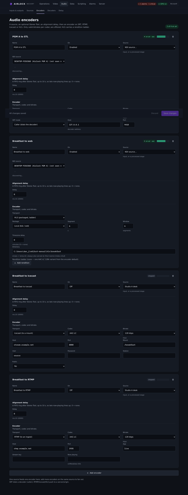
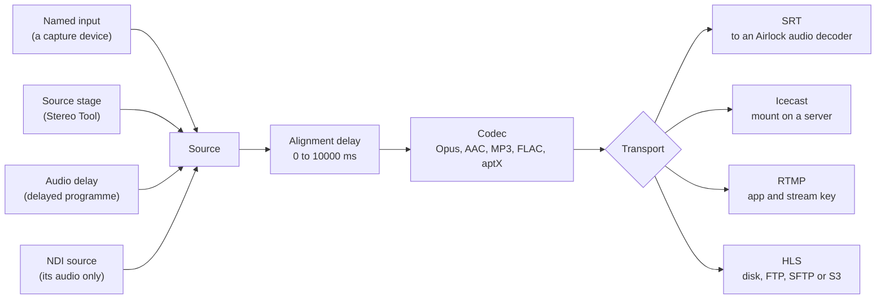
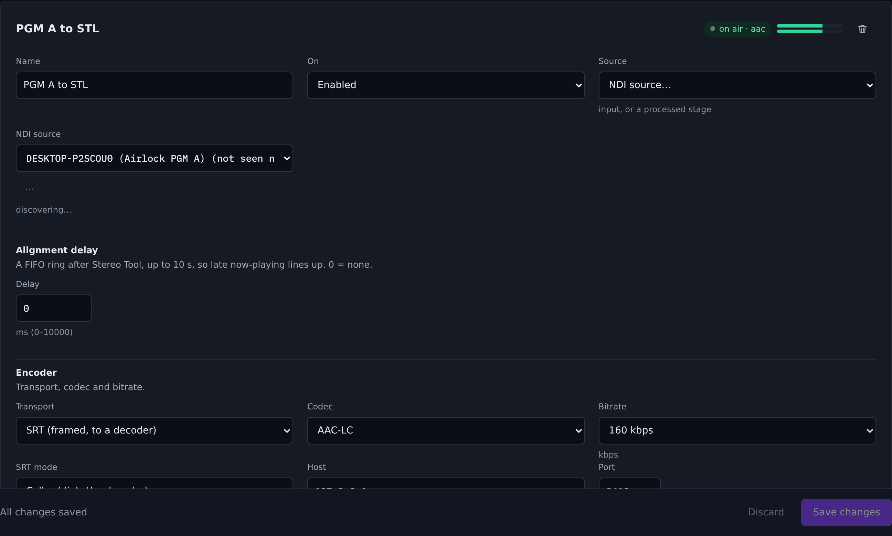

# Audio encoders

An audio encoder takes one audio source on this box, codes it, and sends it somewhere — to another Airlock over SRT, to an Icecast mount, to an RTMP ingest, or to an HLS origin. Encoders are standalone blocks: they do not belong to a video channel, and you can run as many as the box has sources and CPU for.

{ .shot }

## The chain

Each encoder is a straight line from a source to a transport. Pick the source, line it up, code it, send it.



The source list on the card is everything this box publishes as audio: every named input from **Audio › Inputs & outputs**, every processing stage from **Audio › Sources** (shown as *processed*), and the output of every audio delay. Choosing **NDI source…** switches the card to an NDI picker instead, and the encoder receives that sender's audio only — no video is taken.

!!! note "Everything encodes at 48 kHz"
    An encoder always codes at 48 kHz. Named inputs are published at whatever rate their device runs at, and nothing resamples on the way in, so run the capture device at 48 kHz. A source running at 44.1 kHz will be coded as if it were 48 kHz and will play back fast.

## Add an encoder

1. Go to **Audio › Encoders**.
2. Press **Add encoder**. A card appears, named `Encoder 1`, `Encoder 2` and so on.
3. Set **Name**. The name identifies the block on the status API, on GPIO rows and in the HLS URL, so make it short and stable — renaming it changes all three.
4. Set **Source** to a named input, a processed stage, a delay, or **NDI source…**. For NDI, pick the sender from the **NDI source** list; press **Look again** if the box has not discovered it yet.
5. Choose the **Transport**, then the **Codec** and **Bitrate**. Only the codecs that transport can carry are offered, and only the bitrates that codec supports.
6. Fill in the transport's own fields (below).
7. Set **On** to *Enabled*.
8. Press **Save** on the save bar.

The encoder starts as soon as the save lands. Nothing else restarts: saving the page reconciles only the audio blocks whose settings actually changed.

{ .shot }

## Choose a transport

!!! note "No RTP transport"
    Audio encoders send over SRT, Icecast, RTMP or HLS. There is no RTP audio transport — for an RTP-style contribution link, use SRT between two Airlock boxes.

### SRT — to another Airlock

SRT is the point-to-point path between two Airlock boxes. Pick **SRT mode**:

- **Caller (dials the decoder)** — set **Host** to the decoder's address and **Port** to the port it listens on.
- **Listener (waits)** — set **Host** to the address to bind (`0.0.0.0` for every interface) and **Port** to the port the decoder will dial.

Either end may be the listener. Use caller from the studio out to a fixed receiver, and listener when the far end is the one that reconnects.

!!! warning "Audio over SRT is not MPEG-TS"
    The SRT link between an audio encoder and an audio decoder carries Airlock's own audio framing. Every SRT message is one group — codec, channel count, sample rate, a sequence number, then the coded frames — so the decoder learns the stream from the stream and a lost group is a clean gap rather than a corrupted one.

    A third-party SRT receiver will accept the connection and make nothing of the payload, and an Airlock audio decoder cannot take an MPEG-TS source. Pair audio SRT with another Airlock. For standard distribution use Icecast, RTMP or HLS; for a transport-stream SRT feed, use a video channel's encoder, which carries its audio as AAC inside TS.

Encryption, link latency and the stream ID are set in the configuration file rather than on the card — see [the SRT reference](#srt) below.

### Icecast — to a mount

The encoder connects to an Icecast 2 server as a source client and holds the mount open, reconnecting every five seconds if the server drops it.

| Field | What to put in it |
| --- | --- |
| **Host**, **Port** | The Icecast server. Port defaults to `8000`. |
| **Mount** | The mount point, with its leading slash — `/stream`. |
| **User**, **Password** | The source credentials. The user is `source` on most servers. |
| **Station** | The station name listeners see (sent as the Ice-Name header). |
| **Public** | Whether the server may list the mount in a public directory. |

The wrapping follows the codec you picked: Opus is wrapped in Ogg, MP3 and AAC go as raw frames. FLAC and aptX cannot be carried on an Icecast mount and the encoder refuses to start with them.

Now-playing text is part of the encoder's configuration (`icecast.metadata`). For MP3 and AAC it is pushed to the server's admin metadata endpoint; for Opus it rides in-band in the Ogg tags, which means it is written when the stream opens and a change only shows after the next reconnect.

!!! tip "Never let the mount stall the audio"
    The sender runs on its own thread behind a bounded queue of about three seconds. If the server stops reading, the oldest audio is dropped rather than the encoder being held up — the live feed stays live and the mount catches up.

### RTMP — to an ingest

Set **Host**, **Port** (`1935` by default), **App** (`live` on most ingests) and **Stream key**. The encoder publishes to `rtmp://host:port/app/stream-key` and writes an onMetaData record with the codec, rate and channel count; **Now playing** adds a title to it.

RTMP carries AAC-LC, HE-AAC v1, HE-AAC v2 and MP3. Anything else refuses to start.

### HLS — to a local folder or an origin

HLS output is packed audio: the AAC elementary stream is cut into `.aac` segments with a sliding playlist, which Apple devices and hls.js play natively with no TS or fMP4 muxing.

Set **Package** to where the files go:

| Package | Fields |
| --- | --- |
| **Local disk / web** | **Directory**. Leave it empty to use a temporary directory. |
| **FTP** / **SFTP** | **Host**, **Port**, **User**, **Password**, **Remote dir**. |
| **S3** | **Bucket**, **Region**, **Endpoint**, **Prefix**, **Access key**, **Secret key**. Leave **Endpoint** blank for AWS; set it for an S3-compatible store. |

Then set **Segment** (seconds per segment; six is the usual choice) and **Window** (how many segments stay in the playlist and on the target). The playlist advertises a target duration one second longer than the segment length.

Whatever the package, the live window is **also served from this box**:

```
http://<box>:<port>/hls/<name>/index.m3u8     master playlist
http://<box>:<port>/hls/<name>/<id>.m3u8      one rendition
http://<box>:<port>/hls/<name>/player.html    a test player
```

`<name>` is the encoder name made URL-safe: letters, digits, `-` and `_` survive and everything else becomes `-`, so `Studio A (PGM)` is served at `/hls/Studio-A--PGM/`. That means the stream plays before you have configured any origin at all, which is the quickest way to prove an encode.

**Rendition ladder.** Press **Add rendition** to list more than one AAC variant. Each rendition has an **ID** (which names its playlist and segments), a **Codec** (AAC-LC, HE-AAC v1 or HE-AAC v2) and a **Bitrate**, and becomes a child playlist under the master. With no renditions listed, the master carries a single variant built from the card's own codec and bitrate.

**Timezone delay.** Set **Timezone delay** to a number of minutes to publish a second, delayed copy of the same encode for another region. It appears under the same name with a `-tz<minutes>` suffix, on the web listener and on the origin.

**Ad breaks.** A running HLS encoder accepts a break request, which lands on the next segment boundary of every rendition as `EXT-X-CUE-OUT` / `EXT-X-CUE-IN` plus an `EXT-X-DATERANGE` carrying a real splice:

```
POST /api/audio-encoders/<name>/scte35?type=out&duration=30
POST /api/audio-encoders/<name>/scte35?type=in
```

## Codecs

| Codec | Console label | Config value | Transports | Bitrates offered (kbps) |
| --- | --- | --- | --- | --- |
| AAC-LC | AAC-LC | `aac` | SRT, RTMP, Icecast, HLS | 96, 128, 160, 192, 256, 320 |
| HE-AAC v1 | HE-AAC v1 | `aac-he-v1` | SRT, RTMP, Icecast, HLS | 32, 48, 64, 80, 96 |
| HE-AAC v2 | HE-AAC v2 | `aac-he-v2` | SRT, RTMP, Icecast, HLS | 16, 24, 32, 40, 48 |
| MP3 | MP3 | `mp3` | SRT, RTMP, Icecast | 96, 128, 192, 256, 320 |
| Opus | Opus | `opus` | SRT, Icecast | 32, 48, 64, 96, 128, 160, 192, 256 |
| FLAC | FLAC (lossless) | `flac` | SRT | lossless — no bitrate |
| aptX | aptX | `aptx` | SRT | fixed 384 kbit/s at 48 kHz stereo |
| aptX HD | aptX HD | `aptx-hd` | SRT | fixed 576 kbit/s at 48 kHz stereo |

Notes that matter in practice:

- **aptX and aptX HD are stereo only** and have no bitrate setting — the rate is a property of the codec. They are also the only codecs with no native library behind them, so they can never fail to start because something is missing from the host.
- **FLAC is lossless** and is carried as self-contained chunks, which makes it the right choice for a contribution link where bandwidth is not the constraint.
- **MP3 over SRT** is batched into roughly 4 KB groups before it is sent, so the far end can lock to the bit reservoir. Expect a little more latency than Opus or AAC.
- **Opus and AAC use native libraries** loaded from the host. If one is missing, that encoder refuses to start and says so in its log.

## Alignment delay

**Delay** on the card holds the audio in a FIFO ring after processing and before the codec, from 0 to 10000 ms. Use it to line a feed up with something that arrives late — a now-playing event, a video path with its own latency, a second encoder on a different route. `0` disables the ring entirely.

This is not the broadcast dump delay. For build, dump, cough and censor, build an audio delay on **Audio › Delay** and pick that delay as the encoder's source.

## Processing

A Stereo Tool processor belongs to a *source stage*, not to the encoder: build the stage on **Audio › Sources**, then pick the processed source here. The encoder's own `stereotool` keys exist in the configuration file for an inline processor, but the console does not edit them, and a stage is easier to share between several encoders.

## Reading the card

The pill beside each card name is the block's state:

| Pill | Meaning |
| --- | --- |
| **on air · `<codec>`** | Running, source arriving, link up. |
| **on air · `<codec>` · connecting** | Source is arriving and audio is being coded, but the transport has not connected. Check host, port and credentials. |
| **no source** | Running, but nothing is coming from the chosen source. |
| **stopped** | Not running — disabled, or it refused to start. |
| **held · standby** | Not running because this box is a locked backup. Hover for the reason. |

The meter beside the pill is the **program level into the encoder**. An encoder has no output level to show — its output is a coded stream — so this is the one meter on the card.

The status API carries more than the card does. `GET /api/audio-encoders` returns one row per block with `source`, `target`, `transport`, `codec`, `channels`, `rate`, `frames`, `bytes`, `connected`, `held`, the meter, the block's recent log lines, and an `srt` object with the link's own view: `connected`, `peer`, packets sent, lost, retransmitted and dropped, `reconnects` and `last_error`.

!!! note "`connected` is the destination's word"
    On an SRT encoder, `connected` is the link's state, not the queue's: a listener that could never bind its port, or a caller nobody answers, reads `false` with the reason in `srt.last_error`. On an HLS encoder it is the origin's state, so a dead FTP or S3 target reads `false` even while segments are being cut and served locally.

## Control and automation

| Surface | What it does |
| --- | --- |
| GPIO | A mapping row targeting `aenc:<name>` takes the actions **enable** and **disable**, and drives the lamps `running`, `onAir`, `connected` (the source is arriving) and `sourceLost`. |
| REST | `GET /api/audio-encoders` for status; `POST /api/audio-encoders/<name>/scte35` for an HLS ad break. |
| Configuration | Encoders are part of the replicated configuration, so a backup mirrors them exactly. |

## Redundancy

An audio encoder pushes to a mount, a stream key, an origin or an SRT peer — the same one the primary is pushing to. A locked backup therefore **holds every audio encoder**: none of them run, and each shows **held · standby** with the reason. They start the moment the backup takes over and stop again when it rejoins. NDI outputs are never held, so the box stays hot.

## Licensing

Audio encoders are issued against the **AENCODE** feature. **Server › Licence** shows how many seats the licence on this box grants.


## Alarms

Alarm detectors watch delay channels and their video encoders and decoders. Standalone audio encoders do not raise alarms, so monitor them from the card or by polling `GET /api/audio-encoders` and watching `connected`, `source_connected` and `srt.last_error`.

## Troubleshooting

| Symptom | Likely cause |
| --- | --- |
| Card says **stopped** right after a save | The block refused to start — usually a codec the transport cannot carry (FLAC or aptX on Icecast, anything but AAC on HLS), an empty host, or a missing native codec library. The reason is in the server log. |
| **no source** | Nothing is publishing on the chosen source. Check the input on **Audio › Inputs & outputs**, or that the NDI sender is visible from this box. |
| **on air · connecting** that never clears | Wrong host or port; a listener whose port is already taken; a firewall in the way; or, on SRT, a passphrase set on one end only. Read `srt.last_error`. |
| Audio plays fast or slow | The source device is not running at 48 kHz. Encoders code at 48 kHz and nothing resamples on the way in. |
| Icecast mount refuses | Wrong source user or password, or a mount already held by another source. The server's refusal is logged verbatim. |
| HLS plays locally but nothing lands on the origin | The target is failing while the segmenter runs on. The card's **connected** goes false and the destination's error is in the block's log. |
| HLS playlist 404s on first play | The first segment has not closed yet. Wait one segment length. |
| Far end connects over SRT but decodes nothing | The far end is not an Airlock audio decoder. Audio SRT uses Airlock's own framing, not MPEG-TS. |
| Now-playing text does not change on an Opus mount | Ogg tags are written when the stream opens; the new text appears after the next reconnect. |

## Reference

### Encoder

| Setting | Console label | Config key | Default | Meaning |
| --- | --- | --- | --- | --- |
| Name | Name | `name` | empty | Identifies the block on the API, in GPIO rows and in the HLS URL. |
| Enabled | On | `enabled` | `false` | Whether the block runs. |
| Source kind | Source | `source_kind` | `input` | `ndi` takes an NDI sender's audio; any other value (`input`, or `source` as the console writes it) takes the named source. |
| Source | Source | `source` | empty | The named input, stage id or audio delay to take. |
| Input | — | `input` | empty | Older spelling of `source`, used only when `source` is empty. |
| NDI source | NDI source | `ndi_source` | empty | The NDI sender whose audio is taken. |
| Channels | — | `channels` | `2` | Channels the encoder codes. Extra source channels are dropped; missing ones are silent. |
| Codec | Codec | `codec` | `opus` | `aac`, `aac-he-v1`, `aac-he-v2`, `mp3`, `opus`, `flac`, `aptx`, `aptx-hd`. |
| Bitrate | Bitrate | `bitrate_kbps` | `128` | kbps, for the lossy codecs only. |
| Transport | Transport | `transport` | `srt` | `srt`, `rtmp`, `icecast` or `hls`. |
| Alignment delay | Delay | `delay_ms` | `0` | 0–10000 ms held after processing, before the codec. |
| Processing | — | `stereotool` | disabled | Inline Stereo Tool stage. Prefer a source stage. |
| Licence seat | — | `licence_assigned` | `false` | Whether the block is assigned a licence seat. |

### SRT

| Setting | Console label | Config key | Default | Meaning |
| --- | --- | --- | --- | --- |
| Mode | SRT mode | `srt.mode` | `caller` | `caller` dials the decoder; `listener` waits for it. |
| Host | Host | `srt.host` | `127.0.0.1` | The decoder's address (caller) or the address to bind (listener). |
| Port | Port | `srt.port` | `9001` | New cards start at `9400`. |
| Latency | — | `srt.latency_ms` | `200` | The SRT latency window. New cards start at `120`. Both ends should agree. |
| Passphrase | — | `srt.passphrase` | empty | AES passphrase. Empty means no encryption. Must match the far end. |
| Key length | — | `srt.key_len` | `16` | `16`, `24` or `32` for AES-128, 192 or 256. `0` lets the library choose. |
| Stream ID | — | `srt.stream_id` | empty | Sent on connect, for gateways that route on it. |

### Icecast

| Setting | Console label | Config key | Default | Meaning |
| --- | --- | --- | --- | --- |
| Host | Host | `icecast.host` | empty | Icecast server. Required. |
| Port | Port | `icecast.port` | `8000` | Icecast listen port. |
| Mount | Mount | `icecast.mount` | `/stream` | Mount point, leading slash included. |
| User | User | `icecast.username` | `source` | Source user. |
| Password | Password | `icecast.password` | empty | Source password. |
| Format | — | `icecast.format` | `opus` | Wrapping actually sent. Derived from the codec at start. |
| Public | Public | `icecast.public` | `false` | Whether the server may list the mount. |
| Metadata | Station | `icecast.metadata` | empty | `name`, `description`, `genre` and `title` (or `song`) for now-playing. |

### RTMP

| Setting | Console label | Config key | Default | Meaning |
| --- | --- | --- | --- | --- |
| Host | Host | `rtmp.host` | empty | Ingest address. Required. |
| Port | Port | `rtmp.port` | `1935` | Ingest port. |
| App | App | `rtmp.app` | `live` | RTMP application. |
| Stream key | Stream key | `rtmp.stream_key` | empty | Stream key or name. |
| User / password | — | `rtmp.username`, `rtmp.password` | empty | Reserved; the publish uses the app and stream key. |
| Metadata | Now playing | `rtmp.metadata` | empty | onMetaData values. `title` sets the now-playing string; codec fields are added automatically. |

### HLS

| Setting | Console label | Config key | Default | Meaning |
| --- | --- | --- | --- | --- |
| Segment length | Segment | `hls.segment_seconds` | `6` | Seconds of audio per segment. |
| Window | Window | `hls.window` | `6` | Segments kept in the playlist and on the target. |
| Package | Package | `hls.kind` | `disk` | `disk`, `ftp`, `sftp` or `s3`. |
| Directory | Directory | `hls.dir` | empty | Disk only. Empty uses a temporary directory. |
| Host / port | Host, Port | `hls.host`, `hls.port` | empty, `21` | FTP and SFTP. |
| User / password | User, Password | `hls.username`, `hls.password` | empty | FTP and SFTP credentials. |
| Remote dir | Remote dir | `hls.path` | empty | FTP and SFTP directory, created if missing. |
| Bucket | Bucket | `hls.bucket` | empty | S3 bucket. |
| Region | Region | `hls.region` | empty | S3 region. |
| Endpoint | Endpoint | `hls.endpoint` | empty | S3-compatible endpoint. Blank means AWS. |
| Prefix | Prefix | `hls.prefix` | empty | Key prefix inside the bucket. |
| Access key / secret | Access key, Secret key | `hls.access_key`, `hls.secret_key` | empty | S3 credentials. |
| Timezone delay | Timezone delay | `hls.timezone_offset_minutes` | `0` | Minutes to delay a second published copy. `0` means none. |
| Renditions | ID, Codec, Bitrate | `hls.renditions[]` | empty | `id`, `codec` (`aac-lc`, `aac-he-v1`, `aac-he-v2`) and `bitrate_kbps` per variant. |

### Worked example

Two encoders on one source: a lossless SRT feed to a sister site, and a public Opus mount.

```json
"audio_encoders": [
  {
    "name": "Contribution",
    "enabled": true,
    "source_kind": "input",
    "source": "Studio A",
    "channels": 2,
    "codec": "flac",
    "transport": "srt",
    "srt": { "mode": "listener", "host": "0.0.0.0", "port": 9400, "latency_ms": 200, "passphrase": "", "key_len": 0 }
  },
  {
    "name": "Online",
    "enabled": true,
    "source_kind": "input",
    "source": "Studio A processed",
    "channels": 2,
    "codec": "opus",
    "bitrate_kbps": 128,
    "transport": "icecast",
    "delay_ms": 0,
    "icecast": {
      "host": "ice.example.net",
      "port": 8000,
      "mount": "/live",
      "username": "source",
      "password": "",
      "public": true,
      "metadata": { "name": "Example FM", "genre": "Talk" }
    }
  }
]
```
