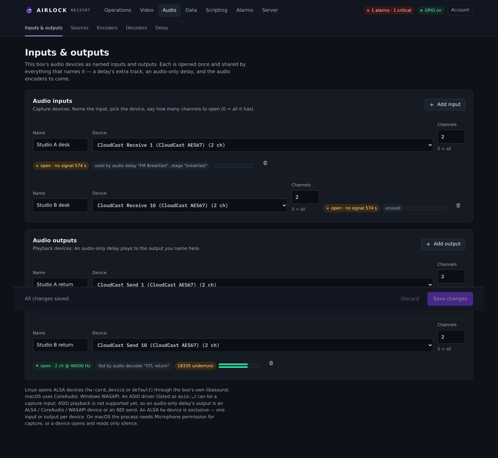
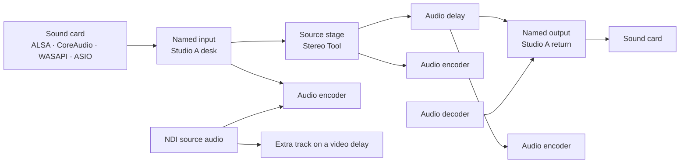
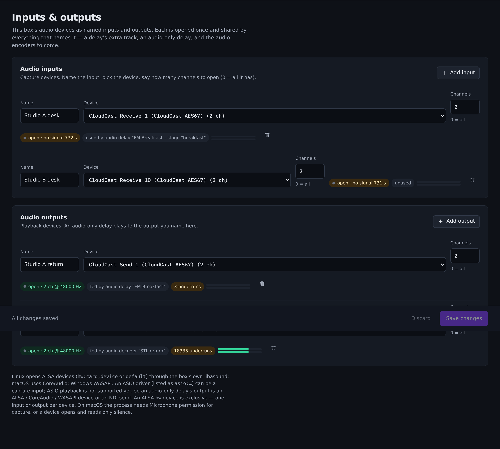

# Inputs and outputs

Airlock reaches your sound cards through one layer: a registry of **named
inputs** and **named outputs**. You name a device once on **Audio › Inputs &
outputs**, and everything else in the box — an audio delay, an extra track on a
video delay, an audio encoder, an audio decoder — refers to it by that name.
Each device is opened once and shared.

{ .shot }

## Why a registry

A sound card is not a file you can open twice. An ALSA `hw` device is exclusive.
An ASIO driver is single-client. Even where a driver tolerates two opens, two
capture clocks on one card are two sources of drift, and your delay depth pays
for it.

So Airlock opens each device exactly once and fans the audio out to every
consumer that asks for it by name:



The same shape applies on the way out. A named output is one playback stream on
one device; every block that plays to it adds a **voice**, and the registry
mixes the voices into the device buffer. Two delays can share one monitor
output without fighting for the card.

!!! tip "Name inputs after the signal, not the hardware"
    `Studio A desk`, `Talkback return`, `AES67 rx 3` survive a card swap.
    `hw:2,0` does not, and the name is what every other page, every backup and
    every configuration file refers to.

## Add a named input

1. Open **Audio › Inputs & outputs**.
2. In the **Audio inputs** card, press **Add input**.
3. Fill in the row:
    - **Name** — what consumers will pick. Keep it short and stable.
    - **Device** — choose from the list of capture devices this box reports.
      Leave it on **Default input** to take the system default.
    - **Channels** — how many channels to open. `0` means *all the device has*.
4. Press **Save**.

The input opens immediately. The state pill at the end of the row turns to
`open · 2 ch @ 48000 Hz · peak −18 dBFS` with a live meter beside it, and the
grey pill next to it says `unused` until something subscribes.

!!! note "There is no sample-rate field"
    An input runs at the device's own rate and reports it. Consumers conform the
    rate themselves, so a 44.1 kHz card and a 48 kHz card can both feed the same
    encoder. Likewise there is no *first channel* on the input: an input opens a
    block of channels, and each consumer picks the slice it wants — an extra
    track on a video delay has its own **First channel** and **Channels**
    fields, for example.

## Add a named output

1. In the **Audio outputs** card, press **Add output**.
2. Fill in **Name**, **Device** (or **Default output**) and **Channels**.
3. Press **Save**.

Then point something at it: an audio delay's **Play to output**, an audio
decoder's output, or a delay's confidence monitor. The output row shows
`fed by audio delay "Breakfast"` once a block claims a voice on it.

An output that nothing feeds still opens and plays silence. That is deliberate —
the card is held, its clock is running, and the first voice to arrive is heard
immediately rather than after a device open.

{ .shot }

## What the page tells you

Each row carries a state pill, a usage pill and a meter.

| Pill | Means |
|---|---|
| `not saved` | the row has been edited but not saved; nothing is open yet |
| `open · N ch @ R Hz · peak X dBFS` | running normally |
| `open · no signal N s` | the device is open and delivering, but every sample has been zero for N seconds |
| `<error> · retrying` | the device would not open; Airlock retries every 5 seconds |
| `no capture on this platform` | this build has no capture backend for this operating system |
| `used by …` / `unused` | which blocks are subscribed right now |
| `fed by …` / `idle` | (outputs) which blocks hold a voice on the device |
| `N blocks dropped` | a consumer fell more than about 1.3 s behind and lost audio |
| `N underruns` | (outputs) the device asked for samples none of its voices had ready |

Meters are peak, per channel, reset each time the page polls. They read the
device directly on an input, and the **mixed** buffer on an output — what the
card is actually playing, all voices summed.

## Platform backends

| Platform | Backend | Device names | Notes |
|---|---|---|---|
| Linux | ALSA | `hw:<card>,<device>` or `default` | `libasound.so.2` is loaded at run time, so no ALSA development packages are needed and a box without ALSA still starts (the input simply reports an error). The device list comes from the kernel's PCM table plus `default`. |
| macOS | CoreAudio | the device's own name | The process needs **Microphone** permission to capture. |
| Windows | WASAPI | the device's own name | The default input and output work with no configuration. |
| Windows | ASIO | `asio:<driver name>` | Airlock drives the driver's own interface directly — no vendor SDK is installed or shipped. **Capture only.** |

Every backend delivers 16-bit interleaved audio. Float, 24-bit and 32-bit device
formats are converted for you.

### ALSA (Linux)

Use `hw:C,D` for a real card — it is exclusive and glitch-free. `default` goes
through the system mixer, which may resample and may be shared with other
software.

`Channels: 0` asks the card what it supports and opens that many. Some cards —
USB interfaces and the ALSA loopback in particular — insist on an exact count;
give them the number explicitly.

To test without hardware, load the ALSA loopback module. Play into
`hw:Loopback,0,0` and capture `hw:Loopback,1,0` with a matching channel count on
both sides.

### CoreAudio (macOS)

Devices appear under their own names. If you want a software loopback, install a
virtual device such as BlackHole and it lists like any other card.

!!! warning "Microphone permission"
    A macOS process with no Microphone permission opens the device happily and
    reads **nothing but zeros** forever. The row shows `open · no signal …`
    rather than an error. A service started over SSH has no permission at all;
    grant it in **System Settings › Privacy & Security › Microphone** for the
    process that runs Airlock.

### WASAPI and ASIO (Windows)

WASAPI covers the default input and output and every endpoint Windows lists.

ASIO is for the broadcast cards: name the device `asio:` followed by the driver
name exactly as it is registered — for example `asio:CloudCast AES67`. Two
constraints matter on air:

- **One ASIO driver per process.** A second ASIO input is refused with a clear
  message. This matches the drivers themselves, which are single-client.
- **ASIO output is not supported.** Play a delay out through a WASAPI device, an
  NDI audio send or an audio encoder instead.

### NDI audio

NDI audio is not a registry input — there is no device to open and no exclusive
access to arbitrate. Blocks that can take NDI audio name the source directly:

- an **audio encoder** with its source kind set to `ndi` and `ndi_source` naming
  the sender;
- an **extra audio track** on a video delay, with `kind: "ndi"`;
- an **audio decoder**, which goes the other way and puts its output on NDI as
  well as (or instead of) a named output.

Only the audio of the named NDI sender is received; its video is never requested,
so an NDI audio source costs the network almost nothing.

## Inputs and outputs are machine-local

The input and output lists are **not** copied from a primary to its backups. A
backup has its own cards in its own slots, so it keeps its own `audio_inputs`
and `audio_outputs`.

What *does* travel is every **reference** to a name: a delay's source, an
encoder's input, a track's input. So the rule for a redundant pair is simple:

!!! important "Define the same names on both boxes"
    If the primary has an input called `Studio A desk`, the backup must have one
    called `Studio A desk` too — pointing at whatever hardware that box has. A
    reference to a name the box does not have reads silence and logs it once.

## Settings reference

### Audio input

| Setting | Console label | Config key | Default | Meaning |
|---|---|---|---|---|
| Name | **Name** | `audio_inputs[].name` | — | The name every consumer refers to. Must be unique on the box. |
| Device | **Device** | `audio_inputs[].device` | `""` | The capture device. `hw:C,D` or `default` on Linux, the device's own name on macOS and Windows, `asio:<driver>` for ASIO. Empty = the box's default input. |
| Channels | **Channels** | `audio_inputs[].channels` | `0` | Channels to open. `0` = all the device has (up to 64). |

### Audio output

| Setting | Console label | Config key | Default | Meaning |
|---|---|---|---|---|
| Name | **Name** | `audio_outputs[].name` | — | The name blocks play to. |
| Device | **Device** | `audio_outputs[].device` | `""` | The playback device, named as above. Empty = the box's default output. ASIO is not available here. |
| Channels | **Channels** | `audio_outputs[].channels` | `0` | Channels to open. `0` = all the device has. |

Both lists live at the top level of `ndi2srt.json`:

```json
{
  "audio_inputs": [
    { "name": "Studio A desk", "device": "hw:1,0", "channels": 2 },
    { "name": "Talkback",      "device": "default", "channels": 0 }
  ],
  "audio_outputs": [
    { "name": "Studio A return", "device": "hw:1,0", "channels": 2 },
    { "name": "Control room",    "device": "",       "channels": 2 }
  ]
}
```

### Status endpoints

| Endpoint | What it returns |
|---|---|
| `GET /api/audio-devices` | Every capture device this box can see |
| `GET /api/audio-output-devices` | Every playback device this box can see |
| `GET /api/audio-inputs` | Each named input: state, channels open, rate, subscribers, frames, per-channel peak, silence seconds, dropped blocks |
| `GET /api/audio-outputs` | Each named output: state, channels open, rate, voices, frames, underruns, per-channel peak |

## Behaviour you should know about

- **Changes apply on save.** Saving the page opens what is new, closes what is
  gone and reopens anything whose device or channel count changed. Consumers of
  a reopened input resubscribe on their own, with a short gap in their audio.
- **A device that disappears is retried every 5 seconds.** The consumer keeps
  running and reads silence; it rejoins automatically when the card returns.
- **A slow consumer loses audio, never the device.** Each subscriber has about
  1.3 seconds of queue. If it falls behind, blocks are dropped and counted
  against it; the card and the other consumers are untouched.
- **An output voice has about half a second of queue.** A voice feeding an
  output that is in error drops its oldest audio rather than growing without
  bound.
- **Rates are conformed at the edges.** A voice pushing 44.1 kHz into a 48 kHz
  device is resampled, and its channel count is mapped, on the way in.

## Troubleshooting

**The row says `Device or resource busy` (or similar) and keeps retrying.**
Something else has the card. On Linux that is usually another process holding
`hw:C,D` exclusively — including a second Airlock instance. Check with your
system's audio tooling, or move to a shareable device. Note that *Airlock itself*
never double-opens a device: if two blocks need the same card, give them one
named input and let both subscribe.

**ASIO: "a second ASIO input is refused".**
One ASIO driver can be open per process. Open the one driver with enough
channels for everything you need, then let each consumer pick its own channel
slice.

**The input is `open` but shows `no signal`.**
The device is delivering, and every sample is zero.

- On macOS, this is almost always missing Microphone permission.
- On Linux, check you opened the right subdevice — many cards expose several,
  and only one carries the signal.
- Check the channel count. If the signal is on channels 3–4 and you opened 2,
  you are listening to a silent pair; open all the channels (`0`) and let the
  consumer pick the pair.

**The input is open with signal, but the consumer is silent.**
Check the consumer's channel selection, then check its own meter. On an audio
delay the card meters **in** and **out** separately — if `in` moves and `out`
does not, the problem is in the delay, not the device.

**The output shows underruns.**
The device asked for samples that none of its voices had ready. A handful at
start-up is normal. Continuous underruns mean the feeding block is not producing
in real time: check that its source is connected, and that the box is not
starved of CPU.

**The rate on the page is not the rate I expected.**
The input reports the device's own rate; Airlock does not set it. If a card is
running at 44.1 kHz and you need 48 kHz, change it in the driver or the
operating system. Everything downstream will conform either way, but you save a
resample by getting it right at the card.

**The device is listed as `(not listed on this box)` in the picker.**
The configuration names a device this box cannot see — usually a configuration
copied from another machine, or a card that has not enumerated yet. The name is
kept so you do not lose it; pick the real device or fix the hardware.

**A backup is silent after a takeover.**
Its input and output names do not match the primary's. Open **Audio › Inputs &
outputs** on the backup and create the same names against its own hardware.
