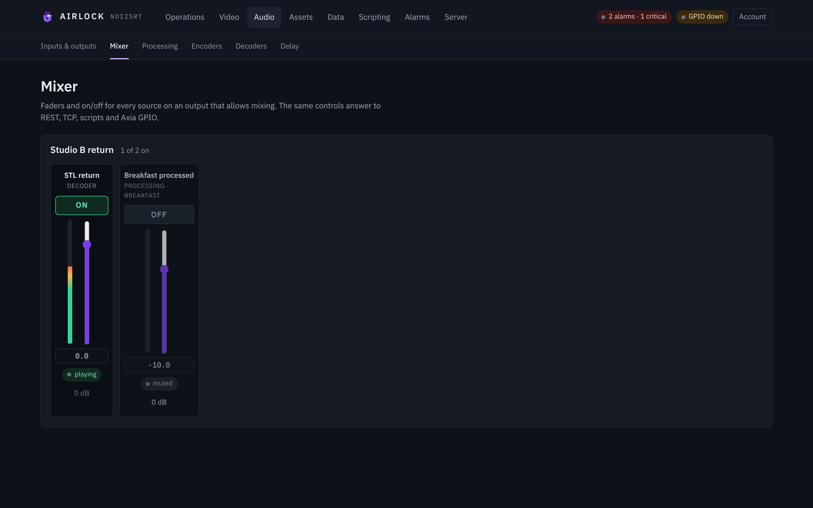
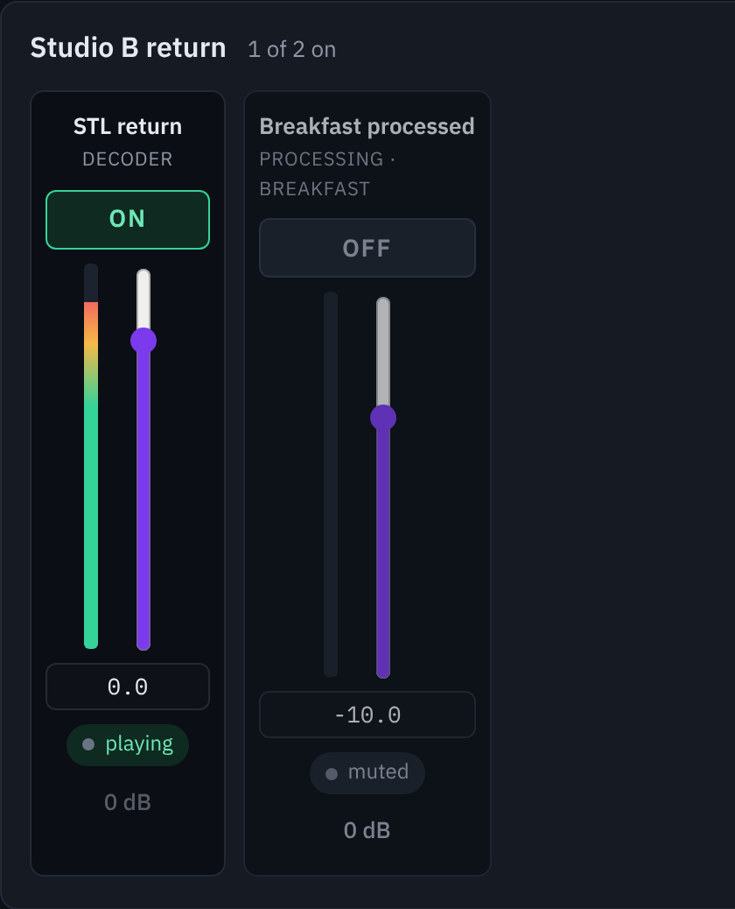

# Mixer

An audio output plays one source unless **Allow mixing** is on for it
([One source per output](io.md#one-source-per-output)). On an output that
mixes, every source gets a **fader** and an **on/off switch**, like a channel on
a desk. **Audio › Mixer** is where you work them.

{ .shot }

## A strip per source

Each output that mixes is a card, with a strip for every block that plays to it:

{ .shot }

| Part | What it does |
|---|---|
| Name | The block, as the rest of the console calls it. Underneath, its kind, and the short name TCP, scripts and GPIO use when that differs (a stage is known there by its id). |
| **ON / OFF** | Switches the source in or out of the mix. An off strip is dimmed. |
| Fader | −80 dB at the bottom (off) to +12 dB at the top; 0 dB, unity, sits about four-fifths of the way up. **Double-click** it for 0 dB. |
| dB box | The fader's level. Click it, type a number and press **Enter** to set it exactly. |
| Meter | The source's level **after** its fader and switch: what it is adding to the output. |
| **playing** / **muted** / **not running** | The source is in the mix now; it is running but switched off; or the block is not running at all. |
| **0 dB** | Back to unity. |

Moves and switches **ramp over 20 ms**, so neither clicks on air. A fader drag is
sent a few times a second and once more when you let go.

## Where the settings live

- Fader positions and switches are **saved** within half a second of a move, and
  come back after a restart.
- They are part of the routing, so a **backup** follows its primary's
  ([Redundancy](../redundancy/overview.md)).
- A **locked backup** refuses them, like every other control.
- An output that does **not** mix has no faders. Its one source passes through
  untouched, bit for bit.
- A source that starts playing to the output later (a block switched on, a new
  decoder) arrives at 0 dB and on unless it already has a saved position.

## Controlling the mix from outside

The same faders and switches answer to every control surface, and this page
follows a change made from any of them. A source is named as the console shows
it (`Studio`, `Breakfast processed`) or by its short name (`breakfast`); names
with spaces are quoted on TCP.

| Surface | How |
|---|---|
| REST | `GET /api/audio-mix` for every output and source; `POST /api/audio-mix?output=&source=` with `gain_db`, `on` or `toggle=1` — see [REST API](../control/rest.md#mixer-faders-and-switches) |
| TCP | `MIX "Studio B return" "STL return" GAIN -6`, `… ON`, `… OFF`, `… TOGGLE`; `MIX` lists everything; `SUBSCRIBE MIX` pushes every change — see [TCP](../control/tcp.md#mixer) |
| Scripts | `air.mix_on`, `air.mix_off`, `air.mix_toggle`, `air.mix_gain`, `air.mix_state`, and the `mixEvent` trigger — see [Scripting API](../scripting/api.md) |
| Axia GPIO | a `mix:<output>/<source>` target: `enable` (on), `disable` (off), `toggle`; `enable` with edge `BOTH` is "on while held". Lamps `on`, `off` and `live` — see [Axia GPIO](../control/gpio.md#one-pin-many-blocks) |

```text
> MIX "Studio B return" "STL return" GAIN -6
< OK 0 MIX "Studio B return" "STL return" ON -6.0
```

```lua
-- duck the processed feed under the return while the talkback key is down
air.mix_gain("Studio B return", "breakfast", -20)
```

## Settings reference

| Setting | Console | Config key | Default | Meaning |
|---|---|---|---|---|
| Allow mixing | Audio › Inputs & outputs › **Sources** | `audio_mix_outputs` | `[]` | The outputs that may play more than one source |
| Fader, switch | Audio › **Mixer** | `audio_mix_sources[]` `{output, source, gain_db, on}` | 0 dB, on | One source on a mixing output; `source` is its full label, e.g. `audio decoder "STL return"` |
