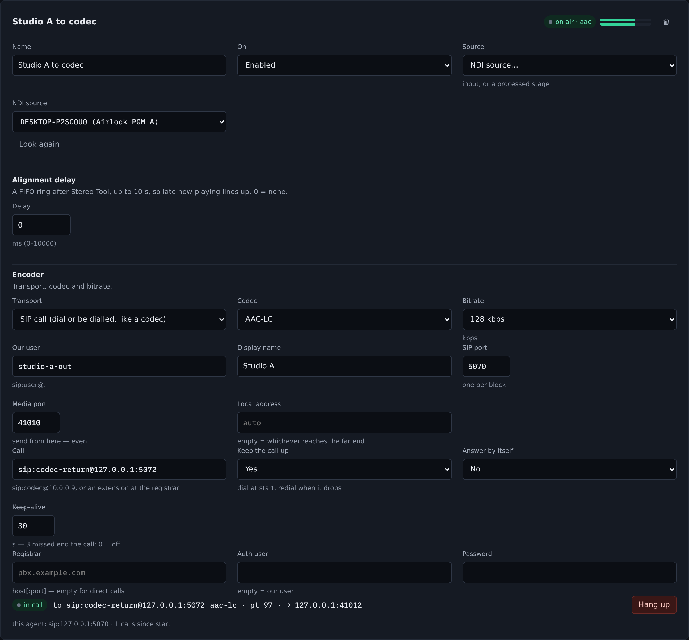
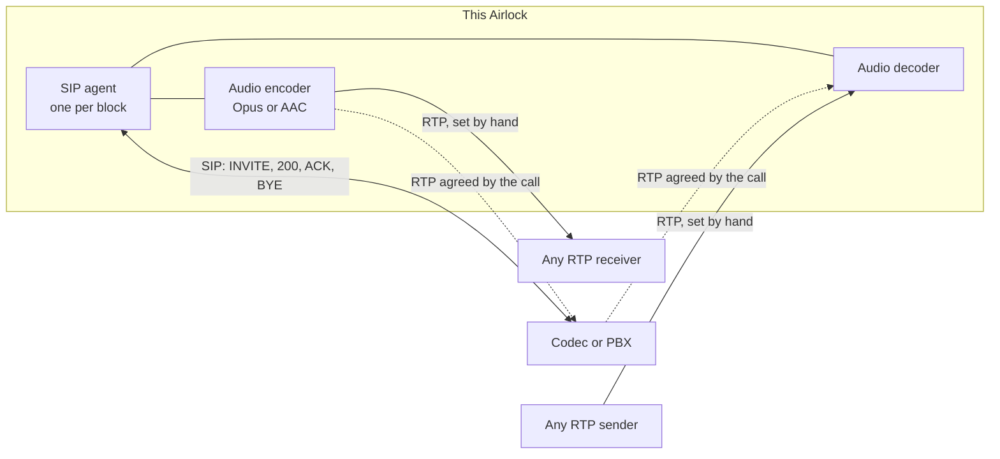
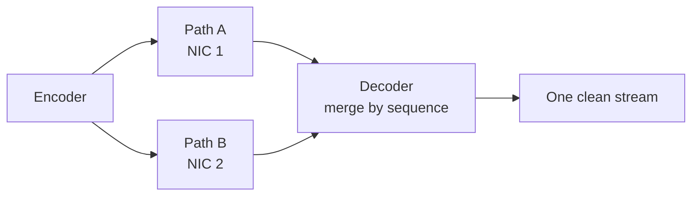
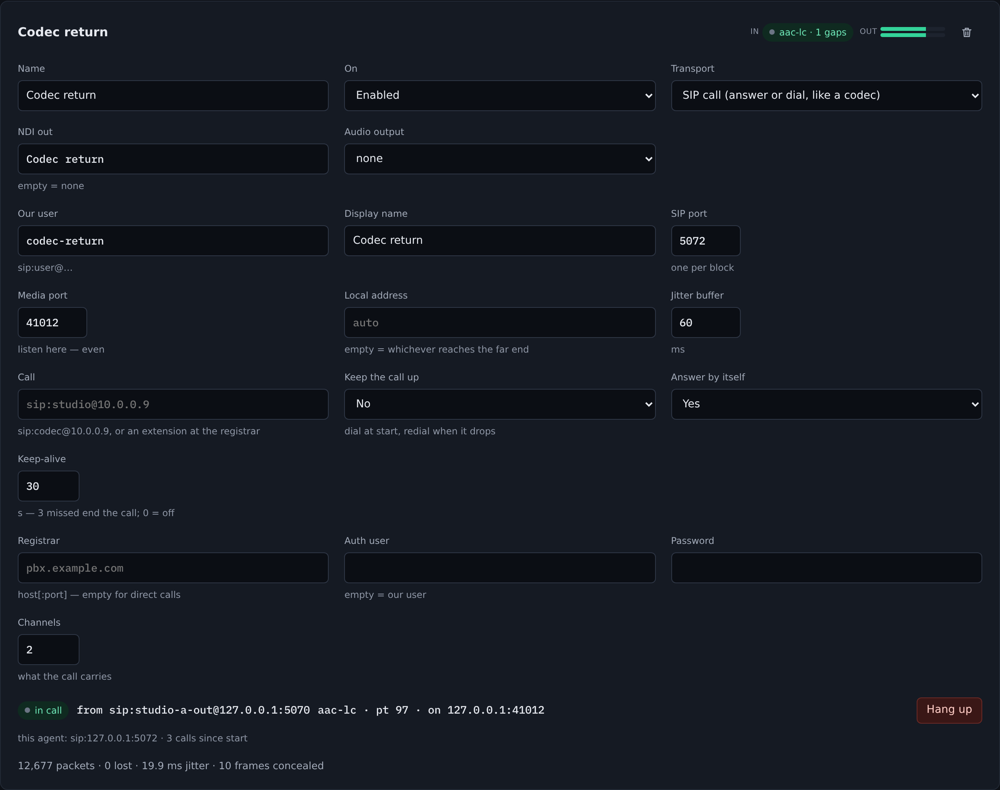
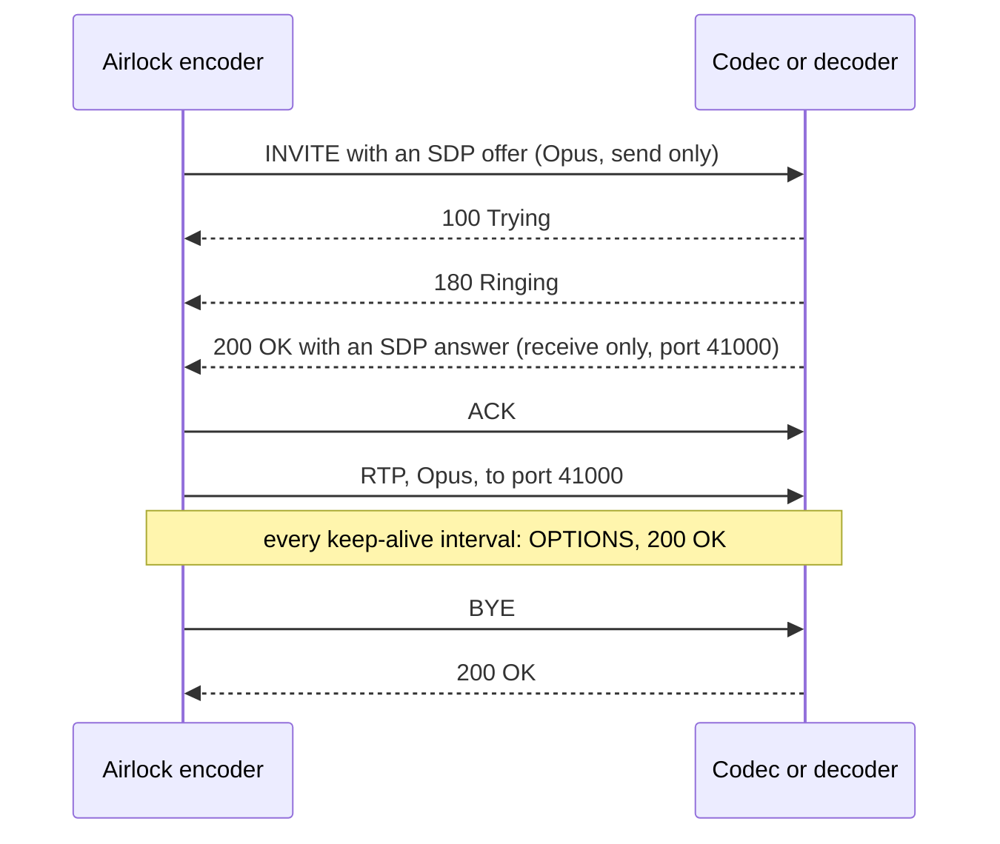

# RTP and SIP calls

An audio encoder or decoder can reach the outside world three ways, and the choice is about **who is at the far end**:

| Transport | Use it when the far end is | What sets the link up |
| --- | --- | --- |
| **SRT** | another Airlock box | you, on both ends — and the stream describes itself |
| **RTP** | anything that takes standard RTP: a hardware decoder, a codec, ffmpeg, an AES67-style receiver | you, on both ends — address, port, codec and payload type |
| **SIP call** | a broadcast codec, a SIP phone system, or another Airlock you want to *dial* | the call — it agrees the address, the port and the codec |

RTP and SIP were added in 0.15.49. Both are set on the card's **Transport** list on **Audio › Encoders** and **Audio › Decoders**.

{ .shot }



## RTP

RTP is RFC 3550 over plain UDP. Where the SRT link speaks a framing only Airlock knows, an RTP stream uses payload formats every receiver can name, so it is the transport for interoperating with other people's equipment.

### What is carried

| Codec | Payload format | Payload type | Notes |
| --- | --- | --- | --- |
| **Opus** | RFC 7587 | 111 | One Opus packet per RTP packet, 20 ms. The RTP clock is 48 kHz whatever the frame's internal rate. |
| **AAC** | RFC 3640, `AAC-hbr` mode | 97 | Raw access units behind a 13-bit size and 3-bit index header. No ADTS on the wire. |

MP3, FLAC and aptX have no payload format worth shipping and are **refused at save** on an RTP transport, rather than sent as something a receiver cannot name.

An encoder may send any AAC profile — LC, HE v1 or HE v2 — because a receiver that holds the SDP can read them. An Airlock **decoder** on RTP takes **Opus or AAC-LC** only: it is told a sample rate and a channel count, and the HE profiles cannot be rebuilt from those two numbers alone.

### Send: an encoder on RTP

1. On **Audio › Encoders**, set **Transport** to **RTP (to anything, unicast or multicast)**.
2. Pick **Opus** or **AAC-LC** as the codec.
3. Set **Destination** and **Port**. A multicast group (224.0.0.0 to 239.255.255.255) sends multicast.
4. For multicast, set **TTL** — 1 keeps the stream on the local subnet, which is the safe default for a plant — and **Send from** to the address of the NIC it should leave on. On a box with several networks, that is what pins multicast to the right one.
5. Leave **Payload type** at 0 to use the codec's default, or set the number the receiver insists on.
6. Turn **RTCP** on if the receiver wants sender reports. They go to the next port up and carry the SDES name `ndi2srt@<host>`.
7. Save.

RTP has no connection, so the card's *connected* means only that the socket is taking the packets. Nothing at this end can know whether a receiver is listening.

### Two paths: SMPTE 2022-7

Fill in **Second path** on the encoder and every packet is sent twice, down two networks, carrying the same sequence number and the same SSRC. A receiver that merges by sequence number — an Airlock decoder with a second leg, or any 2022-7 receiver — plays whichever copy arrives first and drops the other, so either path can fail with nothing heard.



### Receive: a decoder on RTP

1. On **Audio › Decoders**, set **Transport** to **RTP (from anything, unicast or multicast)**.
2. Set **Port**, and **Listen on** to a local address or leave it empty for any.
3. For multicast, set **Multicast group**. The decoder joins it on the **Listen on** interface.
4. Set **Codec** and **Channels**. RTP carries no header that says what the stream is, so the decoder has to be told.
5. Set **Jitter buffer** in milliseconds. 60 rides out ordinary reordering; a rougher network wants more, and every millisecond is a millisecond of delay.
6. Leave **Payload type** at 0 to take whatever arrives, or set it to ignore any other stream sent to the same port.
7. For 2022-7, fill in **Second path** with the second group or port.

### What the decoder does with loss

The jitter buffer holds what arrives for the time you set and hands it on in sequence. A packet that is still missing when its wait runs out is declared **lost**, and the hole is passed to the decoder, which fills it from the codec's own state — Opus conceals properly, AAC writes silence — instead of clicking or letting the rest of the audio arrive early. Concealment is capped at ten frames: covering a long outage would be inventing audio. The same concealment applies to SRT decoders.

### Counters

The decoder card shows packets, lost, late and jitter under the settings, and the status API carries the full set in `rtp`:

| Counter | Meaning |
| --- | --- |
| `packets`, `bytes` | Everything received, both legs together. |
| `lost` | Sequence positions that never arrived in time. |
| `late` | Arrived after its position had been given up on. On a 2022-7 decoder the second copy of every packet lands here too. |
| `duplicates`, `reordered` | The same packet twice; arrived out of order but in time. |
| `jitter_ms` | RFC 3550 interarrival jitter. |
| `ssrc`, `ssrc_changes` | A change means the far end restarted, or something else is sending to this port. |
| `leg_a_packets`, `leg_b_packets` | Per path, for 2022-7. |

### Receiving Airlock's RTP with ffmpeg

Write an SDP and hand it to ffmpeg. These two were run against ffmpeg 4.4 and gave back the 400 Hz test tone at 48 kHz stereo.

=== "Opus"

    ```
    v=0
    o=- 0 0 IN IP4 127.0.0.1
    s=airlock
    c=IN IP4 239.1.1.1
    t=0 0
    m=audio 5004 RTP/AVP 111
    a=rtpmap:111 opus/48000/2
    ```

=== "AAC-LC"

    ```
    v=0
    o=- 0 0 IN IP4 127.0.0.1
    s=airlock
    c=IN IP4 239.1.1.1
    t=0 0
    m=audio 5006 RTP/AVP 97
    a=rtpmap:97 mpeg4-generic/48000/2
    a=fmtp:97 streamtype=5; profile-level-id=15; mode=AAC-hbr; config=1190; SizeLength=13; IndexLength=3; IndexDeltaLength=3;
    ```

```bash
ffplay -protocol_whitelist file,rtp,udp -i stream.sdp
```

`config=1190` is the AAC AudioSpecificConfig for AAC-LC at 48 kHz stereo; for mono it is `1188`. RFC 3640 puts that in the SDP rather than in front of every frame, which is why AAC needs the longer description.

## SIP calls

Set the transport to **SIP call** and the block gets a SIP user agent of its own. Instead of typing an address, a port and a payload type at both ends, you **dial** — or are dialled — and the call agrees all three. This is how broadcast codecs connect.

{ .shot }

### Who sends, who receives

An Airlock audio encoder only sends and an audio decoder only receives, so each agrees exactly that with the far end:

- An **encoder** offers and answers **send only**.
- A **decoder** offers and answers **receive only**.

A codec that offers a two-way call — every codec does — gets the one direction the block can honour, which is allowed by the offer/answer rules (RFC 3264). For a two-way link, run an encoder and a decoder and make two calls, one each way.

Two encoders calling each other cannot agree: both only send. The callee refuses with **488 Not Acceptable Here** rather than putting up a call that carries nothing.

### Codecs

A call carries **Opus** at 48 kHz or **AAC-LC**. G.711 and G.722 are deliberately not offered — this is a broadcast link, not a phone call.

- An encoder offers its own codec only, because it codes once.
- A decoder offers both, Opus first.
- When answering, the block takes **the caller's order** and **the caller's payload type number**: a codec that offers Opus as payload type 96 is sent 96, not Airlock's default 111.

### How a call goes



The block runs its media only while the call is up. An encoder keeps coding between calls but sends nothing; a decoder opens its receiver when the call is answered and closes it when the call ends. A re-INVITE that moves the far end's media mid-call is answered and followed without dropping the call.

### Set up a block for calls

1. On **Audio › Encoders** or **Audio › Decoders**, set **Transport** to **SIP call**.
2. Set **Our user** — the `studio-a` in `sip:studio-a@…` — and a **Display name** if the far end shows one.
3. Set **SIP port** and **Media port**. Every SIP block on a box needs its own SIP port, and the media port must be even, because RTCP takes the odd one above it. The save refuses a clash.
4. Leave **Local address** empty unless the box has several networks and the calls should use one in particular.
5. Set **Call** to who to dial: `sip:codec@10.0.0.9`, or `sip:codec@10.0.0.9:5070` for a port other than 5060. With a registrar, an extension on its own (`2001`) is dialled at the registrar's domain.
6. Choose how calls start:
    - **Answer by itself** answers an incoming call at once. Off, the call rings on the card until someone presses **Answer**, and rings out after a minute.
    - **Keep the call up** dials when the block starts and dials again whenever the call drops — the *permanent connection* every codec offers. Pressing **Hang up** stops it until somebody dials.
7. Save. The block starts its agent; the call card appears under the settings.

On a **decoder**, also set **Channels** to what the call should carry, and the **Jitter buffer**.

### The call card

| State | Meaning |
| --- | --- |
| **idle** | No call. **Dial** places one. |
| **calling…** | An INVITE is out, nothing heard back yet. |
| **ringing** | The far end is ringing. **Hang up** cancels. |
| **incoming call** | Someone is calling this block. **Answer** or **Hang up**. |
| **in call** | Up. The card shows the far end, the codec and payload type, and where the media is going or arriving. |
| **call failed** | Refused, unanswered, or the far end stopped responding. The reason is beside the pill, in the far end's own words where it gave any — `486 Busy Here`, `603 Decline`, `404 Not Found`. |

With a registrar set, the card also shows **registered** or **not registered**, with the registrar's refusal on hover.

### Registering with a phone system

Set **Registrar** to the PBX or SIP server as `host` or `host:port`, then **Auth user** (if it differs from **Our user**) and **Password**. The agent registers at start, answers a digest challenge (MD5, with or without `qop=auth`), refreshes at 80% of the lifetime the registrar grants, and unregisters when the block stops.

With a registrar, calls go **through** it: it is used as the outbound proxy, and an extension is dialled at its domain. Without one, calls go straight to the address in **Call**.

### Keep-alive

During a call the agent sends an OPTIONS request every **Keep-alive** seconds. Three in a row unanswered — or an answer saying the call no longer exists — end the call, so a far end that lost power is noticed in under two minutes instead of being waited on for ever. With **Keep the call up** on, the block then redials. Set **Keep-alive** to 0 to turn it off for equipment that does not answer OPTIONS.

### Control

| Surface | What it does |
| --- | --- |
| Call card | **Dial**, **Answer**, **Hang up**. |
| REST | `POST /api/audio-encoders/<name>/call/dial`, `/hangup` or `/answer`, and the same under `/api/audio-decoders/`. Add `?uri=sip:…` to dial somewhere other than the configured address. |
| Status | `GET /api/audio-encoders` and `/api/audio-decoders` carry a `sip` object: `state`, `direction`, `far_end`, `codec`, `payload_type`, `remote_media`, `local_media`, `registered`, `register_error`, `last_error`, `calls`. |

Dial and answer pass the same gates as every other control: a locked backup refuses them, and so does a licence that does not permit the surface. **Hang up is never refused** — an operator must always be able to end a call.

### On a redundant pair

A standby must not take the plant's calls: the primary is registered under the same name and the two would both answer. So:

- A SIP **encoder** on a locked backup is held, like every audio encoder.
- A SIP **decoder** on a locked backup starts **no agent at all**. Its card says it is held on standby.

Both start when the backup takes over, register in their own right, and stop again when it rejoins.

### Proven against

Both directions were run against **baresip 1.0.0**, an independent SIP client:

| Call | Result |
| --- | --- |
| baresip dials an Airlock decoder | Answered by itself, agreed Opus under baresip's payload type 96, 700 packets with none lost at about 2 ms jitter. baresip's hang-up ended the call on the Airlock side. |
| An Airlock encoder dials baresip | Agreed Opus, payload type 111. baresip played the 400 Hz tone back at 398 Hz, at the level the encoder captured, for exactly the length of the call. The Airlock hang-up closed baresip's side. |

Registration has been tested against a scripted registrar that issues a real digest challenge. It has not yet been run against a production PBX.

### What it does not do

TCP and TLS signalling, DNS SRV lookups, call forking, early media, and delayed offer — an INVITE that carries no SDP is refused with 488. None of these is needed for a codec link, and each is a way for a call to fail obscurely.

## Troubleshooting

| Symptom | Likely cause |
| --- | --- |
| Save refused: *port is already …* | Two SIP blocks on the same SIP or media port. Each needs its own. |
| Save refused: *the media port must be even* | RTCP takes the odd port above it. Pick an even one. |
| Save refused: *an extension, which needs a registrar* | **Call** holds a bare number with no registrar to dial it through. Write `sip:user@host`, or set **Registrar**. |
| **call failed · 488 Not Acceptable Here** | No codec or direction in common. The far end offers only G.711/G.722, or two encoders called each other. |
| **call failed · no response from the far end (408)** | Nothing answered at that address and port. Check the address, the port, and a firewall in the way of UDP 5060. |
| **call failed · nobody answered** | It rang for the answer timeout without being picked up. |
| Call is up but the decoder hears nothing | The far end is sending to a different address from the one in the SDP, often through NAT. Set **Local address** to the address the far end can reach. |
| An RTP decoder shows packets but no audio | The **Codec** or **Channels** set on the card do not match what is being sent. RTP cannot say. |
| `ssrc_changes` keeps climbing | Two senders aimed at the same port. |
| ffmpeg cannot open the stream | The SDP's `c=` address and `m=` port must match the destination, and AAC needs the `fmtp` line with `config`. |

## Reference

### RTP out — `audio_encoders[].rtp`

| Setting | Console label | Config key | Default | Meaning |
| --- | --- | --- | --- | --- |
| Destination | Destination | `rtp.host` | empty | A host, or a multicast group. Required. |
| Port | Port | `rtp.port` | `5004` | Destination port. |
| Send from | Send from | `rtp.bind` | empty | Local address to send from. Pins multicast to a NIC. |
| Source port | — | `rtp.source_port` | `0` | Local port to send from; 0 lets the system choose. A SIP call sets it. |
| TTL | TTL | `rtp.ttl` | `1` | Multicast hops, 1 to 255. |
| Payload type | Payload type | `rtp.payload_type` | `0` | 0 = 111 for Opus, 97 for AAC. |
| SSRC | — | `rtp.ssrc` | `0` | 0 = random at start. |
| RTCP | RTCP | `rtp.rtcp` | `false` | Sender reports on port + 1. |
| Second path | Destination, Port, Send from | `rtp.host_b`, `rtp.port_b`, `rtp.bind_b` | empty, `0`, empty | SMPTE 2022-7 duplicate. Port 0 = the first path's port. |

### RTP in — `audio_decoders[].rtp`

| Setting | Console label | Config key | Default | Meaning |
| --- | --- | --- | --- | --- |
| Listen on | Listen on | `rtp.bind` | empty | Local address, or the interface to join a group on. |
| Port | Port | `rtp.port` | `5004` | Listen port. |
| Multicast group | Multicast group | `rtp.source` | empty | Group to join; empty = unicast. |
| Jitter buffer | Jitter buffer | `rtp.jitter_ms` | `60` | 0 to 2000 ms. |
| Payload type | Payload type | `rtp.payload_type` | `0` | 0 = take any. |
| Second path | Second path, Port, Listen on | `rtp.source_b`, `rtp.port_b`, `rtp.bind_b` | empty, `0`, empty | SMPTE 2022-7 leg. A group or a port turns it on. |
| Codec | Codec | `codec` | `opus` | `opus` or `aac` (AAC-LC). RTP and SIP only. |
| Channels | Channels | `channels` | `2` | 1 to 16. RTP and SIP only. |

### SIP — `audio_encoders[].sip` and `audio_decoders[].sip`

| Setting | Console label | Config key | Default | Meaning |
| --- | --- | --- | --- | --- |
| User | Our user | `sip.user` | `ndi2srt` | Our user part. No spaces, `@` or `:`. |
| Display name | Display name | `sip.display_name` | empty | Shown by far ends that show one. |
| Local address | Local address | `sip.bind` | empty | Empty = whichever address reaches the far end. |
| SIP port | SIP port | `sip.port` | `5060` | One per SIP block on a box. |
| Media port | Media port | `sip.media_port` | `5004` | Even. A decoder listens here; an encoder sends from here. |
| Call | Call | `sip.uri` | empty | `sip:user@host[:port]`, or an extension with a registrar. |
| Registrar | Registrar | `sip.registrar` | empty | `host[:port]`. Empty = direct calls. |
| Auth user | Auth user | `sip.auth_user` | empty | Empty = **Our user**. |
| Password | Password | `sip.password` | empty | For the registrar's or proxy's challenge. |
| Registration lifetime | — | `sip.expires_s` | `300` | Seconds asked for; refreshed at 80% of the grant. |
| Answer by itself | Answer by itself | `sip.auto_answer` | `false` | Off = ring until answered. |
| Keep the call up | Keep the call up | `sip.auto_dial` | `false` | Dial at start and redial on a drop, until hung up. Needs **Call**. |
| Redial after | — | `sip.redial_s` | `10` | Seconds between a drop and the redial. |
| Keep-alive | Keep-alive | `sip.keepalive_s` | `30` | In-call OPTIONS interval; 0 = off. |
| Jitter buffer | Jitter buffer | `sip.jitter_ms` | `60` | Decoder only. |
| Answer timeout | — | `sip.answer_timeout_s` | `60` | How long a call may ring, either way. |

### Worked example: a codec link both ways

An encoder that keeps a call up to a codec at the transmitter, and a decoder that answers the codec's return call:

```json
"audio_encoders": [
  {
    "name": "To TX", "enabled": true, "source_kind": "source", "source": "Studio A processed",
    "channels": 2, "codec": "opus", "bitrate_kbps": 128, "transport": "sip",
    "sip": { "user": "studio-a-out", "port": 5060, "media_port": 5004,
             "uri": "sip:tx-codec@10.20.0.15", "auto_dial": true, "keepalive_s": 30 }
  }
],
"audio_decoders": [
  {
    "name": "From TX", "enabled": true, "transport": "sip", "channels": 2,
    "ndi_name": "TX return", "output": "Monitor",
    "sip": { "user": "studio-a-in", "port": 5062, "media_port": 5006,
             "auto_answer": true, "jitter_ms": 80 }
  }
]
```
