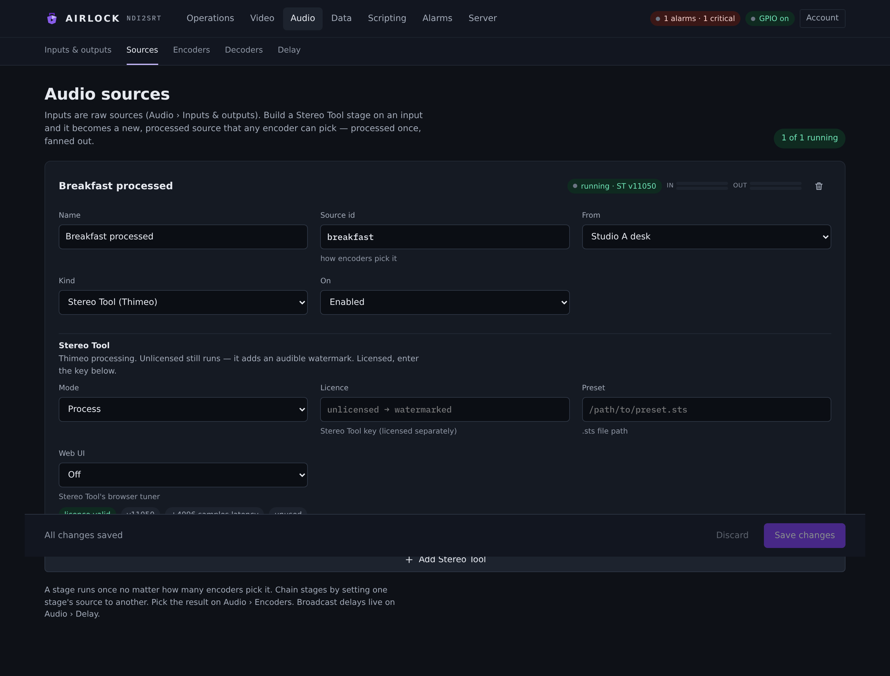
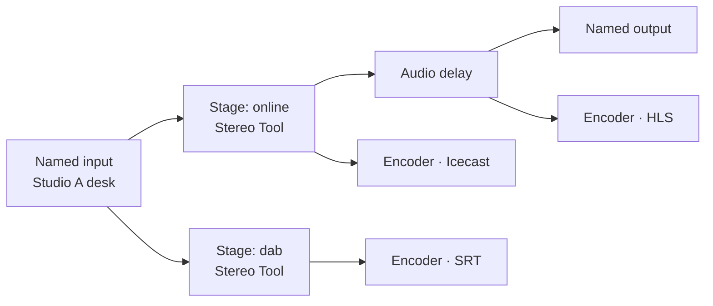

# Sources and Stereo Tool

A **source** is anything in Airlock that can hand audio to something else. A
named input is a raw source. A **stage** takes one source in, processes it, and
publishes the result as a new source — so a Stereo Tool chain is built once and
any number of delays and encoders pick it up. **Audio › Sources** is where you
build stages.

{ .shot }

## What a stage is

A stage is a processor instance with a name. It subscribes to one upstream
source, runs it through its processing, and fans the processed audio out to
every consumer that names it.



Two things follow from that shape, and both matter in a plant:

- **Process once, fan out.** Ten encoders on one stage cost one instance of the
  processing, not ten. Pick the stage, not the input, on every consumer that
  should hear the same sound.
- **Separate sound, separate stage.** Online, DAB+ and the broadcast chain each
  want their own loudness and clipping. Build one stage per sound, each with its
  own preset — and each with its own tuning interface if you enable it.

Stages chain. A stage's **From** may be a named input or *another stage*, so a
house chain can feed per-service trims. A stage cannot take an audio delay as
its source, and it cannot take itself.

## Add a stage

1. Open **Audio › Sources**.
2. Press **Add Stereo Tool**. A card appears, pre-filled.
3. Set the fields:
    - **Name** — what you call it. This is the label on the card and in pickers.
    - **Source id** — the identifier consumers pick, e.g. `online`. Keep it
      short, lower-case and stable: changing it breaks every block pointing at
      it.
    - **From** — the upstream source: a named input or another stage.
    - **Kind** — **Stereo Tool (Thimeo)** or **Passthrough**.
    - **On** — **Enabled** or **Off**.
4. Press **Save**.

The card's status pill shows `running · ST v<version>` once the stage is up and
its source is delivering, `no source` if the upstream has not arrived yet, or
`stopped`. Two meters sit beside it, marked **in** and **out** — the audio
arriving and the audio leaving. On a processing stage those two should look
visibly different; if they do not, the processing is not in the path.

!!! note "Saving restarts a stage"
    Any change to a stage — a preset path, the licence, a bypass — rebuilds it.
    Expect a brief break in that stage's audio, and in the audio of anything
    downstream of it. Save processing changes off air.

## Stereo Tool processing

Stereo Tool is Thimeo's broadcast audio processor — loudness control, AGC,
multiband, stereo handling and clip protection. Airlock does not include it: it
loads Thimeo's shared library at run time, creates one processor instance per
stage, and passes your audio through it.

### Installing the library

Put the Stereo Tool shared library where Airlock can find it. It looks, in
order, at:

1. the path in the `NDI2SRT_STEREOTOOL` environment variable, if set — this must
   be the full path to the library file itself;
2. the directory the Airlock executable is in;
3. a `stereotool/x64` folder in that directory;
4. the operating system's normal library search path.

The file names it recognises are the ones Thimeo ships:

| Platform | File |
|---|---|
| Linux x64 | `libStereoTool_intel64.so` |
| Linux ARM64 | `libStereoTool_arm64.so` |
| Windows x64 | `libStereoTool_64.dll` or `libStereoTool_intel64.dll` |
| macOS | `libStereoTool_64.dylib` |

If no library is found, the stage still runs and passes audio through untouched.
The card shows a warning banner naming the file this box needs and the folder to
put it in — for example *copy `libStereoTool_64.dll` into `C:\Program
Files\ndi2srt` (beside ndi2srt)* — and the log says the same once. Nothing drops
off air because Stereo Tool is missing.

**No restart is needed.** A running stage looks for the library again every few
seconds and changes over to Stereo Tool when it appears. Loading takes from a second to several seconds
(about 10 s end to end on a Windows desktop) — the card says **Stereo Tool is loading** meanwhile — and happens beside
the audio, which keeps passing through until the engine is ready. An audio
encoder with Stereo Tool picks the library up the next time it is started
(disable and enable it).

The library's code is loaded **once per process**; every stage and every
encoder still makes **its own Stereo Tool instance** from it, with its own
input, output, preset, licence, bypass and web port. Almost all of the start-up time
is that instance — about 0.8 s measured on a Mac mini and about 6 s on a
Windows desktop, against 0.07–0.15 s for the library itself — so it is paid for
each stage and encoder.

### Licence and presets

Stereo Tool is **licensed separately, by Thimeo**. Your Airlock licence does not
cover it and Airlock does not validate it — it hands the key you type to the
processor and reports what the processor says back.

| Field | What to put in it |
|---|---|
| **Licence** | Your Stereo Tool key. Leave it empty and the processor runs **unlicensed** — it still processes, and it adds Thimeo's audible watermark to the output. |
| **Preset** | The full path to a `.sts` preset file on this box. Leave it empty to run the processor's defaults. |

Once the stage is up, the card reports what the processor told it:

* **licence: checking** until audio has passed through it — Thimeo's own
  advice is that the processor's licence answer is not reliable before that;
* then **licensed**, or **unlicensed · Stereo Tool watermark**: the settings in
  use need a licence this key does not give, so Stereo Tool puts its own audible
  watermark on the output. It is one answer for the whole processor; *what* it
  is using unlicensed (for example `RuleBreaker Clipper, Auto EQ/Bass EQ and
  Dynamic speed used without license`) is written to the log;
* the version, and the processing **latency in milliseconds** (the samples on
  hover) — the fixed delay the processor adds, useful when you are lining up
  metadata or a second rail against the processed audio.

These are read again every few seconds and a second after a preset or bypass
change, so a preset changed in Stereo Tool's own web interface shows up here
too. An audio encoder with its own Stereo Tool shows the same on its card:
**Stereo Tool · licensed · +85.3 ms**, or **unlicensed · watermark**, or
**bypassed**.

A preset that fails to load is logged as `FAILED` and the stage keeps running on
whatever the processor had. Check the path, and check that the file is readable
by the account the service runs as.

### Settings kept across restarts

Whatever you change in Stereo Tool's own web interface is kept. Each Stereo Tool
(a processing stage, or an encoder's own) saves its settings every two seconds
when they change, and loads them again when Airlock starts. The files are
`stereotool/stage-<id>.sts` and `stereotool/encoder-<name>.sts` in the folder
that holds the configuration.

* **Choosing a different preset still wins.** When the **Preset** field changes,
  the new preset loads and becomes the starting point; changes made after that
  are kept again.
* **Airlock's own settings always apply on top**: bypass, the web interface's
  port and whitelist, the FM path and RDS on or off. The saved file never
  overrides them, and it never holds the licence.
* The card shows what the processor started from and when its settings were
  last saved, for example `Settings kept across restarts · started from its
  saved settings · last saved 14:02:11`.

**Reload preset** on the card drops everything changed in Stereo Tool since and
goes back to the configured preset, or to Stereo Tool's defaults when no preset
is set. It asks first, because it changes the sound on air, and it is written to
the audit log. Over REST it is `POST /api/stereotool/{name}/reload-preset`, where
the name is a stage's id or name, or an encoder's name.

### Bypass

**Mode** has two settings:

- **Process** — audio goes through the processor.
- **Bypass (no processing)** — audio passes through untouched.

Bypass is the control to reach for when you want the stage out of the path but
want everything downstream to keep running. Consumers stay subscribed, the
source keeps publishing, and nothing restarts except the stage itself.


!!! warning "Stereo in, stereo out"
    The processor works on **stereo at 48 kHz**. A stage whose source delivers
    anything other than two channels passes that audio through unprocessed. Feed
    processing stages from a 48 kHz stereo source, or take a stereo pair at the
    consumer that needs it.

## The Stereo Tool web interface

Stereo Tool has its own browser-based tuning interface, and each instance can
offer its own. Airlock exposes it per stage so that Online, DAB+ and Broadcast
are each tuned in their own browser tab, against their own processor.

To enable it:

1. Set **Web UI** to **On**.
2. Set **Port**. `0` picks a free port and reports the one it chose.
3. Set **Allow from** — a CIDR range. The default is `127.0.0.1/32`: this box
   only.
4. Save.

When the stage comes back up, the card shows a link reading
`open tuner :<port> ↗`. It opens the processor's own interface, served by the
processor on that port.

!!! danger "The tuner has no password"
    Stereo Tool's web interface is an **unauthenticated on-air control
    surface**. Anyone who can reach that port can change your processing while
    it is on air. It is off by default for that reason.

    Keep **Allow from** as tight as the job permits — `127.0.0.1/32` and an SSH
    tunnel, or a single operator subnet. `0.0.0.0/0` means *anywhere that can
    route to this box*. It is not protected by Airlock's own sign-in, roles or
    audit log, and nothing it changes appears in Airlock's audit trail.

The tuner follows Airlock's control lock. While this instance is a locked
backup, the interface is withdrawn — the port closes and the link disappears —
and it comes back on its own within a second of the instance becoming
controllable again. A backup should not be offering an on-air processing
surface for a plant it is not driving.

## FM composite (MPX) and RDS

A Stereo Tool stage can also do the transmitter's end of the chain. Turn on
**MPX output** and Stereo Tool builds the **FM composite** — the mono and stereo
multiplex, the 19 kHz pilot and the RDS data at 57 kHz — and Airlock plays it out
of a sound-card output of its own, for a transmitter or an MPX-over-IP encoder.
The stage's processed programme carries on to its consumers as before; the
composite is an extra output.

### Set it up

1. On **Audio › Inputs & outputs**, add an output on a sound card that runs at
   **192 kHz**, and set its **Sample rate** to **192 kHz (MPX)**. Use that output
   for the composite only.
2. On the stage card, tick **MPX output › Play the composite**, then pick the
   output in **To**. The list marks each output with its rate; one that is not
   set to 192 kHz says *not for MPX*.
3. Leave **RDS › RDS encoder** ticked unless your transmitter adds its own RDS.
4. Press **Save**.

When it is running, the card shows **MPX → *output* · 192 kHz** and, with RDS
on, the PS, PI and RadioText the encoder is sending right now.

!!! note "The composite is never resampled"
    Resampling an FM composite destroys the pilot and the RDS, so Airlock does
    not do it. The output must run at the composite's own rate. Saving refuses
    an output set below 192 kHz, and a device that will not open at 192 kHz
    leaves the card at **MPX not playing** with the reason, for example
    `MPX output "MPX" runs at 48000 Hz — the composite needs 192000 Hz`.

MPX is a stage's, not an audio encoder's: an encoder's own Stereo Tool processes
for its stream and has no composite to send.

### Licence and Stereo Tool's own RDS

FM processing is a licensed Stereo Tool feature. Without a key that covers it,
the composite still plays — pilot, stereo and RDS all present, with your RDS —
and Stereo Tool puts its watermark on the audio. The card says
**unlicensed · Stereo Tool watermark**.

Until you give it a PS and RadioText, Stereo Tool sends **its own**: a PS that
cycles `STEREO` · `TOOL` · `WWW.STEREOTOOL.COM` · the time, and a RadioText about
Thimeo, with PI `FFFF`. Set the station's RDS in the stage's preset, or from a
script when the stage starts.

### RDS from a script or REST

Every RDS setting can be changed while the stage runs, from a script —

```lua
air.rds_ps("fm", "AIRLOCK")
air.rds_rt("fm", "Now playing: " .. artist .. " - " .. title)
air.rds_set("fm", "pi", "C201")
air.rds_set("fm", "ta", true)
local r = air.rds_status("fm")   -- r.mpx_playing, r.mpx_rate, r.fields.ps ...
```

— or over REST with `POST /api/audio-sources/<stage>/rds?field=ps&value=AIRLOCK`
(an operator's call, audited as `audio_stage.rds`, and refused on a locked
backup). The stage is named by its ID, as on its card.

| Field | Takes |
|---|---|
| `ps` | Programme Service name: up to 8 characters, or Stereo Tool's timed form `2s:NAME/2s:SHOW` |
| `rt` | RadioText: up to 64 characters (now playing), or the timed form |
| `pi` | Programme Identification: hex like `C201` or a number |
| `pty` | Programme Type, 0–31 |
| `dynamic_pty` | dynamic PTY flag, true/false |
| `tp` | Traffic Programme flag, true/false |
| `ta` | Traffic Announcement flag, true/false |
| `music` | music (true) or speech (false) |
| `rt_enabled` | send RadioText, true/false |
| `ct` | send clock time, true/false |
| `artificial_head`, `compressed` | decoder identification flags, true/false |
| `af1` … `af25` | alternative frequencies, MHz like `98.5` (`0` = none) |
| `af_method`, `af_b_tuning` | AF list method (`0` = A, `1` = B); for method B, the tuning frequency the list belongs to, MHz |
| `long_ps_enabled`, `long_ps` | send a long PS; its text, up to 32 characters |
| `ptyn_enabled`, `ptyn` | send a PTY name; the name, up to 8 characters |
| `ecc_enabled`, `ecc` | send the Extended Country Code; the code |
| `ta_timeout_enabled`, `ta_timeout` | end a TA on its own; after this many seconds |
| `ews_enabled`, `ews` | send Emergency Warning System data; the data |
| `pin_enabled`, `pin_day`, `pin_hour`, `pin_minute` | send the Programme Item Number; its day, hour and minute |
| `lan_enabled`, `lan` | send the language code; the code |
| `group_sequence_enabled`, `group_sequence`, `extended_group_sequence` | use your own group sequence; the sequences, in Stereo Tool's form |
| `rds_on` | the RDS encoder in the composite, true/false |
| `rds_level` | RDS injection level, % (Stereo Tool's default 4.5) |
| `stereo` | the stereo encoder (pilot and 38 kHz), true/false |
| `pilot_level` | pilot level, % (Stereo Tool's default 9) |
| `rds2_on`, `rds2_level` | the RDS2 encoder (extra subcarriers); its level, % (default 3.5) |
| `rds2_logo`, `rds2_logo_type` | the RDS2 station logo — an image file's full path on this box — and its type |

An unknown field is refused with the list above. A value goes to the running
processor; it is **not** saved with the stage. A restart of the stage — or a
backup taking over, whose processor never saw the call — starts from the
preset's RDS, so keep the station's fixed RDS (PI, PS, PTY, AFs) in the
preset and let the script send what changes, such as the RadioText on every
song.

## Using a stage

A stage's output is a source like any other. Pick it:

- on **Audio › Delay**, in the delay's **Source** picker — stages are listed
  with *(processed)* beside the name;
- on **Audio › Encoders**, as the encoder's source;
- on another stage, as its **From**.

The card's `used by N encoder(s)` pill tells you how many consumers are attached
right now. A stage with no consumers still runs — it is cheap to leave one
configured and unused, and it means a consumer that picks it later hears audio
immediately.

!!! tip "Where to put processing relative to the delay"
    Feeding the delay *from* a stage means the delay holds already-processed
    audio: what you dump is what would have aired. Feeding an encoder from a
    stage that is fed by the delay processes after the delay instead. Both are
    valid; pick one per service and be consistent, because a build or a dump in
    the middle of a processing chain behaves differently on each side.

## Settings reference

### Stage

| Setting | Console label | Config key | Default | Meaning |
|---|---|---|---|---|
| Source id | **Source id** | `audio_stages[].id` | — | The identifier consumers pick. Unique on the box. |
| Name | **Name** | `audio_stages[].name` | — | Display label on the card and in pickers. |
| Upstream | **From** | `audio_stages[].source` | `""` | The source into the stage: a named input or another stage's id. |
| Kind | **Kind** | `audio_stages[].kind` | `stereotool` | `stereotool` (a processor instance) or `passthrough`. |
| On | **On** | `audio_stages[].enabled` | `true` | Marks the stage enabled. To take processing out of the path on air, use **Mode › Bypass**. |

### Stereo Tool, per stage

| Setting | Console label | Config key | Default | Meaning |
|---|---|---|---|---|
| Processing | — | `audio_stages[].stereotool.enabled` | `false` (`true` from the console's **Add Stereo Tool**) | Whether a processor instance is created for this stage at all. |
| Mode | **Mode** | `audio_stages[].stereotool.bypass` | `false` | `true` = **Bypass (no processing)**; audio passes through the instance untouched. |
| Licence | **Licence** | `audio_stages[].stereotool.licence` | `""` | Your Thimeo key. Empty = unlicensed, which processes **and watermarks**. |
| Preset | **Preset** | `audio_stages[].stereotool.preset` | `""` | Full path to a `.sts` preset on this box. Empty = the processor's defaults. |
| Web UI | **Web UI** | `audio_stages[].stereotool.web_enable` | `false` | Offer the processor's own browser tuner for this stage. |
| Port | **Port** | `audio_stages[].stereotool.web_port` | `0` | The tuner's port. `0` = pick a free one and report it. |
| Allow from | **Allow from** | `audio_stages[].stereotool.web_whitelist` | `127.0.0.1/32` | CIDR range allowed to reach the tuner. |
| MPX output | **MPX output › Play the composite** | `audio_stages[].stereotool.mpx` | `false` | Build the FM composite and play it out of `mpx_output`. Stages only. |
| To | **To** | `audio_stages[].stereotool.mpx_output` | `""` | The named output the composite plays out of. Required with `mpx`; it must not be set below 192 kHz. |
| RDS | **RDS › RDS encoder** | `audio_stages[].stereotool.rds` | `true` | Put RDS into the composite. Off when the transmitter adds its own. |

```json
{
  "audio_stages": [
    {
      "id": "online",
      "name": "Online processing",
      "source": "Studio A desk",
      "kind": "stereotool",
      "enabled": true,
      "stereotool": {
        "enabled": true,
        "bypass": false,
        "licence": "",
        "preset": "/opt/airlock/presets/online.sts",
        "web_enable": true,
        "web_port": 0,
        "web_whitelist": "10.20.0.0/24"
      }
    }
  ]
}
```

### Status endpoint

`GET /api/audio-sources` returns two things: `sources`, a row per stage with its
run state, in/out meters, rate, consumers and processor state (loaded, version,
licence validity, latency, bypass, web port, and with MPX on whether the
composite is playing, at what rate or why not, and the RDS fields as the
processor holds them); and `list`, every pickable source
on the box as `{ id, label, kind }` where `kind` is `input`, `stage` or `delay`.
That list is what every source picker in the console is built from.

### Redundancy

The stage list is **plant policy**: `audio_stages` is copied from a primary to
its backups, licence key, preset path and all. The *inputs* those stages name
are machine-local, so each box resolves `From` against its own hardware — which
is why input names must match across a redundant pair.

The primary's saved Stereo Tool settings are mirrored too. A backup loads them
into its running processor within a few seconds of a change on the primary, so
a takeover sounds the same. While it is a locked backup it never writes over
them; after a takeover it saves its own changes again.

## Troubleshooting

**The card says Stereo Tool's library is not on this box.**
Airlock could not find the Stereo Tool shared library. The banner names the file
and the folder for this box: copy that file there (or point
`NDI2SRT_STEREOTOOL` at the file, not the folder) and it is picked up within a
few seconds. If it still says so, check the architecture matches the Airlock
build. Audio is passing through untouched in the meantime.

**`unlicensed · Stereo Tool watermark`.**
No key, a key the processor rejected, or a preset that uses features the key
does not cover. The audio carries Thimeo's watermark. The log names the
features; enter a key that covers them in **Licence** and save, or choose a
preset that does not use them.

**The in and out meters look identical.**
Processing is not in the path. Check **Mode** is **Process**, check the library
loaded (`running · ST v…` on the pill), and check the source is **stereo** — a
mono or multi-channel source passes through unprocessed.

**The pill says `no source`.**
The stage is running but the upstream is not delivering. Check **From** names a
source that exists, and check that source on **Audio › Inputs & outputs**. A
stage retries its source every two seconds and connects by itself when it
appears, so this clears on its own once the input is right.

**The tuner link does not appear.**
Three reasons, in order of likelihood: **Web UI** is **Off**; the library did not
load (there is no processor to serve it); or this instance is a locked backup, in
which case the interface is deliberately withdrawn.

**The tuner opens but I cannot reach it from my desk.**
**Allow from** is a CIDR range and it defaults to the local machine only. Widen
it to your operator subnet, and check nothing between you and the box is
blocking the port.

**Audio clicked when I saved.**
Saving a stage rebuilds it. That is expected; do processing edits off air, or on
a stage nothing is currently airing.

**The card says MPX not playing.**
The note beside it says why. `is not open yet` — the output has not opened; check
it on **Audio › Inputs & outputs**. `runs at 48000 Hz — the composite needs
192000 Hz` — set the output's **Sample rate** to **192 kHz (MPX)**, on a card
that runs at 192 kHz. `this Stereo Tool library has no FM path` — the library
on this box is a build without FM processing; use the full generic plugin.

**The receiver shows STEREO TOOL or WWW.STEREOTOOL.COM instead of the station name.**
That is Stereo Tool's own default RDS: nothing has set a PS yet. Put the
station's RDS in the stage's preset, or send it from a script
(`air.rds_ps("fm", "MY FM")`) — a value set from a script lasts until the stage
restarts.
