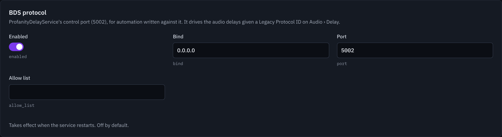
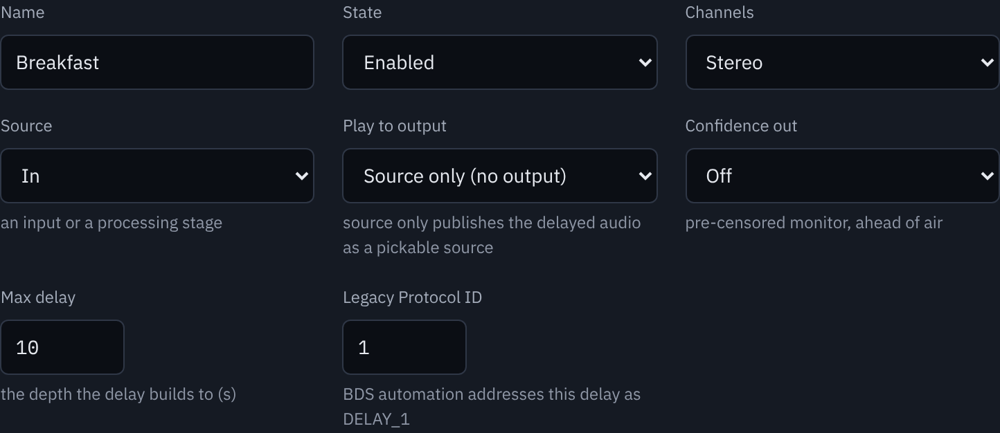

# BDS protocol

Airlock answers **BDS**, the TCP control protocol of the older ProfanityDelayService
(PDS), so automation written for a PDS profanity delay drives an Airlock audio
delay without changes. It is a separate listener from [TCP control](tcp.md), on
PDS's port **5002**, and it reaches the [audio delays](../audio/delay.md) only.

Use it when a playout system, a studio controller or a script already speaks to a
PDS box. For anything new, the [TCP control](tcp.md) port and the
[REST API](rest.md) are richer.

This page is the complete reference: every command, every reply and every push,
in the exact form they cross the wire, with what each does on an Airlock delay.

## Turning it on

The listener is **off by default**. Its settings are on **Server › Panel**, in the
**BDS protocol** card.

{ .shot }

| Setting | Console label | Config key | Default | Meaning |
|---|---|---|---|---|
| Listener on | Enabled | `bds.enabled` | `false` | Run the listener at all. |
| Bind address | Bind | `bds.bind` | `0.0.0.0` | Interface to listen on. `127.0.0.1` keeps it on this machine. |
| Port | Port | `bds.port` | `5002` | PDS's port. It must differ from the TCP control port. |
| Allow list | Allow list | `bds.allow_list` | *(empty)* | Comma-separated peer IP addresses allowed in. Empty = any. Loopback is **always** allowed. |

```json
"bds": { "enabled": true, "bind": "0.0.0.0", "port": 5002, "allow_list": "" }
```

The listener starts with the service: **restart** after turning it on or changing
its port. The log then says what it is serving:

```text
bds: 0.0.0.0:5002 (ProfanityDelayService protocol; DELAY_1=Breakfast, DELAY_2=Drive)
```

If the port is taken, the log names the process holding it. A peer not on the allow
list is disconnected at once and audited as `bds.denied`.

!!! note "Machine-local"
    The `bds` settings are this machine's own: a standby keeps its listener
    settings when it mirrors its primary.

## Give each delay its Legacy Protocol ID

PDS automation addresses a delay as `DELAY_1`, `DELAY_2` and so on — PDS called them
delay units. Give each audio delay the number your automation uses:
**Audio › Delay**, the delay's **Routing** tab, **Legacy Protocol ID**.

{ .shot }

- A whole number, 1 or more. Each delay needs its own; a save that gives two delays
  the same ID is refused, naming both.
- Blank keeps the delay off the BDS port. IDs can be added, changed or removed
  while the listener runs — the next command sees them.
- The ID is part of the delay's settings, so a standby answers to the same IDs as
  its primary.
- A delay's extra track pairs are not addressable on their own: they follow their
  delay, as they do on every other surface.

## The wire

- **TCP**, any number of clients at once, each independent.
- **ASCII lines.** A line ends at CR LF, LF or CR. Several commands may arrive in
  one packet. A command sent with **no** line ending still runs, once nothing more
  has arrived for 50 ms — PDS took each packet as whole commands, and some
  automation relies on it.
- **Replies end CR LF.**
- **Upper case.** Verbs and property names are matched exactly as PDS matched them:
  `GET`, not `get`. Mode values (`EXPAND`, `ROLLOUT`, …) and booleans are accepted
  in any case.

### Grammar

```text
LOGIN [anything]
GET DELAYUNITS
GET   DELAY_<id>.<PROPERTY>[,<PROPERTY>…]
SET   DELAY_<id>.<PROPERTY>=<value>[,<PROPERTY>=<value>…]
SUB   DELAY_<id>.<ITEM>[,<ITEM>…]
UNSUB DELAY_<id>.<ITEM>[,<ITEM>…]
```

- **One prefix per line.** `DELAY_<id>.` goes on the first item only; the rest of
  the comma list belong to the same delay:
  `SET DELAY_1.COUGH=TRUE,CENSOR=FALSE`. Spaces around items are ignored.
- **The id is matched as written**, as PDS did: `DELAY_01` is not `DELAY_1`.
- One line addresses one delay. To act on two, send two lines.

### Replies

| Reply | When |
|---|---|
| `USER LOGGED IN` | `LOGIN` |
| `STATUS DELAY_<id>.<P>=<v>[,<P>=<v>…]` | a `GET` — the whole reply upper-cased, as PDS's was |
| `STATUS` / `BEGIN` / `ID=… NAME=…` / `END` | `GET DELAYUNITS` |
| `SUB DELAY_<id>.<ITEM>=TRUE[,…]` then the current values | `SUB` |
| `SUB DELAY_<id>.<ITEM>=FALSE[,…]` | `UNSUB` (PDS used the `SUB` prefix for both) |
| *nothing* | a `SET` that did everything it asked — what it did arrives as pushes |
| `ERROR IN COMMAND - NOT LOGGED IN` | `SET`, `SUB`, `UNSUB`, `ADD` or `DEL` before `LOGIN` |
| `ERROR IN COMMAND` | anything else that was not understood or was refused (see [Troubleshooting](#troubleshooting)) |

## Session

| Send | Reply |
|---|---|
| `LOGIN` or `LOGIN <anything>` | `USER LOGGED IN` — there is no password, as in PDS. Use the allow list to say who may connect. |
| `GET …` before `LOGIN` | answered — PDS answered `GET` without a login, and monitoring relies on it |
| `SET`, `SUB`, `UNSUB`, `ADD`, `DEL` before `LOGIN` | `ERROR IN COMMAND - NOT LOGGED IN` |

Pushes that go to every client (state changes, safe, dumps, settings) reach every
connection, logged in or not.

## GET DELAYUNITS

Lists the delays that have a Legacy Protocol ID, in ID order:

```text
GET DELAYUNITS
STATUS
BEGIN
ID=1 NAME=Breakfast
ID=2 NAME=Drive
END
```

The line must be exactly `GET DELAYUNITS`. A delay with no ID is not listed and not
addressable.

## SET

A `SET` with several properties applies them in order: transport and cover
controls at once, settings together as **one** saved change at the end of the
line. It replies nothing when everything applied.

### Transport and covers

| Property | Values | Does on the Airlock delay |
|---|---|---|
| `DELAYCONTROL` | `BUILD` | **Build** — grow to **Max delay** in the delay's build mode. |
| | `DUMP` | **Dump** — remove **Dump size**, or cover what is held in censor dump mode. |
| | `DUMPALL` | **Dump all**. |
| | `EXIT` | **Exit** in the delay's exit mode. |
| `COUGH` | `TRUE` · `FALSE` | Pre-cough, **held**: `TRUE` withholds live from the delay until `FALSE`. |
| `CENSOR` | `TRUE` · `FALSE` | Pre-censor, **held** (the censor latch): covers from the point that is live now, until `FALSE`. |
| `POSTCOUGH` | `TRUE` · `FALSE` | Post-cough, held: silence at the air point now. |
| `CENSORPOST` | `TRUE` · `FALSE` | Post-censor, held: the censor cover at the air point now. |

Booleans are `TRUE`/`FALSE` in any case, or a number (`1` = true, `0` = false) —
VB's `CBool`, which PDS used. A `DELAYCONTROL` word other than the four applies
nothing.

### Settings

| Property | Values | Airlock setting | Range |
|---|---|---|---|
| `DELAYSIZE` | ms | **Max delay** | 500 – 120000 |
| `DUMPSIZE` | ms | **Dump size** (`0` = dump everything) | 0 – 120000 |
| `BUILDRATE` | percent | **Build rate** — the stretch while expanding | 1 – 10 |
| `EXITRATE` | percent | **Exit rate** — the squeeze while compressing | 1 – 10 |
| `DELAYBUILDMODE` | `EXPAND` · `INSERT` · `PREROLL` | **Build mode**: Expand · Insert · Pre-roll | |
| `DELAYEXITMODE` | `ROLLOUT` · `COMPRESS` | **Exit mode**: Play out (PDS's rollout) · Compress | |
| `DUMPMODE` | `DUMP` · `CENSOR` | **On a dump**: Remove the audio · Cover what is held | |
| `DELAYINSERTMODE` | `FILE` · `EXTERNAL` | **Fill** for an insert build: the asset · An input | |

A value outside its range, or one the delay's other settings make invalid (for
example `EXTERNAL` with no **Insert input** chosen), is refused with
`ERROR IN COMMAND` and nothing on the line is saved.

**Settings take effect on air.** A setting changed over BDS — or on the console, or
by REST — reaches the running delay without restarting it, so nothing it holds is
lost:

- A bigger **Max delay** grows the buffer in place. A build under way aims for the
  new size at once; a delay already in delay keeps its depth until it next builds
  (PDS's setter behaves the same).
- The build and exit modes are read when a build or an exit starts; a change made
  during one applies to the next.
- Each change is an ordinary saved setting: validated, audited as
  `audio_delay.settings` with origin `bds`, mirrored to a standby, and pushed to
  every BDS client.

### Modes, PDS to Airlock

| PDS | Airlock | What the audience hears |
|---|---|---|
| `DELAYBUILDMODE=EXPAND` | Build mode **Expand** | the programme, slowed by the build rate until the delay is full |
| `DELAYBUILDMODE=INSERT` | Build mode **Insert** | the fill (`FILE`: the fill asset, squeezed to span the build; `EXTERNAL`: the **Insert input**, live) while the delay fills in real time — from near live only; a rebuild after a dump or cough expands |
| `DELAYBUILDMODE=PREROLL` | Build mode **Pre-roll** | silence while the delay fills in real time, from any depth; a rebuild after a dump or cough expands |
| `DELAYEXITMODE=ROLLOUT` | Exit mode **Play out** | the delayed tail at normal speed, live joining for the last **Live joins for** ms |
| `DELAYEXITMODE=COMPRESS` | Exit mode **Compress** | the programme, sped up by the exit rate until it reaches live |
| `DUMPMODE=DUMP` | On a dump **Remove the audio** | a jump forward by the dump size, crossfaded |
| `DUMPMODE=CENSOR` | On a dump **Cover what is held** | everything the delay held at the press, covered by the censor cover; the depth is kept |
| `DELAYINSERTMODE=FILE` | Fill **Squeeze asset to span** (or **Silence**, if already set) | |
| `DELAYINSERTMODE=EXTERNAL` | Fill **An input (external insert)** | |

Two of Airlock's choices have no PDS word, and read back as the nearest one:
Exit mode **Rollout (crossfade to live)** reads as `ROLLOUT` (setting `ROLLOUT`
keeps it), and Fill **Silence** reads as `FILE`.

### Properties that are configuration here

PDS also let automation pick sound cards, open devices, manage data ports and time
dump files: `WAVEINDEVICE`, `WAVEOUTDEVICE`, `OPENDEVICES`, `DATAPORT.<id>.ENABLE`,
`DATAPORT.<id>.TX.<n>.ENABLE`, `UDPDATAPORT`, `DUMPWRITEWAITTIME`. On Airlock those
are configuration (audio inputs and outputs, data receivers and routes, dump
clips). On a line with other properties they are passed over; alone they answer
`ERROR IN COMMAND`. `ADD` and `DEL` (PDS's run-time ports) answer
`ERROR IN COMMAND` too.

## GET

```text
GET DELAY_1.DELAYSTATE,DELAYTIMESECONDS,DELAYSAFE,DELAYSIZE,DELAYBUILDMODE
STATUS DELAY_1.DELAYSTATE=IN DELAY,DELAYTIMESECONDS=10,DELAYSAFE=TRUE,DELAYSIZE=10000,DELAYBUILDMODE=EXPAND
```

| Property | Reply | Meaning |
|---|---|---|
| `DELAYSTATE` | `IDLE` · `BUILDING` · `EXITING` · `IN DELAY` | The state, PDS's words (`IN DELAY` has a space). A delay that is not running — disabled, or no source — is `IDLE`. |
| `DELAYSAFE` | `TRUE` · `FALSE` | The delay holds at least one whole dump. |
| `DELAYTIME` | ms | The depth **as last reported** — at the last state change, dump, or once-a-second update. This is what PDS's `DELAYTIME` meant; for the depth this instant use `DELAYEDSAMPLES`. |
| `DELAYTIMESECONDS` | s | The depth now, rounded (halves to even, as VB's `Math.Round`). |
| `DELAYEDSAMPLES` | ms | The depth now. (PDS's name; the value is milliseconds, as PDS's was.) |
| `AVGDELAYTIME` | ms | The depth now. |
| `TIMETOBUILD` | s | Seconds left in a build; `0` when not building. See [Timing](#timing). |
| `TIMETOEXIT` | s | Seconds left in an exit; `0` when not exiting. |
| `BUILDRATE` · `EXITRATE` | percent | As set. |
| `DELAYSIZE` · `DUMPSIZE` | ms | As set. |
| `DELAYBUILDMODE` | `EXPAND` · `INSERT` · `PREROLL` | As set. |
| `DELAYEXITMODE` | `ROLLOUT` · `COMPRESS` | As set. |
| `DUMPMODE` | `DUMP` · `CENSOR` | As set. |
| `DELAYINSERTMODE` | `FILE` · `EXTERNAL` | As set. |
| `WAVEINDEVICE` · `WAVEOUTDEVICE` | a `BEGIN`…`END` list | The delay's source and output, one `ID=0 NAME=…` line each (upper-cased, as PDS's lists were). |
| `PROCESSEDSAMPLES` · `UNPROCESSEDSAMPLES` · `DUMPWRITEWAITTIME` | `0` | PDS buffer internals with no meaning here. |

An unknown property is left out of the reply; a `GET` with no property Airlock
knows answers `ERROR IN COMMAND`.

## SUB and UNSUB

```text
SUB DELAY_1.BUILD,DELAYTIME,TIMETOBUILD
SUB DELAY_1.BUILD=TRUE,DELAYTIME=TRUE,TIMETOBUILD=TRUE
STATUS DELAY_1.DELAYTIME=9980
STATUS DELAY_1.TIMETOBUILD=0
```

| Item | The subscriber receives |
|---|---|
| `BUILD` | `STATUS DELAY_<id>.STATE=BUILDING DELAYTIME=<ms>` once a second while building |
| `EXIT` | `STATUS DELAY_<id>.STATE=EXITING DELAYTIME=<ms>` once a second while exiting |
| `DELAYTIME` | `STATUS DELAY_<id>.DELAYTIME=<ms>` |
| `DELAYTIMESECONDS` | `STATUS DELAY_<id>.DELAYTIMESECONDS=<s>` |
| `TIMETOBUILD` | `STATUS DELAY_<id>.TIMETOBUILD=<s>` |
| `TIMETOEXIT` | `STATUS DELAY_<id>.TIMETOEXIT=<s>` |

The four value items are pushed once a second while building or exiting; once a
second while idle or in delay **if the depth has moved more than 10 ms** since it
was last reported; and at the events in the table below. Subscribing to a value
item sends its current value at once, after the `SUB` line.

`UNSUB` takes the same items and stops them:

```text
UNSUB DELAY_1.TIMETOBUILD
SUB DELAY_1.TIMETOBUILD=FALSE
```

Subscriptions belong to the connection and end with it; they accumulate across
lines. A subscription is per delay: one to `DELAY_1` never receives `DELAY_12`'s
pushes.

## What is pushed

Airlock looks at every delay ten times a second, so a push follows its event within
about 0.1 s. "Every client" means every connection, logged in or not;
"subscribers" means connections subscribed to that item of that delay. Each line
is `STATUS DELAY_<id>.…`, CR LF.

| Event | Lines, in order | To |
|---|---|---|
| → **idle** | `DELAYSTATE=IDLE`, `ROLLOUTOVERLAP=INACTIVE` | every client |
| | `DELAYTIMESECONDS=0`, `TIMETOBUILD=0`, `TIMETOEXIT=0` | subscribers |
| → **building** | `DELAYSTATE=BUILDING` | every client |
| → **exiting** | `DELAYSTATE=EXITING` | every client |
| → **in delay** | `DELAYTIME=<ms>`, `DELAYTIMESECONDS=<s>` (subscribers), `DELAYSTATE=IN DELAY` (every client), `TIMETOBUILD`, `TIMETOEXIT` (subscribers) | as marked |
| a **dump** or **dump all** | `DELAYSTATE=DUMPING`, `DELAYTIME=<ms left>` | every client |
| | `DELAYTIME`, `DELAYTIMESECONDS`, `TIMETOBUILD`, `TIMETOEXIT` | subscribers |
| | then the state change, if any (a rebuild → building; emptied → idle) | |
| a dump in **CENSOR** dump mode | `DELAYTIME=<ms>` — nothing was removed, so no `DUMPING` | every client |
| becomes **safe** / **unsafe** | `DELAYSAFE=TRUE` / `DELAYSAFE=FALSE` | every client |
| live starts joining the tail of an exit | `ROLLOUTOVERLAP=ACTIVE` | every client |
| a **setting** changes, from any surface | each that changed, in this order: `BUILDRATE=`, `EXITRATE=`, `DELAYSIZE=`, `DUMPSIZE=`, `DELAYBUILDMODE=`, `DELAYEXITMODE=`, `DUMPMODE=`, `DELAYINSERTMODE=` | every client |
| every second, **building** | `DELAYTIME`, `DELAYTIMESECONDS`, `TIMETOBUILD`, `STATE=BUILDING DELAYTIME=<ms>`, `TIMETOEXIT` | subscribers of each |
| every second, **exiting** | the same, with `STATE=EXITING DELAYTIME=<ms>` | subscribers of each |
| every second, idle or in delay, depth moved > 10 ms | `DELAYTIME`, `DELAYTIMESECONDS`, `TIMETOBUILD`, `TIMETOEXIT` | subscribers of each |

When several things happen at once they arrive in this order: the dump, the state
change, safe, the rollout overlap, the settings, then the once-a-second values.

## Timing

All arithmetic is PDS's, so automation that counts down from these numbers keeps
working:

| Value | While | Is |
|---|---|---|
| `DELAYTIMESECONDS` | always | depth ms ÷ 1000, rounded half to even |
| `TIMETOBUILD` | building by **Expand** (and every rebuild after a dump or cough) | (size − depth) ÷ (build rate ÷ 100) ÷ 1000 |
| | building by **Insert** or **Pre-roll** | (size − depth) ÷ 1000 — the delay grows in real time |
| `TIMETOEXIT` | exiting by **Compress** | depth ÷ (exit rate ÷ 100) ÷ 1000 |
| | exiting by **Play out** | depth ÷ 1000 — the tail airs at normal speed |

Times are seconds, rounded half to even. Depths and sizes are milliseconds.
Example: a 10 s delay building by Expand at 4 % from 2 s has
(10000 − 2000) ÷ 0.04 ÷ 1000 = 200 s to go.

## Worked sessions

A build from idle, watched by a subscriber:

```text
LOGIN
USER LOGGED IN
SUB DELAY_1.BUILD,TIMETOBUILD
SUB DELAY_1.BUILD=TRUE,TIMETOBUILD=TRUE
STATUS DELAY_1.TIMETOBUILD=0
SET DELAY_1.DELAYCONTROL=BUILD
STATUS DELAY_1.DELAYSTATE=BUILDING
STATUS DELAY_1.TIMETOBUILD=248
STATUS DELAY_1.STATE=BUILDING DELAYTIME=38
STATUS DELAY_1.TIMETOBUILD=247
STATUS DELAY_1.STATE=BUILDING DELAYTIME=79
   … once a second …
STATUS DELAY_1.DELAYSAFE=TRUE
   …
STATUS DELAY_1.DELAYSTATE=IN DELAY
STATUS DELAY_1.TIMETOBUILD=0
```

A dump that rebuilds (dump size 7 s from a 10 s delay):

```text
SET DELAY_1.DELAYCONTROL=DUMP
STATUS DELAY_1.DELAYSTATE=DUMPING
STATUS DELAY_1.DELAYTIME=3004
STATUS DELAY_1.DELAYSTATE=BUILDING
STATUS DELAY_1.DELAYSAFE=FALSE
```

The same press with `DUMPMODE=CENSOR` — covered, nothing removed:

```text
SET DELAY_1.DELAYCONTROL=DUMP
STATUS DELAY_1.DELAYTIME=10000
```

A pre-roll from live, then a dump that rebuilds by stretching:

```text
SET DELAY_2.DELAYBUILDMODE=PREROLL,DELAYSIZE=3000
STATUS DELAY_2.DELAYSIZE=3000
STATUS DELAY_2.DELAYBUILDMODE=PREROLL
SET DELAY_2.DELAYCONTROL=BUILD
STATUS DELAY_2.DELAYSTATE=BUILDING
STATUS DELAY_2.TIMETOBUILD=3
STATUS DELAY_2.TIMETOBUILD=2
STATUS DELAY_2.DELAYSAFE=TRUE
STATUS DELAY_2.TIMETOBUILD=1
STATUS DELAY_2.DELAYSTATE=IN DELAY
SET DELAY_2.DELAYCONTROL=DUMP
STATUS DELAY_2.DELAYSTATE=DUMPING
STATUS DELAY_2.DELAYTIME=1523
STATUS DELAY_2.TIMETOBUILD=15
STATUS DELAY_2.DELAYSTATE=BUILDING
```

A play-out exit (`DELAYEXITMODE=ROLLOUT`):

```text
SET DELAY_1.DELAYCONTROL=EXIT
STATUS DELAY_1.DELAYSTATE=EXITING
STATUS DELAY_1.DELAYSAFE=FALSE
STATUS DELAY_1.ROLLOUTOVERLAP=ACTIVE
STATUS DELAY_1.DELAYSTATE=IDLE
STATUS DELAY_1.ROLLOUTOVERLAP=INACTIVE
```

A held cough and censor, and a change of size on air — `SET` replies nothing, and
the size change reaches every client:

```text
SET DELAY_1.COUGH=TRUE,CENSOR=TRUE
SET DELAY_1.COUGH=FALSE,CENSOR=FALSE
SET DELAY_1.DELAYSIZE=12000
STATUS DELAY_1.DELAYSIZE=12000
```

## Moving a PDS Axia GPIO map across

PDS's Axia pins map onto an Airlock audio delay's GPIO rows (**Data › Axia GPIO**;
a row drives a delay by naming it as the row's stage). Full detail is on the
[audio delay page](../audio/delay.md#axia-gpio).

**Controls** (GPI in):

| PDS pin | Airlock action | Edge |
|---|---|---|
| `build` | `build` | Press |
| `exit` | `rollout` (the delay's exit mode) | Press |
| `rollout` | `playout` (exit by playing out, this exit only) | Press |
| `compress` | `compress` (exit by compressing, this exit only) | Press |
| `dump`, `dumpall` | `dump`, `dumpall` | Press |
| `cough`, `coughpost` | `cough`, `coughpost` | Follow the level (held) |
| `censor` | `censor` | Follow the level — covers while held |
| `censorpost` | `censorpost` | Follow the level (held) |
| `forcecensoroff` | `forcecensoroff` | Press |
| `static1`–`10`, `pulse1`–`10` | a GPIO **relay** riding the delay | — |
| `reload` | not provided — restarting a delay throws away the audio it holds | — |

**Statuses** (lamps out) — PDS's names are accepted as written and stored under
Airlock's:

| PDS status | Airlock lamp |
|---|---|
| `idle` | `delayIdle` |
| `build` · `buildtrig` | `stateBuilding` · `buildtrig` |
| `exit` · `exittrig` | `stateRollingOut` · `exittrig` |
| `indelay` | `stateDelayed` |
| `delaysafe` | `delaySafe` |
| `precensor` · `precensortrig` | `censorActive` · `censortrig` |
| `postcensor` · `postcensortrig` | `censorPostActive` · `censorPosttrig` |
| `cough` · `coughtrig` | `coughActive` · `coughtrig` |
| `postcough` · `postcoughtrig` | `coughPostActive` · `coughPosttrig` |
| `dumptrig` · `dumpalltrig` | `dumptrig` · `dumpalltrig` |
| `delayfull` · `delayfulltrig` | `delayFull` · `delayfulltrig` |
| `delayempty` · `delayemptytrig` | `delayEmpty` · `delayemptytrig` |
| `rolloutendtrig` | `rolloutendtrig` |
| `rolloutoverlap` · `rolloutoverlaptrig` | `rolloutOverlap` · `rolloutoverlaptrig` |
| `playbackstopped` | `playbackStopped` |
| `delay10` … `delay100` | the same — lit while the depth is within 2 % of that percentage of **Max delay** |
| `delay10static` … `delay100static` | the same — lit at or above it (a bar graph) |

Airlock adds `inserting` (the fill, an input or pre-roll silence on air in place
of the programme) and `dumpCover` (a censor dump covering).

## On a standby

A locked standby answers every control and setting with `ERROR IN COMMAND`, and
audits the refusal (`control.locked`, or a refused `audio_delay.settings`). `GET`
and `SUB` keep working, so a monitoring system can watch both boxes. A standby that
has taken over answers like a primary.

## Audit

Every control and setting is in **Server › Audit log** with origin `bds` and the
peer's address:

| Action | Detail |
|---|---|
| `stage.control` | `bds DELAY_1 (Breakfast) DELAYCONTROL=DUMP` |
| `audio_delay.settings` | `bds DELAY_1 (Breakfast) DELAYSIZE=12000` |
| `control.locked` | a control refused on a locked standby, with the reason |
| `bds.denied` | a connection from an address not on the allow list |

## Differences from PDS

Airlock follows PDS's parser, replies and pushes, and leaves out PDS's faults:

- A subscription to `DELAY_1` does not receive `DELAY_12`'s pushes (PDS matched the
  first character).
- The 10 ms dead-band works both ways (PDS's `Range(start, count)` swallowed most
  rises).
- `EXITRATE` is pushed with the exit rate (PDS sent the build rate).
- `SET …DUMPMODE=…` alone is accepted (PDS applied it and answered an error).
- `TIMETOBUILD` and `TIMETOEXIT` can be unsubscribed.
- A `PREROLL` from a part-full delay is silent only for what is missing (PDS waited
  the whole delay size and overshot), and a rebuild after a dump stretches (PDS
  pre-rolled again, putting dead air on air after every dump).
- A `CENSOR` dump covers what the delay holds (PDS covered the delay size, which
  on a part-built delay ran into new audio); a censor file plays once, then
  silence, rather than stopping the cover early.
- An unknown first `GET` item does not leave a stray comma in the reply.
- `SUB` puts the current values after the reply line (PDS spliced them into it,
  which broke the reply when a value item was not last).
- A line with a value that cannot be read applies nothing (PDS could apply the
  items before it).
- A setting is pushed when it changes, not every time it is set.

## Troubleshooting

| Symptom | Cause |
|---|---|
| Nothing answers on 5002 | The listener is off, or the service has not been restarted since it was turned on. The log's `bds:` line says what it serves; a bind failure names the process holding the port. |
| The connection closes at once | The peer is not on the allow list (`bds.denied` in the audit log). |
| `GET DELAYUNITS` lists nothing | No audio delay has a **Legacy Protocol ID**. |
| `ERROR IN COMMAND` for `DELAY_3` | No delay has ID 3, or the line has no `DELAY_<id>.` prefix, or the id is written differently (`DELAY_03`). |
| `ERROR IN COMMAND - NOT LOGGED IN` | Send `LOGIN` first on this connection. |
| A `SET` answers nothing | That is success — watch the pushes, or `GET` the property. |
| A setting answers `ERROR IN COMMAND` | The value is out of range or invalid with the delay's other settings (the audit log's `audio_delay.settings` entry says which), or this is a locked standby. |
| `DELAYCONTROL` answers `ERROR IN COMMAND` | The delay is disabled, or this is a locked standby. |
| Subscribed, but no `DELAYTIME` pushes | In delay and steady, the depth is not moving: values are pushed when it moves more than 10 ms. |

## Testing it by hand

```text
$ nc airlock.example 5002
LOGIN
USER LOGGED IN
GET DELAYUNITS
STATUS
BEGIN
ID=1 NAME=Breakfast
END
SUB DELAY_1.BUILD
SUB DELAY_1.BUILD=TRUE
SET DELAY_1.DELAYCONTROL=BUILD
STATUS DELAY_1.DELAYSTATE=BUILDING
STATUS DELAY_1.STATE=BUILDING DELAYTIME=412
STATUS DELAY_1.STATE=BUILDING DELAYTIME=817
```

On Windows, PuTTY in **Raw** mode (or `telnet airlock.example 5002`) does the same.
