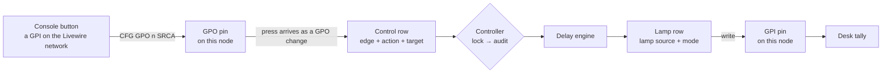
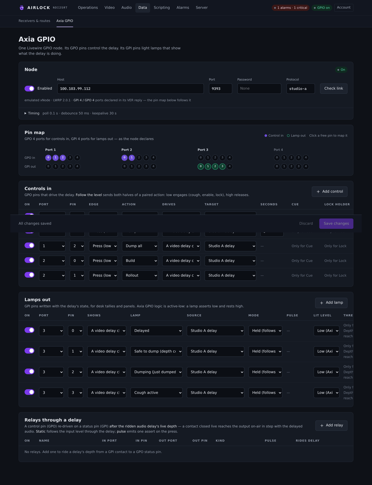

# Axia GPIO

Studio contacts drive the delay, and the delay's state drives lamps back out, over
the Livewire Routing Protocol (LWRP) — one long-lived TCP session to an Axia
xNode or IP-Driver. This chapter covers connecting a node, mapping pins in both
directions, the timing settings, and the three things about Axia GPIO that are
easy to get wrong.



## Three things to get right

These cost a bench run each. They are worth saying plainly before anything else.

!!! warning "Controls ride GPO; lamps ride GPI"
    GPI and GPO are named from the **Livewire network's** point of view, not
    yours. A GPI is an input *into* that world, so Airlock's tallies are written
    there. A GPO is an output *out of* it, tied by `CFG GPO n SRCA:"…"` to a GPI
    somewhere else on the network — and an operator's console button is that
    far-end GPI. So **the press arrives as a GPO pin change**.

    Writing lamps to GPI needs a device with **writable GPIs** (an IP-Driver or a
    console's virtual GPIO). A physical xNode's GPIs are read-only, and the lamps
    will not light.

!!! warning "Pins are 0-based"
    `pin: 1` is the **second** of the five pins on a port. The console's pin
    selectors show 0–4; the node's own labelling is usually 1–5.

!!! warning "Edge characters are uppercase"
    On the wire, `l` and `h` are steady low and high; `L` and `H` are a
    transition *to* low and high. A node upper-cases only the pins that actually
    moved, so an all-lowercase line means "nothing moved" and fires nothing. That
    is also what makes the initial pin dump and every reconnect safe: they carry
    steady characters only, so a reconnect can never replay a dump.

## Connecting a node

**Data › Axia GPIO**, the **Node** card.

{ .shot }

| Setting | Console label | Config key | Default | Meaning |
|---|---|---|---|---|
| GPIO on | Enabled | `gpio.enabled` | `false` | Connect to the node at all. Rows are kept while it is off. |
| Node address | Host | `gpio.host` | *(empty)* | The node's IP address or host name. |
| Node port | Port | `gpio.port` | `93` | LWRP listens on 93. |
| Node password | Password | `gpio.password` | *(empty)* | Sent as `LOGIN <password>`. Empty sends a bare `LOGIN`, which is still required before a node accepts pin writes. |
| Short name | Protocol | `gpio.device` | `lwrp` | A short name for this node in the log, in the audit principal and on the page — `axia-studio-a/2.3` reads better than an address. |

```json
"gpio": {
  "enabled": true, "host": "10.20.4.60", "port": 93, "password": "", "device": "axia",
  "poll_s": 1.0, "debounce_ms": 50, "hysteresis_pct": 2.0,
  "dump_lamp_s": 2.0, "keepalive_s": 30.0,
  "inputs": [ … ], "outputs": [ … ], "relays": [ … ]
}
```

**Check link** reads the engine's own session state back to you: connected, with
the node name and the command and connect counters; or not connected, with the
last error and the reconnect count. It is a read, not a dial — the engine keeps
the session itself, and it connects to what is **saved**, not to what is typed,
so save first.

Changing any `gpio` setting reconnects without restarting the program.

### More than one node

A site with several Axia boxes lists them in `gpio.nodes[]`, each its own LWRP
connection on its own address. A row then names the node it is on with `node`
(the node's `device` name); an empty `node` means the first.

```json
"gpio": { "nodes": [
  { "enabled": true, "device": "studio-a", "host": "10.20.4.60", "port": 93, "password": "" },
  { "enabled": true, "device": "studio-b", "host": "10.20.4.61", "port": 93, "password": "" }
] }
```

When `nodes` is empty, the single `host`/`port`/`password`/`device` above is
used.

## The pin map

The **Pin map** card lays out the node's ports as a grid: a **GPO in** row for
controls and a **GPI out** row for lamps, five pins each. Mapped pins are
coloured — filled for a control, outlined for a lamp — and dim when the row is
switched off. Click a free pin to map it.

The grid follows what the node declared in its `VER` reply: `NGPO` ports for
controls in, `NGPI` for lamps out. Until the node has answered, the page shows
the xNode shape — four ports. A line under the Node card says which you are
looking at.

A row that names a port beyond what the node declares is kept and flagged — *"2
rows name ports beyond what the node declares (GPO 4 / GPI 4). The engine will
never see those pins."*

## Controls in

A **Controls in** row is a GPO pin that drives something.

| Column | Config key | Default | Meaning |
|---|---|---|---|
| On | `enabled` | `true` | Use this row. |
| Port | `port` | `1` | GPIO port on the node, 1-based as the node numbers them. |
| Pin | `pin` | `0` | Pin within the port, **0-based**. |
| Edge | `edge` | `LOW` | Which transition fires — see below. |
| Action | `action` | `dump` | What it does. |
| Drives | — | channel | Whether the row targets a channel, a stage, or many blocks. |
| Target | `channel` / `stage` / `targets` | `1` | Which block or blocks. |
| Seconds | `seconds` | `0` | Dump length, or break length for a cue, 0–600. `0` uses the channel's configured dump length. |
| Cue | `cue` | *(empty)* | A cue row's kind. Empty means `out_now`. |
| Lock holder | `holder` | *(empty)* | The leader name a `lock` row claims for. Empty uses the pin. |
| — | `kind` | `any` | Channel-kind filter. Every delay channel here is a **video** channel that carries its audio, so `any` or `video` match and `audio` is refused at save. |
| — | `node` | *(empty)* | Which node this row is on. Empty = the first. |

### Actions

| `action` | Console label | What it does |
|---|---|---|
| `build` | Build | start filling the buffer |
| `dump` | Dump | dump the row's `seconds` (0 = the channel's configured length) |
| `dumpall` | Dump all | dump everything |
| `rollout` | Rollout | return to live (`exit` is accepted as a synonym) |
| `cough` | Cough | momentary censor |
| `enable` | Enable delay | set the delay's run flag and start it |
| `disable` | Disable delay | clear the flag and stop it |
| `lock` | Lock | claim the channel for `holder` |
| `unlock` | Unlock | release it |
| `cue` | Cue ad break (SCTE) | originate a cue of kind `cue`, length `seconds` (`trigger` is accepted as a synonym) |
| `censor` | Censor (stage) | **stage only** — a one-shot cover |
| `bypass` | Bypass (stage) | **stage only** |
| `coughpost` | Post-cough (stage) | **stage only**, held |
| `censorpost` | Post-censor (stage) | **stage only**, held |

A cue row's kind is `out_now` (the default, and the immediate break start a
button is nearly always for), `in_now`, `out`, `in`, `cancel` or `time_signal`.

### Edges

| `edge` | Console label | Behaviour |
|---|---|---|
| `LOW` | Press (low) | fires on the press — the `L` transition. Axia GPIO is active-low, so this is the normal momentary button, and the default. |
| `HIGH` | Release (high) | fires on the release. |
| `BOTH` | Follow the level | follows the level, for a latching switch: low sends the action, high sends its off half — cough on/off, enable/disable, lock/unlock. |

A `BOTH` row is **never debounced** (an "off" must never be swallowed and leave
the state latched) and it **reconciles**: a steady indication that contradicts
the last level that was commanded fires the correcting half, so an edge lost to a
dropped session cannot leave the engine stuck on.

### Debounce

Everything else gets a per-channel debounce of `gpio.debounce_ms` (50 ms by
default). **Dump and dump-all are exempt** — the escape hatch must never lose a
race against a bouncing contact.

### One pin, many blocks

Set **Drives** to *Many blocks (fan-out)* and the row carries a `targets` list
instead of a single channel. Each entry is `kind:id`:

| Prefix | Target |
|---|---|
| `delay:2` | a video delay channel |
| `stage:fm` | an audio stage or audio delay |
| `encoder:2` · `decoder:2` | a video encoder or decoder |
| `aenc:web` · `adec:studio` | an audio encoder or decoder |

The action runs on every target it is valid for. A fan-out overrides `channel`
and `stage`.

```json
{ "enabled": true, "port": 2, "pin": 0, "edge": "LOW", "action": "dump",
  "targets": ["delay:1", "delay:2", "stage:studio-dump"] }
```

### Every pin goes through the same seam

A GPIO command reaches the engine through the same controller as the console,
REST and TCP, so **the channel lock is consulted and the audit entry is written
by construction**. The audit line names the pin — numbered 1-based, as a console
labels it, although the configuration numbers it from 0:

```text
audit  gpio  axia/2.1  delay.build  at 0.00 s
audit  gpio  axia/2.2  delay.dump   4 s at 9.98 s
audit  gpio  axia/2.1  delay.build  at 7.48 s — refused: LOCKED: the delay is locked to studio-a …
```

A refusal is **logged and dropped** — never retried, and never left wedging a
pin: the level record has already moved on, so the release still fires.

!!! note "GPIO is never licence-gated"
    An Axia pin is plant integration, not the panel product, and a contact
    closure has nowhere to show a refusal — gating it would be exactly the silent
    no-op this design avoids. Unlike the TCP control port, GPIO needs no `PANEL`
    feature.

## Lamps out

A **Lamps out** row is a GPI pin written with the delay's state.

| Column | Config key | Default | Meaning |
|---|---|---|---|
| On | `enabled` | `true` | Use this row. |
| Port | `port` | `1` | GPIO port, 1-based. |
| Pin | `pin` | `0` | Pin within the port, **0-based**. |
| Shows | — | channel | Whether the lamp follows a channel, a stage, or many blocks. |
| Lamp | `lamp` | `inDelay` | The status source. |
| Source | `channel` / `stage` / `sources` + `aggregate` | `1` | Which block, or which set. |
| Mode | `mode` | `held` | `held` follows the level; `pulse` fires once. |
| Pulse | `pulse_ms` | `100` | Pulse length in ms. |
| Lit level | `active_level` | `low` | The level the pin is driven to while lit. Axia GPIO logic is active-low. |
| — | `resting_level` | `high` | The level it rests at. |
| Threshold | `threshold_s` | `0` | `depthReached` only: the depth that lights it. `0` = the configured delay depth. |
| — | `node` | *(empty)* | Which node. Empty = the first. |

### The lamp catalogue

| `lamp` | Console label | Kind | Lights when |
|---|---|---|---|
| `inDelay` | In delay (building, delayed or rolling out) | level | building, delayed or rolling out — the canonical "we are delaying" tally |
| `stateLive` | Live | level | the delay is live |
| `stateBuilding` | Building | level | the delay is building |
| `stateDelayed` | Delayed | level | the delay is at depth |
| `stateRollingOut` | Rolling out | level | the delay is rolling out |
| `running` | Delay running | level | the block is running at all |
| `delaySafe` | Safe to dump (depth covers the dump) | level | the depth covers the dump window (±5 %) |
| `delayFull` | Depth full (≥ 99 %) | level | depth ≥ 99 % of target |
| `delayEmpty` | Depth empty (≤ 1 %) | level | depth ≤ 1 % of target |
| `depth10` … `depth100` | Depth ≥ N % | level | depth ≥ N % of target — a meter-bridge gauge |
| `depthReached` | Depth reached (a threshold) | level | depth ≥ the row's `threshold_s` |
| `dumping` | Dumping (just dumped) | level | a dump happened within the last `dump_lamp_s` |
| `sourceLost` | Source lost | level | the delay is running and its source is not arriving |
| `serverAlarm` (`alarmActive`) | Any alarm active | level | any alarm is active |
| `lockHeld` | Lock held | level | the channel lock is held |
| `coughActive` | Cough active | level | a cough is in effect |
| `dumped` | Dump happened (pulse) | **event** | a dump executed |
| `dumpedAll` | Dump-all happened (pulse) | **event** | a dump left the buffer empty |
| `built` | Built (pulse) | **event** | the delay reached its target |
| `wentLive` | Went live (pulse) | **event** | the delay returned to live |

An audio stage adds its own: `censorActive`, `coughPostActive`,
`censorPostActive`, `delayIdle`, and the legacy trigger set (`buildtrig`,
`exittrig`, `dumptrig`, `dumpalltrig`, `delayfulltrig`, `delayemptytrig`,
`coughtrig`, `censortrig`, `coughPosttrig`, `censorPosttrig`,
`rolloutoverlaptrig`). An aggregate lamp can also read `onAir`, `connected` and
`noStream`; a name a block does not know is simply left dark.

### Held and pulse

`held` holds the pin at `active_level` while the source is true and drives it to
`resting_level` when it clears.

`pulse` fires `pulse_ms` at the active level and returns. An **event** source can
only ever be a pulse — the console forces the mode when you pick one. A **level**
source in pulse mode fires once as it becomes true.

A pulse encodes a moment, so a reconnect **converges a pin to its rest and never
re-fires one**. If a source re-activates mid-pulse, the current pulse completes
and then exactly one more fires.

### Dump lamp timing

`dumping` is a level lamp with a tail: it lights the moment a dump executes and
stays lit for `gpio.dump_lamp_s` (2 s by default). That is what makes a dump
visible on a desk tally, where the dump itself is instantaneous. Use `dumped` as
a pulse instead if the desk wants a momentary trigger.

### Depth lamps have hysteresis

A depth threshold lights at its level and stays lit until the depth falls
`gpio.hysteresis_pct` of target below it (2 % by default), so a lamp does not
chatter on the boundary.

### One lamp per pin

Writes are **diff-only against confirmed state**, and confirmed state comes only
from the node's own indications — the node echoes every write back, and that echo
is the only thing trusted. Nothing is written before the initial dump has said
what a port is doing, a pin is not rewritten while its echo is in flight, and the
`poll_s` tick re-asserts anything that has drifted (someone else moving the pin).

Only the named pin is touched, so two rows on one port cannot clobber each other
— but **one enabled row per lamp pin** is enforced when the configuration is
saved, because two writers on one output flap the hardware. Control pins stack
freely: many readers of one input are harmless.

### One lamp, many blocks

Set **Shows** to *Many blocks (aggregate)*: the lamp is evaluated against every
entry in `sources` (the same `kind:id` form as a control fan-out) and combined by
`aggregate` — `any` lights if any source is lit, `all` only if every one is.

## Relays through a delay

A **relay** re-drives a control pin on a status pin **after an audio delay's
current depth**, so a contact closed live reaches the output on air at the same
moment the live audio does.

| Column | Config key | Default | Meaning |
|---|---|---|---|
| On | `enabled` | `true` | Use this relay. |
| Name | `name` | *(empty)* | A short name, in the log and the audit principal. |
| In port / In pin | `in_port` / `in_pin` | `1` / `0` | The control (GPO) pin whose edges it follows. |
| Out port / Out pin | `out_port` / `out_pin` | `1` / `1` | The status (GPI) pin it drives. |
| Kind | `kind` | `static` | `static` follows the input level through the delay; `pulse` emits one assert on the press. |
| Pulse | `pulse_ms` | `300` | Pulse width for `kind: "pulse"`. |
| Rides delay | `delay` | *(empty)* | The audio delay whose live depth the relay rides. |
| — | `node` | *(empty)* | The node both pins live on. Same node only. |

Both edges are delayed by the buffer depth, and at zero depth the relay is
immediate. A relay needs an audio delay to ride: with none configured the card
says so and points you at **Audio › Delay**.

## Timing settings

The **Timing** section of the Node card.

| Setting | Console label | Config key | Default | Meaning |
|---|---|---|---|---|
| Lamp tick | Poll every | `gpio.poll_s` | `1.0` | How often held lamps are re-evaluated and any drift re-asserted. Also the pulse resolution. |
| Debounce | Debounce | `gpio.debounce_ms` | `50` | Per-channel debounce for control pins. Dump, dump-all and level-following rows are exempt. |
| Hysteresis | Hysteresis | `gpio.hysteresis_pct` | `2.0` | How far below a depth threshold a lamp stays lit, as a percentage of target. |
| Dump lamp hold | Dump lamp hold | `gpio.dump_lamp_s` | `2.0` | How long a `dumping` lamp stays lit after a dump. |
| Keepalive | Keepalive | `gpio.keepalive_s` | `30.0` | How often a liveness probe is sent. LWRP has no keepalive of its own. |

## The session

One socket. `LOGIN` is always sent — a node otherwise accepts subscriptions and
silently drops writes — then a version query, then subscriptions to the GPI and
GPO tables. A periodic probe every `keepalive_s` doubles as the liveness check;
an interval that goes unanswered drops the socket.

What the node declares — its name, the LWRP version, `NGPI` and `NGPO` — is
published on `GET /api/gpio` and in the state feed, and the page lays its pin
grid out from it.

Reconnect is exponential and capped — 1 s, 2 s, 4 s … 60 s, with jitter so a rack
of boxes does not resynchronise on a node reboot. A session that got as far as
the version reply restarts the ladder.

## Alarms

A node unreachable for 5 seconds raises **`ALARM_GPIO_DOWN`** (warning, block
`gpio`): GPIO controls are dead and the lamps are stale. It clears on the next
session, and goes out over email, webhooks and SNMP like every other alarm.

| Where | What you see |
|---|---|
| Console header | the **GPIO on** / **GPIO down** pill, whenever GPIO is enabled |
| Panel page | the **gpio** chip: `off`, `up` or `DOWN` |
| Axia GPIO page | the Node card's declared line, and **Check link** |
| REST | `GET /api/gpio` — session, capabilities, confirmed pin states, counters, rows and catalogues |
| Log | `gpio: axia/2.1 → build`, and `… refused: …` |

## Cough

Cough is complete on every surface: the GPIO action, the console button, the
panel button, `POST /api/channels/{n}/delay/cough?on=`, the TCP verb, the channel
lock and the audit entry. On the engine it censors while held, with the
configured lead-in and tail. The `coughActive` lamp follows the engine's own
state, not the pin — so a cough started from the console lights the desk tally
too.

Map it as a `BOTH` row and the switch behaves exactly like the studio button:
low engages, high releases, and a lost edge is reconciled.

## Redundancy

The **node connection** (`enabled`, `host`, `port`, `password`, `device`) is
**machine-local**. A node is wired to one box, and two instances writing one
node's lamp pins would fight over them — so a standby keeps its own, and you
configure each box's node separately.

The **mapping rows and their timing** (`inputs`, `outputs`, `relays`, `poll_s`,
`debounce_ms`, `hysteresis_pct`, `dump_lamp_s`, `keepalive_s`) are **replicated**.
After a takeover the same button must still dump and the same lamp must still
light.

While an instance is a standby its controls are locked, so a GPIO press is
refused and audited like any other surface — except dump and rollout once the
local-control window has expired. See
[Operating a standby](../redundancy/standby.md).

## Validation at save

A configuration save refuses, naming the row and the reason:

- GPIO is enabled with no node host;
- `port` below 1 (ports are 1-based) or `pin` outside 0–4 (pins are 0-based);
- an `edge` that is not `LOW`, `HIGH` or `BOTH` — uppercase, as the wire's
  transition characters are;
- an unknown `action` or `lamp` name, or one that is not valid for the row's
  target (a stage-only action on a channel row, or the reverse);
- a fan-out or aggregate target that does not parse, or that names a block this
  box does not have;
- `seconds` outside 0–600;
- a `channel` that is not configured;
- a `node` name that is not a configured Axia node;
- a `kind` of `audio` — every delay channel here carries its audio with the
  pictures, so that row could never match;
- a cue row whose `cue` kind is not one of the accepted words;
- two enabled lamp rows on the same pin;
- a relay with no name;
- a timing value out of range (`poll_s` 0.05–60, `keepalive_s` 1–600,
  `debounce_ms` 0–5000, `hysteresis_pct` 0–50, `dump_lamp_s` 0–60).

## Troubleshooting

| Symptom | Likely cause |
|---|---|
| Nothing fires when the operator presses the button | the row is on a GPI pin — **controls ride GPO**; or the pin number is off by one, because pins are 0-based |
| The wrong thing fires | off-by-one again: `pin: 1` is the second pin |
| Lamps never light | the node's GPIs are read-only (a physical xNode); you need an IP-Driver or console virtual GPIO |
| Lamps light but then go out | two enabled rows are writing one pin, or something else on the network is moving it — the `poll_s` tick re-asserts, so look for a flap |
| A latching switch leaves the cough stuck on | use `edge: "BOTH"`, which sends both halves and reconciles a lost edge |
| A dump is missed when the contact bounces | it should not be — dump and dump-all are exempt from debounce; check the row is on the right pin and edge |
| The dump lamp flashes too briefly to see | raise `gpio.dump_lamp_s`, or use the `dumped` event lamp as a pulse |
| A depth lamp chatters on the boundary | raise `gpio.hysteresis_pct` |
| A pulse lamp re-fires on reconnect | it should not — a reconnect converges a pin to rest; if it does, something else is driving the pin |
| **GPIO down** in the header | the node is unreachable; **Check link** shows the last error and the reconnect count |
| Commands are accepted and audited as `refused: LOCKED` | the channel lock is held by another surface, or this box is a standby |
| **Check link** says *Save first* | the engine connects to what is saved; the page has unsaved changes |
| A row is flagged *beyond the node* | it names a port higher than the node's declared `NGPI` / `NGPO`; the engine will never see that pin |
