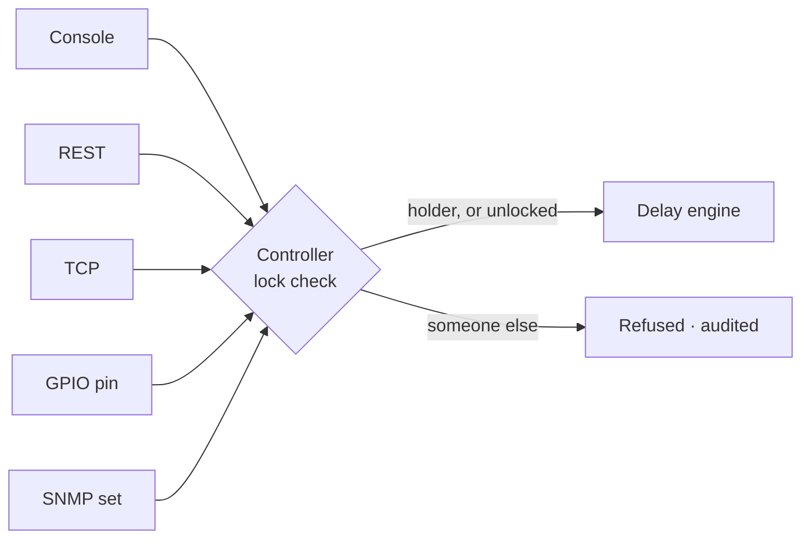

# Channel lock

The channel lock claims a delay for one leader. While it is held, every other
surface is refused the on-air controls until the holder gives it back — or an
administrator takes it. This page covers taking and releasing a lock, exactly
what is refused, how the refusal reads on each surface, the force release, and
what the audit log records.

<!-- SHOT: control/lock.png — the Delay card header showing the Locked pill beside the channel name, with Settings / Disable / Stop to its right -->

## What a lock is

A lock is a claim by whoever is on shift, not a setting:

| Field | What it is |
|---|---|
| `holder` | the name everyone sees, for example `studio-a` |
| `principal` | what is actually compared — a user name over the web and REST, an API client id, the peer address over TCP, the pin on a GPIO row |
| `origin` | `web`, `rest`, `tcp`, `window`, `snmp`, `gpio` or `script` |
| `taken_at` | when it was claimed |
| `note` | free text, shown in the refusal: `— ad break` |

!!! note
    The lock is **runtime state, not configuration**. It is not written to the
    configuration file, it is not mirrored to a redundancy backup, and a restart
    starts unlocked.

## To lock a channel

| Surface | Take it | Give it back | Ask who holds it |
|---|---|---|---|
| Console | the **Unlocked** button in the Delay card header | the same button, now reading **Locked** | the button's label |
| Panel page | the **Lock** button | the same button | the lock chip in the strip |
| REST | `POST /api/channels/{n}/delay/lock` with `{"holder":"…","note":"…"}` | `POST /api/channels/{n}/delay/unlock` | `delay_lock` per channel in `GET /api/state` and `GET /api/channels` |
| TCP | `LOCK <ch> <holder> [note…]` | `UNLOCK <ch>` | `LOCKSTATE <ch>`, and `STATE <ch>` appends `lock=<holder>` |
| GPIO | a row with `action: lock`, claimed for the row's `holder` (empty uses the pin) | a row with `action: unlock`, or the same row with `edge: BOTH` | a `lockHeld` lamp row |

From the console:

1. Open **Video › Delay**.
2. In the card header for the channel, select **Unlocked**. It becomes
   **Locked**, and every transport button on that card greys out for everyone
   else.
3. Select **Locked** again when you are finished to release it.

From a script or a panel over REST:

```bash
curl -X POST http://airlock.example:8090/api/channels/2/delay/lock \
     -H 'Content-Type: application/json' \
     -d '{"holder":"studio-b","note":"ad break"}'
```

An empty `holder` falls back to the principal that took it, so a lock taken from
the console by `dan` shows as `dan`.

Taking a lock you already hold succeeds and refreshes it — it is not an error to
press **Lock** twice.

## What is refused while locked

The lock is checked at the **execution seam**, not on each surface. Every
surface — the console, REST, TCP, SNMP and GPIO — reaches the delay through one
controller, and the check lives there, so a new control is covered the day it is
added and no surface can route around it.



**Transport is locked. Configuration stays open.**

| Refused to anyone but the holder | Open to everyone |
|---|---|
| Build | Dissolve settings (fade length and the three switches) |
| Dump, Dump all | Fill set and fill dayparts |
| Rollout | Audio processing chain |
| Set depth | Censor **settings** (modes, timings, mask) |
| Start, Stop, Enable, Disable | Depth-maintenance policy |
| Cough, Censor, Censor on / off, Force censor off | `PUT /api/config` |
| Slate on / off | Reading state, previews and alarms |
| Originating a SCTE cue, Block cues | The delay's **Settings** pages |

Cough, censor, slate and cue origination change what goes to air this second, so
the leader holds them. Configuration stays open deliberately: it is how a lock
left behind by a shift that went home gets sorted out, and changing it is an
administrator's job already.

!!! warning
    **With authentication off, the lock is weaker than it looks.** Open mode has
    no user to name, so a web or REST caller's principal is its address — which
    means a lock taken over TCP from `127.0.0.1` does not stop a REST command
    from `127.0.0.1`: same address, same principal. On a box where the lock is
    meant to keep two operators apart, turn authentication on. The lock then
    compares the people, not the hosts.

## How a refusal reads

Refusals are **audited, not alarmed** — a lock doing its job is not a fault.

```
REST   403 {"error":"ERR_LOCKED","message":"the delay is locked to studio-a (web admin) since 2026-10-17T09:14:02 — ad break"}
TCP    ERR 1 LOCKED the delay is locked to studio-a (web admin) since 2026-10-17T09:14:02 — ad break
SNMP   authorizationError
```

In the console, the buttons are simply disabled and the header reads **Locked**.
A GPIO refusal is logged and dropped — never retried, and never left wedging a
pin, so the release still fires normally.

## To force a release

An administrator can take a lock that is not theirs when the holder has gone
home:

| Surface | How |
|---|---|
| REST | `POST /api/channels/{n}/delay/unlock?force=true` |
| TCP | `UNLOCK <ch> FORCE` |

`?force=true` requires the **admin** role; an operator asking for it gets a 403
naming the role required.

A force release is audited as `delay.lock_force`, never quietly as an unlock, so
a steal always leaves a trace with a name on it.

## The audit trail

| Action | Written when |
|---|---|
| `delay.lock` | a lock is taken, or the attempt is refused |
| `delay.unlock` | the holder releases it |
| `delay.lock_force` | an administrator releases someone else's lock |
| `delay.build`, `delay.dump`, … | every refused control, with `refused: LOCKED: …` in the detail |

Each entry carries the channel, the origin and the principal, so the log says
which surface pressed what:

```
audit  web   sam        delay.build  at 3.96 s — refused: LOCKED: the delay is locked to studio-a …
audit  gpio  axia/2.1   delay.dump   4 s at 9.98 s
audit  tcp   10.0.0.5   delay.lock   studio-a (tcp 10.0.0.5) since 2026-10-17T09:14:02 — ad break
```

`GET /api/audit?channel=2` filters the log to one channel.

## Reading the lock state

| Surface | Where |
|---|---|
| REST | `delay_lock` per channel in `GET /api/state` and `GET /api/channels` |
| REST (panel) | `lock` and `lock_principal` in `GET /api/channels/{n}/panel/state` |
| TCP | `LOCKSTATE <ch>`, and `lock=<holder>` appended to `STATE <ch>` |
| Console | the **Locked** / **Unlocked** button in the Delay card header |

One `STATE <ch>` therefore tells a panel everything it needs in a single line:

```
OK 1 DELAYED depth=3.96 protection=3.98 censor=audio lock=studio-a
```

## Locks and redundancy

The channel lock is one thing; the redundancy lockout is another.

| | Channel lock | Redundancy lockout |
|---|---|---|
| Scope | one channel's transport controls | every mutating control on the instance |
| Set by | an operator claiming the delay | this box's role as a backup |
| Cleared by | the holder, or an admin force release | a takeover, or the box becoming standalone or primary |
| Survives a restart | no | yes — it follows the configured role |

A backup refuses control with a different message
(`this instance is a backup …`), not `ERR_LOCKED`. See
[Operating a standby](../redundancy/standby.md).

## Troubleshooting

**Every button on a card is greyed out.** Either another leader holds the lock —
the header says **Locked** — or this box is a redundancy backup.

**I locked it from the panel and the console still works.** Authentication is
off and both are on the same address, so they share a principal. Turn
authentication on.

**The holder has gone home.** An administrator can force the release:
`POST /api/channels/{n}/delay/unlock?force=true`, or `UNLOCK <ch> FORCE`. It is
audited as a force.

**The lock vanished after a restart.** By design. The lock is a claim by whoever
is on shift, not configuration, so a restart starts unlocked.

**A GPIO button does nothing while a lock is held.** That is the lock. The
refusal is in the audit log, named by pin — for example `axia/2.1`. Release the
lock, or give the GPIO row the holder's name with a `lock` action so the pin
claims it first.

**I cannot change a fill or a fade while locked.** You can — configuration is
deliberately open. If a save is being refused, the reason is something else; read
the message on the save bar.
