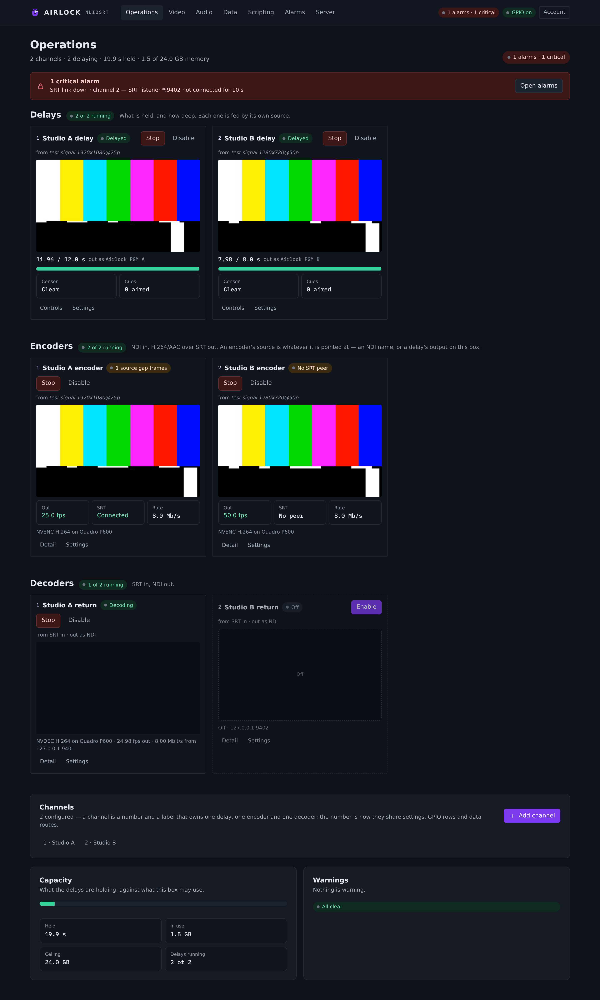
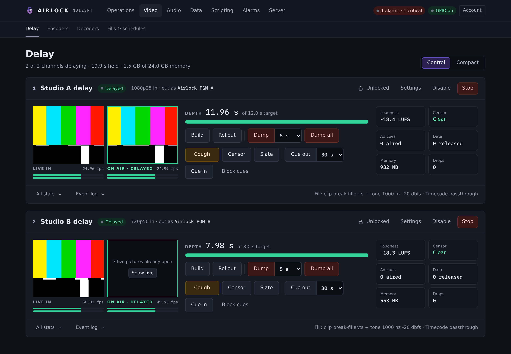
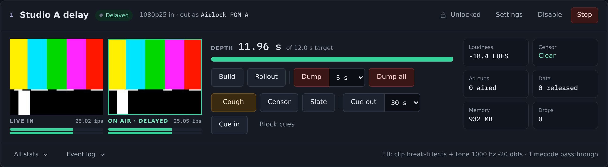
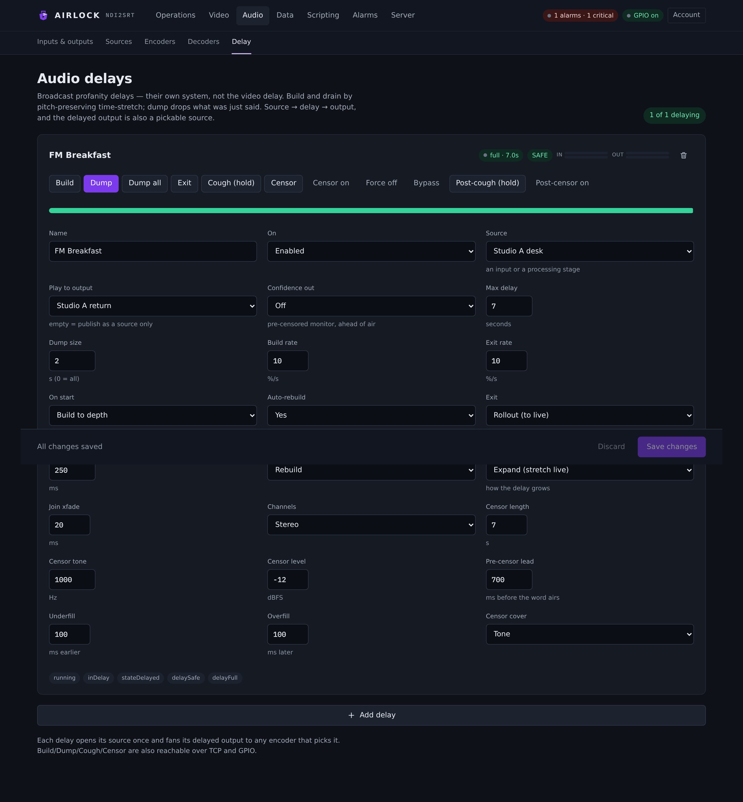
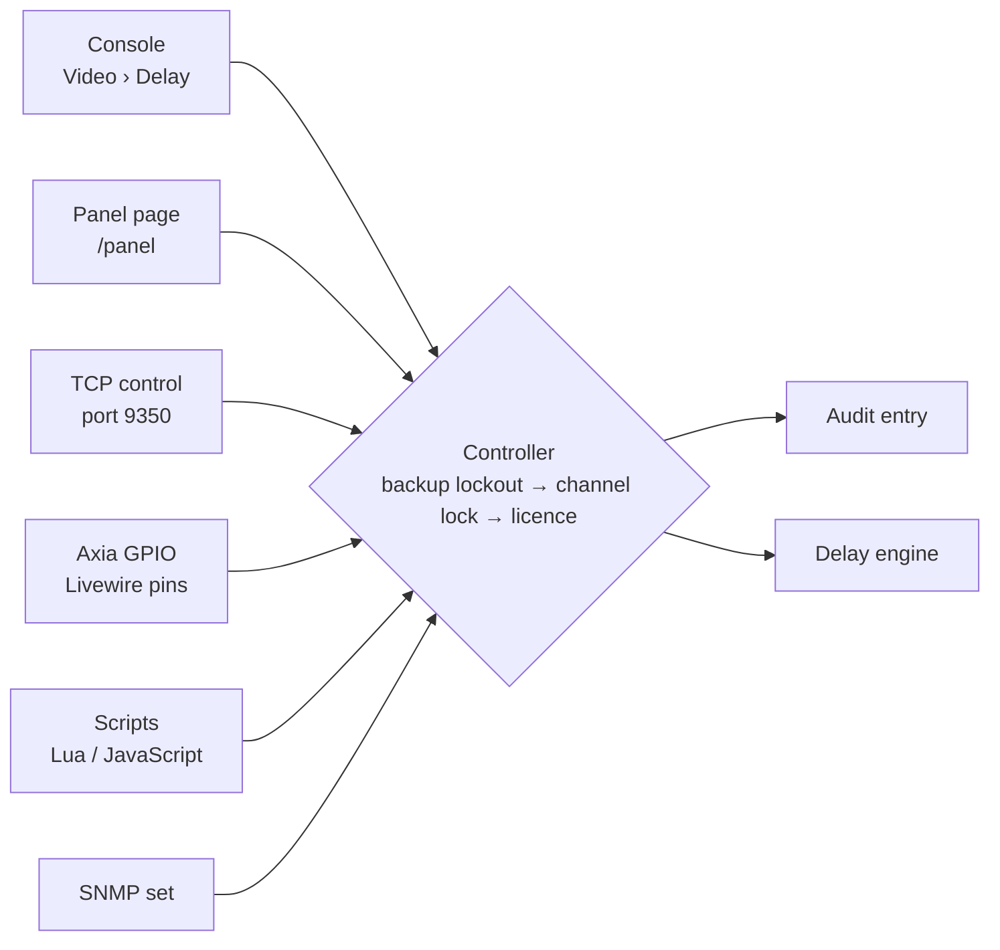

# Operating the delay

This is the shift chapter: what an operator does on air. It covers the two views
you work from, building to depth, dumping, rolling out, cough and censor, what
every pill means, what happens when the controls are locked, and which surface
wins when two of them reach for the same delay.

## The two views

### Operations

The brand mark in the top left is the home button, and home is **Operations** —
the landing view. It is deliberately read-only about detail and generous about
state: a **Delays** section with a tile per channel, then **Encoders** and
**Decoders**, then **Channels**, **Capacity** and **Warnings**.

Each delay tile carries the channel number, the delay's name, a state pill, what
feeds it, a snapshot of the delayed output, the depth against the target, and two
stats — **Censor** and **Cues**. The buttons are lifecycle only (**Enable**,
**Start**, **Stop**, **Disable**) plus **Controls**, which opens Video › Delay,
and **Settings**, which opens that channel's settings.

{ .shot }

Use Operations to see the whole box at a glance. Do not try to run a bleep from
it — the transport and on-air controls live on the Delay page.

### Video › Delay

This is the operator's page. It lists **every** channel, a card each, with a
**Density** toggle in the header: **Control** (the full card) or **Compact** (one
row per channel, with **Cough**, **Dump** and **Open**).

The page header reads *N of M channels delaying · X s held · Y GB of Z GB
memory*.

{ .shot }

A full card has:

| Part | What it shows |
|---|---|
| Head | channel number, delay name, state pill, input format, the NDI name it goes out as |
| Head buttons | **Locked** / **Unlocked**, **Settings**, **Disable**, **Start** / **Stop** |
| Monitors | **LIVE IN** (the source) and **ON AIR · DELAYED** (what is airing), each with its own meters |
| Depth | the current depth in seconds, the target, and a bar |
| Delay actions | **Build**, **Rollout**, **Dump** (with a length picker), **Dump all** |
| On-air actions | **Cough**, **Censor**, **Slate**, **Cue out** (with a length picker), **Cue in**, **Block cues** |
| Stats | Loudness, Censor, Ad cues, Data, Memory, Drops |
| Foot | **All stats**, **Event log**, and a line naming the fill and the timecode mode |

A channel whose delay is off in the configuration shows a single **Off** row with
**Settings** and **Enable**, and nothing else — its settings are kept.

{ .shot }

## Building to depth

**Build** starts filling the buffer. While it fills, the output airs the
channel's **fill** — by default the frozen last frame and silence, but it can be
an image, a clip, a live NDI source or a dayparted schedule. When the buffer
reaches the target the output changes over to delayed content and the state pill
reads **Delayed**.

With dissolves enabled the build dissolves *into* the fill at the start and *out
of* it when the depth is reached, picture and audio together.

The target is `delay.depth_s`, set on the channel's settings. **Set depth** while
running does the obvious thing: a deeper target builds, a shallower one trims the
newest surplus exactly as a dump does.

!!! tip "Build before you need it"
    A build costs you the whole depth in fill. Build at the top of the shift, not
    thirty seconds before the talkback guest arrives.

## Dumping

A dump removes **the newest seconds** — what was just said. The output carries on
from where it was, so the delay is that much shorter.

- **Dump** removes the length in the picker beside the button (2, 5 or 10 s on
  the page; the configured default is `delay.dump_seconds`, which is what every
  other surface uses when no length is given).
- **Dump all** empties the buffer and the output goes live.

What happens next depends on `delay.rebuild_after_dump`:

| Setting | After a dump |
|---|---|
| `true` (default) | the fill airs while the depth is regained, then delayed content returns |
| `false` | the output stays at the shorter depth — live, if everything went — until the next **Build**; depth maintenance holds that depth rather than growing it back |

With `fade_dump` on, the output dissolves across the splice where the removed
seconds were. The dumped material is never shown: the dissolve runs between the
frame before the gap and the frames after it.

Every dump also writes the removed seconds to a clip and raises a one-shot alert
to the configured recipients — see [Dump clips and alerts](../alarms/clips.md).

!!! warning "A dump is not a censor"
    A dump spends protection. If the problem is one word, use **Cough** or
    **Censor** and keep your window.

## Rollout

**Rollout** takes the output to live and discards the buffer. With
`fill.rollout_fill` the fill airs for the remaining depth first; with
`fade_rollout` the output crossfades picture and audio from the delayed feed to
live before the buffer goes.

Rollout is how you hand the channel back at the end of a programme. It is also,
with **Dump**, one of the two **exits** — see *Exits are never blocked* below.

## Cough, censor and slate

These change what airs **without** spending the buffer.

| Control | Behaviour |
|---|---|
| **Cough** | momentary — censors while the button is down (mouse, touch, or the space bar on the page), and the configured tail covers the release |
| **Censor** | a one-shot of `censor.censor_seconds` |
| **Censor on / Censor off** | the latch — it stays on until you turn it off, or until `censor.held_timeout_ms` releases it for a press whose release went missing |
| **Slate** | covers the picture with the fill set's picture (or black) and, with `slate_mute`, mutes the audio. No timeout: a slate is deliberate |

Every press reaches **back** as well as forward by `censor.pre_ms`, because you
are reacting to something you have already heard. A press marks a span of frames,
not a stretch of wall-clock time — so a dump, a rebuild or a depth change between
the press and the frames airing cannot strand it.

The full set, including the video masking modes and the dayparted censor
schedule, is in [Censor, cough and slate](../video/censor.md).

## Audio delays

A broadcast (profanity) audio delay is its own system on **Audio › Delay**, not a
video channel. Its card carries **Build**, **Dump**, **Dump all**, **Exit**,
**Cough (hold)**, **Censor**, **Censor on** / **Censor off**, **Force off**,
**Bypass**, **Post-cough (hold)** and **Post-censor on** / **Post-censor off**,
with a depth gauge, in and out meters, and the tally lamps the GPIO model drives.

{ .shot }

Audio delays build and drain by pitch-preserving time-stretch rather than by
airing a fill, so their states read **building**, **full**, **live** and
**bypass**. See [Audio delay](../audio/delay.md).

## What the pills mean

### The channel state pill

| Pill | Meaning |
|---|---|
| **Live** | running, nothing held — the output is the input |
| **Building** | filling the buffer; the fill is on air |
| **Delayed** | at depth, airing delayed content |
| **Rolling out** | returning to live; the buffer is being given up |
| **Bypass** | passing through without delaying (audio delays) |
| **Stopped** | the block is enabled but not running |
| **Off** | the block is disabled in the configuration |

### The header pills

| Pill | Meaning |
|---|---|
| **No alarms** / **N alarms · M critical** | the alarm centre; click it to open Alarms |
| **Unlicensed · output watermarked** | no valid licence — outputs without a seat carry the watermark and tone |
| **GPIO on** / **GPIO down** | shown only when GPIO is enabled: whether the Livewire session is up |

### On the card

**Locked** / **Unlocked** is the channel lock — the claim one operator takes so
nobody else drives this channel. **Censor: Clear / On** is the live censor state.
On an audio delay card the extra pills — **SAFE**, **COUGH**, **CENSOR**,
**POST-COUGH**, **POST-CENSOR** — are the engine's own lamps.

!!! note "Depth and protection are two numbers"
    `depth_s` is what the buffer holds. `protection_s` is the window actually in
    force — how long ago the frame about to air was captured. They match on a
    healthy source; after the source has stalled and depth maintenance has held
    the buffer, protection is larger, and that difference is your drift made
    visible. See [Video › Delay](../video/delay.md).

## Exits are never blocked

Three things can refuse a control, and they are asked in this order:

1. **The backup lockout.** A standby instance refuses control actions; they
   belong to the primary.
2. **The channel lock.** Transport belongs to whoever holds it.
3. **The licence.** A machine panel surface with no `PANEL` feature is refused.

**Dump and Rollout are taken out before any of those are asked.** The exits from
delay work on any box, in any state, with no licence at all, and on a standby
whose local-control window has expired. An operator who may be on air is never
trapped.

What each refusal looks like:

```text
REST   403 {"error":"ERR_LOCKED","message":"the delay is locked to studio-a …"}
REST   403 {"error":"ERR_UNLICENSED","message":"panel control is not licensed (PANEL) — …"}
TCP    ERR 1 LOCKED the delay is locked to studio-a …
TCP    ERR 1 LICENSE panel control is not licensed (PANEL) — …
SNMP   authorizationError
```

### What the channel lock holds

Transport and on-air only: Build, Dump, Dump all, Rollout, Set depth, Start,
Stop, Enable, Disable, Cough, Censor, Censor force-off, Slate, Block cues and
originating a cue. Configuration stays open — dissolves, fills, the audio chain,
censor settings, depth maintenance — because that is how a lock left behind by a
shift that went home gets sorted out. See [Channel lock](lock.md).

### What a standby refuses

While an instance is a backup, every mutating call is refused with the reason and
`locked_by_redundancy`. Reads keep working, as do signing in, the redundancy
page, licence activation and acknowledging an alarm. Once the local-control
window has expired, Dump and Rollout come back. See
[Operating a standby](../redundancy/standby.md).

## Every control is audited

The audit entry is written by the controller, not by the surface, so no surface
can forget one — and a **refused** action is recorded too, with the reason.

```text
{"ts":"2026-10-17T14:26:40.123","origin":"web","principal":"dan",
 "action":"delay.dump","detail":"5 s at 9.98 s"}
```

| Field | What it carries |
|---|---|
| `origin` | `web`, `rest`, `tcp`, `snmp`, `gpio`, `script`, `window`, `sync`, `system` |
| `principal` | the user name, the API client id, the peer address, or the GPIO pin |
| `action` | `delay.build`, `delay.dump`, `delay.rollout`, `delay.depth`, `delay.cough`, `delay.censor`, `delay.censor_on`, `delay.censor_off`, `delay.censor_force_off`, `delay.slate`, `delay.lock`, `delay.unlock`, `delay.lock_force`, `delay.start`, `delay.stop`, `delay.enable`, `delay.disable`, `scte.block`, `scte.cue` |
| `detail` | the depth it landed on, the length dumped, or `refused: …` |

A GPIO entry names the pin — and numbers it **1-based**, the way a console
labels it, although the configuration numbers pins from 0:

```text
audit  gpio  axia/2.2  delay.dump   4 s at 9.98 s
audit  gpio  axia/2.1  delay.build  at 7.48 s — refused: LOCKED: the delay is locked to studio-a …
```

Read it on **Server › Audit log**, or with `GET /api/audit`. Filter by channel
with `?channel=2` and by action prefix with `?action=delay.` — see
[Audit log](../server/audit.md).

## The surfaces, and which one wins

Every surface reaches the engine through one seam. There is no surface with a
private path, and no surface that skips the lock or the audit.



| Surface | Reach | Notes |
|---|---|---|
| Console (Video › Delay) | everything | signed in as operator or above |
| Panel page (`/panel`) | Build, Dump, Dump all, Rollout, Cough, Lock | one channel per page; see [Panel page](panel.md) |
| TCP control, port 9350 | the full verb set | the surface a Stream Deck or Companion drives; needs `PANEL` for acting verbs; see [TCP control](tcp.md) |
| REST | everything | API clients and bearer tokens; **not** gated by `PANEL`; see [REST API](rest.md) |
| Axia GPIO | Build, Dump, Dump all, Rollout, Cough, Enable, Disable, Lock, Unlock, Cue | never licence-gated — a pin has nowhere to show a refusal; see [Axia GPIO](gpio.md) |
| Scripts | the host API | needs `SCRIPTING`; see [Scripting](../scripting/overview.md) |
| SNMP | the channel command column | see [SNMP](../alarms/snmp.md) |

**Precedence is a claim, not a priority.** No surface outranks another. The
channel lock decides: whoever holds it drives, everyone else is refused, and an
admin can force the release. With no lock taken, the last command wins — which is
exactly what you want from a dump.

!!! warning "Open mode weakens the lock"
    With `auth.enabled: false` there is no user to name, so a caller's principal
    is its address. A lock taken over TCP from `127.0.0.1` will not stop a REST
    command from `127.0.0.1`. On a box where the lock has to keep two operators
    apart, turn authentication on.

## Troubleshooting

| Symptom | Likely cause |
|---|---|
| **Build** does nothing and the state stays **Stopped** | the block is not running — press **Start**, or **Enable** if the card shows **Off** |
| Every button is refused with `ERR_LOCKED` | someone holds the channel lock, or this box is a standby; the message says which |
| Every button is refused except Dump and Rollout | the licence does not carry the feature the surface needs, or the standby's local-control window has expired |
| Depth never reaches the target | the source is not delivering at nominal rate, or the memory cap is lower than the depth needs — check **All stats** and the memory figure in the page header |
| Depth creeps down over hours | the source is running slightly slow; turn on depth maintenance with `catchup: "bounded"` |
| Cough bleeps but the picture is untouched | `censor.video_mode` is `none`, which is the default; set a mask or a slate |
| The censor stays on after a release | the release was lost — use **Force off**, which drops the latch and every pending span |
| The depth is right but the output is a frozen frame | the source has stalled and depth maintenance is holding the buffer; `maintain_state` reads `holding` |
