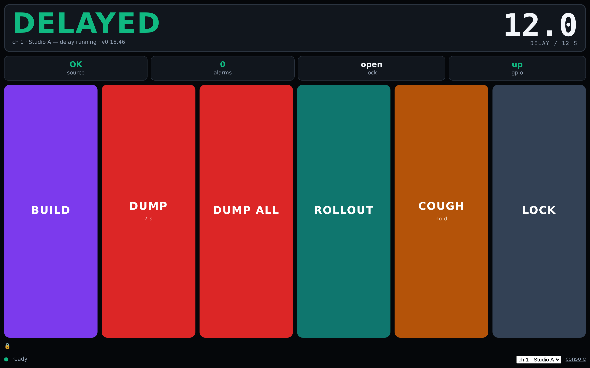
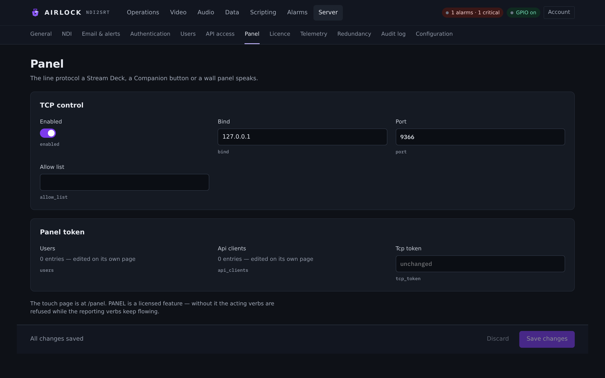

# Panel page

`/panel` is a stripped-down page for a wall-mounted touch screen, a spare
monitor in the studio, or an operator driving one delay and nothing else. Six
big buttons, the state and the depth in very large type, and a strip of chips.
This chapter covers the page, what it shows, and the settings behind it on
**Server › Panel**.

## What it is for

The console is a control room tool: many channels, many cards, settings on every
page. The panel page is the opposite. It drives **one** channel, it has no
navigation, it has no settings, and the whole page is a one-second poll of a
couple of hundred bytes — so it comes up and stays responsive over a studio's
slow link or a tablet on wi-fi.

It is one self-contained file: no images, no web fonts, no libraries. Nothing is
fetched that is not the state object.

{ .shot }

## Opening it

| Address | Opens |
|---|---|
| `http://<host>:8090/panel` | the channel this device last used, or channel 1 |
| `http://<host>:8090/panel?channel=2` | channel 2, and remembers it on that device |

With more than one channel configured, a small picker appears in the footer. The
state object names every channel, so the picker costs no second request.

Pin a wall tablet or a browser kiosk to `?channel=N` and it will always come back
to the same delay.

!!! note "You must be signed in"
    The page and its feed are **operator** level. A browser with no session is
    redirected to the console to sign in, rather than being shown a JSON
    refusal. If the page jumps to the console, that is why.

## The buttons

| Button | What it does |
|---|---|
| **Build** | starts filling the buffer |
| **Dump** | dumps the configured length — the button carries that length as a sub-label, e.g. *5 s* |
| **Dump all** | empties the buffer; the output goes live |
| **Rollout** | returns to live and discards the buffer |
| **Cough** *(hold)* | momentary: censors while held |
| **Lock** / **Unlock** | takes or releases the channel lock; the label follows the current state |

**Cough is a held control.** Press and it sends the on edge; release and it sends
the off edge — however the press ends, including dragging your finger off the
button. That is the same behaviour as the studio switch and the GPIO pin.

Everything else is one tap. Every button except **Lock** is disabled while the
delay block is not running, so the page cannot send a command into a stopped
block.

Each press flashes the button, then the footer says `BUILD sent`, `DUMP sent` and
so on, or shows the refusal.

## State and depth

The top of the page carries two things, both in very large type:

- **the state word** — `LIVE`, `BUILDING`, `DELAYED`, `ROLLING OUT`, `STOPPED`
  or `DISABLED`, colour-coded;
- **the depth**, in seconds, against the target: *4.9 delay / 10 s*.

Under the state word a smaller line names the channel and what the block is
doing: `ch 2 · Studio B — delay running · v0.15.42`, or *delay stopped*, or
*delay disabled*.

## The chips

Four chips sit under the state, each a value with a label.

| Chip | Reads | Meaning |
|---|---|---|
| **source** | `OK` / `LOST` / `—` | whether the delay's source is arriving; `—` when the block is not running |
| **alarms** | a count | active alarms **on this channel**; red when any is critical, amber otherwise |
| **lock** | a holder name, or `open` | who holds the channel lock |
| **gpio** | `off` / `up` / `DOWN` | the Livewire session: not configured, connected, or lost |

A dot and a message line in the footer carry the link to the server itself: *no
connection to the server* when the poll fails.

### The licence notice

If the box has no `PANEL` feature, a line appears across the foot of the page:

> PANEL is not licensed — this page works, but hardware panels on the TCP
> control port (9350) are refused every button. Their lamps and depth keep
> updating, so they look healthy.

That is the one failure mode worth shouting about: a wall panel with no `PANEL`
on the licence keeps showing live state and dim keys, so it *looks* fine while
nothing works. The page says it for you. See [Licensing](../start/licensing.md).

## The 1 Hz poll

Everything on the page comes from one request, once a second:

```bash
curl -s -b cookies.txt http://localhost:8090/api/channels/2/panel/state
```

```json
{"channel":2,"channel_name":"Studio B",
 "channels":[{"id":1,"name":"Studio A"},{"id":2,"name":"Studio B"}],
 "state":"delayed","running":true,"enabled":true,
 "depth_s":10.0,"target_s":10.0,"dump_seconds":4.0,
 "source_ok":true,"alarms":0,"critical":0,"worst":"ok",
 "cough":false,"censor":false,"slate":false,
 "lock":null,"lock_principal":null,
 "gpio":{"enabled":true,"connected":true},
 "panel_licensed":true,"licence_valid":true,"version":"0.15.42"}
```

`GET /api/panel/state` without the channel segment is channel 1.

| Field | Meaning |
|---|---|
| `channel`, `channel_name` | which delay this is |
| `channels[]` | every configured channel, for the picker |
| `state` | `live`, `building`, `delayed`, `rolling out`, or the block's own state (`stopped`, `disabled`) |
| `running`, `enabled` | whether the block is up, and whether it is enabled in the configuration |
| `depth_s`, `target_s` | current depth and target, in seconds |
| `dump_seconds` | the configured partial-dump length — the **Dump** button's sub-label |
| `source_ok` | the source is arriving |
| `alarms`, `critical`, `worst` | this channel's alarm tallies |
| `cough`, `censor`, `slate` | the on-air covers, live |
| `lock`, `lock_principal` | the holder shown to everyone, and the principal actually compared |
| `gpio` | whether GPIO is enabled and whether the node session is up |
| `panel_licensed`, `licence_valid` | what drives the licence notice |
| `version` | the running build |

It is a cheap feedback source for anything, not just the page. A Companion button
can poll it for a lamp.

## Driving a hardware panel

The panel page is a page. The **machine** surface a Stream Deck, a Companion
button or a wall panel drives is the existing REST and TCP — there is no third
protocol.

=== "Over REST"

    Create an API client on **Server › API access** with role **operator**, take
    a bearer token, then post the controls and poll the state.

    ```bash
    T=$(curl -s -u ak_…:as_… -d grant_type=client_credentials \
        http://box:8090/oauth/token | jq -r .access_token)

    curl -s -X POST -H "Authorization: Bearer $T" \
        "http://box:8090/api/channels/2/delay/dump?seconds=4"
    curl -s -H "Authorization: Bearer $T" \
        http://box:8090/api/channels/2/panel/state
    ```

    `POST /api/delay/dump` with no `seconds` is dump-all. REST is **not** gated
    by the `PANEL` feature — it is the automation surface, not the panel one.

=== "Over TCP"

    Point a generic TCP module at port 9350 and send the line protocol.

    ```text
    > SUBSCRIBE 2
    < OK 2 SUBSCRIBED
    < STATUS CH 2 Delayed
    > DUMP 2
    < OK 2
    < STATUS CH 2 Building
    ```

    A subscription pushes the state on every change, which is cheaper than
    polling for a feedback. This port **is** the licensed panel surface. See
    [TCP control](tcp.md).

Both are refused with the same shapes as every other surface while the channel
lock is held (`403 ERR_LOCKED` / `ERR 2 LOCKED …`), so a panel can dim its own
keys consistently.

## Settings — Server › Panel

**Server › Panel** is where the machine surface is configured. The page carries
two cards: **TCP control** and **Panel token**.

{ .shot }

| Setting | Console label | Config key | Default | Meaning |
|---|---|---|---|---|
| Listener on | Enabled | `tcp.enabled` | `true` | Run the line-protocol listener at all. |
| Bind address | Bind | `tcp.bind` | `0.0.0.0` | Which interface to listen on. `127.0.0.1` restricts it to this machine. |
| Port | Port | `tcp.port` | `9350` | The listener's TCP port. |
| Allow list | Allow list | `tcp.allow_list` | *(empty)* | Comma-separated peer IP addresses allowed to connect. Empty means any. Loopback is always allowed. `*` means any. |
| Panel token | Tcp token | `auth.tcp_token` | *(empty)* | When set, a connection must open with `AUTH <token>` before any command. One word, compared in constant time. |

The **Panel token** card also lists **Users** and **Api clients** as a count —
those are edited on **Server › Users** and **Server › API access**.

!!! note "The page itself has no settings"
    `/panel` has no configuration: the channel comes from the URL or the device,
    the dump length comes from the channel, and everything else is state. The
    settings on this page are for the TCP surface the page mirrors.

!!! warning "Machine-local, not mirrored"
    `tcp.bind`, `tcp.port` and `tcp.allow_list` are machine-local: a standby
    keeps its own. `auth.tcp_token` is replicated with the rest of the
    authentication block, so a panel that reaches the primary reaches a standby
    after a takeover with the same token. See
    [Primary and backup](../redundancy/overview.md).

## Troubleshooting

| Symptom | Likely cause |
|---|---|
| The page jumps to the console | no session, or the session expired — sign in; the panel feed is operator level |
| Every button is greyed out | the delay block is not running; **Lock** stays live |
| `signed out — reload and sign in at the console` | the session ended while the page was open |
| `no connection to the server` | the poll is failing — check the box, the port and the network |
| The licence line is showing | the licence has no `PANEL` feature; the page still works, hardware panels on 9350 do not |
| The buttons work here but not from Companion | Companion is on the TCP port, which needs `PANEL`; or the peer is not on `tcp.allow_list`; or `auth.tcp_token` is set and the profile is not sending `AUTH` first |
| The chip says **GPIO DOWN** | the Livewire node is unreachable; see [Axia GPIO](gpio.md) |
