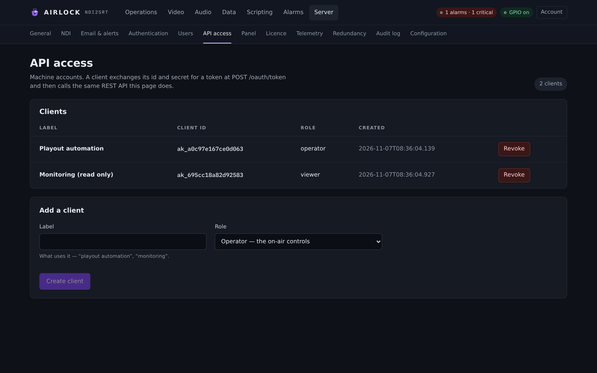
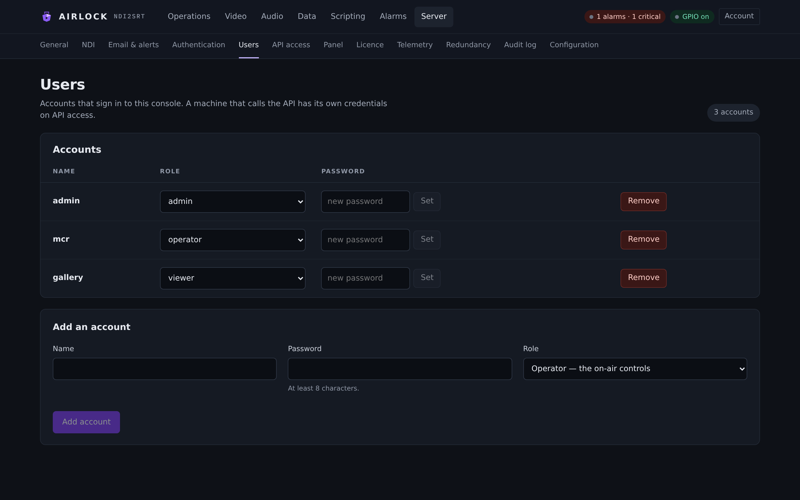

# REST API

Everything the console does, it does over this API — there is no private path.
This chapter is the complete reference: how to authenticate, what every endpoint
needs, what it returns, and what a refusal looks like. Examples use `curl`
against `localhost:8090`.

## The basics

| | |
|---|---|
| Base URL | `http://<host>:8090` (`web.bind`, `web.port`) |
| Request bodies | JSON, except file uploads and the OAuth token form |
| Responses | JSON, except previews, clips, HLS and backups |
| Success | `200` with `{"ok":true}` or the object asked for |
| Mutating calls | `POST`, `PUT`, `DELETE` — all audited |

### Channel addressing

The channel is a **path segment**, because the resource that owns the action
belongs in the URL:

```text
POST /api/channels/2/delay/build
```

Every channel-scoped route also exists **without** the segment, where it means
channel 1 — so existing clients, panel profiles and the panel page keep working:

```text
POST /api/delay/build            # channel 1
POST /api/delay/build?channel=2  # channel 2, if rewriting the URL is awkward
```

| Situation | Response |
|---|---|
| Unknown channel | `404 {"error":"no channel 9 — this process has 1, 2"}` |
| Non-numeric channel | `400 {"error":"channel must be a number 1 or more, not \"x\""}` |

`{block}` in a path is `encoder`, `decoder` or `delay`. Anything else is
`400 {"error":"unknown block 'x' — encoder|decoder|delay"}`.

## Authentication

### Open mode (the default)

With `auth.enabled: false` the page and the API are open and every caller is an
admin named after its address. The log warns at start if that is paired with a
non-loopback `web.bind`.

!!! warning "Open mode on a plant network"
    Anyone who can reach the port can dump, roll out, rewrite the configuration
    and deactivate the licence. Put the box behind the plant's network, or turn
    `auth.enabled` on.

### Browser sessions

```bash
curl -s -c cookies.txt -X POST http://localhost:8090/api/auth/login \
     -H 'Content-Type: application/json' \
     -d '{"name":"dan","password":"…"}'
```

The reply sets an `HttpOnly`, `SameSite=Strict` session cookie that lives
`auth.session_hours`. `POST /api/auth/logout` ends it. Sessions are held in
memory, so a restart signs everyone out. Logins are rate-limited to **5 a minute
per address**.

### API clients (OAuth2 client credentials)

An admin creates a client on **Server › API access**, or with
`POST /api/clients`. The `client_id` (`ak_…`) and `client_secret` (`as_…`) are
returned **once**; only a hash is stored.

{ .shot }

```bash
T=$(curl -s -X POST http://localhost:8090/oauth/token \
      -d grant_type=client_credentials \
      -d client_id=ak_… -d client_secret=as_… | jq -r .access_token)

curl -s -H "Authorization: Bearer $T" http://localhost:8090/api/state
```

`Authorization: Basic base64(id:secret)` works in place of the form fields.
Tokens live `auth.session_hours` and die with the client. Token requests are
rate-limited to **10 a minute per address**. Calls made this way are audited with
origin `rest` and the client id as the principal.

| Response | Meaning |
|---|---|
| `{"access_token","token_type":"Bearer","expires_in","scope"}` | granted; `scope` is the role |
| `400 unsupported_grant_type` | `grant_type` must be `client_credentials` |
| `400 invalid_request` | credentials missing, or authentication is disabled |
| `401 invalid_client` | unknown client or wrong secret |
| `429` | rate limited |

### Roles

| Role | May |
|---|---|
| `viewer` | read state, previews, alarms, clips, the audit log, the licence |
| `operator` | + start/stop, build, dump, rollout, set depth, dissolves, enable/disable a block, the channel lock, cough/censor/slate, cues, data sends, reset stats, read the configuration |
| `admin` | + save the configuration, force-release a lock, assign or release a licence seat, manage users and API clients, scripts, licence activation, redundancy, restart |

A user flagged `must_change_password` is refused everything except
`POST /api/users/me/password` and `POST /api/auth/logout`, with
`403 {"error":"password_change_required"}`.

{ .shot }

### Refusal shapes

| Status | Body | Meaning |
|---|---|---|
| `401` | `{"error":"unauthorized"}` | no credential, or it expired |
| `403` | `{"error":"forbidden","required":"admin"}` | the role is too low |
| `403` | `{"error":"ERR_LOCKED","message":"the delay is locked to studio-a …"}` | the channel lock |
| `403` | `{"error":"ERR_UNLICENSED","message":"…"}` | a licence feature is missing |
| `403` | `{"error":"…","locked_by_redundancy":true,"state":"backup_synced"}` | this instance is a standby |
| `404` | `{"error":"no channel 9 — …"}` | unknown channel, clip, script or asset |
| `400` | `{"error":"…"}` | the block or the validator refused it, with the reason |

`GET /panel` is the one exception: an unauthenticated browser is redirected to
the console rather than shown a JSON refusal.

!!! note "Dump and rollout are never gated"
    `POST /api/…/delay/dump` and `…/delay/rollout` pass the licence gate and the
    standby's expired-window lockout. They can still be refused by the channel
    lock, which an operator can resolve.

---

## Open endpoints

No credential required.

| Method | Path | Returns |
|---|---|---|
| `GET` | `/` | the console |
| `GET` | `/old` | the previous console page |
| `GET` | `/next` | permanent redirect to `/` |
| `POST` | `/api/auth/login` | body `{name,password}` (`username` accepted) → sets the session cookie |
| `GET` | `/api/auth/me` | `{auth_enabled,oidc_enabled,oidc_display_name,users_configured,authenticated,name,role,kind,must_change_password}` — `kind` is `session`, `bearer` or `open` |
| `GET` | `/api/auth/oidc/start` | starts single sign-on; `501` while OIDC is configured but not built |
| `GET` | `/api/auth/oidc/callback` | the identity provider's return; `?code`, `?state`, `?error` |
| `POST` | `/oauth/token` | form: `grant_type=client_credentials`, `client_id`, `client_secret` → a bearer token |
| `GET` | `/hls/{name}/{file}` | an audio encoder's live HLS playlist (`.m3u8`), segment, or `player.html` |
| `GET` | `/api/sync/config` | the configuration mirror — **standby only**, bearer `redundancy.token` |
| `GET` | `/api/sync/asset/{sha}` | one asset by sha256 — same token |

The two sync routes are authenticated by the shared redundancy token alone, not
by a user session, because the user records are themselves part of what is being
replicated. They are served only by an instance whose role is `primary`.

```text
GET /api/sync/config?since=<digest>&wait=<seconds>&id=&name=&state=&version=
Authorization: Bearer <redundancy.token>

→ {"schema","app_version","digest","config":{…},"scripts":[…],
   "variables":[…],"assets":[…],"rank":1}
→ {"schema","app_version","digest","unchanged":true,"rank":1}
```

`wait` holds the poll open for up to 120 seconds while nothing has changed.

---

## Status and telemetry — viewer

| Method | Path | Returns |
|---|---|---|
| `GET` | `/api/state` | the whole box: `channels[]`, `channel_ids`, `capacity`, `alarms`, `scripting`, and channel 1 at the top level as `delay`, `encoder`, `decoder` |
| `GET` | `/api/channels` | one row per channel — state, depth, lock, alarms, buffer — plus `capacity` |
| `GET` | `/api/alarms` | active list, cleared history, counts |
| `GET` | `/api/audit` | `{entries,tail,dir}`, newest first |
| `GET` | `/api/clips` | every dump clip with its record, newest first |
| `GET` | `/api/clips/{name}` | the clip, as an MPEG-TS attachment |
| `GET` | `/api/licence` | the validity verdict, the grant, the pools and the hardware id; the serial is masked |
| `GET` | `/api/redundancy` | role, state, children, assets, watchdog settings, `instance`, and `sync_digest` on a primary |
| `GET` | `/api/telemetry` | where this box reports and whether the last sample landed — never the key |
| `GET` | `/api/encoder/bitstream` | what the encoder's own output says it is (raster, rate, interlace) |
| `GET` | `/api/channels/{n}/encoder/bitstream` | the same, per channel |
| `GET` | `/api/scripts` | the stored scripts (without their source) and the dispatcher's counters |
| `GET` | `/api/script-log` | `{lines,next}` — a cursor poll |
| `GET` | `/api/script-log/stream` | the same lines live, `text/event-stream` |
| `GET` | `/api/data-log` | the data rail's recent lines, same shape |
| `POST` | `/api/auth/logout` | ends the session |
| `POST` | `/api/users/me/password` | body `{current,new}` (`currentPassword`/`newPassword` accepted) — change your own |
| `GET` | `/preview/{tap}` | channel 1's preview |
| `GET` | `/preview/channels/{n}/{tap}` | channel *n*'s preview |

### `GET /api/audit`

| Parameter | Default | Meaning |
|---|---|---|
| `limit` | `50` | how many entries |
| `before` | — | the paging cursor: only entries older than this `id` |
| `action` | — | matches a **prefix**: `delay.` is every delay action, `delay.dump` just the dumps |
| `principal` | — | exact name |
| `channel` | — | only this channel's entries; `0` is the process-wide ones |

### `GET /api/script-log` and `/api/data-log`

| Parameter | Meaning |
|---|---|
| `after` | cursor: only lines past this `seq` |
| `replay` | how many recent lines to return (absent = the whole ring) |
| `script` | only this script's lines (exact name) |

### Previews

`{tap}` is `delay`, `delay-pre`, `encoder` or `decoder`, with an extension:

| Extension | Behaviour |
|---|---|
| `.mjpg` | `multipart/x-mixed-replace`, one JPEG part per new frame — a held connection |
| `.jpg` | the latest frame, once, then closes; `204` while there is no picture yet |

```bash
curl -s -o frame.jpg http://localhost:8090/preview/channels/2/delay.jpg
```

Use `.jpg` for a dashboard. A browser allows about six connections to one host,
and six held `.mjpg` streams will use all of them.

An unknown tap is
`404 {"error":"no preview \"x\" — delay|delay-pre|encoder|decoder"}`.

---

## Delay transport and on-air — operator

Every route here exists in both spellings. The channel-scoped form is shown.

| Method | Path | Parameters | Does |
|---|---|---|---|
| `POST` | `/api/channels/{n}/delay/build` | — | start filling the buffer |
| `POST` | `/api/channels/{n}/delay/dump` | `?seconds=` | dump that many seconds; **without `seconds` it is dump-all** |
| `POST` | `/api/channels/{n}/delay/rollout` | — | return to live, discard the buffer |
| `POST` | `/api/channels/{n}/delay/depth` | `?seconds=` | set the target depth |
| `POST` | `/api/channels/{n}/delay/fades` | `?ms=&rollout=&build=&dump=` | dissolve length and which seams use it; saved **and** pushed live |
| `POST` | `/api/channels/{n}/delay/cough` | `?down=true\|false` or `?on=` | the held cough; **without either, a press and release in one call** |
| `POST` | `/api/channels/{n}/delay/censor` | `?seconds=` | a one-shot censor |
| `POST` | `/api/channels/{n}/delay/censor-on` | — | latch the censor on |
| `POST` | `/api/channels/{n}/delay/censor-off` | — | release the latch |
| `POST` | `/api/channels/{n}/delay/censor-force-off` | — | drop the latch **and** every queued span |
| `POST` | `/api/channels/{n}/delay/slate-on` | — | cover the picture (and mute, if configured) |
| `POST` | `/api/channels/{n}/delay/slate-off` | — | uncover |
| `POST` | `/api/channels/{n}/delay/lock` | body `{holder,note}` | claim the channel; `holder` defaults to the caller |
| `POST` | `/api/channels/{n}/delay/unlock` | `?force=true` | release it; `force` is an admin taking it from someone else |

All answer `{"ok":true}`, or a refusal from the table above.

```bash
curl -s -X POST "http://localhost:8090/api/channels/2/delay/dump?seconds=4"
curl -s -X POST "http://localhost:8090/api/channels/2/delay/cough?down=true"
curl -s -X POST  http://localhost:8090/api/channels/2/delay/lock \
     -H 'Content-Type: application/json' -d '{"holder":"studio-b","note":"ad break"}'
```

---

## Block lifecycle — operator

| Method | Path | Does |
|---|---|---|
| `POST` | `/api/channels/{n}/delay/start` · `/stop` | run or stop the delay now; the enabled flag is untouched |
| `POST` | `/api/channels/{n}/encoder/start` · `/stop` | the same for the encoder |
| `POST` | `/api/channels/{n}/decoder/start` · `/stop` | the same for the decoder |
| `POST` | `/api/channels/{n}/delay/restart` | stop and start, so a setting that only applies on start takes effect now |
| `POST` | `/api/channels/{n}/encoder/restart` · `/api/channels/{n}/decoder/restart` | the same |
| `POST` | `/api/channels/{n}/{block}/enable` · `/disable` | set the **persisted** run flag and act on it |
| `POST` | `/api/channels/{n}/{block}/reset` | zero that block's counters without touching the stream |
| `GET` `POST` | `/api/channels/{n}/{block}/audio-processing` | read or write the block's gain / EQ / compressor chain; saved **and** pushed live |

**Enable/disable persists; start/stop does not.** Disable is a full stop: the
threads end and the NDI sender closes. Enabling a block that cannot run yet still
sets the flag and tells you why (`{"error":"choose an NDI source"}`).

---

## Channels

| Method | Path | Role | Does |
|---|---|---|---|
| `GET` | `/api/channels` | viewer | list them |
| `POST` | `/api/channels` | admin | body `{name}` → `{"ok":true,"id":3}`; gets the next id, its own NDI names, SRT ports and service id, and starts **disabled** |
| `POST` | `/api/channels/{n}/name` | admin | body `{name}` → rename |
| `DELETE` | `/api/channels/{n}` | admin | remove; its blocks stop, and its GPIO rows and delayed data routes go with it. The last channel cannot go |

---

## Ad cues and data — operator

| Method | Path | Parameters |
|---|---|---|
| `POST` | `/api/channels/{n}/scte/cue` | see below |
| `POST` | `/api/channels/{n}/scte/block` | `?on=true\|false` (default `true`) |
| `POST` | `/api/data/send` | `?sender=&text=` |
| `POST` | `/api/audio-encoders/{name}/scte35` | `?type=out\|in&duration=` or `?out=true` — schedule a break on a live HLS audio encoder |

### `POST /api/scte/cue`

| Parameter | Meaning |
|---|---|
| `type` | `out`, `in`, `cancel`, `out_now`, `in_now`, `time_signal` |
| `event_id` | the splice event id |
| `duration_s` | break length |
| `pre_roll_ms` | pre-roll; `0` uses the channel's configured value |
| `program_id`, `avail`, `avails`, `auto_return` | splice_insert fields |
| `seg_type`, `upid`, `segment`, `segments` | `time_signal` only |

```bash
curl -s -X POST "http://localhost:8090/api/channels/1/scte/cue?type=out&event_id=4242&duration_s=30"
curl -s -X POST "http://localhost:8090/api/scte/cue?type=time_signal&seg_type=provider_ad_start&duration_s=30&upid=AIR1"
```

Returns `{"ok":true,"cue":"operator splice out id 4242 pre-roll 4000 ms break 30.0 s"}`.
The cue rides the delay, so it airs one depth later — and a dump cancels it.

---

## Alarms

| Method | Path | Role | Does |
|---|---|---|---|
| `GET` | `/api/alarms` | viewer | active, cleared, counts |
| `POST` | `/api/alarms/{id}/ack` | operator | mark one occurrence seen |
| `POST` | `/api/alarms/{id}/dismiss` | operator | hide it until it re-raises |
| `POST` | `/api/alarms/test-email` | admin | send a synthetic alarm email |
| `POST` | `/api/alarms/test-webhook` | admin | fire a synthetic `ALARM_TEST` transition |

Acknowledge and dismiss change only what this box's displays show. The raw state
behind SNMP, email and GPIO is untouched.

---

## Dump clips

| Method | Path | Role | Does |
|---|---|---|---|
| `GET` | `/api/clips` | viewer | every clip and its record, plus this run's dumps that wrote none |
| `GET` | `/api/clips/{name}` | viewer | download the transport stream |
| `DELETE` | `/api/clips/{name}` | operator | remove the clip and its record (audited) |

---

## Panel and GPIO — operator

| Method | Path | Returns |
|---|---|---|
| `GET` | `/panel` | the panel page |
| `GET` | `/api/panel/state` | channel 1's panel object |
| `GET` | `/api/channels/{n}/panel/state` | channel *n*'s |
| `GET` | `/api/gpio` | `{status,nodes,lamps,actions,stage_actions,stage_lamps,inputs,outputs}` — the live LWRP session, the confirmed pin states, the counters, the configured rows and the catalogues |

See [Panel page](panel.md) and [Axia GPIO](gpio.md).

---

## Sources and the box's hardware — operator

| Method | Path | Returns |
|---|---|---|
| `GET` | `/api/sources` | the NDI sources found on the network (a 2.5 s discovery); `503` with the reason if NDI cannot look |
| `GET` | `/api/ndi/diagnose` | why NDI is, or is not, seeing what it should — adapters, discovery servers, configuration |
| `GET` | `/api/audio-devices` | the box's capture devices |
| `GET` | `/api/audio-inputs` | the named inputs opened on them, and how each is doing |
| `GET` | `/api/audio-output-devices` | the box's playback devices |
| `GET` | `/api/audio-outputs` | the named outputs and their state |
| `GET` | `/api/tools` | `{ffmpeg,ffmpeg_configured}` — which external tool was found and where |

---

## Audio blocks — operator

| Method | Path | Does |
|---|---|---|
| `GET` | `/api/audio-encoders` | a row per audio encoder: codec, rate, channels, frames, bytes, meter, and the `srt` link state |
| `GET` | `/api/audio-decoders` | the same for decoders |
| `GET` | `/api/audio-sources` | processing stages: Stereo Tool state, meters, consumers, and any profanity delay on the stage |
| `GET` | `/api/audio-delays` | a row per audio delay: state, depth, target, max, safe/idle, dumps, cough/censor flags and the tally lamps |
| `POST` | `/api/audio-delays/{name}/{action}` | drive one audio delay |
| `POST` | `/api/audio-sources/{id}/{action}` | drive a stage's profanity delay |

`{action}` is one of:

```text
build · exit (or rollout) · dump · dumpall · bypass
cough?down=true|false · cough-post?down=true|false
censor?seconds=N · censor-on · censor-off
censor-post-on · censor-post-off · censor-force-off
```

An unknown action is `400` naming the set; an unknown name is `404`.

```bash
curl -s -X POST "http://localhost:8090/api/audio-delays/studio-dump/dump"
curl -s -X POST "http://localhost:8090/api/audio-delays/studio-dump/cough?down=true"
```

---

## Fill assets — operator

| Method | Path | Body / parameters | Does |
|---|---|---|---|
| `POST` | `/api/channels/{n}/fill/assets` | `?name=<file>`, body = the file (`application/octet-stream`) | stream an upload to the assets folder and probe it |
| `POST` | `/api/channels/{n}/fill/assets/probe` | `{path}` | report what a file is and whether the built-in decoders can play it |
| `POST` | `/api/channels/{n}/fill/assets/convert` | `{path}` | re-encode it with the box's ffmpeg so it can be played |
| `GET` | `/api/channels/{n}/fill/assets/job` | — | the conversion's progress |

See [Fills and schedules](../video/fills.md).

---

## Scripting — admin, except where noted

| Method | Path | Role | Does |
|---|---|---|---|
| `GET` | `/api/scripts` | viewer | the scripts (no source) and the dispatcher's counters |
| `POST` | `/api/scripts/{name}/run` | operator | queue a manual run and return at once |
| `GET` | `/api/scripts/{name}` | admin | one script with its source and version list |
| `POST` | `/api/scripts` | admin | create; body `{name,language,enabled,entry,trigger,…}` |
| `PUT` | `/api/scripts/{name}` | admin | update (the body may rename it) |
| `DELETE` | `/api/scripts/{name}` | admin | remove it and its history |
| `POST` | `/api/scripts/{name}/enabled` | admin | `{"enabled":false}` or `?on=false` |
| `GET` | `/api/scripts/{name}/versions` | admin | the history |
| `GET` | `/api/scripts/{name}/versions/{v}` | admin | one stored source |
| `POST` | `/api/scripts/{name}/rollback/{v}` | admin | activate a stored version |
| `POST` | `/api/scripts/validate` | admin | `{language,source}` → `{"ok":true}` or the parser's message |
| `POST` | `/api/scripts/reload` | admin | re-read the store from disk |
| `GET` | `/api/script-vars` | admin | the variables |
| `POST` | `/api/script-vars` | admin | `{name,value,type}` |
| `DELETE` | `/api/script-vars/{name}` | admin | remove one |

A script's **source** is at least as powerful as the configuration, which is why
reading it is an admin's right and listing them is a viewer's.

---

## Users and API clients — admin

| Method | Path | Body | Does |
|---|---|---|---|
| `GET` | `/api/users` | — | the local users and their roles |
| `POST` | `/api/users` | `{name,password,role}` | create one |
| `DELETE` | `/api/users/{name}` | — | remove one |
| `POST` | `/api/users/{name}/role` | `{role}` | change a role |
| `POST` | `/api/users/{name}/password` | `{password}` | an admin reset — the user must change it at the next login |
| `GET` | `/api/clients` | — | the API clients (never the secret) |
| `POST` | `/api/clients` | `{label,role}` | create one → `{id,secret,note}`; the secret is shown **once** |
| `DELETE` | `/api/clients/{id}` | — | remove it; its tokens die with it |

Passwords are at least 8 characters and are stored only as a PBKDF2-HMAC-SHA256
hash. An admin cannot delete their own account or the last admin. Deleting a user
or changing their role ends their sessions.

---

## Licence — admin, except the read

| Method | Path | Role | Does |
|---|---|---|---|
| `GET` | `/api/licence` | viewer | the verdict, the grant, the pools, the hardware id; the serial is masked, and counts of `4294967295` mean unlimited |
| `POST` | `/api/licence/activate` | admin | `{serial}`, optionally `{name,surname,email}` |
| `POST` | `/api/licence/activate-trial` | admin | `{email}` — ask for a trial |
| `POST` | `/api/licence/activate-hwid` | admin | pull down a licence already issued to this hardware id |
| `POST` | `/api/licence/deactivate` | admin | release the seat server-side, then delete locally; `?force=true` deletes locally without asking |
| `POST` | `/api/licence/recheck` | admin | run the online re-check now |
| `GET` `POST` | `/api/channels/{n}/{block}/licence` | admin | read or set that block's seat — `{"assigned":true\|false}` or `?assigned=` |

A `POST` to the seat route with neither spelling **releases** the seat, which is
the safe direction: it can never over-subscribe a pool.

The licence read stays open to a viewer: an operator looking at a watermarked
output has to be able to see why. See [Licensing](../start/licensing.md).

---

## Redundancy and the watchdog — admin

| Method | Path | Does |
|---|---|---|
| `GET` | `/api/redundancy` | role, state, children and their ranks, the asset mirror, the watchdog settings |
| `POST` | `/api/redundancy/takeover` | become the primary; refused while the primary is answering or while this box is not ready — `?force=true` overrides, having shown the reasons |
| `POST` | `/api/redundancy/rejoin` | hand control back and return to standby |
| `POST` | `/api/watchdog/test/{block}` | treat that block as stalled on the watchdog's next tick, so you can watch the restart, the audit entry and the alarm for real |
| `POST` | `/api/channels/{n}/watchdog/test/{block}` | the same, per channel |

The watchdog test is refused if the watchdog is off or the block is not running.

See [Takeover and rejoin](../redundancy/takeover.md).

---

## Configuration

| Method | Path | Role | Does |
|---|---|---|---|
| `GET` | `/api/config` | operator | the whole live document |
| `PUT` | `/api/config` | admin | replace it; `?actor=` records who |
| `GET` | `/api/config/choices` | operator | the enumerated values a field accepts, for a form |
| `GET` | `/api/config/history` | admin | `{entries,dir}` — snapshots, newest first |
| `POST` | `/api/config/restore/{id}` | admin | apply a history entry; `?actor=` |
| `GET` | `/api/config/backup` | admin | download a self-describing backup document |
| `POST` | `/api/config/restore` | admin | body = a backup document; `?keep_local=&actor=` |
| `POST` | `/api/config/reset` | admin | factory defaults; `?keep_local=&actor=` |
| `POST` | `/api/server/restart` | admin | restart this instance — needed for settings the NDI runtime reads once, at start |

The four mutating calls answer `{"ok":true,"config":{…}}` with the configuration
now live, or `400 {"error":"…"}` with the validator's reason.

`keep_local` defaults to **true** and keeps this machine's own fields: web and
TCP bind/port, the TCP allow list, log paths, NDI adapters and receiver name,
GPU/thread choices, each delay's memory limit, the clock reference.

!!! note "A restore applies to the next start of each block"
    Running encoders, decoders and delays keep what they started with. Only the
    dissolve settings and the audio chain are pushed live.

```bash
# read, edit, write back
curl -s http://localhost:8090/api/config > cfg.json
curl -s -X PUT http://localhost:8090/api/config \
     -H 'Content-Type: application/json' --data-binary @cfg.json
```

!!! warning "A `PUT` is the whole document"
    There is no patch. Read the configuration, change the keys you mean, and put
    it all back — that is exactly what each console page does.

---

## Worked examples

### Build, wait for depth, dump

```bash
B=http://localhost:8090
curl -s -X POST $B/api/channels/2/delay/build
until [ "$(curl -s $B/api/channels/2/panel/state | jq -r .state)" = delayed ]; do sleep 1; done
curl -s -X POST "$B/api/channels/2/delay/dump?seconds=4"
```

### A panel feedback loop

```bash
curl -s -H "Authorization: Bearer $T" \
     http://localhost:8090/api/channels/2/panel/state \
  | jq '{state,depth_s,lock,cough,alarms}'
```

### Who dumped, and when

```bash
curl -s "http://localhost:8090/api/audit?action=delay.dump&limit=20&channel=2" | jq '.entries[]'
```

### Take the channel, do the work, give it back

```bash
curl -s -X POST $B/api/channels/2/delay/lock -d '{"holder":"studio-b"}' -H 'Content-Type: application/json'
curl -s -X POST $B/api/channels/2/delay/dump
curl -s -X POST $B/api/channels/2/delay/unlock
```

## Troubleshooting

| Symptom | Likely cause |
|---|---|
| `401 unauthorized` on everything | no cookie or bearer token; or the token expired (`auth.session_hours`) |
| `403 forbidden` with `required` | the client's role is too low — API clients are created with a role |
| `403 password_change_required` | the account must change its password first |
| `403 ERR_LOCKED` | the channel lock is held — `GET /api/channels` shows the holder |
| `403 ERR_UNLICENSED` | a licence feature is missing; REST itself is never gated by `PANEL` |
| `403 locked_by_redundancy` | this instance is a standby |
| `404 no channel 9` | the channel does not exist on this box |
| `400 unknown block 'x'` | `{block}` must be `encoder`, `decoder` or `delay` |
| `POST /api/delay/dump` empties the buffer | no `seconds` means dump-all |
| A `PUT /api/config` loses settings | the body is the **whole** document; read it first, edit, put it back |
| The console looks hung while the server is fine | too many held `.mjpg` previews — use `.jpg` snapshots in dashboards |
| `503` from `/api/sources` | NDI could not run a discovery; `GET /api/ndi/diagnose` says why |
