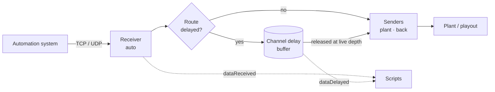
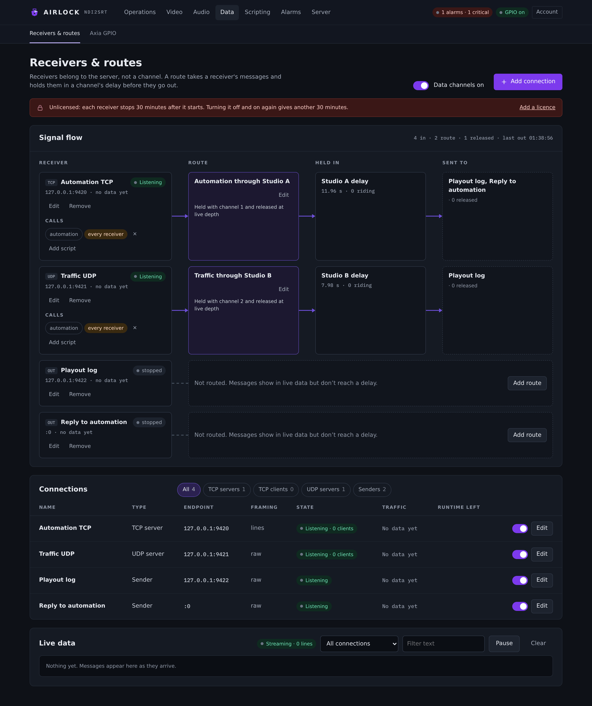

# Data receivers and routes

Automation data describes a moment. If the pictures of that moment are two seconds late, the data has to be too. Airlock carries TCP and UDP messages through the same delay the pictures ride, so a caption, a squeeze-back or a logo change lands with the programme it belongs to.

## How it works

Three objects, and you wire them together by name.

| Object | What it is |
|---|---|
| **Receiver** | A pure input. Other gear connects to you (`tcp_server`), you dial out (`tcp_client`), or you listen for datagrams (`udp_server`). |
| **Sender** | A pure output. `tcp_client`, `tcp_server` (write to every connected client), `udp`, or `receiver` — write back out through an existing receiver's own connections. |
| **Route** | Binds one receiver to one channel's delay and to any number of senders. |



A message is attached to the delay slot that was being written when it arrived, and it goes out when that slot airs. Two things follow from that:

- a **dump cancels exactly the messages in the dumped span** — they were in the removed slots, so they leave with them;
- the release is **frame-exact**, not within a sweep interval.

A rollout's jump cut cancels them the same way: the material never airs, so neither does the data that described it.

!!! note "Sends never run on the frame path"
    A released message is handed to the sender's own thread over a bounded queue. A stalled TCP peer cannot stall the pictures.

## Before you start

- Turn the feature on: **Data channels on** at the top of the page, or `data.enabled: true`.
- The data hub is built at start and reconciled by a **restart**. Adding a receiver, renaming one, or turning one back on takes a restart before it is live.
- On an unlicensed box each enabled receiver runs for **30 minutes per enable**, then it is disabled, audited and alarmed. Turning it off and on again grants a fresh 30 minutes; a valid licence lifts the limit. The page shows the time left in the **Runtime left** column.

## The Receivers & routes page

**Data ▸ Receivers & routes.**

{ .shot }

The page has three cards:

**Signal flow** draws one row per connection — receiver, route, the delay it is held in, and where it is sent. A receiver with no route shows *Not routed. Messages show in live data but don't reach a delay*, with an **Add route** button beside it. Each receiver row also carries its **Calls** strip: the scripts that message fires.

**Connections** is the table: Name, Type, Endpoint, Framing, State, Traffic, Runtime left. Filter it with the chips (**All**, **TCP servers**, **TCP clients**, **UDP servers**, **Senders**). The switch in each row turns a connection on and off; **Edit** reopens it.

**Live data** is the running feed of what has actually arrived and left — time, direction (`in` / `out`), the connection, the peer and the payload. Narrow it with the connection select and the **Filter text** box, hold it with **Pause**, and drop what is on screen with **Clear**. The list above tells you a receiver is connected; this tells you the automation system is sending what it promised.

### Add a receiver

1. Press **Add connection**.
2. Pick the **Type**: *TCP server* (others connect to us), *TCP client* (we connect out) or *UDP server*.
3. Give it a **Name**. Routes, scripts and the live feed all refer to it, so make it short and stable — renaming it means re-pointing everything that names it.
4. Set **Listen on** (the adapter) and **Port**, or **Connect to host** and **Port** for a TCP client.
5. Choose the **Message framing** — see below.
6. Optionally route it straight away under **Route to a delay**: pick a **Channel** and a **Timing** (*Delayed* or *Immediate*).
7. Leave **Start now** on and press **Add TCP server** (the button names the type you picked).
8. Restart the server so the hub picks it up.

### Add a sender

Senders are added through the same **Add connection** drawer, with the **Sender** tile.

!!! warning "The drawer's Sender tile writes a UDP sender"
    A connection added as **Sender** is stored as `kind: "udp"`. The other three sender kinds — `tcp_client`, `tcp_server` and `receiver` — are set in the configuration file. A `receiver`-kind sender is the one that answers down the same TCP session a command arrived on.

### Add a route

1. Press **Add route** on an unrouted receiver, or **Edit** on an existing route.
2. **Name** it — the flow, the live log and script log lines use this name.
3. **Carries messages from**: the receiver.
4. **Through channel**: the delay channel this route rides.
5. **Timing**: *Delayed with the channel* (held with the picture and released at live depth) or *Immediate* (sent the moment it arrives).
6. **Sends to**: at least one sender. A route with no sender is refused — plumbing that counts messages through and delivers them nowhere reads as working until the day somebody needs the data.
7. Leave **Route is on** set and press **Add route**.

One receiver may feed several routes, so the same feed can go out at channel 1's depth on one path and channel 2's on another, or delayed on one and live on another.

## Framing

| Framing | Behaviour |
|---|---|
| `raw` | One read, or one datagram, is one message. |
| `lines` | Split on LF. A trailing CR is trimmed, empty lines are skipped, and an unterminated line is flushed at 64 KiB. |

UDP is always `raw`. The longest single message accepted is **64 KiB**.

Use `lines` for an automation feed that sends one command per line: it hands a script exactly one command per invocation, with the CR already trimmed. With `raw`, a burst from the automation system arrives as a single message holding several commands.

`\n`, `\r`, `\t`, `\0` and `\\` escapes are processed in the on-connect, keep-alive and init strings, and in the text of a manual send.

## What the delay does to a message

| Event | What happens | Counter |
|---|---|---|
| Message arrives on a delayed route | Attached to the slot being written now | `queued` |
| That slot airs | Fanned out to the route's senders | `released` |
| A dump removes the span it rode | It never airs | `cancelled` |
| A rollout jump-cuts past it | It never airs | `cancelled` |
| It arrives while the delay is not running or not draining | Dropped, not sent early — the depth is unknown, so it cannot be honoured | `dropped` |
| It reaches air time on a locked backup | Held back deliberately, so master and backup do not both fire the plant | `suppressed` |

An **immediate** route touches no channel: the message goes out as it arrives.

!!! info "On a backup"
    Receivers stay bound — the automation system dials the same port whichever box is live — but nothing goes out. A held message counts as `suppressed`, which is separate from `cancelled` (taken out by a dump) and `dropped` (arrived with nowhere to go). A manual send is refused with a reason.

## Data and the transport stream

Data routes are socket to socket: in on a receiver, through the delay, out of a sender. They do not add a stream to the encoder's transport stream.

The only non-audio, non-video stream the transport stream carries is **SCTE-35**, which is its own feature — SCTE-104 in on NDI metadata or SCTE-35 off a received stream, delayed with the pictures, re-emitted on NDI and re-inserted on the transport stream. Use a data route for automation traffic between two machines; use SCTE for cues that must ride the stream itself.

## Scripts on a receiver

Every message a receiver takes can call as many scripts as you like. The engine runs every script whose binding matches, so attaching a second one costs nothing.

In **Signal flow**, each receiver row has a **Calls** strip:

- the chips are the scripts bound to this receiver; click one to open it in the editor;
- a chip marked **every receiver** is bound with an empty filter, so editing it affects more than this receiver;
- **Add script** picks an existing script and a **When**: *As it arrives* (`dataReceived`), *When it comes out of the delay* (`dataDelayed`) or *When a client connects or drops* (`dataClientEvent`). Press **Attach**;
- with no scripts on the box at all, **Create a script for this receiver** makes a new JavaScript script already bound to it and opens the editor.

!!! warning "Fix the starter script's argument name"
    The script created by **Create a script for this receiver** reads `args.message`. The payload key is **`args.data`** (with `args.bytes` beside it as lowercase hex). Change it before you save, or the line logs `undefined`.

See [Triggers](../scripting/triggers.md) for the full argument map of the three data triggers.

## Sending a message yourself

Two surfaces write straight into a named sender, outside any route. Both are audited, both process `\n` `\r` `\t` escapes, and both are refused on a locked backup.

=== "REST"

    ```bash
    curl -X POST "http://localhost:8090/api/data/send?sender=plant&text=HELLO"
    ```

=== "TCP control port"

    ```text
    DATA plant HELLO FROM TCP
    OK 0
    ```

A script does the same thing with [`air.send_data`](../scripting/api.md#data).

## Reference

### Receivers

Each entry in `data.receivers`.

| Setting | Console label | Config key | Default | Meaning |
|---|---|---|---|---|
| Name | Name | `name` | — | Unique. Routes, senders and script bindings refer to it. |
| Kind | Type | `kind` | `tcp_server` | `tcp_server` \| `tcp_client` \| `udp_server`. |
| Host | Connect to host | `host` | `""` | `tcp_client` only: the host to dial. Required when enabled. |
| Port | Port | `port` | `0` | Required when enabled. |
| Bind address | Listen on | `bind` | `""` | Server kinds. Empty binds every adapter. A bind failure is an **error** state, never a silent fall back to the wildcard. |
| Framing | Message framing | `framing` | `raw` | `raw` \| `lines`. UDP always behaves as `raw`. The console drawer offers *Lines* first. |
| On connect | — | `on_connect` | `""` | `tcp_client`: sent once when the session opens. Escapes processed. |
| Keep-alive | — | `keep_alive` | `""` | `tcp_client`: sent every `keep_alive_s` while the session lives. |
| Keep-alive interval | — | `keep_alive_s` | `60` | Seconds, 1–86400. |
| Enabled | Start now / row switch | `enabled` | `true` | A disabled receiver binds nothing. |

### Senders

Each entry in `data.senders`.

| Setting | Console label | Config key | Default | Meaning |
|---|---|---|---|---|
| Name | Name | `name` | — | Unique. Routes name it in `sends`. |
| Kind | Type (Sender) | `kind` | `tcp_client` | `tcp_client` \| `tcp_server` \| `udp` \| `receiver`. The console's Sender tile writes `udp`. |
| Host | Connect to host | `host` | `""` | Required when enabled, except for `tcp_server` and `receiver`. |
| Port | Port | `port` | `0` | Required when enabled, except for `receiver`. |
| Bind address | — | `bind` | `""` | Local address for the listening kinds. |
| Through receiver | — | `receiver` | `""` | `kind: receiver` only: which receiver to write back through. A `udp_server` receiver cannot — there is no peer to reply to. |
| Init string | — | `init` | `""` | Sent once per new connection (`tcp_client`, and to each client a `tcp_server` accepts). Escapes processed. |
| Append newline | — | `append_newline` | `true` | Add a newline to any message that has none. |
| Enabled | Row switch | `enabled` | `true` | |

### Routes

Each entry in `data.routes`.

| Setting | Console label | Config key | Default | Meaning |
|---|---|---|---|---|
| Name | Name | `name` | — | Shown in the flow, the live log and script log lines. |
| Receiver | Carries messages from | `receiver` | `""` | Must name an existing receiver. |
| Channel | Through channel | `channel` | `1` | The delay channel this route rides. Must exist when `delayed`. |
| Timing | Timing | `delayed` | `true` | `true` = *Delayed with the channel*; `false` = *Immediate*. |
| Sends to | Sends to | `sends` | `[]` | Sender names. At least one when enabled. |
| Enabled | Route is on | `enabled` | `true` | |

### The whole block

```json
"data": {
  "enabled": true,
  "receivers": [
    { "name": "auto", "kind": "tcp_server", "bind": "0.0.0.0", "port": 9123,
      "framing": "lines", "enabled": true }
  ],
  "senders": [
    { "name": "plant", "kind": "tcp_client", "host": "10.0.0.9", "port": 9720 },
    { "name": "back",  "kind": "receiver",   "receiver": "auto",
      "append_newline": true, "enabled": true }
  ],
  "routes": [
    { "name": "r1", "receiver": "auto", "channel": 1, "delayed": true,
      "sends": ["plant", "back"], "enabled": true }
  ]
}
```

Names are the wiring, so they are validated on save: receiver and sender names must be unique, a route's receiver and every name in its `sends` must resolve, a `receiver`-kind sender must not point at a UDP receiver, and a delayed route's channel must exist.

### Counters

All of these are on the page and in `/api/state` under `data`.

| Scope | Counters |
|---|---|
| Receiver | state, endpoint, clients, messages, bytes, last message, error |
| Sender | state, endpoint, clients, messages, failures, error |
| Route | channel, delayed, sends, `queued` (riding now), `released`, `cancelled`, `dropped`, `suppressed` |
| Whole hub | `messages_in`, `messages_out`, `cancelled`, `dropped`, `messages_suppressed`, `suppressed` |

Receiver and sender **state** reads:

| State | Meaning |
|---|---|
| `listening` | A server kind is bound and waiting. |
| `connecting` · `connected` · `disconnected` | A client kind's session. |
| `ready` · `linked` | A sender is up (`linked` = a `receiver`-kind sender attached to its receiver). |
| `disabled` | Turned off, or stopped by the unlicensed runtime limit. |
| `error` | Could not bind, could not resolve, or names a receiver that does not exist. The reason is carried beside it. |

## Troubleshooting

**The receiver says `error — cannot bind …`.**
Something else holds the port, or the address in **Listen on** is not on this machine. When the port is in use, the message names the process holding it (its pid and executable). Airlock never falls back to the wildcard silently, so a bind failure stays visible until you fix it.

**I added a receiver and nothing is listening.**
The hub is reconciled by a restart. Restart the server.

**The receiver stopped after half an hour and reads `disabled`.**
That is the unlicensed runtime limit. Install a licence, or turn the receiver off and on for another 30 minutes. The alarm list carries `ALARM_UNLICENSED_RUNTIME_LIMIT`.

**Messages arrive but never come out.**
Check the route's counters. `dropped` climbing means the delay was not running when they arrived — nothing is sent early, because the depth is unknown. `cancelled` climbing means a dump or a rollout is taking out the span they rode on. `suppressed` climbing means this box is a backup, which is correct behaviour.

**Several commands arrive in one script call.**
The receiver is on `raw` framing. Switch it to `lines`.

**The far end sees no line breaks.**
`append_newline` on the sender adds one to any message that has none. For a `tcp_client` receiver's own strings, use `\n` in `on_connect` and `keep_alive`.

**A route save is refused.**
A route needs at least one sender, its receiver and senders must exist by name, and a delayed route's channel must exist. The console shows the server's own message.

**A script bound to the receiver never fires.**
Check the binding's **Fired** count on the Scripts page. Zero means the wiring is wrong — usually an **event** filter that does not match the receiver name exactly, or a channel filter on a trigger that carries no channel. See [When a script does nothing](../scripting/examples.md#when-a-script-does-nothing).
