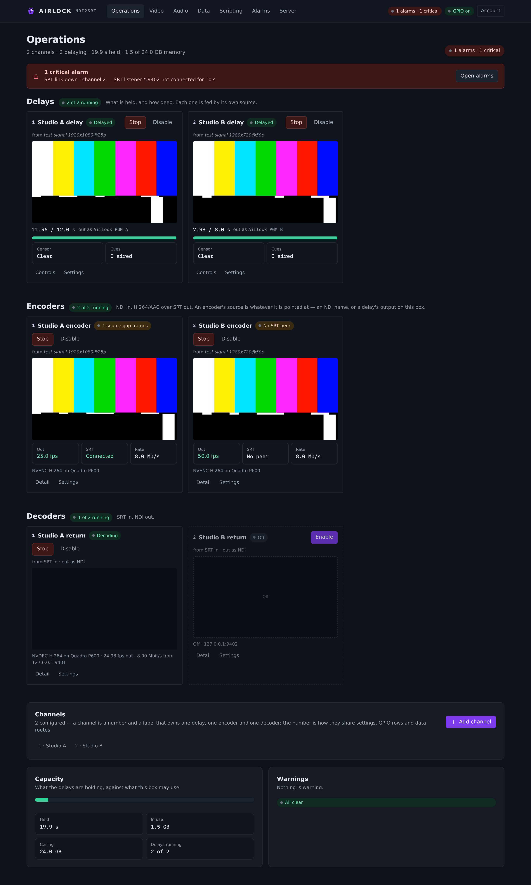

# Airlock

Airlock is a broadcast delay server for NDI plants. It holds your programme in a
buffer so you can drop what should never have been said, encodes and decodes
contribution feeds over SRT, delays and processes audio, and does all of it from
one web console. This manual shows you how to install it, wire it up, operate it
on air, and keep it running.

One Airlock process runs up to 32 **channels**. Each channel owns a video delay,
a video encoder and a video decoder, and carries the ad-cue and automation-data
rails that ride with the pictures. Alongside the channels, the same process runs
the box's named audio inputs and outputs, audio sources with Stereo Tool
processing, broadcast (profanity) audio delays, and standalone audio encoders and
decoders for SRT, RTP, SIP calls, RTMP, Icecast and HLS. Everything else — the console, the TCP
control port, the SNMP agent, the Axia GPIO client, the alarm centre, the audit
log, scripting, authentication and redundancy — is shared by the whole process.

Airlock runs on Windows, Linux and macOS. The shipped build is headless: it runs
as a service and you drive it from the console in a browser, from a wall panel,
from TCP or REST, from Axia contact closures, or from a script.

{ .shot }

## Where to start

- **[Install and first run](start/install.md)** — get the service on the box,
  open the console, and have a delay on air inside ten minutes.
- **[Overview](start/overview.md)** — the blocks, the channel model, and what
  each part is for.
- **[Signal flow](start/signal-flow.md)** — the paths through the box, drawn.
- **[The console](start/console.md)** — every page, every tab, and who is
  allowed to press what.
- **[Licensing](start/licensing.md)** — seats, activation, the hardware id, and
  what an unlicensed box does.

Then go to the part of the plant you are building:

| You want to | Read |
|---|---|
| Delay pictures and sound from an NDI source | [Video › Delay](video/delay.md) and [Operating the delay](control/operating.md) |
| Decide what airs while the delay builds | [Fills and schedules](video/fills.md) |
| Bleep a word without dumping | [Censor, cough and slate](video/censor.md) |
| Send a feed out over SRT | [Video › Encoders](video/encoders.md) |
| Receive an SRT feed and put it on NDI | [Video › Decoders](video/decoders.md) |
| Delay audio on its own, with processing | [Audio delay](audio/delay.md) and [Sources and Stereo Tool](audio/sources.md) |
| Stream audio to Icecast, RTMP or HLS | [Audio encoders](audio/encoders.md) |
| Send audio over RTP, or call a codec over SIP | [RTP and SIP calls](audio/rtp-sip.md) |
| Drive the delay from the studio | [Panel page](control/panel.md), [Axia GPIO](control/gpio.md), [TCP control](control/tcp.md) |
| Carry automation data through the delay | [Receivers and routes](data/receivers.md) |
| Automate the box | [Scripting](scripting/overview.md) |
| Be told when something breaks | [Alarms](alarms/alarms.md) |
| Run a hot spare | [Primary and backup](redundancy/overview.md) |

## Feature matrix

What one Airlock box can do, and where you set it up.

| Capability | What it gives you | Licence token | Console |
|---|---|---|---|
| Video delay | NDI in, a buffer of raw frames, NDI out; build, dump, dump all, rollout, set depth | `VDELAY` | Video › Delay |
| Censor, cough and slate | Bleep, mask or slate the output without dumping | with the delay | Delay settings › Censor & cough |
| Fills and dayparts | What airs while the delay builds or rolls out, by time of day | with the delay | Video › Fills & schedules |
| Video encoder | H.264 or HEVC + AAC in MPEG-TS, out over SRT (caller or listener, AES-128/192/256) | `VENCODE` | Video › Encoders |
| Video decoder | SRT in, H.264/HEVC + AAC decode, out as NDI | `VDECODE` | Video › Decoders |
| Ad cues | SCTE-104 in, SCTE-35 out on the transport stream; cues delayed with the pictures | with the channel | Channel settings › Ad cues (SCTE) |
| Audio inputs and outputs | The box's capture and playback devices as named objects, opened once and shared | — | Audio › Inputs & outputs |
| Audio sources | Stereo Tool processing stages; process once, fan out to many consumers | — | Audio › Sources |
| Audio delay | Broadcast profanity delay built and drained by pitch-preserving time-stretch | `ADELAY` | Audio › Delay |
| Audio encoders | Opus, AAC, MP3, FLAC, aptX / aptX HD over SRT, RTP, a SIP call, RTMP, Icecast or HLS | `AENCODE` | Audio › Encoders |
| Audio decoders | A coded audio stream in over SRT, out as NDI audio and/or to an audio output | `ADECODE` | Audio › Decoders |
| Automation data | TCP/UDP receivers, senders and routes, with the delay in the middle | — | Data › Receivers & routes |
| Axia GPIO | Studio contacts drive the delay; lamps carry its state back | — | Data › Axia GPIO |
| Panel control | The TCP control surface a Stream Deck, Companion or wall panel drives | `PANEL` | Server › Panel |
| Scripting | Lua and JavaScript automation on triggers, timers and cron | `SCRIPTING` | Scripting |
| Alarms | Email, signed webhooks and SNMP v2c traps on everything the box watches | — | Alarms, Server › Email & alerts |
| Redundancy | A backup that mirrors the primary, stays hot and takes over | `PRIMARY` / `BACKUP` / `STANDALONE` | Server › Redundancy |

!!! note "Unlicensed is not blocked"
    A block with no licence seat keeps running — its output carries a watermark
    in the picture and a tone burst in the audio. **Dump and Rollout are never
    gated**, with no licence at all. See [Licensing](start/licensing.md).

## Conventions in this manual

- Console names are written as you see them: **Video › Delay**, the **Build**
  button, the **Depth & dumps** tab.
- Configuration keys are written as they appear in `ndi2srt.json`, e.g.
  `delay.depth_s`, `web.port`, `channels[].encoder.enabled`.
- Addresses in examples use `localhost:8090`; substitute your own host and port.
