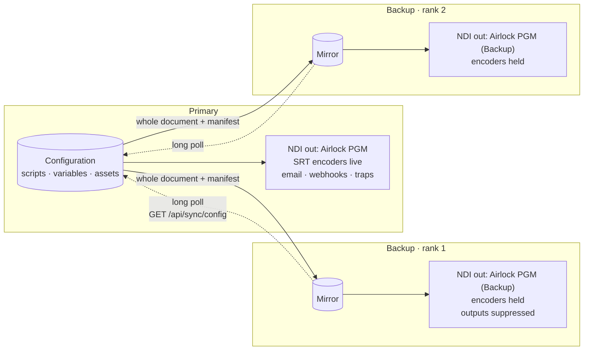
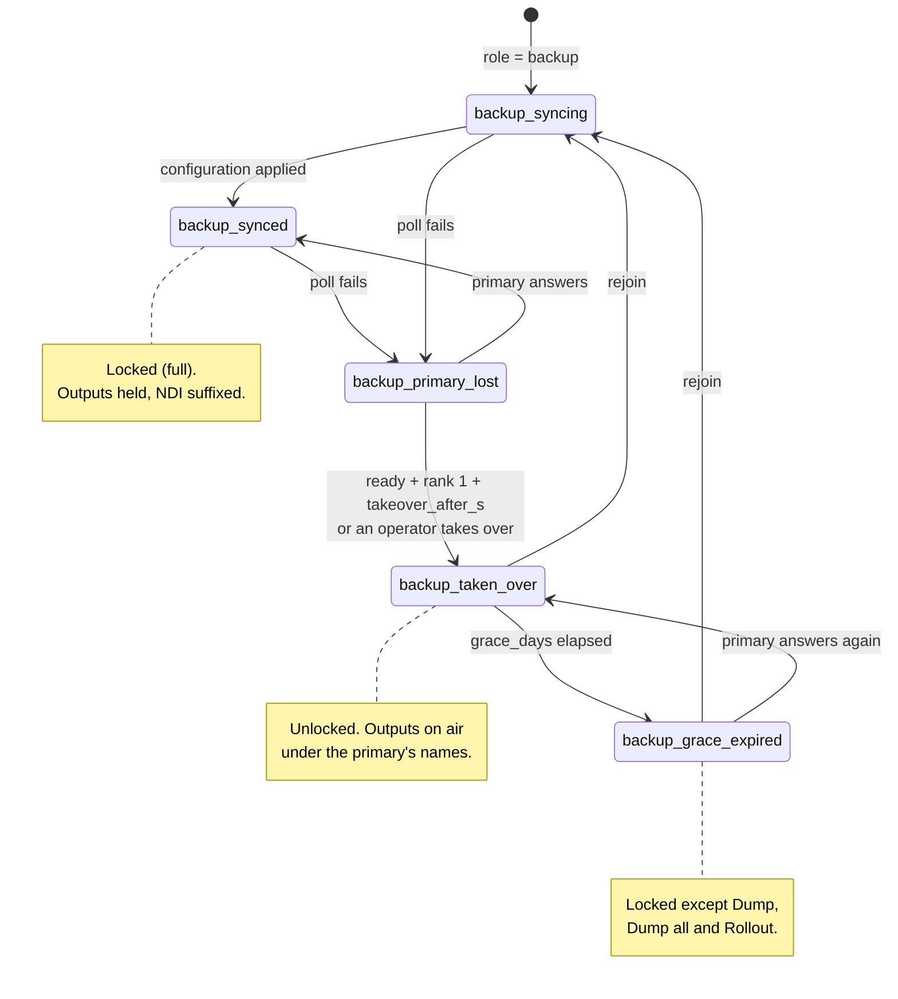
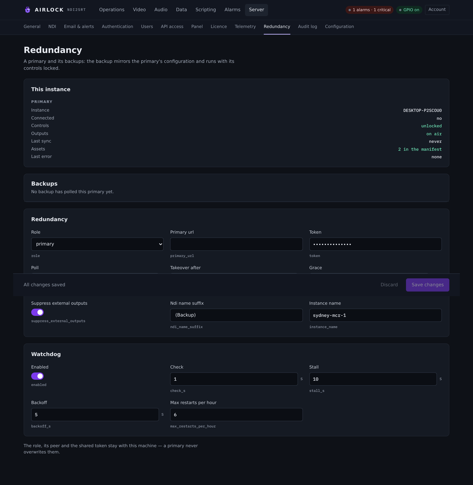

# Primary and backup

Airlock runs in pairs. One instance is the **primary** and does the work; one or
more **backups** mirror its whole configuration, sit hot with full delay buffers,
and take the plant when the primary goes away. This page explains the model —
what mirrors, what stays with the machine, what a standby is allowed to do, and
what each side raises an alarm about.

## The three roles

Every instance has a role, set in `redundancy.role`.

| Role | What it does |
|---|---|
| `standalone` | The default. Nothing changes: no mirroring, no lockout, no peer. |
| `primary` | Serves its configuration to backups. Runs completely normally otherwise — a primary with no backup paired to it is just a standalone. |
| `backup` | Long-polls a primary, applies its configuration, and runs with every control locked. |

The role is part of the licence. A `PRIMARY` licence permits the primary and
standalone roles, a `BACKUP` licence permits the backup role, and a `STANDALONE`
licence permits standalone only. A save that moves an instance into a role its
licence does not carry is refused, and the refusal names the role and what the
licence permits.

!!! danger "Never confirm a backup-role activation on a box you are testing"
    Accepting a backup-role licence offer switches the instance into the backup
    role, which locks its console. A backup-role licence grants nothing on its
    own. If it has already happened, set `redundancy.role` back to `standalone`
    in the configuration file and restart the service.

## The topology



A backup holds one long poll open against the primary and sends the digest of the
configuration it already has. The primary answers the moment its own document
differs, so a change lands in well under a second; an unchanged poll returns at
`redundancy.poll_s` and doubles as the heartbeat. The payload is the **whole**
configuration, not a delta — over-sending costs nothing, and missing an update
would let the backup drift.

The same poll carries the primary's scripts, the persistent script variables, and
an asset manifest. The shared token authenticates it, as a bearer token.

!!! warning "The shared token is as sensitive as the password file"
    The mirrored configuration carries the user records. Keep the pair on a
    trusted network, or terminate the primary's web interface behind TLS and
    point `redundancy.primary_url` at `https://`.

Chained backups are refused: an instance only serves the sync feed while its own
role is `primary`, so a backup of a backup never syncs.

## What mirrors and what stays local

Every setting in the configuration is classified. A backup takes the primary's
value for a **synced** setting and keeps its own value for a **local** one. The
rule of thumb: *what the service does* travels, *what this machine is* stays.

### Stays with the machine

| Area | Keys |
|---|---|
| Web console listener | `web.enabled`, `web.bind`, `web.port` |
| TCP control listener | `tcp.enabled`, `tcp.bind`, `tcp.port`, `tcp.allow_list` |
| SNMP agent socket | `snmp.enabled`, `snmp.bind`, `snmp.port` |
| Redundancy itself | the whole `redundancy` section — role, peer, token, poll, takeover, grace, suppression, suffix, instance name |
| Licence | `licence.store_dir`, `licence.file`, `licence.container_serial`, `licence.container_base_url`, `licence.container_renew_hours` |
| Audio hardware | `audio_inputs`, `audio_outputs` |
| Axia node connections | `gpio.enabled`, `gpio.host`, `gpio.port`, `gpio.password`, `gpio.device`, `gpio.nodes` |
| Paths | `logging.file`, `logging.dir`, `clips.dir`, `tools.ffmpeg` |
| This box's URLs | `clips.public_base_url`, `auth.oidc.redirect_url` |
| Hardware capacity | `process.priority`, `process.max_memory_mb`, `channels[].video.encoder`, `channels[].video.threads`, `channels[].decoder.hw`, `channels[].delay.max_memory_mb`, `clips.encoder` |
| NDI identity and NICs | `ndi_network.adapters`, `channels[].ndi.receiver_name` |
| Clock topology | `clock.reference` |
| Telemetry identity | `telemetry.site` |

Everything else follows the primary.

!!! note "Why the redundancy section is local"
    If a primary could overwrite a backup's `redundancy` section, the first poll
    would tell the backup it is a primary — and you would have two primaries and
    no mirror. The section never travels in either direction.

### Follows the primary

The channel list itself, the delay settings, fills and schedules, censor and
slate, depth maintenance, aux audio tracks, audio processing chains, encoder and
decoder settings, SRT endpoints, transport-stream parameters, SCTE cue handling,
alarms and their thresholds, email, webhooks, SNMP communities and trap targets,
the Axia pin maps, data receivers / senders / routes, the scripting policy, the
scripts themselves and their variables, audit retention, the watchdog, telemetry
destination and key, clip retention and format, the standalone audio encoders,
decoders, stages and audio delays — and **the user records**.

!!! note "Logins mirror on purpose"
    A login that works on the primary works on the backup. There is no shadow
    admin account to remember during a failover.

NDI **output** names are synced on purpose too. They are the service identity a
backup has to be able to assume at takeover. While it is a standby it publishes
under a suffix instead; see [Outputs on a standby](#outputs-on-a-standby).

### Per-channel settings are matched by channel id

The channel list comes from the primary whole — ids, names and all — and the
machine-local per-channel settings are then put back **by channel id**, not by
position. This box's channel 2 keeps its own encoder choice and memory cap even
if the primary lists its channels in a different order. A channel the primary has
and the backup does not simply arrives with the primary's values.

## Assets travel with the configuration

A configuration names files: a fill image or clip, a daypart fill, an audio
delay's fill and censor assets, a Stereo Tool preset. Those files ride the same
poll.

The primary builds a **manifest** of every file under its assets directory plus
every file a mirrored path names, as name, size and SHA-256. The manifest's digest
is part of the revision, so a new or changed fill wakes the backup's poll exactly
as a configuration change does. The backup diffs the manifest against its own
assets directory, fetches only what differs by hash, verifies it, renames it into
place, and prunes whatever the manifest no longer lists.

All of that happens **before** the document is applied, so a fill never
references a file still in flight.

Paths stay the primary's. A path that exists on the backup too — one install
layout on both boxes, or shared storage — is left alone and nothing is fetched.
A path that does not exist on the backup but whose file the mirror holds is
rewritten to the backup's own assets directory as the document is applied. Two
different files with one basename take hash-tagged names.

A file that cannot be brought across — gone from the primary, or a transfer that
did not verify — is reported per file on the Redundancy page, raises
`ALARM_REDUNDANCY_ASSETS`, and never fails the sync: the rest of the document
still lands.

Clips, logs, the licence and the configuration history stay local on both boxes.

## Lockout on a backup

A standby refuses everything that *does* something, at every surface.

| Surface | What a locked backup does |
|---|---|
| REST | Every mutating `/api` call answers `403` with `"locked_by_redundancy": true` and the reason |
| TCP control | `ERR <ch> LOCKED this instance is a backup — …` for `BUILD`, `DUMP`, `DUMPALL`, `ROLLOUT`, `EXIT`, `ENABLE`, `DISABLE` |
| SNMP | A SET on the channel command object answers `resourceUnavailable` |
| Console | The controls in **Operations**, **Video**, **Audio**, **Data** and **Scripting** are dimmed and inert, and the standby banner carries the reason |

Reading is untouched. The console pages, `/api/state`, `/api/config`, the audit
log, previews, and the TCP `STATE`, `ALARMS`, `ROLE`, `CHANNELS`, `SUBSCRIBE` and
`PING` verbs all keep working, so a standby is fully observable while it is
locked. Every refusal is written to the audit log as `control.locked` with who
tried it.

Configuration editing is refused too — the next poll would overwrite it anyway.

The REST lockout is **fail-closed**: a mutating route is locked unless it is on a
short allow-list. The allowed paths are signing in and out, the redundancy panel
itself, the sync feed, the process licence routes, and alarm acknowledge /
dismiss (which only changes what this box's own display shows).

!!! note "The licence stays reachable on a standby"
    Activation is not a control action — it changes nothing on air — and a
    backup that cannot be licensed cannot take over. Discovering that during a
    failover is the worst possible moment, so `/api/licence` stays open. It is
    still admin-only and still audited.

`ROLE 1` on the TCP port tells a panel which half of the pair it is talking to:

```text
ROLE 1 → OK 1 ROLE=backup STATE=backup_synced LOCKED=1 PRIMARY=http://primary:8090
```

### The exits are never locked

**Dump**, **Dump all** and **Rollout** are escape hatches. They stay available
whenever the window has expired, because an instance that may be on air must
never trap its operator. See [Takeover and
rejoin](takeover.md#the-local-control-window) for when that matters.

## Outputs on a standby

With `redundancy.suppress_external_outputs` on — the default — a **locked**
backup does not fire into the plant.

| | On a locked backup |
|---|---|
| Alarm email, signed webhooks, SNMP traps | **Suppressed.** The alarms are still raised, listed, visible to SNMP GET and shown on the page |
| Dump-clip alert email and webhook | **Suppressed** |
| Telemetry samples | **Suppressed** — the primary reports for the plant |
| SRT video encoders | **Held.** Stopped the moment the box becomes a locked backup; started at takeover, or when the role leaves backup. The channel card says *Held · standby* |
| Audio encoders (SRT, RTMP, Icecast, HLS) | **Held** the same way — a mount, a stream key or an origin the primary is already feeding must not be fed twice. the **Audio › Encoders** page lists them *held · standby* |
| Stereo Tool web UI | **Withdrawn** while the controls are locked — it is an unauthenticated on-air control surface — and offered again at takeover |
| NDI outputs (delay, decoder, audio decoders) | **Running**, under the suffixed name. The box stays hot and the delay buffer stays full |
| Dump clips on disk, the audit log, alarm detection, the watchdog | **Running.** All local |

Inputs are never suppressed: the standby's delay keeps receiving its NDI source
and its decoder keeps pulling its SRT stream. That is what keeps it hot.

!!! warning "One SRT source, two receivers"
    If the far end of a decoder's SRT link only accepts one caller, give the
    backup's decoder its own stream, or leave the decoder block disabled there.

### The NDI name suffix

A standby publishes `Airlock PGM (Backup)` rather than going dark, because a
backup whose delay buffer is empty is no use at the moment it is needed — and a
duplicate sender name is far worse than a suffixed one. NDI will not allow two
senders of one name on one host, and a returning primary whose name is still
held by a backup simply fails to create its sender.

`redundancy.ndi_name_suffix` sets the suffix. It is dropped at takeover, and the
NDI blocks restart to take the primary's names.

!!! note "The delay rebuilds its buffer at takeover"
    An NDI sender name is fixed when a block starts, so adopting a name means
    restarting the block that publishes it. Airing under the wrong name is
    worse.

## Ranks and readiness

A primary may have several backups. Two things decide which one acts on its own.

**Rank** is the order the primary first saw its backups: first registered, first
to take over. The rank is persisted on the primary, so a primary restart does not
reshuffle it, and every poll answer carries the backup its rank. Rank **#1**
takes over by itself; the rest wait for an operator. A network partition must not
have three boxes adopt the primary's names at once.

**Readiness** is whether this backup could actually carry the plant right now. It
is not ready if any of these hold:

- one or more assets could not be mirrored;
- the mirrored channels exceed this box's own capacity ceiling
  (`process.max_memory_mb`);
- the pair is running different versions.

A backup that would not take over says so while the primary is gone, with
`ALARM_REDUNDANCY_NOT_READY` and the reasons on the Redundancy page. An
operator's takeover is refused with the same reasons, and **Take over anyway**
overrides them.

## The state machine



| State | Console label | Controls |
|---|---|---|
| `standalone` | standalone | Unlocked |
| `primary` | primary | Unlocked |
| `backup_syncing` | backup · syncing | Locked |
| `backup_synced` | backup · in sync | Locked |
| `backup_primary_lost` | backup · primary lost | Locked |
| `backup_taken_over` | backup · TAKEN OVER | Unlocked |
| `backup_grace_expired` | backup · taken over, window expired | Locked except the exits |

A backup that has not reached its primary yet is locked, not loose. A blip must
never hand the plant to both machines.

## Alarms

Raised on a **backup**:

| Alarm | Severity | Raised when |
|---|---|---|
| `ALARM_REDUNDANCY_PRIMARY_LOST` | Critical | The sync poll cannot reach the primary |
| `ALARM_REDUNDANCY_NOT_READY` | Warning | The primary is gone and this backup will not take over by itself |
| `ALARM_REDUNDANCY_TAKEOVER` | Critical | This backup has taken the plant |
| `ALARM_REDUNDANCY_LOCAL_WINDOW` | Warning | Staged warnings at four days, two days and at expiry of the local-control window |
| `ALARM_REDUNDANCY_ASSETS` | Warning | One or more assets could not be mirrored from the primary |
| `ALARM_REDUNDANCY_SYNC_REFUSED` | Warning | The primary's configuration will not apply on this box |

Raised on a **primary**:

| Alarm | Severity | Raised when |
|---|---|---|
| `ALARM_REDUNDANCY_CHILD_TAKEN_OVER` | Critical | A backup has taken over and is airing under this primary's names |
| `ALARM_REDUNDANCY_CHILD_STALE` | Warning | A backup has not polled for 20 seconds |

While a standby is locked these alarms are raised and listed but not delivered —
`suppress_external_outputs` keeps email, webhooks and traps with the primary.
They are delivered again as soon as the backup takes over.

!!! note "A refused configuration is not a lost primary"
    If the primary's document reaches the backup but will not apply there — a
    path that does not exist, a port already bound, a channel list this box
    cannot honour — the poll still counts as contact. It raises
    `ALARM_REDUNDANCY_SYNC_REFUSED` on its own and is retried, but it never
    makes a healthy pair fail over.

{ .shot }

## Next

- [Setting up a pair](setup.md) — the step-by-step build.
- [Takeover and rejoin](takeover.md) — the rules, the timings and the REST calls.
- [Operating a standby](standby.md) — what the day-to-day looks like on the
  locked box.
