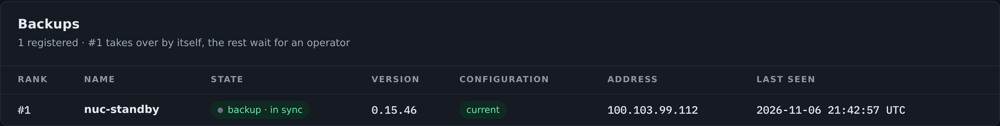

# Setting up a pair

This page builds a primary and a backup from two installed instances. Work
through it in order: licence both boxes, set the primary, set the backup, map the
backup's local audio hardware, then prove the mirror before you trust it.

## Before you start

You need:

- Two installed Airlock instances that can reach each other over HTTP.
- A licence on each box that permits the role it is about to take.
- A strong shared secret, which you will put in `redundancy.token` on both.
- The same media on both boxes, or a primary whose assets directory holds it.
  Fills, slates, daypart assets and Stereo Tool presets are replicated for you —
  see [Step 6](#step-6-check-the-assets).

!!! warning "Run one version on both boxes"
    The sync payload carries a schema version, and a mismatched pair is refused
    loudly rather than silently losing fields. A version difference also makes a
    backup report itself **not ready** to take over. Upgrade the pair together.

## Step 1 — licence both roles

The role is licensed, and the check happens on the *transition*. A save that
moves an instance into a role its licence does not permit is refused with a
message naming the role and what the licence allows.

| Licence flag | Permits |
|---|---|
| `PRIMARY` | `primary` and `standalone` |
| `BACKUP` | `backup` |
| `STANDALONE` | `standalone` only |

A licence carrying none of the three is a legacy roleless licence and is
unrestricted, and so is a box with no licence at all.

So: issue the primary a `PRIMARY` licence and the backup a `BACKUP` licence, and
activate both **before** you change the roles. Activate on **Server › Licence**
on each box.

!!! danger "Do not confirm a backup-role activation on a box you want to keep driving"
    Accepting that offer switches the instance into the backup role and locks
    its console. Recover by setting `redundancy.role` back to `standalone` in
    the configuration file and restarting the service.

!!! note "A backup can always be licensed"
    The licence routes stay open on a locked standby, deliberately. You can
    activate or re-activate a backup while it is mirroring.

## Step 2 — set the primary

On the primary, open **Server › Redundancy** and edit the **Redundancy** block.

| Setting | Value |
|---|---|
| `role` | `primary` |
| `token` | your shared secret |
| `instance_name` | optional; a label for this box. Empty uses the hostname |

Save. The log says *redundancy: primary — serving /api/sync/config to backups*.

Nothing else on the primary changes. It runs exactly as a standalone instance
does, and it will keep running normally whether or not a backup ever appears.

```json
"redundancy": {
  "role": "primary",
  "token": "a-long-random-shared-secret",
  "instance_name": "DC1 primary"
}
```

## Step 3 — set the backup

On the backup, open **Server › Redundancy** and edit the **Redundancy** block.

| Setting | Console label | Config key | Default | Meaning |
|---|---|---|---|---|
| Role | Role | `redundancy.role` | `standalone` | Set it to `backup` |
| Primary URL | Primary URL | `redundancy.primary_url` | *(empty)* | The primary's web base URL, e.g. `http://primary:8090`. Use `https://` if the primary is behind TLS |
| Token | Token | `redundancy.token` | *(empty)* | The same shared secret as the primary. Compared in constant time |
| Poll | Poll s | `redundancy.poll_s` | `5` | How long one long poll waits on the primary before returning empty, and how long to wait before re-dialling after an error. Clamped to 0.5–300 s |
| Takeover after | Takeover after s | `redundancy.takeover_after_s` | `30` | The primary must be unreachable this long before the backup takes over by itself. `0` disables automatic takeover |
| Grace days | Grace days | `redundancy.grace_days` | `14` | The local-control window: how long this backup may hold the plant before the controls re-lock except the exits. `0` = never re-lock |
| Suppress external outputs | Suppress external outputs | `redundancy.suppress_external_outputs` | `true` | While locked, hold the encoders and keep email, webhooks, traps, clip alerts and telemetry with the primary |
| NDI name suffix | NDI name suffix | `redundancy.ndi_name_suffix` | `" (Backup)"` | Appended to this box's NDI output names while it is a locked backup. Dropped at takeover |
| Instance name | Instance name | `redundancy.instance_name` | *(empty)* | The label shown in the primary's **Backups** table. Empty uses the hostname |

Save.

```json
"redundancy": {
  "role": "backup",
  "primary_url": "http://primary:8090",
  "token": "a-long-random-shared-secret",
  "poll_s": 5,
  "takeover_after_s": 30,
  "grace_days": 14,
  "suppress_external_outputs": true,
  "ndi_name_suffix": " (Backup)",
  "instance_name": "DC2 standby"
}
```

The log says *redundancy: backup of … — controls LOCKED, NDI names suffixed
'(Backup)', takeover after 30 s, external outputs suppressed*, and the standby
banner appears under the top bar on every page.

!!! note "The whole redundancy section stays with the machine"
    The primary never overwrites it. Neither instance can tell the other what
    role it is.

!!! warning "This is the last save you can make from that console"
    The save that moves the box into the backup role is allowed, because the box
    is still standalone when you press it. Every save after it is refused — the
    lockout covers the configuration too. To change a backup's settings later,
    stop the service, edit `ndi2srt.json` on the box, and start it again.

### Choosing the numbers

- **`takeover_after_s`** is the gap you are prepared to be off air. Thirty
  seconds is deliberate: a brief network blip must not hand the plant to two
  machines, and the standby's blocks have to restart to adopt the primary's NDI
  names. Shorten it for a plant with a fast, reliable link between the pair;
  set `0` if you want every failover to be a human decision.
- **`poll_s`** is the heartbeat, not the latency of a change. A change on the
  primary wakes the poll immediately — `poll_s` only sets how often an
  *unchanged* poll returns, which is what detects a dead primary.
- **`grace_days`** is how long you are prepared to run the plant on a standby's
  own authority. See [the local-control
  window](takeover.md#the-local-control-window).

## Step 4 — map the backup's local audio I/O

`audio_inputs` and `audio_outputs` are machine-local. The *names* in them are
what everything else refers to — an aux track, an audio delay, an audio encoder,
an audio decoder — and all of those **are** mirrored.

So the backup needs its own input and output entries, with **the same names** as
the primary's and whatever `device` string its own hardware uses.

!!! tip "Do this before Step 3, or edit the file"
    Once the box is in the backup role its console refuses every save. Either map
    the audio I/O while it is still standalone, or stop the service and edit
    `ndi2srt.json` on the box.

=== "Primary"

    ```json
    "audio_inputs": [
      { "name": "Desk", "device": "hw:2,0", "channels": 2 },
      { "name": "Studio mic", "device": "hw:2,2", "channels": 1 }
    ],
    "audio_outputs": [
      { "name": "Air", "device": "hw:2,0", "channels": 2 }
    ]
    ```

=== "Backup"

    ```json
    "audio_inputs": [
      { "name": "Desk", "device": "Axia IP-Audio Device", "channels": 2 },
      { "name": "Studio mic", "device": "Axia IP-Audio Device", "channels": 1 }
    ],
    "audio_outputs": [
      { "name": "Air", "device": "Axia IP-Audio Device", "channels": 2 }
    ]
    ```

The device strings differ — the names do not.

!!! warning "A name the backup does not have is a silent gap"
    If the primary's audio delay plays to an output called `Air` and the backup
    has no output of that name, the mirrored delay on the backup has nowhere to
    go. Build the names first, then the mirror.

The same applies to the Axia GPIO node. `gpio.host`, `gpio.port`,
`gpio.password`, `gpio.device` and `gpio.nodes` are local — two instances writing
one node's lamp pins would fight over them — while the pin maps (`gpio.inputs`,
`gpio.outputs`, `gpio.relays`) and the timing settings mirror. Give the backup
its own node, or leave `gpio.enabled` off there.

!!! note "Match the node `device` names"
    A pin row names the node it is on by that node's `device` label. Use the
    same labels on both boxes, or mirrored rows will land on the wrong node — or
    on none.

## Step 5 — verify the mirror

Open **Server › Redundancy** on the backup. The **This instance** card should
read:

| Row | What you want |
|---|---|
| Instance | the backup's name |
| Primary | the URL you set |
| Connected | `yes` |
| Controls | `locked (backup)` |
| Outputs | `held (standby)` |
| Last sync | a timestamp, seconds ago |
| Rank | `#1 · takes over by itself`, or `#2 · waits for an operator` |
| Ready to take over | `yes` |
| Primary version | the same version this box runs |
| Automatic takeover | `after 30 s unreachable` |
| Assets | `n of n in sync` |
| Last error | `none` |

The card's heading shows the state — you want **backup · in sync**.

Now change something on the primary — a delay depth, a fill tone, an alarm
threshold — and watch **Last sync** tick over on the backup within a second or
two. Its audit log shows `config.sync` with origin `sync`, and the configuration
history keeps the version, exactly as a local save would.

Check that the backup kept its own machine settings: its `web.port`, `tcp.port`,
`redundancy.role` and `redundancy.primary_url` must be untouched.

!!! note "An identical document is a no-op"
    Saving the same configuration again on the primary does not create a history
    entry on the backup.

## Step 6 — check the assets

The **Assets** row on the backup's **This instance** card reads
`n of n in sync`, and lists any file it could not bring across underneath.

On the primary, the same row reads `n in the manifest`.

If a file shows `missing` or `error`, fix it before you rely on the pair: a
takeover on a box that never received the bytes airs a missing fill. A file that
cannot be mirrored also raises `ALARM_REDUNDANCY_ASSETS` and marks the backup
**not ready**.

!!! note "Where the files land"
    A path that exists on both boxes is left alone and nothing is fetched. A
    path that only exists on the primary is fetched into the backup's own assets
    directory and the mirrored document is rewritten to point there.

## Step 7 — read the Backups table on the primary

On the primary, **Server › Redundancy** shows a **Backups** card listing every
backup that has polled it.

| Column | Meaning |
|---|---|
| Rank | `#1` takes over by itself; the rest wait for an operator |
| Name | the backup's `instance_name`, or its hostname |
| State | its own state, or a `taken over` / `stale` pill |
| Version | the version that backup runs |
| Configuration | `current` if it has acknowledged this primary's digest, `behind` if not |
| Address | where it polled from |
| Last seen | the last poll |

A backup that has not polled for 20 seconds is marked **stale** and raises
`ALARM_REDUNDANCY_CHILD_STALE` on the primary. A backup that has taken over
raises `ALARM_REDUNDANCY_CHILD_TAKEN_OVER`, which is critical — two boxes may be
airing under one set of names.

{ .shot }

!!! note "Ranks are persisted"
    Rank is the order the primary first registered each backup, and it survives
    a primary restart, so which box acts on its own does not change because the
    primary rebooted.

## Ports and firewalling

| From | To | Port | Why |
|---|---|---|---|
| Backup | Primary | the primary's `web.port` (default **8090**) | The sync poll and the asset fetches |

That is the only link redundancy itself needs. The pair does **not** talk on the
TCP control port, the SNMP port, or any port of its own.

Everything else a backup needs is the same reach the primary needs: its NDI
sources, its SRT peers, its Axia node, its SMTP relay, its trap receiver. Open
those for the backup too, or it will come up unable to do the job at the moment
you need it.

| Listener | Config key | Default | Note |
|---|---|---|---|
| Web console (and the sync feed) | `web.port` | `8090` | Machine-local on each box — the pair can use different ports |
| TCP control | `tcp.port` | `9350` | Machine-local. Use `tcp.allow_list` to restrict peers |
| SNMP agent | `snmp.port` | `161` | Machine-local |

!!! warning "Protect the sync feed"
    `/api/sync/config` and `/api/sync/asset/<hash>` are authenticated by the
    shared token alone, not by a user session — a backup has to poll before
    anyone has signed in. The token therefore guards the whole configuration,
    user records included. Do not expose the primary's web port to an untrusted
    network without TLS in front of it.

## Checklist

- [ ] Both boxes licensed for the role they will take, and activated.
- [ ] Both boxes on the same version.
- [ ] Primary: `role: primary` and the token.
- [ ] Backup: `role: backup`, `primary_url`, the same token.
- [ ] Backup: `audio_inputs` and `audio_outputs` named the same as the primary's.
- [ ] Backup: its own Axia node, or GPIO off.
- [ ] Backup reaches **backup · in sync**, **Connected: yes**, **Ready: yes**.
- [ ] Assets `n of n in sync` on the backup.
- [ ] The backup appears in the primary's **Backups** table as `current`.
- [ ] The backup's NDI outputs are on air under the suffixed names, with full
      delay buffers.
- [ ] A test change on the primary lands on the backup.

Then read [Takeover and rejoin](takeover.md) before you need it.
