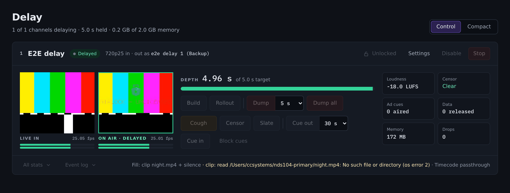

# Operating a standby

A standby is a live, fully observable Airlock instance with its controls switched
off. This page is for the people who look at one every day: what the banner is
telling you, what you can still press, what you cannot, and what to do about the
handful of situations that come up.

## The banner

A backup carries a banner under the top bar on **every** page. It is the fastest
way to know which half of the pair you are looking at. A primary and a standalone
instance show nothing.

There are three.

### Standby

> **Standby.** Mirroring the primary; controls are locked here and the outputs
> are held. &nbsp; *Redundancy*

The normal, healthy state. The middle clause changes with what the sync client is
doing:

| You see | The state is | It means |
|---|---|---|
| *Mirroring the primary* | `backup_synced` | In step. This is where a healthy standby lives |
| *Resyncing from the primary* | `backup_syncing` | Dialling, or no configuration applied yet this run |
| *The primary is unreachable* | `backup_primary_lost` | The poll is failing. The banner adds *A takeover is decided on the Redundancy page* |

*…and the outputs are held* appears only while
`redundancy.suppress_external_outputs` is on, which is the default.

{ .shot }

### This standby has taken the plant

> **This standby has taken the plant.** Controls are live and the outputs are on
> air under the primary's names. &nbsp; *Redundancy*

This box is the plant. The controls answer, the encoders are running and email,
webhooks and traps are firing from here.

If the local-control window has expired the banner adds:

> The local-control window has expired: only Dump and Rollout still answer.

### The primary is back

> **The primary is back.** This standby still holds the plant under the
> primary's names. Rejoin to hand control back and mirror again.
> &nbsp; **[ Rejoin… ]** &nbsp; *Redundancy*

The primary is answering again, and this box is deliberately *not* handing back
on its own. The **Rejoin…** button is right there in the banner; it asks once
more (**Confirm rejoin** / **Not yet**) before it acts.

Until somebody rejoins, changes made on the primary are not applied here.

## What is dimmed and what is not

While a standby is locked, every control in these sections is dimmed and inert —
nothing is clicked only to be refused:

- **Operations**
- **Video**
- **Audio**
- **Data**
- **Scripting**

These sections keep their buttons:

- **Alarms** — acknowledge and dismiss still work. An operator must be able to
  clear a *primary lost* row.
- **Server** — the Redundancy panel is the emergency path, and the Licence page
  has to stay reachable.
- **Account** — sign in, sign out, change your own password.

{ .shot }

!!! note "Navigation is never locked"
    Settings buttons that only open a page stay live. You can read every
    configuration page on a standby — you just cannot save one.

### Everything you can still do

| You can | Where |
|---|---|
| Read every page, card, meter and preview | anywhere |
| Watch the alarm list, and acknowledge or dismiss alarms | **Alarms** |
| Read the audit log | **Server › Audit log** |
| Read the configuration, including every page's settings | **Server**, and the block settings pages |
| Activate or re-activate the licence | **Server › Licence** |
| Take over, or rejoin | **Server › Redundancy** |
| Sign in and out, and change your own password | **Account** |
| Query everything over REST (`GET`) and TCP (`STATE`, `ALARMS`, `ROLE`, `CHANNELS`, `SUBSCRIBE`, `PING`) and SNMP GET | any client |

!!! note "Your login works on both boxes"
    The user records mirror from the primary, so the account you use on the
    primary signs you into the standby. There is no separate standby password to
    find during a failover.

### Everything you cannot

Every mutating action is refused at every surface, with the reason *this instance
is a backup — controls are managed by the primary at &lt;url&gt;*:

- Build, Dump, Dump all, Rollout, Set depth, Cough, Censor, Slate.
- Starting and stopping any block; enabling and disabling one.
- Saving any configuration page — **including the machine-local settings**.
- Resetting statistics, restoring or resetting the configuration.
- Firing a test email or a test webhook.
- Editing or running a script.
- SNMP SET.

Every refusal is written to the audit log as `control.locked`, with who tried it
and what they tried.

!!! warning "You cannot edit a standby's own settings from its console"
    The lockout is blanket: it refuses the configuration save, not just the
    settings that would be overwritten by the next poll. To change a
    machine-local setting on a locked backup — its web port, its audio devices,
    its Axia node, or its role — stop the service, edit `ndi2srt.json` on the
    box, and start it again.

### After the local-control window expires

When a standby that has taken the plant runs past `redundancy.grace_days`, the
controls re-lock except the exits. **Dump**, **Dump all** and **Rollout** on a
video delay keep answering — on the console, over REST and over TCP (`DUMP`,
`DUMPALL`, `ROLLOUT`, `EXIT`). Nothing else does.

An instance that may be on air must never trap its operator, so those three never
lock, in any state, on any box, licensed or not.

## Reading the Redundancy page

**Server › Redundancy** is the one page that tells you everything about this
box's half of the pair. The **This instance** card is headed with the state —
*backup · in sync*, *backup · primary lost*, *backup · TAKEN OVER* — and carries
these rows.

| Row | What it says | What you want on a healthy standby |
|---|---|---|
| Instance | This box's name | — |
| Primary | The URL it polls | the primary's base URL |
| Connected | Whether the last poll reached the primary | **yes** |
| Controls | `locked (backup)`, `locked (exits only)` or `unlocked` | **locked (backup)** |
| Outputs | `held (standby)` or `on air` | **held (standby)** |
| Last sync | When a configuration was last applied, and how long ago | a recent timestamp |
| Rank | `#1 · takes over by itself` or `#n · waits for an operator` | whichever you designed |
| Ready to take over | `yes`, or the reasons it is not | **yes** |
| Primary version | The version the primary runs | the same version this box runs |
| Automatic takeover | `after 30 s unreachable`, or `off` | whichever you configured |
| Taken over | When, and by whom | absent on a standby |
| Local-control window | Time left, or `expired`, or `not running (primary reachable)` | absent on a standby |
| Assets | `n of n in sync`, with problems and fetches counted | **n of n in sync**, no problems |
| Last error | The last poll error | **none** |

Any asset that is not in sync is listed underneath the card, one line each, with
its name and what went wrong.

The **Watchdog** block on the same page is the block watchdog, not a redundancy
setting — it runs on a standby exactly as it does anywhere else.

!!! note "`Ready to take over` is worth watching"
    It is the single row that tells you whether this standby would actually be
    any use. Add it to whatever you look at each morning.

## Common situations

### Connected says no and Last error names a connection problem

The backup cannot reach the primary.

1. Check the primary is running, and that its web listener is up on the port in
   `redundancy.primary_url`.
2. Check the network path and any firewall between the pair. The only port
   redundancy needs is the primary's web port.
3. Check the URL itself — a trailing path, the wrong scheme, or a hostname the
   backup cannot resolve.

`ALARM_REDUNDANCY_PRIMARY_LOST` is raised, and the automatic-takeover countdown
is running if `takeover_after_s` is non-zero.

### Last error says the primary answered 401 or 403

The token does not match, or the primary is not in the `primary` role.

- `401` / a token message: `redundancy.token` differs between the boxes. Set it
  on both. It is compared in constant time, so there is no partial match.
- *this instance is not a primary*: the far box's `redundancy.role` is not
  `primary`. A backup never serves the sync feed, so a backup of a backup cannot
  work.

### The schema version does not match

> sync schema 1 from the primary, this build speaks 2 — upgrade the pair
> together

The two boxes run builds whose sync payloads differ. Upgrade both to the same
version. The backup keeps running on the configuration it already has until you
do.

### ALARM_REDUNDANCY_SYNC_REFUSED

The primary's configuration reached this box and would not apply here. The alarm
text carries the reason — a path that does not exist, a port already in use, a
channel list beyond this box's capacity.

Fix the cause on this box (it is almost always a machine-local setting that does
not match the plant the primary describes), and the next poll applies the
document. Contact is fine throughout; this never causes a failover.

### Ready to take over says no

Read the reasons on the card. They are one of:

| Reason | Fix |
|---|---|
| *n asset(s) not mirrored* | Look at the per-file list under the card. A file gone from the primary, or a transfer that did not verify |
| *over this box's capacity ceiling* | The mirrored channels need more buffer memory than `process.max_memory_mb` allows here. Raise it, or lower the primary's depths |
| *version mismatch* | Upgrade the pair to one version |

An operator can still take the plant with **Take over anyway**, having read the
reasons.

### The NDI outputs are not where you expect them

A locked standby publishes under `redundancy.ndi_name_suffix` — `Airlock PGM
(Backup)` by default. That is correct and deliberate: a duplicate sender name is
far worse than a suffixed one, and NDI will not allow two senders of one name.

If a receiver downstream is pinned to the unsuffixed name it will see the
primary only, which is the point. The suffix is dropped at takeover.

### The encoders say "Held · standby"

Expected. A locked backup holds every SRT video encoder and every audio encoder
(SRT, RTMP, Icecast, HLS) so that a mount, a stream key or an SRT listener the
primary is already feeding is not fed twice. They start at takeover.

If you need the standby's encoders running anyway — a separate destination that
genuinely wants a second feed — set `redundancy.suppress_external_outputs` to
`false` on that box. Think about email, webhooks, traps and telemetry before you
do: they come back too, and the plant will get everything twice.

### Alarms are showing but nobody is being emailed

Also expected. A locked standby raises, lists and displays alarms but does not
deliver them — the primary speaks for the plant. The alarms are visible on the
page and to SNMP GET, and delivery resumes the moment the box takes over.

### The box says it has taken over and you did not do it

Automatic takeover fired: the primary was unreachable for `takeover_after_s` and
this box was ready and rank 1. Check the audit entry `redundancy.takeover` for
the detail — it names the threshold and how long the primary had been gone.

Find out why the primary went away before you rejoin.

### Two boxes are airing under one set of names

The primary is raising `ALARM_REDUNDANCY_CHILD_TAKEN_OVER` — a critical alarm —
and naming the backup. Decide which box is the plant:

- Keep the standby on air: stop the primary's service, or move it off the names.
- Give it back: **Rejoin…** on the standby, then bring the primary back on air.

Do not leave it. NDI will refuse the second sender of a name, so one of the two
is publishing nothing.

### A backup has gone quiet

On the primary, the **Backups** table marks it **stale** after 20 seconds without
a poll, and raises `ALARM_REDUNDANCY_CHILD_STALE`. The backup is down, or has
lost the path to the primary. Go and look at it — a standby nobody checks is a
standby that is not there.

### You need to make this box a standalone instance again

Stop the service, set `redundancy.role` to `standalone` in `ndi2srt.json`, and
start it again. Leaving the backup role clears any takeover state and the
local-control window, so re-entering the role later starts suffixed and locked
from scratch.

You cannot do this from the console while the box is locked — the configuration
save is refused like every other mutating call.
