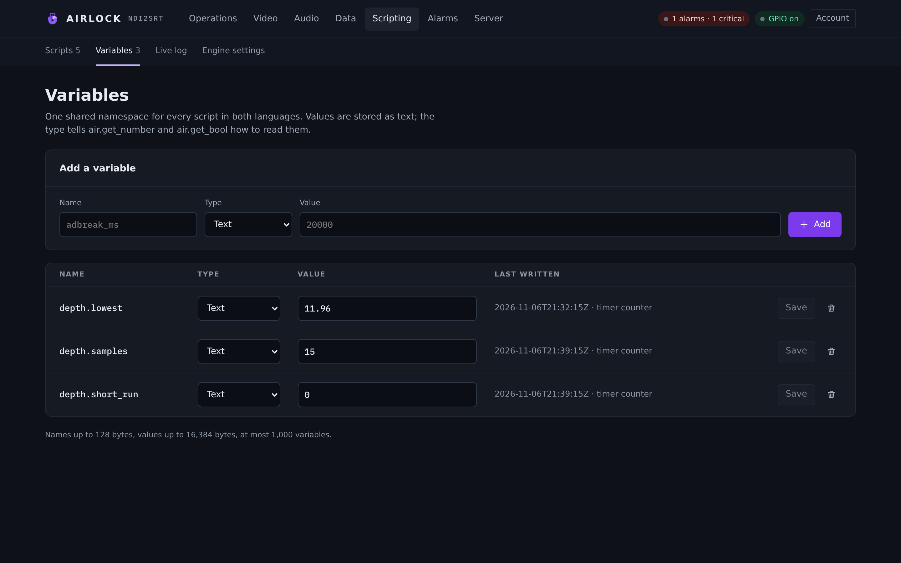

# Variables and examples

A script keeps nothing of its own between runs. Persistent variables are the state that does survive — a latch, a counter, the name of the last cue, the flag another script reads. This page covers the variable store, the worked examples that ship with Airlock, and what to check when a script does nothing.

## Persistent variables

=== "Lua"

    ```lua
    local n = (air.get_number("breaks") or 0) + 1
    air.set_var("breaks", string.format("%d", n))
    ```

=== "JavaScript"

    ```javascript
    air.set_var("state", JSON.stringify({ breaks: n, at: new Date().toISOString() }));
    ```

The rules:

- **One flat namespace**, shared by every script and by both languages. One script sets, another reads.
- **Everything is a string on the wire.** `air.get_number` and `air.get_bool` parse it; both answer nothing — `nil` in Lua, `undefined` in JavaScript — when the variable is absent or does not parse, so the script supplies its own default.
- A variable's **type** (`string` \| `number` \| `bool` \| `json`) is a display and validation hint for the Variables page, not a contract. **A script's write keeps whatever hint is already recorded.**
- **Persisted and replicated.** They live in `<config dir>/script-vars.json`, rewritten as a whole file through a temporary file and a rename, so a write can neither interleave with another nor be read half-done. They are mirrored to a backup, so a counter or a latch survives a restart *and* a takeover.
- **A script's write is not audited one by one.** A counter would fill the audit log with its own arithmetic, and the run that did it is already audited. An operator's write over REST is audited (`scriptvar.set`, `scriptvar.delete`).

### Typed reads

| Call | Answers |
|---|---|
| `air.get_var(name)` | The raw string, or nothing when absent. |
| `air.get_number(name)` | The value parsed as a number, or nothing when absent or unparseable. |
| `air.get_bool(name)` | `true` for `true`, `1`, `yes`, `on`; `false` for `false`, `0`, `no`, `off`; nothing for anything else. |

```lua
local depth = air.get_number("night.depth") or 6   -- always supply a default
local armed = air.get_bool("auto.armed")
if armed == nil then armed = false end
```

### The caps

| | Cap | Past it |
|---|---|---|
| Variable name | **128 bytes**, no control characters | The write is refused |
| Value | **16 KiB** | The write is refused |
| How many | **1000** variables | A *new* name is refused; overwriting an existing one still works |

A refused write is `false` to the script, and HTTP 400 over REST. It is never an exception and never a silent success. The whole file is rewritten on every set, so these bounds are what keeps a runaway script from costing more than memory: **a variable is a latch, a counter or a short string, not a buffer.**

### Operator editing

**Scripting ▸ Variables.**

{ .shot }

Add one with the **Add a variable** row — **Name**, **Type** (*Text*, *Number*, *On / off*) and **Value** — then **Add**. The page asks for names of letters, numbers and underscores starting with a letter, which keeps them comfortable in both languages.

In the table, edit **Value** or **Type** in place and press **Save** on that row; the bin removes it. **Last written** shows when and by whom — a script name, a user, or `sync` when a backup took it from its primary.

Use this to tune automation without editing a script: a threshold, a channel number, an armed/disarmed latch. Read it back with `air.get_number` or `air.get_bool`.

Over REST:

```bash
curl -s http://localhost:8090/api/script-vars
curl -X POST http://localhost:8090/api/script-vars \
  -H 'content-type: application/json' \
  -d '{"name":"night_depth","value":"30","type":"number"}'
curl -X DELETE http://localhost:8090/api/script-vars/night_depth
```

## The worked examples

Every file in `examples/` is compiled into the test binary and run through its real engine by the test suite, so the script you copy is the script under test. Each one carries its own wiring in its header comment.

| File | Language | Trigger | What it does |
|---|---|---|---|
| `timer-counter.lua` | Lua | `timer` | Samples the depth every tick and keeps what it found in four persistent variables — lowest depth, consecutive shortfalls, episodes — so the box can answer "has this channel been holding its depth?" across restarts. |
| `timer-counter.js` | JavaScript | `timer` | The same, keeping its whole state in **one JSON variable**, stamped with `Date`. |
| `nightly-depth.lua` | Lua | `schedule` | A deep buffer overnight, the on-air depth back before breakfast. One file installed twice, telling the two passes apart by the **cron expression it was fired for** — the only clock a Lua script has. |
| `status-watchdog.lua` | Lua | `encoderEvent` · `decoderEvent` · `alarm` | Starts a block that went `Down` again, at most three times per outage, and reports a raised alarm to the plant. One file, up to three bindings, switching on `trigger`. |
| `status-watchdog.js` | JavaScript | the same three | The same watchdog reporting **JSON** to the plant, for a monitoring system rather than a person. |
| `gpi-control.lua` | Lua | `gpi` | The part a GPIO mapping row cannot say: counts dump presses, tells the plant, and holds the **picture** censor while the cough pin is held. |
| `automation.lua` | Lua | `dataReceived` | An automation feed's **command lines** (`DUMP 5 CH 2`) driving the delay and the encoder, with a `STATUS` reply back out through a data sender. |
| `automation.js` | JavaScript | `dataReceived` | The same surface over **JSON** (`{"cmd":"dump","seconds":5}`) — the case JavaScript exists here for. |

Two things every example shares, because both are the house style:

- **a refused command is never reported as done** — each one turns `false` into one line naming the cause;
- **anything unrecognised is logged at info and ignored**, never an error. A real feed carries traffic meant for other gear.

The full sources are in [Lua](lua.md) and [JavaScript](javascript.md). Two more are worth reading here.

### A scheduled depth change

`examples/nightly-depth.lua`, installed **twice** — a script names one trigger and one cron expression, so each pass is its own binding, and the script tells them apart by the expression it was fired for.

| Name | Trigger | Cron | Meaning |
|---|---|---|---|
| `nightly deep` | `schedule` | `0 1 * * *` | 01:00 every day |
| `nightly back` | `schedule` | `0 6 * * 1-5` | 06:00 on weekdays |

```lua
local CH = 1

-- Keyed by the cron expression exactly as it is written in the binding.
local PASSES = {
  ["0 1 * * *"]   = { depth = 30, note = "overnight: deep buffer for the compliance window", clear = true },
  ["0 6 * * 1-5"] = { depth = 6,  note = "breakfast: back to the on-air depth" },
}

local function why(ch)
  local locked = air.locked_out()
  if locked ~= "" then
    return "this box is a backup: " .. locked
  end
  if air.locked(ch) then
    return "ch" .. ch .. " is locked to " .. air.lock_holder(ch)
  end
  return "delay on ch" .. ch .. " is " .. air.block_state(ch, "delay")
end

function main(trigger, channel, event, args)
  local cron = (args and args.cron) or event
  local pass = PASSES[cron]
  if not pass then
    -- A binding whose expression is not in the table above: say so rather than
    -- guess, because guessing means the wrong depth on air.
    air.log("warn", "no pass for cron '" .. tostring(cron) .. "' — nothing done")
    return "unknown pass"
  end

  air.log("info", pass.note)
  if pass.clear then
    -- Start the day's counters again, so depth.lowest means "lowest today".
    for _, v in ipairs({ "depth.samples", "depth.lowest", "depth.short_run", "depth.short_episodes" }) do
      air.delete_var(v)
    end
  end

  local state = air.state(CH)
  if not air.set_depth(CH, pass.depth) then
    return string.format("depth %d s REFUSED (%s)", pass.depth, why(CH))
  end

  -- Setting the depth is the target, not the buffer: a channel sitting live
  -- has to be told to build to it. One already delayed converges by itself.
  if state == "live" then
    air.build(CH)
  end

  return string.format("%s → depth %d s (was %s, %.2f s)", cron, pass.depth, state, air.depth(CH))
end
```

### A GPI pin that does more than its mapping row

`examples/gpi-control.lua`, bound to `gpi` on channel 1.

Read this first: a `gpi` trigger fires for a pin a **control row already recognised**, and that row has already run its action through the controller. The script is not how a pin dumps — the mapping row is. It is how a pin does the part the mapping vocabulary has no word for: tell the plant, count the press, and add the control GPIO cannot express. The cough half is the point of the example: the GPIO vocabulary has no censor action, so a studio that wants the picture masked while the cough is held can only get it from a script.

```lua
local NOTIFY = "plant" -- data sender to report on; "" = don't report at all

local function tell(line)
  air.log("info", line)
  if NOTIFY ~= "" then
    air.send_data(NOTIFY, line)
  end
end

function main(trigger, channel, event, args)
  if not args then
    return "no args"
  end
  local ch = channel
  if ch < 1 then ch = 1 end
  local action = args.action or ""
  local asserted = args.edge == "asserted"
  local pin = string.format("%s/%s.%s", args.device or "?", args.port or "?", args.pin or "?")

  if action == "dump" or action == "dumpall" then
    if not asserted then
      return "ignored release"
    end
    local n = math.floor((air.get_number("dumps.pressed") or 0) + 1)
    air.set_var("dumps.pressed", string.format("%d", n))
    tell(string.format("DUMP pressed on %s — ch%d at %.2f s, %d this shift", pin, ch, air.depth(ch), n))
    return string.format("dump %d", n)
  end

  if action == "cough" then
    -- The row's own action has already taken the audio; this adds the picture.
    -- Spelled out with an `if`, not with and/or: these calls answer false when
    -- they are refused, and `a and f() or g()` would then call g().
    local ok
    if asserted then
      ok = air.censor_on(ch)
    else
      ok = air.censor_off(ch)
    end
    air.set_var("cough.held", asserted and "yes" or "no")
    tell(string.format("COUGH %s on %s — picture censor %s",
      asserted and "down" or "up", pin, ok and "followed" or "REFUSED"))
    return asserted and "cough on" or "cough off"
  end

  -- Every other pin: the mapping row has done its job and there is nothing to
  -- add. Logged rather than ignored silently, so a new pin is visible.
  air.log("info", string.format("%s %s %s — nothing extra to do", pin, action, args.edge or ""))
  return "ignored " .. action
end
```

The matching GPIO rows, with their **0-based** pins:

```json
"gpio": { "enabled": true, "device": "axia", "inputs": [
  { "port": 2, "pin": 0, "edge": "LOW",  "action": "dump",  "channel": 1 },
  { "port": 2, "pin": 1, "edge": "BOTH", "action": "cough", "channel": 1 } ] }
```

Those two rows reach the script as `axia/2.1` and `axia/2.2`: the pin a script is handed is **1-based**, as the console labels it and as the audit log writes it.

## When a script does nothing

Work down the list. Each answer rules out the ones above it.

**1. Is scripting on?**
`scripting.enabled`, or **Scripting on** on the Engine settings page. With it off, the store still holds the scripts and the log says how many are stored and that none will run.

**2. Is scripting licensed?**
Without `SCRIPTING` on the licence nothing is dispatched at all — no trigger, no timer, no cron, no `startup` or `shutdown` job — and a manual Run answers `403 ERR_UNLICENSED`. The log says so once at start and once per script the first time it is turned away: `not dispatched: the licence carries no SCRIPTING feature`. Writing, saving, validating and rolling back all still work.

**3. Is the script enabled?**
A disabled script that is triggered records a failed run saying so.

**4. Is the trigger arriving?**
Look at **Fired** on the Scripts page. Zero is a wiring problem: the wrong trigger word, a **Channel** filter on a trigger that carries no channel, or a name filter that does not match — the receiver name, the alarm code, or `<device>/<port>.<pin>` with its 1-based pin.

**5. Is it being dropped?**
`dropped` climbing means the queue is full: something on the box is firing faster than the scripts can run, or a script is slow enough to be cut. Raise **Queue size**, or make the script faster.

**6. Is it failing?**
`failed` and the last error. A compile failure reads `will not load: …`, a missing entry reads `no such entry function '…'`, a cut run reads `timeout after …`.

**7. Is it being refused?**
The run succeeded but the command did not. Look at the script's own log line, and at the audit entry under the script's name with the reason — the channel lock, the backup lockout, the licence, or a block that is not running. Dump and rollout are never refused by the licence.

The live table of runs (last run, how long, what it returned or why it failed) and the scripts' own log lines are both on the Scripts page, on the **Live log** page, and in `/api/state` under `scripting`.

### Symptoms and causes

| Symptom | Likely cause |
|---|---|
| `Fired` climbs, nothing happens | The script ran and its commands were refused. Check the Live log and the audit log. |
| `Fired` is 0 on a `dataReceived` binding | The **Receiver** filter does not match the receiver's name, or the receiver is not running. |
| `Fired` is 0 on a `gpi` binding | The pin filter is 0-based. Copy the `<device>/<port>.<pin>` string from an audit line. |
| `Fired` is 0 on a channel-filtered binding | That trigger carries no channel, so a channel filter can never match it. Set **Channel** to *Any channel*. |
| A run reads `will not load: …` | The source does not compile. Open it and press **Check**. |
| A run reads `no such entry function` | The **Entry function** field and the function in the source disagree. |
| Every run reads `timeout after 1000 ms` | The script loops, or does too much. Split the work across timer ticks and keep progress in a variable. |
| Nothing at all runs, and the log mentions the licence | `SCRIPTING` is missing from the licence. |
| A variable never changes | `air.set_var` answered `false` — the name, the value or the store is past a cap. The script log carries the refusal. |
| Everything worked until half an hour after a restart | The unlicensed runtime limit disabled the script. Install a licence, or re-enable it. |
