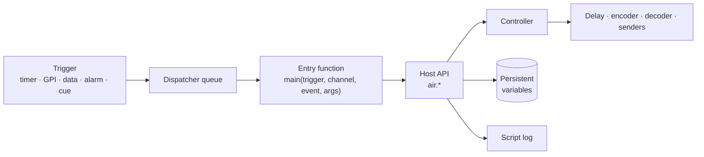
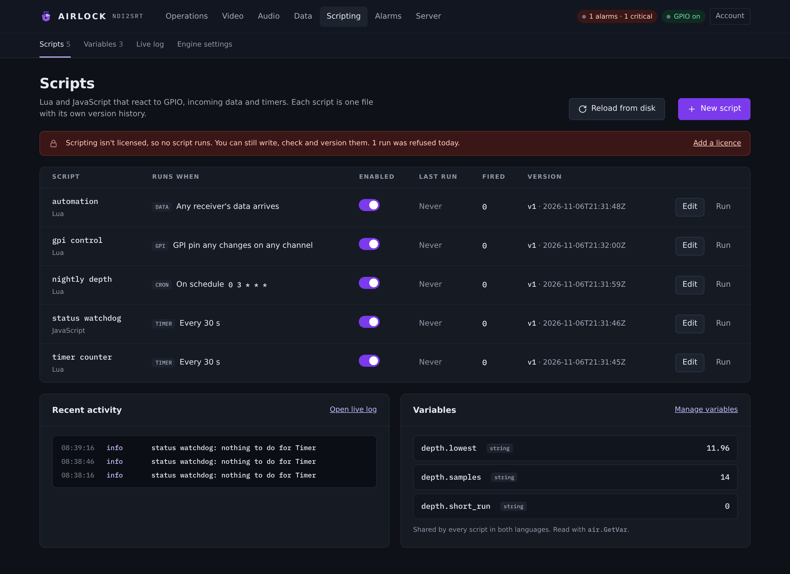
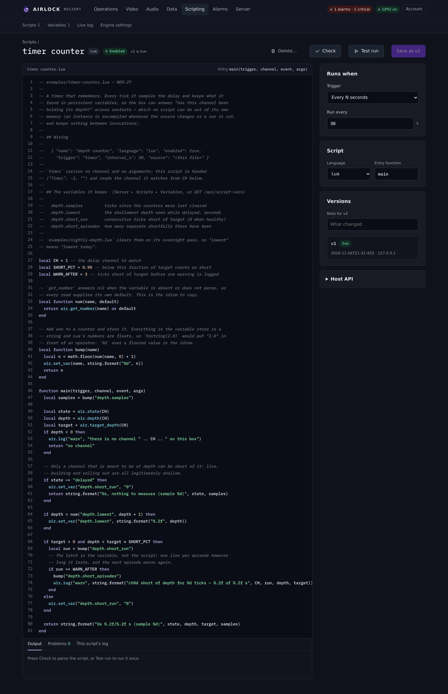
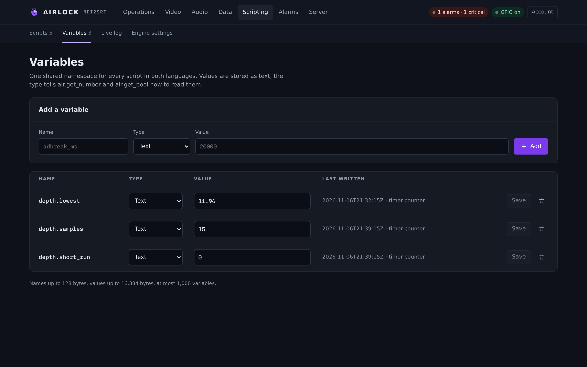
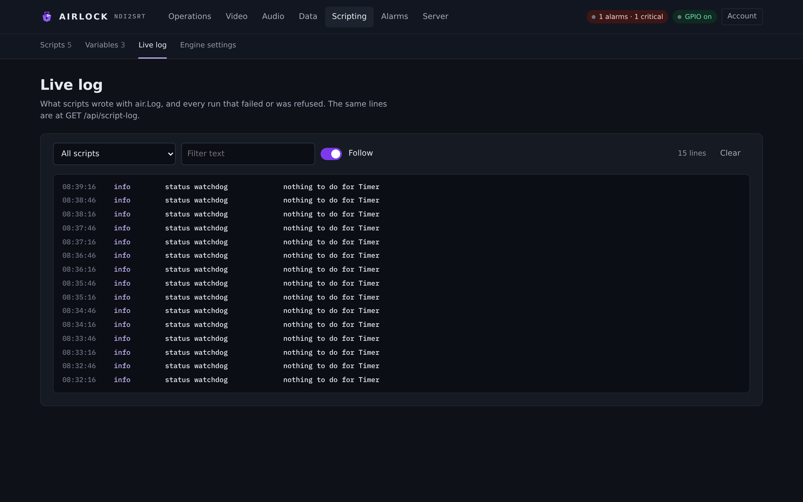
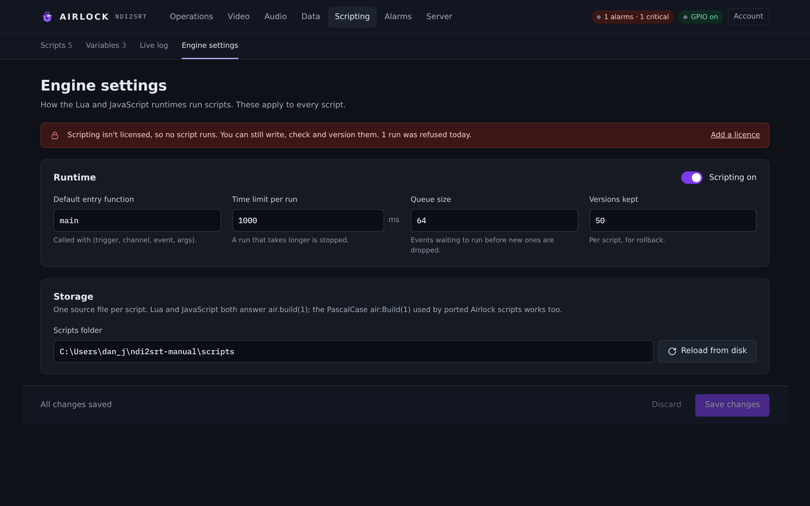

# Scripting overview

Scripting is automation you write yourself: a few lines of Lua or JavaScript that watch this box and drive it. Build the delay when automation says a programme has started, dump when a code arrives, hold the censor while a pin is held, tell the plant how deep the buffer is, start a block that fell over at three in the morning.

## What it is for

A script is a **first-class control surface with an operator's authority**. Everything it does goes through the same door the console, REST, TCP, GPIO and the panel come through, so it obeys the channel lock, appears in the audit log by name, and is refused on a locked backup.



Reach for a script when the thing you want is *not* a control that already exists:

- an automation feed sends `DUMP 5 CH 2` and you need that turned into a dump;
- a GPI pin should mask the picture as well as the audio, and the GPIO vocabulary has no censor action;
- an encoder that drops out at 3 a.m. should be started again, three times, and then reported;
- the buffer should be 30 seconds overnight and 6 seconds by breakfast;
- the plant wants a JSON status report on a socket every thirty seconds.

If a console control, a GPIO mapping row or a TCP verb already does the job, use that. A script is for the part the vocabulary has no word for.

## Licence

Scripting needs the **SCRIPTING** feature on the licence. Without it nothing is dispatched at all — no trigger, no timer, no cron, no `startup` or `shutdown` job — and a manual run answers `403 ERR_UNLICENSED`.

Writing, saving, validating, versioning and rolling back scripts all keep working on an unlicensed box, so you can build and check automation before the licence arrives. The log says so once at start and once per script the first time it is turned away, and the `unlicensed` counter in `/api/state` counts every refusal.

!!! note "The unlicensed runtime limit"
    On a box with no valid licence, each **enabled** script also runs for 30 minutes per enable before it is disabled, audited and alarmed. Re-enabling grants a fresh 30 minutes.

## Lua or JavaScript

Both engines are compiled into the binary. There is nothing to install on either platform, the host API is identical, and the entry signature is the same.

| | Engine | Pick it when |
|---|---|---|
| **Lua** | Lua 5.4 | This is what operators already write. A ported script runs by pasting it, including the `air:Build(1)` colon spelling. |
| **JavaScript** | QuickJS | **The payload is JSON.** `JSON.parse` and `JSON.stringify` are in the sandbox. |

That is the honest difference, and it should be the one that decides it. Lua's sandbox has **no JSON library at all**, so a Lua script handed `{"cmd":"dump","seconds":5}` has to pattern-match it by hand — which is how quoting bugs get on air. If a data receiver or a data sender carries JSON, write that script in JavaScript. If it carries a line of text, Lua is the shorter program.

Two smaller differences:

- **Lua has no clock.** The `os` library is never opened, so there is no `os.time` and no `os.date`. A Lua script knows when it ran only from the trigger that ran it. JavaScript has `Date`, because `Date` is part of the language.
- **JavaScript has a heap limit** of 64 MiB per instance, so a runaway allocation fails inside the script rather than inside the process. Lua is bounded by the invocation budget instead.

On the wire the languages are **`lua`** and **`javascript`**; `js` is accepted and stored as `javascript`.

See [Lua](lua.md) and [JavaScript](javascript.md) for the specifics of each.

## Where scripts live

Scripts are **not** part of the configuration file. They are their own versioned store in a directory beside it:

```text
<config dir>/scripts/index.json                      name, language, entry, trigger, filters, enabled, live version
<config dir>/scripts/<name>.lua | <name>.js          the live source — diffable, greppable, hand-editable
<config dir>/scripts/versions/index.json             the version history
<config dir>/scripts/versions/<name>-<n>.lua | .js   one immutable snapshot per version
<config dir>/script-vars.json                        the persistent variables
```

One file per script, because that is what you want at three in the morning: it diffs in git, greps on the box, and gets syntax highlighting from its extension — and one corrupt file costs one script instead of all of them. The index holds only metadata, so hand-editing a source never has to be matched by an edit to the index.

Two bounds on a script itself:

- a **name** is 1–64 characters of letters, digits, space, `.`, `_` and `-`. It is the audit principal, the log line and the REST path;
- a **source** is at most **512 KiB** — automation, not a data file, and small enough that a paste accident is refused rather than stored.

### Installing a script

Three ways, all equivalent.

=== "The console"

    **Scripting ▸ Scripts ▸ New script**, paste the file, set the language, trigger and filters, press **Check**, then **Create script**.

=== "REST"

    ```bash
    jq -n --arg src "$(cat examples/timer-counter.lua)" \
       '{name:"depth counter", language:"lua", trigger:"timer", interval_s:30, source:$src}' \
     | curl -sS -X POST http://localhost:8090/api/scripts \
         -H 'content-type: application/json' -d @-
    ```

=== "Drop the file in"

    Put a `.lua` or `.js` file in `<config dir>/scripts/` and reload (**Reload from disk**, `POST /api/scripts/reload`, or a restart). A file the index does not know about is **adopted** under its file name, enabled, as a `manual`-trigger script — then set its trigger and filters on the page.

### A hand-edited file that is broken

Nothing in that directory can stop the process starting.

| What you did | What happens |
|---|---|
| A source file is **missing or unreadable** | The script is still listed with the reason against it, and does not run. Everything else runs. |
| `index.json` **will not parse** | It is logged and the directory is **scanned** instead — the sources are found and adopted under their file names, with their metadata (trigger, filters) lost until you set it again. |
| A source **will not compile** | Nothing notices at load. The dispatcher finds out on the first invocation, records a failed run against that script (`will not load: …`) and carries on. Every other script runs normally. |
| `script-vars.json` will not parse | It is logged and the box starts with **no** variables rather than not starting. |

A broken script is therefore visible in exactly one place — its own row, with its last error — and nowhere else.

## The Scripting pages

The **Scripting** section has four pages: **Scripts**, **Variables**, **Live log** and **Engine settings**.

### Scripts

{ .shot }

The table lists every script with **Script** (name and language), **Runs when** (the binding in plain English), **Enabled**, **Last run**, **Fired** and **Version**. **Edit** opens the editor; **Run** queues one manual run. **Reload from disk** re-reads the store; **New script** starts an empty one.

Below the table, **Recent activity** shows the last few log lines (**Open live log** for the rest) and **Variables** shows the store (**Manage variables** to edit it).

A row whose last run was refused is highlighted. Refused is not the same as failed: the script ran, and the command it issued was turned down.

### The editor

{ .shot }

The editor is the source on the left and the binding on the right.

| Control | What it does |
|---|---|
| **Check** | Compiles the source on the server, in the language it is written in. Nothing executes, so a syntax check can never have a side effect. |
| **Test run** | Queues one run of the stored version. Save first — the engine runs what is stored, not what is in the box. |
| **Create script** / **Save as v*n*** | Validates, then stores a new immutable version. |
| **Delete…** | Removes the script and its whole history, after a confirm. |

Under the editor, **Output** carries what Check and Test run said, **Problems** the failed checks, and **This script's log** the engine's own lines for this script.

On the right:

- **Runs when** — the **Trigger**, and the filters that trigger takes: **Channel** (0 = any), a **Receiver** select or a typed name (**Pin**, **Alarm code**, **Cue kind**, **Event name**), **Run every** for a timer, **Cron schedule** for a schedule, and **Event name** for `scriptDelayed`;
- **Script** — **Language** and **Entry function**;
- **Versions** — a **Note for v*n***, the history, and **View** / **Roll back** / **Load into editor** on each stored version;
- **Host API** — a short crib sheet. The full reference is in [Host API](api.md).

### Variables

{ .shot }

The persistent variable store: **Name**, **Type**, **Value**, **Last written** (when and by whom). Add one with the **Add a variable** row, edit a value or type in the table and press **Save**, or remove a row with the bin. See [Variables and examples](examples.md).

### Live log

{ .shot }

Everything scripts wrote with `air.log` — plus `print` in Lua and `console.log` in JavaScript, which are wired to the same place — and every run that failed or was refused. Filter by script, filter by text, and toggle **Follow**. The same lines are at `GET /api/script-log` and as a live stream at `GET /api/script-log/stream`.

### Engine settings

{ .shot }

The dispatcher's own policy, which applies to every script.

| Setting | Console label | Config key | Default | Meaning |
|---|---|---|---|---|
| Scripting on | Scripting on | `scripting.enabled` | `false` | Run the dispatcher at all. With it off, scripts are still stored and editable and the log says none will run. |
| Default entry | Default entry function | `scripting.entry` | `"main"` | The entry function a script that names none is called at. |
| Time limit per run | Time limit per run | `scripting.timeout_ms` | `1000` | Per-invocation budget in milliseconds, clamped to 10 ms … 10 minutes. A run that passes it is cut. |
| Queue size | Queue size | `scripting.queue_size` | `64` | Pending invocations before new ones are dropped and counted. A trigger source is never blocked. |
| Versions kept | Versions kept | `scripting.history_keep` | `50` | Immutable versions kept per script, for rollback. |
| Scripts folder | Scripts folder | — | `<config dir>/scripts` | Read-only. **Reload from disk** re-reads it. |

```json
"scripting": { "enabled": true, "entry": "main", "timeout_ms": 1000,
               "queue_size": 64, "history_keep": 50 }
```

## Validation, versions and rollback

**Every save compiles the source first, and an invalid script is refused with nothing changed** — not the file, not the version number, not what is running. The refusal carries the engine's own parser message, with the line where it gives one:

```text
script "air watch" does not compile — syntax error: script:3: 'end' expected (to close 'function' at line 1) near <eof>
```

Each successful save appends an **immutable version**: the source, the language, the entry, your note, who wrote it and when. `scripting.history_keep` of them are kept per script.

A **rollback activates a stored version** rather than appending a new one, and **re-validates it first**, so a version that no longer compiles can never be put back on air. A later edit still gets a fresh number, never one already used. Renaming a script takes its file and its whole history with it.

The dispatcher reads the store **per invocation**, so a save, an enable, a disable and a rollback all take effect on the next run. There is nothing to restart.

All of it is audited: `script.save`, `script.enable`, `script.disable`, `script.delete`, `script.rollback`, `script.reload`, `script.sync`.

## The sandbox

A script is trusted code with an operator's authority **and nothing else**. The surface is defined by subtraction — read the language chapters for the full list:

- no filesystem, no network, no process, no shell, in either language;
- no module loader and no way to compile more code at run time;
- **no sleep and no blocking call anywhere in the host API**, by design. A script that wants to act later binds to a `timer` or a `schedule`, or sets a one-shot with `air.after`;
- a script cannot see, call or interfere with another script. Each has its own instance. The only thing they share is the variable store, which is deliberate.

## The invocation budget

Every run has a deadline: **`scripting.timeout_ms`, 1000 ms by default**. It is not advisory and it is not cooperative — it is enforced **inside the VM**, so `while true do end` and `for(;;){}` are *cut*, not waited out.

When a run exceeds it:

1. the VM unwinds where it stood. Nothing of the script is left running;
2. the run is recorded as **failed** with `timeout after 1000 ms: …`, and both the dispatcher's `timeouts` counter and the binding's `failed` counter move;
3. **the compiled instance is thrown away.** A cut VM was interrupted at an arbitrary point, so the next invocation starts from a fresh compile. A cut script therefore loses anything it was holding in a local variable. Persistent variables survive;
4. the dispatcher runs the next job immediately. Nothing else on the box notices.

Two consequences for how you write a script:

- **Do the work and return.** A trigger handler that takes a second will be cut on a busy box. If a job is long, split it across timer ticks and keep the progress in a variable.
- **Never poll in a loop.** There is nothing to poll with. Bind to a `timer` instead.

A run that fails, times out, or even panics the host callback is contained to that run. The dispatcher thread survives all three, and every other script keeps its own cached state.

!!! danger "Keep the top level to definitions"
    Loading a script runs its **top level** — that is what defines the entry functions. The JavaScript load is cut after 5 seconds, and so is the Lua load. Validation cannot catch an endless top level either: **Check** and every save *compile* without executing, which is what makes a syntax check side-effect-free. At the top level, declare constants and define functions; do the work inside the entry function, where the budget applies.

## The trust model

- **Every mutating call goes through the same door every other surface uses**, as `Actor { origin: script, principal: <script name> }`. From that one choice the script inherits the channel lock (refused on a channel another leader holds, and able to read the holder's name and say so), the audit log (`audit: ch1 script automation lua delay.dump — 5 s at 9.96 s`, and a dump clip filed under the script's name), and the backup lockout.
- **The authority is an operator's, not an administrator's.** Nothing in the host API can change the configuration, write a script, add a user, mint a token or read the audit log. Scripts are **admin**-only to create, edit, enable, roll back or delete; an **operator** may press **Run**; a **viewer** may only look.
- **Scripts are replicated to a backup in full**, with their variables, so a box that takes over runs the same automation with the counters and latches it had. A mirrored script may be *loaded* on a locked backup — it has to be ready the instant that box takes over — but it cannot drive the plant until then.
- **A script cannot wedge the box, cannot escape its sandbox, and cannot take another script down.** One dispatcher thread, one run at a time, failures and timeouts contained to the run that caused them.
- **What a script *can* do is put the wrong thing to air**, instantly and repeatedly, with an operator's authority. That is the whole point of it. Review a script the way you would review a change to the automation system: the version history, the note and the audit trail are there so that "what changed, who changed it, and what did it then do" has an answer.

## REST

| | |
|---|---|
| `GET /api/scripts` | The scripts (no source) and the dispatcher's counters — **viewer** |
| `GET /api/script-log` | Recent log lines as a cursor poll: `?after=<seq>`, `?replay=n`, `?script=<name>` → `{"lines","next"}` — **viewer** |
| `GET /api/script-log/stream` | The same lines live, `text/event-stream` — **viewer** |
| `POST /api/scripts/{name}/run` | The manual trigger — **operator**. It *queues* the run and returns, so a slow script never holds a request open |
| `GET /api/scripts/{name}` | One script with its source — **admin** |
| `POST /api/scripts` | Create — **admin** |
| `PUT /api/scripts/{name}` | Update; the body may rename it — **admin** |
| `DELETE /api/scripts/{name}` | Remove it and its history — **admin** |
| `POST /api/scripts/{name}/enabled` | `{"enabled": false}` or `?on=false` — **admin** |
| `GET /api/scripts/{name}/versions` · `GET …/versions/{n}` | The history, and one stored source — **admin** |
| `POST /api/scripts/{name}/rollback/{n}` | Activate a stored version — **admin** |
| `POST /api/scripts/validate` | `{"language","source"}` → `{"ok"}` or the parser's message — **admin** |
| `POST /api/scripts/reload` | Re-read the store from disk — **admin** |
| `GET /api/script-vars` · `POST /api/script-vars` · `DELETE /api/script-vars/{name}` | The variables — **admin** |

The create and update body is `{name, language, enabled, entry, trigger, channel, event, interval_s, cron, source, comment}`. Everything but the name is optional and a field left out keeps the value it had, so an update may resend the source alone without losing the binding.

The **source is not in the list** — it is at least as powerful as the configuration, so reading one is an admin's right, not a viewer's. A name or version that does not exist is a `404`; a refusal is a `400` carrying the store's own message. `validate` answers `200` with `{"ok":false,"error":…}`, because an editor's Check is a question and "it does not compile, here is why" is not a failed request.

Every mutating route is refused on a locked backup, like every other control.
