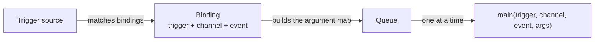

# Triggers

A trigger is what makes a script run. Each script names **one** trigger and may narrow it with two filters. This page lists every trigger, what it is handed, and when it fires.

## The entry function



=== "Lua"

    ```lua
    function main(trigger, channel, event, args)
      air.log("info", "ran on " .. trigger)
      if trigger == "DataReceived" and args.receiver == "auto" then
        return air.build(1)
      end
    end
    ```

=== "JavaScript"

    ```javascript
    function main(trigger, channel, event, args) {
      if (trigger === "DataReceived" && args.receiver === "auto") return air.build(1);
    }
    ```

| Parameter | What it is |
|---|---|
| `trigger` | Why this run happened, in **PascalCase**: `Manual`, `Startup`, `Timer`, `DataReceived`, `ScteAired`, … |
| `channel` | The delay channel, or **`-1`** when the trigger carries none (`Manual`, `Startup`, `Shutdown`, `Timer`, `Schedule`, `ScriptDelayed`, the data arrival triggers, `Status`) |
| `event` | A name: the receiver, the alarm code, the cue kind, the pin, the state change. An empty string when the trigger carries none |
| `args` | A map of **string → string**. **Absent** — `nil` in Lua, `undefined` in JavaScript — when the trigger carries no arguments |

The return value is recorded with the run and shown on the Scripts page. Make it a short string saying what happened. It is not otherwise used.

!!! note "Three arguments, or four"
    Four parameters are passed when the trigger has arguments and **three when it does not**, so a three-parameter entry function keeps working. Guard the fourth: `if args then …` in Lua, `args && args.receiver` in JavaScript.

### The trigger name is spelled twice

The **trigger name a script sees is PascalCase** (`"DataReceived"`), while the **binding word in the configuration is camelCase** (`"trigger": "dataReceived"`). That is deliberate: a script compares against the PascalCase one, a configuration is written with the camelCase one. Parsing a binding accepts either spelling in any case; what the script is handed is always PascalCase.

### Which function is called

| The script's situation | Entry called |
|---|---|
| The script names an **Entry function** | That |
| No entry, trigger is `startup` | `onstart` |
| No entry, trigger is `shutdown` | `onstop` |
| Otherwise | `scripting.entry` — `main` by default |

A missing `onstart` or `onstop` is **not** an error: a script with no lifecycle function is normal and is skipped quietly. Any other missing entry is recorded as a failed run (`no such entry function '…'`).

## Filters

| Filter | Console label | Config key | Meaning |
|---|---|---|---|
| Channel | Channel | `channel` | `0` (or absent) hears every channel. A channel-filtered binding **never fires for an event that carries no channel at all**. |
| Name | Receiver / Pin / Alarm code / Cue kind / Event name | `event` | Empty hears every name; otherwise it is matched **case-insensitively** against the `event` column below. |

!!! tip "Process-wide alarms"
    Process-wide alarms are raised on channel 0, and `channel: 0` means *any channel*. You cannot filter a binding down to process-wide alarms alone — filter on the alarm code instead.

## Every trigger

The **Binding** column is what you write in the configuration and what the console's **Trigger** select stores. The **Script sees** column is the first parameter the entry function is handed.

| Binding | Script sees | Fires when | `event` is | `args` keys |
|---|---|---|---|---|
| `manual` | `Manual` | An operator presses **Run** (page, REST, panel) | — | *(none)* |
| `startup` | `Startup` | The dispatcher starts; entry defaults to `onstart` | — | *(none)* |
| `shutdown` | `Shutdown` | The process is stopping; entry defaults to `onstop` | — | *(none)* |
| `timer` | `Timer` | Every `interval_s` seconds (0.1 … 86400) | — | *(none)* |
| `schedule` | `Schedule` | A `cron` minute matches, in **local** time | The cron expression | `cron` |
| `scriptDelayed` | `ScriptDelayed` | A one-shot set with `air.after(ms, id)` comes due | The identifier | `id` |
| `dataReceived` | `DataReceived` | A message arrives on a data receiver | The receiver name | `receiver`, `source`, `data`, `bytes` |
| `dataClientEvent` | `DataClientEvent` | A client connects to, or leaves, a **listening** receiver | The receiver name | `receiver`, `source`, `event` (`connected` \| `disconnected`) |
| `dataDelayed` | `DataDelayed` | A delayed message reaches **air time** | The receiver name | `receiver`, `source`, `data`, `bytes`, `channel` |
| `channelEvent` | `ChannelEvent` | The delay changed state, dumped, wrote a clip, or a block was restarted | The event name (table below) | `channel`, `event`, plus that event's own keys |
| `encoderEvent` | `EncoderEvent` | That channel's encoder went `Running` or `Down` | `Running` \| `Down` | `channel`, `block` (`encoder`), `event` |
| `decoderEvent` | `DecoderEvent` | That channel's decoder went `Running` or `Down` | `Running` \| `Down` | `channel`, `block` (`decoder`), `event` |
| `audioEvent` | `AudioEvent` | An audio delay changed state, dumped, or a cough or censor went on or off | The **audio delay's name** | `name`, `event` (table below), plus that event's own keys |
| `audioEncoderEvent` | `AudioEncoderEvent` | An audio encoder started or stopped, connected or dropped, or its SIP call changed | The **encoder's name** | `name`, `event` (table below), plus `state`, `from` on a call change |
| `audioDecoderEvent` | `AudioDecoderEvent` | The same, for an audio decoder | The **decoder's name** | The same |
| `alarm` | `Alarm` | An alarm was raised or cleared | The alarm code | `code`, `state` (`raised` \| `cleared`), `block`, `channel`, `message` |
| `gpi` | `Gpi` | A GPIO input edge that a mapping row recognised | `<device>/<port>.<pin>` | `device`, `port`, `pin`, `edge` (`asserted` \| `released`), `action`, `channel` |
| `scteReceived` | `ScteReceived` | A SCTE cue arrived from the source | The cue kind | `channel`, `cueType`, `immediate`, `spliceEventId`, `uniqueProgramId`, `preRollMs`, `breakDurationSeconds`, `autoReturn`, `description` |
| `scteAired` | `ScteAired` | That cue reached air, one depth later | The cue kind | The same keys |
| `status` | `Status` | This box **took over** or **rejoined** | `takeover` \| `rejoin` | `event`, `by`, plus `automatic` and `primary` on a takeover |

### Audio event names

The audio blocks have names, not channel numbers, so on the three audio triggers
the `event` filter is the **block's name** — bind `audioEvent` with event
`Breakfast` to hear that one delay — and what happened is `args.event`. A
`channel` filter never matches them (they carry none; the script is handed `-1`).

| trigger | `args.event` | when | extra `args` |
|---|---|---|---|
| `audioEvent` | `EnteredBuilding` · `EnteredDelayed` · `ReturnedToLive` · `EnteredRollingOut` · `Stopped` | the delay went `building` · `full` · `bypass` · `exiting` · stopped | `state`, `from` |
| `audioEvent` | `Dumped` | a dump was taken | `dumps` (the running count) |
| `audioEvent` | `CoughOn` · `CoughOff` | a cough (pre or post) went on or off | — |
| `audioEvent` | `CensorOn` · `CensorOff` | a censor (pre or post) went on or off | — |
| `audioEncoderEvent` · `audioDecoderEvent` | `Running` · `Down` | the block started or stopped (an encoder held on a standby is down) | — |
| `audioEncoderEvent` · `audioDecoderEvent` | `Connected` · `Disconnected` | it reached, or lost, its far end | — |
| `audioEncoderEvent` · `audioDecoderEvent` | `CallState` | its SIP call changed | `state`, `from` (`idle` · `calling` · `ringing` · `incoming` · `in_call` · `failed` · `held`) |

!!! note "The console's wording for `status`"
    The Trigger select labels `status` *Every status tick*. It is not a tick: it fires only when this instance takes over from a primary or rejoins as a backup.

### `channelEvent` names

The `event` a `channelEvent` carries, with the arguments that come with it.

| `event` | When | Extra `args` |
|---|---|---|
| `EnteredBuilding` | The delay started filling | `state`, `from` |
| `EnteredDelayed` | It reached its target depth | `state`, `from` |
| `ReturnedToLive` | It came out of delay | `state`, `from` |
| `EnteredRollingOut` | A rollout began | `state`, `from` |
| `Stopped` | The delay block stopped | `state`, `from` |
| `ChannelState` | Any other state word, as a catch-all | `state`, `from` |
| `Dumped` | A dump was accepted | `seconds`, `depth`, `by` |
| `ClipWritten` | The dump's clip is on disk, or is not | `name`, `status`, `seconds`, `frames`, `bytes`, `note` |
| `BlockRestarted` | The watchdog restarted a block | `block`, `stalled_s`, `attempt`, `by` |

### The data payload

The three data triggers carry the message twice:

- **`data`** is the payload as UTF-8 text, with U+FFFD for anything that is not valid UTF-8;
- **`bytes`** is the same payload as lowercase hex, for a binary protocol — a checksum, a `0x00` inside a frame.

Both are bounded by the receiver's own 64 KiB message cap.

`dataClientEvent` fires for **listening (`tcp_server`) receivers only**: a `tcp_client` receiver's own reconnect is not a client arriving.

On a suppressed backup a delayed message is never released, so **`dataDelayed` never fires there** — the backup is not on air.

### The GPI pin

`gpi` fires for a pin a **control mapping row already recognised**, and that row has already run its action through the controller. The script is not how a pin dumps; the mapping row is. The script is how a pin does the part the mapping vocabulary has no word for.

!!! warning "Two pin numbering conventions"
    A GPIO mapping row's `pin` is **0-based**. The pin the script is handed — and the `<device>/<port>.<pin>` string in `event` and in the audit log — is **1-based**. A row on port 2 pin 1 is `axia/2.2` to a script. Copy the `event` filter from an audit line and it will always be right.

### Timers and schedules

`timer` carries no channel and no arguments: the script reads the channel it watches from a constant of its own.

A timer **catches up by one period, not by the whole gap**: a box that was stopped for an hour does not run a 30-second timer 120 times when it comes back.

`schedule` takes a 5-field cron expression — minute, hour, day-of-month, month, day-of-week — matched on the minute in **local** time. Each field takes `*`, `*/n`, a value, `a-b`, `a-b/n`, `n/step` and comma lists of those. Sunday is `0` or `7`.

!!! warning "Day-of-month and day-of-week are ANDed"
    `0 6 13 * 5` means "06:00 on Friday the 13th", not "the 13th, and every Friday". That differs from Vixie cron, and it is deliberate: operator schedules are written against this behaviour, so a schedule brought over from an older system keeps its meaning.

The expression arrives as `args.cron` and as `event`, which is how one file installed twice can tell its two passes apart — and, for a Lua script, the only clock it has.

### One-shots

`air.after(ms, id)` fires `scriptDelayed` once with that identifier as the `event`. Bind a script to `scriptDelayed` and set its **Event name** to the identifier.

Setting an identifier that is already waiting **replaces** it, so calling `air.after` on every pass of a repeating event cannot build a queue. `air.cancel_after(id)` cancels a pending one. Resolution is the trigger service's tick, 250 ms.

This is how an originated ad break is ended on your own clock rather than on the downstream's `auto_return`: fire the break, then schedule the return.

=== "Lua"

    ```lua
    -- bound to dataReceived
    function main(trigger, channel, event, args)
      air.cue(4, { type = "out_now", duration_s = 30, program_id = 1 })
      air.after(30000, "adbreak-return")
    end
    ```

    ```lua
    -- bound to scriptDelayed, event "adbreak-return"
    function main()
      air.cue(4, { type = "in_now" })
    end
    ```

=== "JavaScript"

    ```javascript
    // bound to dataReceived
    function main(trigger, channel, event, args) {
      var ms = parseInt(/(\d+)/.exec(args.data)[1], 10);
      air.cue(4, { type: "out_now", duration_s: ms / 1000, program_id: 1 });
      air.after(ms, "adbreak-return");
    }
    ```

    ```javascript
    // bound to scriptDelayed, event "adbreak-return"
    function main() { air.cue(4, { type: "in_now" }); }
    ```

## How triggers behave

**Nothing runs at the hook.** Every source matches the bindings, builds the argument map and *queues*. One dispatcher thread runs the scripts, one at a time. That matters most for `dataDelayed` and `scteAired`, which are raised on the delay's **output thread** — the thread that owes NDI its next frame. When the queue (`scripting.queue_size`, 64) is full the invocation is **dropped and counted**, never waited on.

**State is polled at 4 Hz.** `channelEvent`, `encoderEvent`, `decoderEvent` and the three audio triggers come from a 250 ms poll of the state each block reports. A change that reverses inside 250 ms is seen once, or not at all. Every other trigger is an edge at its own site. The poll is also **seeded on the first pass**, so a restart never replays the state the box came up in as a transition.

**A locked backup holds them.** On a standby (a backup with its controls locked) every automatic trigger is counted as `held` and not run, until the box takes over; `startup`, `shutdown` and `status` still run. See [Redundancy › Standby](../redundancy/standby.md#scripts-on-a-standby).

**Counters are per binding.** `fired`, `dropped`, `failed`, the last fire and the last error are kept for each script's binding and shown on the Scripts page and in `/api/state` — so "the trigger never arrives" (`fired` 0) and "the script always fails" (`failed` climbing) are different rows rather than the same blank one.

Counters survive an edit to a script's **source**, and are reset when you change its **binding**.

## Words a binding cannot use

A binding may only name a trigger this build has a source for. Anything else is **refused at the save**, rather than accepted and left dark — a binding that looks configured and does nothing is the worst outcome.

| Name | What it is |
|---|---|
| `scriptCompleted` | A trigger name a ported script may compare against, but not a binding: script chaining has no host call here, so nothing ever raises it. |

`videoEncoderEvent` and `videoDecoderEvent`, Airlock's words for the per-channel encoder and decoder, are accepted and saved as `encoderEvent` / `decoderEvent`.

The console's **Trigger** select offers only the words the server will accept, so it cannot put you in that position. Hand-edited configuration can, and is refused on load.
