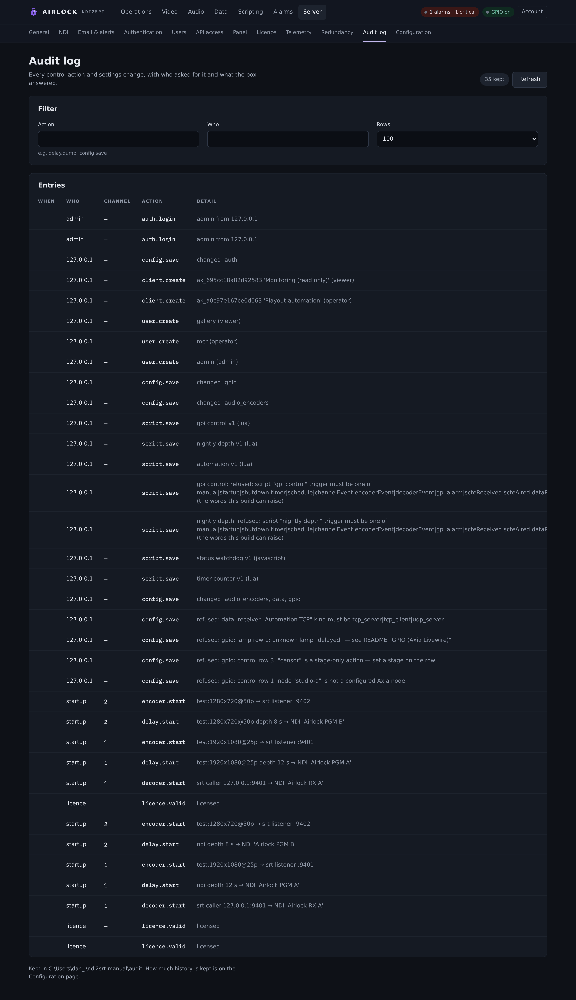

# Audit log

Every control action on this box is recorded with **where it came from** and
**who did it** — including the ones that were refused, and why. The log is
append-only on disk and survives restarts.

{ .shot }

## What is recorded

The controller writes the entry itself, so no surface can forget one. A dump
pressed on the console, sent over TCP, triggered by a GPIO pin, set by an SNMP
manager or run by a script all land in the same log in the same shape.

| Group | Example actions |
|---|---|
| Transport | `delay.build`, `delay.dump`, `delay.rollout`, `delay.depth`, `delay.fades`, `delay.rebuild_after_dump` |
| On-air | `delay.cough`, `delay.censor`, `delay.censor_on`, `delay.censor_off`, `delay.censor_force_off`, `delay.slate` |
| Blocks | `delay.start`, `delay.stop`, `encoder.start`, `encoder.stop`, `decoder.start`, `decoder.stop`, `block.restart`, `stats.reset` |
| Channels | `channel.add`, `channel.remove`, `channel.rename`, `delay.lock`, `control.locked` |
| Cues and data | `scte.cue`, `scte.block`, `data.send` |
| Scripting | `script.save`, `script.run`, `script.delete`, `script.reload`, `script.rollback`, `scriptvar.set`, `scriptvar.delete` |
| Configuration | `config.save`, `config.restore`, `config.restore_backup`, `config.reset`, `config.sync` |
| Accounts | `auth.login`, `auth.logout`, `auth.password_changed`, `user.create`, `user.role`, `user.password_reset`, `user.delete`, `user.bootstrap`, `client.create`, `client.delete` |
| Supervision | `watchdog.restart`, `watchdog.capped`, `watchdog.test`, `server.restart` |
| Redundancy | `outputs.held`, `outputs.released`, `redundancy.window_warning`, `redundancy.window_expired` |
| Clips and licence | `delay.clip`, `clip.delete`, `licence.recheck` |

A refused action is recorded too, with the reason:

```
delay.build … refused: delay block is not running
```

## An entry

```json
{"id":1794493600123001,
 "ts":"2026-11-06T14:26:40.123",
 "origin":"web",
 "principal":"dan",
 "action":"delay.dump",
 "detail":"5 s at 9.98 s",
 "channel":2}
```

| Field | Meaning |
|---|---|
| `id` | A millisecond clock with a sequence in the low digits. Monotonic across restarts, and the paging cursor. |
| `ts` | Local time. |
| `origin` | Which surface the action entered through. |
| `principal` | Who or what. |
| `action` | The verb, in `group.verb` form. |
| `detail` | Free text — the seconds dumped, the depth, the reason for a refusal. |
| `channel` | The delay channel. **0 means process-wide** — a sign-in, a configuration save, a user change. |

## Actors and origins

| `origin` | `principal` is | Means |
|---|---|---|
| `web` | the signed-in user name, or the peer address while authentication is off | Someone pressed it in the console. |
| `rest` | the API client id (`ak_…`) | A machine account called the REST API with a bearer token. |
| `tcp` | the peer address | The Airlock TCP control port. |
| `snmp` | the manager's address | An SNMP `SET` of `airlockChannelCommand`. |
| `gpio` | `<device>/<port>.<pin>` | A pin on an Axia Livewire node. The pin is named 1-based, as a console labels it — so the log says which button, not which node. |
| `script` | the script's name | An operator script running on the dispatcher. Every control a script drives is audited as that script. |
| `window` | `console` | The local desktop window. |
| `sync` | the primary's URL | A configuration applied from this instance's primary. Nobody pressed anything here. |
| `system` | `startup`, `shutdown`, `watchdog`, `redundancy` | The process itself: autostart, a clean shutdown, a watchdog restart, an automatic takeover. |

## The page

**Server › Audit log** is the viewer.

**Filter** holds three controls:

| Control | What it does |
|---|---|
| **Action** | A **prefix** match. `delay.` is every delay action; `delay.dump` just the dumps; `config` every configuration action. |
| **Who** | An exact match on the principal — a user name, an API client id, a peer address. |
| **Rows** | 50, 100, 250 or 500. |

**Entries** shows **When**, **Who**, **Channel**, **Action** and **Detail**,
newest first. **Refresh** re-reads it. The pill in the header counts the entries
currently held in memory, and the note under the table names the directory the
files are in.

Reading the audit log needs the `viewer` role — operators and viewers can see who
did what, not only admins.

## Storage and retention

Append-only JSON lines, one file per month, beside the configuration:

```
audit/audit-2026-10.jsonl
audit/audit-2026-11.jsonl
```

For an installed service, `/var/lib/ndi2srt/audit` on Linux and
`%ProgramData%\ndi2srt\audit` on Windows.

A bounded in-memory tail answers the page's usual queries without touching the
disk; older pages come from the files, newest first.

| Setting | Console label | Config key | Default | Meaning |
|---|---|---|---|---|
| Months kept | Keep months | `audit.keep_months` | `12` | Month files kept, **including the current one**. `1` means this month only. Minimum 1. |

```json
"audit": { "keep_months": 12 }
```

Months older than `keep_months` are deleted when a new month opens, and again at
start. There is no manual purge — set the retention you want and let it run.


!!! note "Every entry is also a log line"
    Each entry is written to the normal log at info level, prefixed `audit:`, so
    a plain log file still shows who pressed what even if the audit directory is
    unreadable. A disk error never stops the action.

## Exporting and filtering over REST

```bash
# the most recent 50
curl -s http://host:8090/api/audit

# 200 dumps and builds, any channel
curl -s 'http://host:8090/api/audit?limit=200&action=delay.'

# everything one operator did
curl -s 'http://host:8090/api/audit?principal=dan&limit=500'

# only channel 2
curl -s 'http://host:8090/api/audit?channel=2&limit=200'

# only process-wide entries — sign-ins, configuration saves
curl -s 'http://host:8090/api/audit?channel=0&limit=200'

# page backwards: pass the oldest id you have seen
curl -s 'http://host:8090/api/audit?limit=500&before=1794493600123001'
```

| Parameter | Meaning |
|---|---|
| `limit` | 1 to 1000. Default 50. |
| `before` | Strictly older than this `id`. The paging cursor. |
| `action` | Prefix match. |
| `principal` | Exact match. |
| `channel` | Exact match. `0` = process-wide only. |

The response is `{"entries":[…],"tail":n,"dir":"…"}`, newest first.

For a bulk export, take the files themselves — they are plain JSON lines and
every common tool reads them:

```bash
cat /var/lib/ndi2srt/audit/audit-2026-*.jsonl | jq -c 'select(.action|startswith("delay.dump"))'
```

## Troubleshooting

**Nothing recorded yet.** A brand-new box has an empty log until something
happens. Press something and refresh.

**The Action filter finds nothing.** It is a prefix, not a search. `dump` matches
nothing; `delay.dump` matches the dumps.

**The Who filter finds nothing.** It is exact. While authentication is off, the
principal is the caller's address, not a name.

**Entries from before a restart are missing from the page.** They are not — the
tail is in memory, but anything beyond it is read from the files. Raise **Rows**
or page with `before`.

**A dump I know happened is not in the log.** Check the channel filter, then
check `origin`: a GPIO pin or a script is audited under its own name, not under
the person who set it up.

**The audit directory is not writable.** The log says
`audit: cannot create …` or `audit: write failed:` at start. The actions still
happen and still reach the normal log. Fix the ownership of the data directory.
