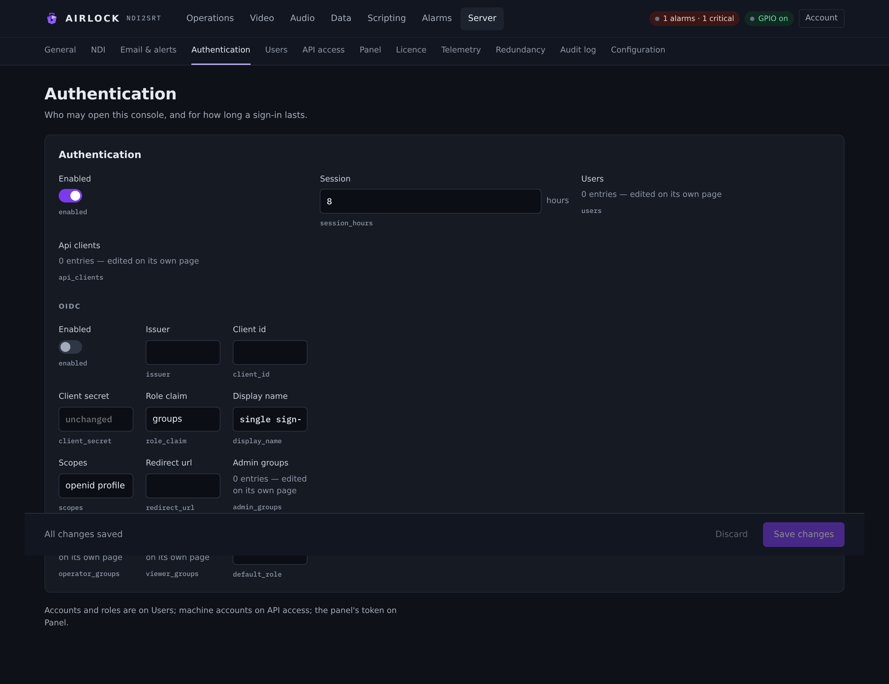
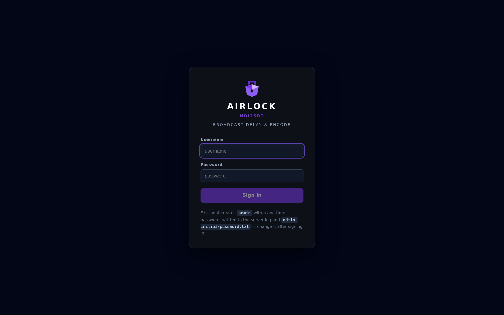
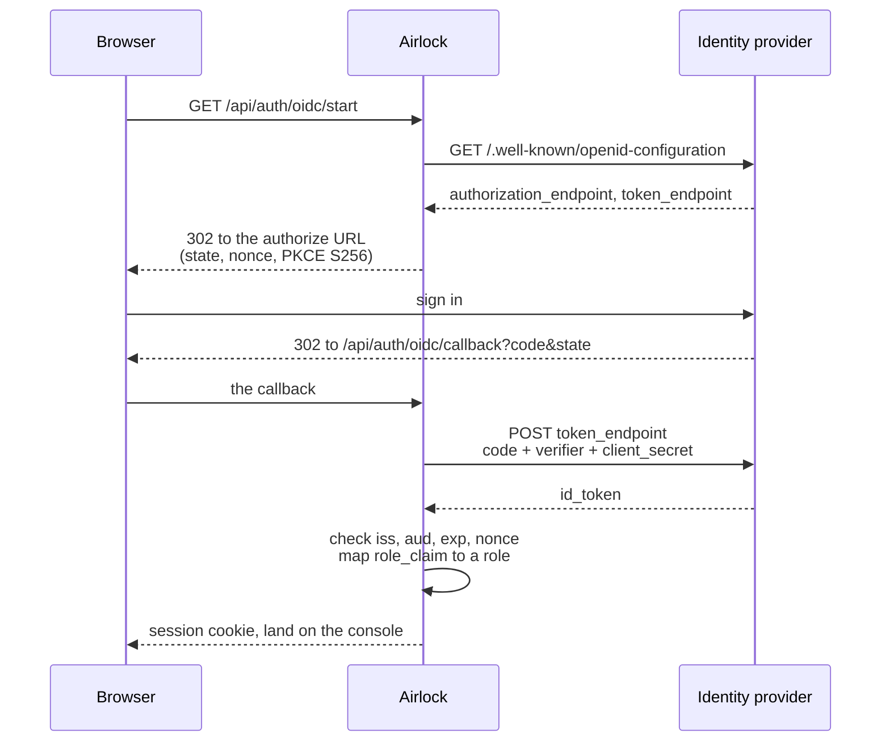

# Authentication and OIDC

Who may open this console, how long a sign-in lasts, and how to hand sign-in over
to your identity provider. Accounts themselves are on
[Users and API access](users.md).

{ .shot }

## Open or gated

Out of the box, authentication is **off**. The console and the REST API are open,
and everyone who can reach the port is an admin named after their address.

That is fine for a bench. It is not fine for a plant:

!!! danger "Authentication off means no door at all"
    Anyone who can reach this port can control the box — including dump, rollout,
    the configuration and the licence. The log warns at start when
    `auth.enabled` is false and `web.bind` is not loopback, and the console
    shows a red banner on this page and on **Account**.

### Turning it on

Do these in this order, or you will lock yourself out:

1. Go to **Server › Users** and create an **admin** account.
2. Come back to **Server › Authentication**, switch **Enabled** on, and save.
3. Sign in with the account you just made.

If you switch it on with no users at all, the box creates one for you — see
[First run](#first-run) below.

### Settings

| Setting | Console label | Config key | Default | Meaning |
|---|---|---|---|---|
| Require sign-in | Enabled | `auth.enabled` | `false` | Off, every request is accepted as admin. |
| Session length | Session (hours) | `auth.session_hours` | `8.0` | Browser sessions **and** bearer tokens from `/oauth/token`. |
| Accounts | Users | `auth.users` | `[]` | Edited on [Users](users.md). The page shows the count. |
| Machine accounts | Api clients | `auth.api_clients` | `[]` | Edited on [API access](users.md#api-access). |
| Panel token | — | `auth.tcp_token` | `""` | Not on this page: it is on **Server › Panel**. |
| Single sign-on | Oidc | `auth.oidc` | off | See [OIDC](#oidc-single-sign-on). |

## Roles

Three roles, hierarchical: an operator can do everything a viewer can, an admin
everything an operator can.

| Role | May |
|---|---|
| **viewer** | Read the state feed, the previews, the audit log, the clip list and the script log. Read the licence (serial masked). Sign out and change their own password. |
| **operator** | Everything a viewer may, plus: read the configuration, start and stop blocks, build, dump, dump all, rollout, set depth, dissolves, enable and disable a block, take and give back the channel lock, ride the audio chain, cough, censor and slate, reset stats, delete a dump clip. |
| **admin** | Everything an operator may, plus: save the configuration, restore and reset it, manage users and API clients, force-release a lock someone else holds, assign or release a licence seat, restart the service. |

Refusals are JSON and say what was needed:

```json
401 {"error":"unauthorized"}
403 {"error":"forbidden","required":"operator"}
403 {"error":"password_change_required"}
403 {"error":"ERR_LOCKED","message":"…"}
```

The console reads your role from `GET /api/auth/me` and hides what you may not
press — but the server is the authority, not the page.

!!! note "The local window is not a user"
    When the engine is run with its desktop window, that window is the local
    console. It acts as admin without a login, and its actions are audited with
    origin `window`.

## Signing in and out

{ .shot }

With authentication on, the whole console is wrapped: it asks who you are before
it renders a single menu. The sign-in card takes a username and password, and —
when OIDC is configured — offers **Sign in with &lt;your provider&gt;** below a
divider.

Sign out on **Account**, which also shows the role you hold, what it means, and
the box's configuration path. Changing your own password is on the same page: the
current password, the new one, and the new one again.

| Route | Role | Does |
|---|---|---|
| `POST /api/auth/login` | — | `{name, password}`. Sets an `HttpOnly`, `SameSite=Strict` session cookie that lives `session_hours`. |
| `POST /api/auth/logout` | viewer | Ends the session. |
| `GET /api/auth/me` | — | Always open. Says whether authentication is on, whether OIDC is offered, who you are and what role you hold. |
| `POST /api/users/me/password` | viewer | `{current, new}`. |

Sessions and tokens are in memory, so **a restart signs everyone out**. Sessions
also end when an admin deletes the user, changes their role, or resets their
password.

Logins are rate-limited to **5 a minute per address**; the sixth gets 429 and the
card says *Too many attempts — wait a minute*. Another address is unaffected.

## First run

Starting with `auth.enabled: true` and no users creates an `admin` account with a
random 20-character password. It is:

* printed once to the console and to the log;
* written to `admin-initial-password.txt` beside the configuration, owner-only
  (mode 600 on Unix).

```
==== ndi2srt first login ====
  user:     admin
  password: <20 characters>
  (change it at the first login)
=============================
```

That account **must** change its password at the first sign-in — the console
shows nothing but the change-password card until it does. Delete the file
afterwards.

## Passwords

Stored only as `pbkdf2-sha256$100000$<salt>$<hash>` — PBKDF2-HMAC-SHA256, a
16-byte random salt, 100 000 iterations, a 32-byte hash, verified in constant
time. A minimum of 8 characters is enforced.

An unknown user name is verified against a dummy hash before it is refused, so
the timing of a failed sign-in does not reveal which names exist.

## OIDC (single sign-on)

Airlock speaks the OpenID Connect **authorization code flow with PKCE** as a
confidential client. It discovers your provider's endpoints, exchanges the code
over its own TLS connection to the issuer, validates the ID token and maps the
user's groups to a role.



### Settings

| Setting | Console label | Config key | Default | Meaning |
|---|---|---|---|---|
| Enable SSO | Enabled | `auth.oidc.enabled` | `false` | Adds the SSO button to the sign-in card. |
| Issuer | Issuer | `auth.oidc.issuer` | `""` | The issuer URL. Discovery is `<issuer>/.well-known/openid-configuration`. |
| Client id | Client id | `auth.oidc.client_id` | `""` | |
| Client secret | Client secret | `auth.oidc.client_secret` | `""` | Shown as dots. Leave it alone and it stays unchanged. |
| Role claim | Role claim | `auth.oidc.role_claim` | `groups` | The claim in the ID token carrying the group values. |
| Button label | Display name | `auth.oidc.display_name` | `single sign-on` | The card reads *Sign in with &lt;this&gt;* — e.g. `Okta`, `Entra ID`. |
| Scopes | Scopes | `auth.oidc.scopes` | `openid profile email` | Space-separated. Some providers need an extra scope (`groups`) before they will put the role claim in the token. |
| Callback URL | Redirect url | `auth.oidc.redirect_url` | `""` | Empty derives it from the request. |
| Admin groups | Admin groups | `auth.oidc.admin_groups` | `[]` | Claim values that map to admin. |
| Operator groups | Operator groups | `auth.oidc.operator_groups` | `[]` | … to operator. |
| Viewer groups | Viewer groups | `auth.oidc.viewer_groups` | `[]` | … to viewer. |
| Default role | Default role | `auth.oidc.default_role` | `""` | For a user whose groups match none of the lists. **Empty means deny.** |

!!! note "The three group lists are edited in the configuration document"
    The settings page renders arrays as a count, so it shows how many entries
    each list holds but will not edit them. Set them with `PUT /api/config`, or
    by editing `ndi2srt.json` and restarting.

### Set it up

1. **At the identity provider**, register a confidential web application. Note
   the client id and secret.
2. **Register the callback URL** with the provider. It must match exactly what
   Airlock sends:
   * with **Redirect url** set, that value;
   * with it empty, `<scheme>://<host>/api/auth/oidc/callback` derived from how
     the browser reached the console — `X-Forwarded-Proto` and
     `X-Forwarded-Host` are honoured, so a reverse proxy works.
3. **Put the role claim in the ID token.** Airlock reads `role_claim` from the ID
   token, not from a userinfo call. On most providers that means adding a groups
   claim to the token and asking for the scope that carries it.
4. **In Airlock**, fill in the OIDC fields and save. Set the three group lists in
   the configuration document.
5. **Sign out** and use the SSO button.

### How a role is chosen

The claim's values are matched against the three lists, in order of privilege:

```
admin_groups  →  admin
operator_groups  →  operator
viewer_groups  →  viewer
otherwise  →  default_role  (empty = refuse the sign-in)
```

The highest match wins. A user in both `ops` and `broadcast-admins` is an admin.

The mapping is applied **at every sign-in**. Move someone between groups at the
provider and their next sign-in carries the new role — there is nothing sticky to
clear here. Their current session keeps the role it was opened with until it
expires or they sign out.

### What is validated

The ID token arrives over Airlock's own authenticated TLS connection to the
issuer's token endpoint, so — per OIDC Core §3.1.3.7 — its `iss`, `aud`, `exp`
and `nonce` are checked rather than its JWS signature. `state` is single-use and
expires after 10 minutes; the PKCE verifier is S256.

A signed-in OIDC user has **no local password**. Their name comes from
`preferred_username`, then `email`, then `name`, then the subject.

### When it goes wrong

A failure sends the browser back to the sign-in card with the reason in red.
What you will see:

| Message | Means |
|---|---|
| *OIDC discovery failed* / *HTTP 404* | The issuer URL is wrong, or this box cannot reach it. |
| *the identity provider refused the sign-in* | The provider said no — the detail is its own. |
| *the sign-in request expired or was already used* | More than 10 minutes between the button and the callback, or a replayed callback. Try again. |
| *id_token issuer did not match the configured issuer* | A trailing-slash or hostname mismatch between `issuer` and the token's `iss`. |
| *id_token audience did not include this client* | Wrong `client_id`. |
| *id_token nonce did not match (possible replay)* | Treat as a security event. |
| *signed in, but your account is in no group mapped to a role here* | The group lists do not cover this user and `default_role` is empty. |

The same text is in the log, prefixed `oidc:`.

!!! tip "Keep a local admin"
    OIDC and local accounts work side by side. Keep one local admin so a provider
    outage does not lock you out of your own plant.

## The TCP token

TCP control has its own handshake, configured on **Server › Panel** as **Panel
token** (`auth.tcp_token`).

With it set, the first line on a control connection must be `AUTH <token>`:

```
> AUTH s3cr3t
< OK 0 AUTH
```

Anything before it gets `ERR 0 AUTH required`; a wrong token gets
`ERR 0 AUTH bad token` and the socket closes. The token is one word, compared in
constant time. Companion and Stream Deck profiles send it as the connection's
first command.

The TCP allow-list applies as well, and loopback is always allowed. See
[TCP control](../control/tcp.md).

## In a primary/backup pair

* The whole `auth` section is **mirrored** — users, roles, password hashes, API
  clients and the OIDC settings all travel from the primary. Set accounts up
  once, on the primary.
* `auth.oidc.redirect_url` is **machine-local**: each box, or each proxy in front
  of one, has its own callback URL.
* The mirrored configuration therefore carries the user records. Treat the
  redundancy token as being as sensitive as the password file.
* A locked backup refuses mutating calls — but **signing in is always allowed**,
  as are acknowledging an alarm, taking over and rejoining.

## Troubleshooting

**Locked out after turning authentication on.** Stop the service, set
`"enabled": false` in the `auth` block of the configuration document, start it,
create an admin, turn it back on.

**Everyone is suddenly signed out.** The service restarted. Sessions are in
memory by design.

**429 on sign-in.** Five failed attempts a minute from that address. Wait a
minute, or sign in from elsewhere.

**A user still has their old role.** Their session was opened before the change.
Changing a role drops that user's sessions, so a refresh should ask them to sign
in again — if it does not, they are on a bearer token, which lives until it
expires or the client is revoked.

**The SSO button is missing.** `auth.oidc.enabled` is false, or authentication
itself is off. The card only offers SSO when both are on.
