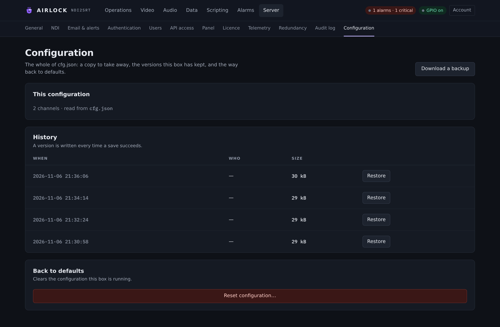

# Configuration store

Everything Airlock runs on is one JSON document. It is not the only copy: every
save appends a full snapshot to a history beside it, so there is always a way
back.

{ .shot }

## The document

One file. Its path is on the **This configuration** card, next to how many
channels it defines.

| Platform | Where the service keeps it |
|---|---|
| Linux | `/var/lib/ndi2srt/ndi2srt.json` |
| Windows | `%ProgramData%\ndi2srt\ndi2srt.json` |
| Run from a folder | `ndi2srt.json` beside the executable |

The engine finds it in this order: `--config <path>`, the `NDI2SRT_CONFIG`
environment variable, `ndi2srt.json` beside the executable, then the installed
service's copy. An operator who double-clicks the installed exe therefore edits
the same configuration the service runs.

!!! warning "Don't run two at once"
    A desktop run and the service would fight over the web port, the TCP port and
    the NDI sender names.

The top-level sections are: `channels[]` and then everything that belongs to the
process — `web`, `tcp`, `process`, `clock`, `ndi_network`, `logging`, `audit`,
`auth`, `alarms`, `email`, `webhooks`, `snmp`, `store`, `clips`, `redundancy`,
`watchdog`, `gpio`, `data`, `scripting`, `licence`, `telemetry`, `tools`,
`audio_inputs`, `audio_outputs`, `audio_encoders`, `audio_decoders`,
`audio_stages`, `audio_delays`. The full field reference is in
[Configuration file](../reference/config.md).

## History

```
<config dir>/ndi2srt.json                                    the live configuration
<config dir>/config-history/index.json                       when / who / where from
<config dir>/config-history/ndi2srt-20261106-094512-7.json    one complete config per save
```

Every save writes the live file **and** appends a snapshot — from the console,
the REST API, a restore, a factory reset or a configuration mirrored from a
primary. The **History** table lists them newest first:

| Column | Meaning |
|---|---|
| **When** | UTC of the save. |
| **Who** | The actor: a user name, an API client, `window`, the primary's URL on a sync. |
| **Size** | The snapshot in kilobytes. |
| **Restore** | Apply that version. |

| Setting | Console label | Config key | Default | Meaning |
|---|---|---|---|---|
| Versions kept | History keep | `store.history_keep` | `50` | Snapshots kept. Older entries and their files are removed as new ones arrive. 1 to 10000. The field is on [Server › General](general.md) under **Storage**. |

The history is written **best-effort**. A save never fails because the history
directory could not be written — the live file is what runs, and the log says
what went wrong.

## Restore

Press **Restore** on a history row. Three things happen, in order:

1. The configuration that is live right now is snapshotted, with origin
   `pre-restore`. Restoring the wrong entry therefore loses nothing.
2. The entry is validated. An entry that will not parse or will not pass
   validation is refused with the reason, and nothing changes.
3. It is written as the live configuration.

The banner says *Restored — blocks whose settings changed restart*.

!!! note "A restore applies to the next start of each block"
    Running encoders, decoders and delays keep the settings they started with.
    Only the dissolve settings are pushed live. If a restore is meant to change
    something on air, restart that block.

## Download a backup

**Download a backup** in the page header hands you a self-describing document:

```json
{ "version": 1,
  "app": "ndi2srt",
  "app_version": "0.15.42",
  "exported_at": "2026-11-06T14:26:40Z",
  "host": "mcr-airlock-1",
  "config": { "…": "the whole configuration" } }
```

The wrapper exists so a file from another box or an older build is recognised
*before* it is applied. Uploading one is refused, with the reason, when:

* it is not JSON, or not an object;
* it has no `version`, or a version this build does not write;
* `app` is not `ndi2srt`;
* there is no `config` object;
* the configuration inside it does not parse or does not validate.

A backup written before the multi-channel shape is migrated into channel 1 on the
way in, exactly as the live file is.

Restoring a backup follows the same safety rule as a history restore: the current
configuration is snapshotted first.


## Back to defaults

**Reset configuration…** on the **Back to defaults** card, then **Yes, reset
everything**. Every channel, receiver, script binding and setting goes back to
its default.

!!! danger "Download a backup first"
    This cannot be undone from the page. There *is* a `pre-restore` snapshot in
    the history, but a backup in your hand is better.

## Machine-local or mirrored

A restore-from-backup and a reset both take `keep_local`, which defaults to
**true** and keeps this machine's own fields. The same classification decides
what a backup instance takes from its primary.

Every leaf of the configuration is classified as one or the other. A build-time
check walks the whole document and **fails the build** if a field is in neither
list, so a new setting can never silently leak between a primary and its backups.

**Machine-local** — listeners, paths, identities, hardware capacity and clock
topology:

| Area | Fields |
|---|---|
| Listeners | `web.enabled/bind/port`, `tcp.enabled/bind/port/allow_list`, `snmp.enabled/bind/port` |
| Paths | `logging.file`, `logging.dir`, `clips.dir`, `tools.ffmpeg`, `licence.store_dir`, `licence.file` |
| Identities and URLs | `clips.public_base_url`, `auth.oidc.redirect_url`, `telemetry.site` |
| Hardware | `process.priority`, `process.max_memory_mb`, `ndi_network.adapters`, `clock.reference`, each channel's `ndi.receiver_name`, `video.encoder`, `video.threads`, `decoder.hw`, `delay.max_memory_mb` |
| Devices | `audio_inputs`, `audio_outputs` |
| Redundancy | the whole `redundancy` section — role, peer, token, window |
| GPIO connection | `gpio.enabled/host/port/password/device/nodes` |
| Licence | the `licence` section, including the container serial |

**Mirrored** — everything that describes what the service does: the channel list
and every channel's name, source, codec, delay depth, fills, censor and cues; the
NDI output names; alarm thresholds and every delivery transport's settings; the
whole `auth` section including users, roles and API clients; scripts and script
variables; data receivers, senders and routes; what the GPIO pins *mean*; the
audio encoders, decoders, stages and delays.

!!! note "NDI output names are mirrored on purpose"
    They are the service identity a backup must be able to assume at takeover.
    While it is a locked backup it publishes under a suffix. See
    [Primary and backup](../redundancy/overview.md).

## Over REST

```bash
# the live document (user records and client records are stripped)
curl -s http://host:8090/api/config | jq

# what a word-valued field will accept
curl -s http://host:8090/api/config/choices | jq

# the history
curl -s http://host:8090/api/config/history | jq '.entries[] | {id, at, by, bytes}'

# apply a history entry
curl -s -X POST http://host:8090/api/config/restore/ndi2srt-20261106-094512-7

# download a backup
curl -sOJ http://host:8090/api/config/backup

# apply a backup, keeping this machine's own fields
curl -s -X POST 'http://host:8090/api/config/restore?keep_local=true' \
  -H 'content-type: application/json' --data-binary @backup.json

# factory defaults, keeping this machine's own fields
curl -s -X POST 'http://host:8090/api/config/reset?keep_local=true'

# save a whole document
curl -s -X PUT http://host:8090/api/config \
  -H 'content-type: application/json' --data-binary @ndi2srt.json
```

| Route | Role | Notes |
|---|---|---|
| `GET /api/config` | operator | User and API-client records are removed from the answer. |
| `GET /api/config/choices` | operator | Every enumerated field and the values this build accepts, keyed by path. |
| `GET /api/config/history` | admin | Entries newest first, plus the history directory. |
| `POST /api/config/restore/{id}` | admin | |
| `GET /api/config/backup` | admin | Attachment. |
| `POST /api/config/restore` | admin | Body is a backup document. `?keep_local=` (default true). |
| `POST /api/config/reset` | admin | `?keep_local=` (default true). |
| `PUT /api/config` | admin | The whole document. |

All five mutating calls answer `{"ok":true,"config":{…}}` with what is now live,
or 400 with `{"error":"…"}`. Each takes `?actor=` to record who did it in the
history index. Each is written to the [audit log](audit.md) as `config.save`,
`config.restore`, `config.restore_backup` or `config.reset`.

!!! tip "The console form is generated from the document"
    Every Server page renders from the configuration the server actually sent, so
    a page can never quietly omit a setting the box has — and when a build gains
    one, it appears on the next poll. The word-valued fields get their menus from
    `/api/config/choices`, which is held to the save validators by a test, so the
    console can never offer a value a save would refuse.

## Troubleshooting

**A save is refused.** The banner carries the validator's own words — a bad
enumerated value, a channel list that exceeds the memory ceiling, a telemetry URL
with no scheme. Fix the named field.

**No saved versions yet.** Nothing has been saved since the history directory
existed. Save anything and a row appears.

**The history stopped growing.** The directory is not writable. The log carries
`config history:` with the reason. The live file is still being written.

**A backup from another box broke this one's networking.** You restored with
`keep_local=false`. Restore again with it true, or restore the `pre-restore`
snapshot the history holds.

**Changes are saved but the picture has not changed.** A restore applies to the
next start of each block. Restart the block.

**A backup keeps reverting my change.** It is a backup: its configuration is the
primary's, and the next sync overwrites anything you change locally. Change it on
the primary.
