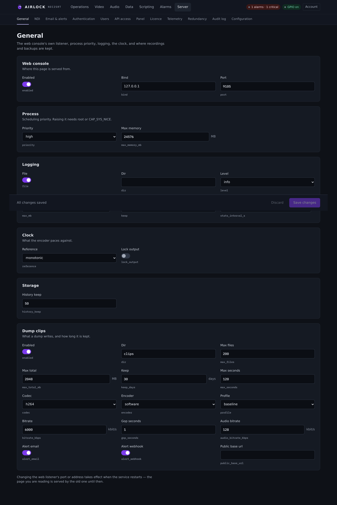

# General

**Server › General** holds the settings that belong to the process rather than to
any one channel: where the console is served from, how the OS schedules the
engine, what the log does, what the encoder paces against, and what a dump leaves
behind.

{ .shot }

The page edits whole blocks of the configuration document. Each field shows its
plain-English label with the configuration key beside it, so the page, the
document and a support call all use the same word. Changes land on **Save**.

## Web console

Where this page is served from.

| Setting | Console label | Config key | Default | Meaning |
|---|---|---|---|---|
| Serve the console | Enabled | `web.enabled` | `true` | Off, there is no web interface and no REST API. TCP control and the engine keep running. |
| Bind address | Bind | `web.bind` | `0.0.0.0` | Which address the listener binds. `127.0.0.1` restricts it to this machine. |
| Port | Port | `web.port` | `8090` | |

!!! warning "Changing the listener needs a restart"
    The page you are reading is served by the old listener until the service
    restarts. The page says so under the card.

!!! danger "Open on a network means open"
    With [authentication](auth.md) off, anyone who can reach this port is an
    admin — including dump, rollout and the licence. The log warns at start when
    `auth.enabled` is false and `web.bind` is not loopback.

## Process

How the OS schedules the engine.

| Setting | Console label | Config key | Default | Meaning |
|---|---|---|---|---|
| Priority | Priority | `process.priority` | `high` | `normal`, `high` or `realtime`. |
| Memory ceiling | Max memory (MB) | `process.max_memory_mb` | `0` | Process-wide admission ceiling on delay buffering. `0` is off. |

### Priority

At start the process class is raised and the threads that pace output on a clock
— the SRT byte-clock pacer, the delay output, the decoder output — are raised
further.

| Value | Windows | Linux |
|---|---|---|
| `normal` | left alone | left alone |
| `high` | `HIGH_PRIORITY_CLASS`; pacing threads `THREAD_PRIORITY_TIME_CRITICAL` and registered with MMCSS as *Pro Audio* | nice −10, `SCHED_FIFO 50` on the pacing threads |
| `realtime` | `REALTIME_PRIORITY_CLASS` — needs administrator, falls back to HIGH | nice −20, `SCHED_FIFO 50` |

Raising priority needs privilege: root or `CAP_SYS_NICE` on Linux,
administrator on Windows. The systemd unit the installer writes runs with
`LimitRTPRIO=99`, so both are granted there. **What was actually granted** is in
the console header and in the log at start — check it rather than assuming.

!!! warning "`realtime` can starve the machine"
    It can push the NDI and network stacks out of the way. `high` is the right
    answer on almost every box.

### Memory ceiling

`max_memory_mb` is an **admission** ceiling: it decides what may be configured,
not what a running buffer may grow to. With a non-zero value, a configuration
whose channels add up past it is refused at save, and `GET /api/state` reports
the running total against it.

It exists because channels multiply. Four channels at the 4096 MB per-channel
default would commit 16 GB. The per-channel cap (`delay.max_memory_mb`) still
applies to each channel on its own.

## Logging

| Setting | Console label | Config key | Default | Meaning |
|---|---|---|---|---|
| Write a log file | File | `logging.file` | `true` | Off, nothing is written to disk. The console (when there is one) still prints. |
| Directory | Dir | `logging.dir` | `""` | Empty = `logs` beside the configuration. |
| Level | Level | `logging.level` | `info` | `off`, `error`, `warn`, `info`, `debug` or `trace`. |
| Rotate at | Max (MB) | `logging.max_mb` | `10` | Rotate when the live file passes this size. |
| Files kept | Keep | `logging.keep` | `10` | Including the live one. |
| Stats interval | Stats interval (s) | `logging.stats_interval_s` | `10` | Seconds between the per-block stats lines when running as a service. |

Everything a block reports goes to the console when there is one and to the log
file. Timestamps are local time.

```
logs/ndi2srt.log       the live file
logs/ndi2srt.1.log     … rotated, up to `keep` of them
logs/ndi2srt.9.log
```

For an installed service that is `/var/lib/ndi2srt/logs` on Linux and
`%ProgramData%\ndi2srt\logs` on Windows.

!!! tip "Turning up the detail for one run"
    `RUST_LOG=debug` in the environment overrides `logging.level` without
    changing the configuration. Set it, restart, reproduce, unset it.

!!! note "Audit entries are also log lines"
    Every [audit](audit.md) entry is written to the normal log at info level, so
    a plain log file still shows who pressed what.

## Clock

What the encoder paces against.

| Setting | Console label | Config key | Default | Meaning |
|---|---|---|---|---|
| Reference | Reference | `clock.reference` | `monotonic` | `monotonic` (the host timer) or `system` (the OS wall clock — the PTP reference when it is disciplined). |
| Lock output | Lock output | `clock.lock_output` | `false` | Hold the output cadence to the reference: one frame slot per period, source frames repeated or dropped to fit, audio conformed to the same grid. Off, the stream runs at the source's own rate. |

The clock reference is machine-local — whether a box is PTP-disciplined is a
property of that box, not of the plant's policy. See
[Timecode and clocking](../video/timecode.md).

## Storage

| Setting | Console label | Config key | Default | Meaning |
|---|---|---|---|---|
| Versions kept | History keep | `store.history_keep` | `50` | How many configuration snapshots the history holds. 1–10000. |

See [Configuration store](config.md) for what the history is and how to restore
from it.

## Dump clips

What a dump writes, and how long it is kept. The full reference is on
[Dump clips and alerts](../alarms/clips.md).

## Tools

```json
"tools": { "ffmpeg": "" }
```

`tools.ffmpeg` is the path to an ffmpeg this box has. Empty looks beside the
executable and on the `PATH`. The engine calls it to convert a fill asset into
something its own decoders can play — nothing on the frame path ever shells out.

The path is machine-local and is never mirrored to a backup. It has no field on
this page; the console surfaces it on **Video › Fills**, which tells you when a
box has no ffmpeg to re-encode an asset with. Set it in the configuration
document when ffmpeg is somewhere unusual.

## The instance's name

There is no single "instance name" field. Three things name this box, and they
answer different questions:

| Name | Where | Used by |
|---|---|---|
| The machine's host name | the OS | alarm emails ("Where"), webhook `instance` and `host`, the default for both fields below |
| `redundancy.instance_name` | Server › Redundancy | the label a primary shows for this backup in its child registry |
| `telemetry.site` | Server › Telemetry | what this instance is called in the collector |

Leave the last two empty and both fall back to the host name. Set them when two
boxes in one plant would otherwise be indistinguishable in a mailbox or a
dashboard.

## Restarting

Some settings — the web listener, the [NDI network](ndi.md) document — are read
once, at start. The console can restart the service for you:

```bash
curl -s -X POST http://host:8090/api/server/restart
```

`POST /api/server/restart` needs the `admin` role. It writes `server.restart` to
the audit log and exits with a code both service managers read as a failure to
recover from, so systemd (`Restart=always`) or the Windows SCM brings it straight
back. The page reconnects on its own.

It refuses with 409 when the process is running as a desktop application: nothing
would bring it back. Close and reopen it instead.

See [Watchdog and service](watchdog.md) for installing, starting and stopping the
service from the command line.

## Troubleshooting

**The console will not come back after a port change.** The new port is in the
configuration document. Read it on the box:
`grep -A3 '"web"' /var/lib/ndi2srt/ndi2srt.json`.

**Priority says normal in the header even though it is set to high.** The OS
refused it. On Linux, run the service as root or grant `CAP_SYS_NICE`; the
installer's unit does both. The log line at start names what was granted.

**A save is refused with a memory message.** The channels add up past
`process.max_memory_mb`. Lower a channel's depth or its `delay.max_memory_mb`, or
raise the ceiling if the box really has the RAM.

**No log file.** Check `logging.file`, then check the directory is writable by
the user the service runs as. A service that cannot write its log still runs.

**The log is enormous.** `logging.level` is probably `debug` or `trace`, or
`RUST_LOG` is set in the service environment. Rotation only bounds it to
`max_mb × keep`.
