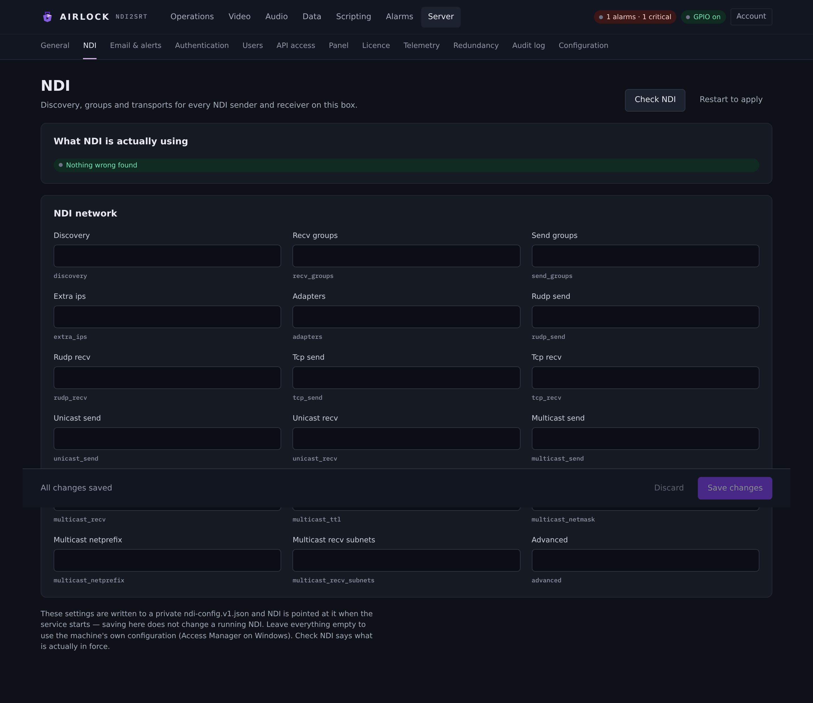
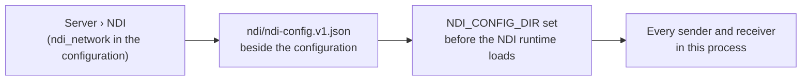

# NDI

**Server › NDI** sets discovery, groups and transports for every NDI sender and
receiver on this box. One list serves both directions: what Airlock can see, and
what it publishes.

{ .shot }

## How these settings reach NDI

Airlock does not hand these to the NDI library one at a time. It renders them
into a private `ndi-config.v1.json` and points the library at it:



Two consequences you have to plan around:

!!! warning "Saving here does not change a running NDI"
    The NDI runtime reads its configuration **once**, when the service starts.
    Save, then press **Restart to apply** — or restart the service yourself.
    Until then, the previous configuration is what NDI is using, and the
    diagnosis panel will say so in its first finding.

!!! note "Empty means the machine's own configuration"
    Leave everything blank and NDI uses what the machine already has — NDI Access
    Manager on Windows, `~/.ndi` on Linux and macOS. That is the right setting
    for most boxes. Only fill these in when this instance needs to differ from
    the rest of the machine, or when the machine has nothing configured.

## Settings

| Setting | Console label | Config key | Default | Meaning |
|---|---|---|---|---|
| Discovery servers | Discovery | `ndi_network.discovery` | `""` | `ip[:port]`, comma-separated. Port 5959 when omitted. **Setting this turns mDNS off.** |
| Receive groups | Recv groups | `ndi_network.recv_groups` | `""` | Groups this box receives from, comma-separated. Empty = `public`. |
| Send groups | Send groups | `ndi_network.send_groups` | `""` | Groups the delay and decoder outputs are published into. |
| Extra sender IPs | Extra ips | `ndi_network.extra_ips` | `""` | Addresses to consider besides discovery, comma-separated. |
| Adapters | Adapters | `ndi_network.adapters` | `""` | Adapter IPs NDI may use. Empty = every adapter. |
| RUDP send / receive | Rudp send · Rudp recv | `ndi_network.rudp_send` · `rudp_recv` | unset | |
| TCP send / receive | Tcp send · Tcp recv | `ndi_network.tcp_send` · `tcp_recv` | unset | |
| Unicast send / receive | Unicast send · Unicast recv | `ndi_network.unicast_send` · `unicast_recv` | unset | |
| Multicast send / receive | Multicast send · Multicast recv | `ndi_network.multicast_send` · `multicast_recv` | unset | |
| Multicast TTL | Multicast ttl | `ndi_network.multicast_ttl` | unset | Only applied when multicast send is on. |
| Multicast netmask | Multicast netmask | `ndi_network.multicast_netmask` | `""` | |
| Multicast prefix | Multicast netprefix | `ndi_network.multicast_netprefix` | `""` | |
| Multicast receive subnets | Multicast recv subnets | `ndi_network.multicast_recv_subnets` | `""` | CIDR subnets multicast receive may be negotiated from, comma-separated. |
| Advanced | Advanced | `ndi_network.advanced` | `""` | A whole `ndi-config.v1.json` (or just its `ndi` object), merged **over** everything above. |

```json
"ndi_network": {
  "discovery": "10.0.0.5:5959", "recv_groups": "studio,mcr", "send_groups": "",
  "extra_ips": "10.0.1.20", "adapters": "192.168.1.80",
  "rudp_send": null, "rudp_recv": null, "tcp_send": null, "tcp_recv": null,
  "unicast_send": null, "unicast_recv": null,
  "multicast_send": null, "multicast_recv": null,
  "multicast_ttl": null, "multicast_netmask": "", "multicast_netprefix": "",
  "multicast_recv_subnets": "", "advanced": ""
}
```

### The transport switches are three-state

The eight send/receive switches are **unset**, `true` or `false`. Unset — the
default — means "use NDI's own default", which is not the same as off. On the
page an unset switch shows as an empty field.

Set them as JSON booleans, either through **Advanced** or by editing the
configuration document. Typing a word into an unset field is refused at save.

```json
"advanced": "{\"tcp\":{\"recv\":{\"enable\":true}},\"multicast\":{\"recv\":{\"enable\":false}}}"
```

!!! danger "Do not switch every receive transport off"
    With TCP, unicast, multicast and RUDP receive all `false`, nothing can be
    received whatever is discovered. The diagnosis panel reports this as a fault.

## What the fields become

The rendered document uses NDI's own key names, so a configuration written here
matches one written by hand or by Access Manager:

| Field | Key in `ndi-config.v1.json` |
|---|---|
| Discovery | `ndi.networks.discovery` |
| Extra IPs | `ndi.networks.ips` |
| Receive / send groups | `ndi.groups.recv` · `ndi.groups.send` |
| Adapters | `ndi.adapters.allowed` |
| Transport switches | `ndi.rudp` · `ndi.tcp` · `ndi.unicast` · `ndi.multicast`, each `.send.enable` / `.recv.enable` |
| Multicast TTL, netmask, prefix, subnets | under `ndi.multicast` |

The file is written to `ndi/ndi-config.v1.json` beside the configuration — for an
installed service, `/var/lib/ndi2srt/ndi/` or `%ProgramData%\ndi2srt\ndi\`.

## Check NDI

**Check NDI** in the page header runs a live diagnosis and shows it as **What NDI
is actually using**. Either a green *Nothing wrong found*, or a list of findings
in plain language, worst first.

It checks, in order:

| Check | Looks for |
|---|---|
| Settings in force | The saved document differs from the one NDI loaded — saved, not restarted. This is reported first, because every other check is about a configuration that is not even running. |
| `NDI_CONFIG_DIR` | Set in this process. If it is not, the library never saw these settings at all. |
| Adapters | Every address in the allow-list is actually held by an interface on this machine. |
| Discovery server | Each one answers on TCP. Also warns that mDNS is off while any is configured. |
| Receive transports | At least one is not switched off. |
| Receive groups | `public` is among them. A source nobody put in a group is in `public`. |
| NDI runtime | The library loaded at all. |

The same answer is available over REST:

```bash
curl -s http://host:8090/api/ndi/diagnose | jq '.diagnosis.findings'
```

The response also carries `diagnosis.applied` (what NDI loaded, and from where),
`diagnosis.current` (what the saved settings would write now),
`diagnosis.pending_restart`, `config_dir` and `runtime`. Reading it needs the
`operator` role.

## Importing and exporting a configuration

There is no separate import/download button. Instead:

* **To import** an `ndi-config.v1.json` from Access Manager or another box, paste
  the whole document — or just its `ndi` object — into **Advanced**. It is merged
  over the fields above, so anything it names wins.
* **To see what is in force**, read `diagnosis.applied` from
  `GET /api/ndi/diagnose`. That is the document the running NDI loaded, not the
  one you have typed.
* **To take a copy away**, use **Download a backup** on
  [Server › Configuration](config.md) — `ndi_network` travels with it.

## Mirrored or machine-local?

In a primary/backup pair, `ndi_network.adapters` stays with the machine — which
NICs exist is a property of the box. Everything else in the section is mirrored:
discovery, groups, extra IPs, the transport switches and `advanced` describe what
the plant does.

Each channel's `ndi.receiver_name` is machine-local too. See
[Configuration store](config.md).

## Can't see a source?

Work through these in order.

1. **The sender is in a group other than `public`.** Add it to **Recv groups**.
   Remember to keep `public` in the list if other sources rely on it.
2. **The plant runs a Discovery Server.** Set **Discovery**. This turns mDNS
   off — every sender must then register with the same server, or it vanishes.
3. **The sender is on another subnet and there is no discovery server.** Add its
   address to **Extra ips**, or to the channel's own extra IPs.
4. **The machine has several NICs and NDI picked the wrong one.** Set
   **Adapters** to this machine's address on the right network. Check the address
   is actually held here — **Check NDI** will tell you if it is not.
5. **A firewall is in the way.** mDNS is 5353/udp; NDI's own traffic starts at
   TCP/UDP 5960. On Windows, add a rule for the program.

From the command line, `ndi2srt --list` prints the configuration in effect and
every source it can see.

## Troubleshooting

**Nothing changed after saving.** You have not restarted. Press **Restart to
apply**, or restart the service. The diagnosis panel's first finding says the
saved settings are not in force.

**All sources disappeared at once.** Almost always a discovery server that is
configured and unreachable — mDNS is off, so there are not *fewer* sources, there
are *none*. **Check NDI** names the server and the error. Clear the field to fall
back to mDNS.

**Discovery works but nothing connects.** Look at the adapter allow-list. An
allow-list copied from another machine pins NDI to an adapter this box does not
have, and it goes quiet with nothing said anywhere. **Check NDI** names the
address and this machine's own.

**`NDI_CONFIG_DIR is not set in this process`.** That is a start-up fault, not a
configuration one. Send the diagnosis output to support.

**The NDI runtime did not load.** Nothing here can work until it does. Install
the NDI runtime on this machine; on Windows `NDI_RUNTIME_DIR_V6` is honoured.
