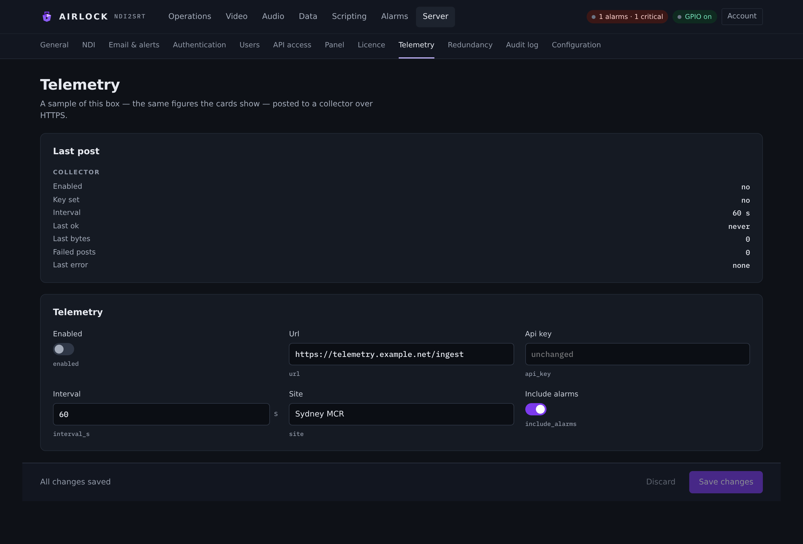

# Telemetry

Each instance can post a sample of itself to a collector over HTTPS. The
collector keeps the series; the box keeps nothing. It is off by default, silent
when off, and one-way.

{ .shot }

## Why it exists

Some faults are only visible as a comparison between today and yesterday, and
yesterday is not kept anywhere on the box.

A decoder in the field once fell from 25 fps to 0.96 fps over nineteen hours.
Every counter on its card was still moving, so nothing alarmed —
`ALARM_DECODER_STALL` asks whether output has *stopped*, and it had not. An
operator opened the page the next day and found a picture that had been dying
since the previous afternoon. No single box can see that on its own.

## What is sent

One JSON document per sample:

| Part | Carries |
|---|---|
| `instance` | The site name, a hashed hardware id, the application and version, uptime, whether the licence is valid and its **masked** serial, the GPU in use. |
| `machine` | Host name, OS and version, kernel, architecture, CPU, core count, RAM, machine model, this box's outbound IP, whether it runs as a service / desktop / console, and the configuration path. |
| `chains` | Each channel's configuration as far as it describes the chain: NDI source, codec and encoder, bitrates, GOP, PCR interval, the delay's depth and NDI name, the decoder's hardware mode and output delay, and each SRT endpoint's mode, address, latency and stream id. |
| `alarms` | The active alarm list, when `include_alarms` is on. |
| `state` | **The same document the console renders**, with the narrative stripped. |

The last one is the point. The sample is built by the same builder that feeds the
console, so a figure plotted in the cloud is by construction the figure on the
card. A hand-written telemetry payload drifts from the console within two
releases and then nobody trusts either.

"Narrative stripped" means the rolling log rings, recent script runs and the data
feed are removed — forty lines a block, most of the size and none of the meaning
once it is a time series. What is left is counters and rates.

A three-channel box is about 12 kB per sample. A sample larger than 512 kB is
refused locally and logged rather than sent.

### What is deliberately not sent

* **No credentials.** An SRT passphrase is reported as `encrypted: true`, never
  as itself. SMTP passwords, API client secrets, the redundancy token and the
  OIDC client secret are not in the sample at all.
* **No raw hardware string.** The hardware id is a digest. It identifies the
  machine for support without handing a collector the input to someone's licence.
* **No video or audio.** Counters and configuration only.
* **No log text.**

### It is not a control channel

The agent posts and reads nothing back but an acknowledgement. Nothing the
collector returns can change this instance's behaviour. A compromised or
impersonated collector can learn what a site is doing; it cannot touch the plant.

## Settings

| Setting | Console label | Config key | Default | Meaning |
|---|---|---|---|---|
| Send samples | Enabled | `telemetry.enabled` | `false` | Off, nothing is sent and nothing is logged about it. |
| Collector | Url | `telemetry.url` | `""` | The base URL. The agent posts to `<url>/v1/ingest`. |
| API key | Api key | `telemetry.api_key` | `""` | Issued by the collector. Sent as `Authorization: Bearer …`. Masked in the console. |
| Interval | Interval (s) | `telemetry.interval_s` | `60` | Seconds between samples. 10 to 3600. |
| Site name | Site | `telemetry.site` | `""` | What this instance is called in the collector. Empty = the machine name. |
| Include alarms | Include alarms | `telemetry.include_alarms` | `true` | Send the active alarms with each sample. |

```json
"telemetry": { "enabled": false, "url": "", "api_key": "",
               "interval_s": 60.0, "site": "", "include_alarms": true }
```

A save is refused unless, with `enabled` on:

* `url` starts with `https://` — or `http://`, accepted for a collector on this
  LAN;
* `api_key` is not empty;
* `interval_s` is between 10 and 3600.

!!! tip "A minute is plenty"
    These are trends, not a control loop. Shorter intervals cost bandwidth and
    buy very little.

!!! tip "Leave `include_alarms` on"
    The alarms are small, and they are the difference between "the numbers look
    odd" and "this is why".

## Set it up

1. Get a collector URL and an API key from the collector.
2. Open **Server › Telemetry**, fill in **Url**, **Api key** and **Site**.
3. Switch **Enabled** on and save.
4. Watch the **Last post** card.

Changes apply live. The agent re-reads the configuration every tick, so turning
telemetry on, changing the collector or changing the interval takes effect
without a restart.

## Last post

The card below the settings is the agent's own account of itself:

| Row | Means |
|---|---|
| **Collector** | Where it is posting, without the key. |
| **Enabled** | What the configuration says. |
| **Key set** | Whether an API key is present — the key itself is never shown. |
| **Interval** | Seconds between samples. |
| **Last ok** | UTC of the last accepted sample, or *never*. |
| **Last bytes** | Size of the last sample. The figure a site watching its data bill asks for. |
| **Failed posts** | Count since start. |
| **Last error** | The collector's own words where it has any — "key not recognised" is worth seeing; a bare 401 is not. |

The same thing over REST:

```bash
curl -s http://host:8090/api/telemetry | jq
```

`GET /api/telemetry` needs the `viewer` role and also returns `machine`.

## Failures and backoff

A collector that is down must not be hammered by fifty plants at their configured
interval. After a failure the agent waits longer each time — the interval
doubled per consecutive failure, to a ceiling of 15 minutes — and resets on the
first success.

Only the **first** failure of an outage is logged, so a collector down for a day
is one line, not fourteen hundred. The count and the message stay on the page
throughout. An HTTP post that hangs is abandoned after 20 seconds, so it never
holds the thread past the next sample.

### Through a proxy

A plant box often reaches the internet through a proxy. `HTTPS_PROXY`,
`HTTP_PROXY` and `NO_PROXY` in the service's environment are honoured, so you
configure this the way you configure every other outbound tool on the box. When a
post fails and a proxy is set, the error names it.

### On a backup

A locked backup sends nothing. Its sample would describe a box that is not on air
under the primary's site name, so the primary reports for the pair. The page
shows the agent as suppressed.

## Privacy

| Question | Answer |
|---|---|
| Is it on by default? | No. A site that wants nothing leaving the building sets nothing, and nothing is sent. |
| Can the collector change this box? | No. The agent reads only an acknowledgement. |
| Does it carry any password? | No. |
| Does it carry the licence? | The validity and a **masked** serial. |
| Does it identify the machine? | By host name, model, outbound IP and a hashed hardware id. |
| Can I run my own collector? | Yes — anything that accepts `POST <url>/v1/ingest` with a bearer token and a JSON body. |

The API key is a credential: treat it like a password. It is masked on the page
and kept out of the audit detail.

## Troubleshooting

**Nothing is sent and nothing is logged.** `telemetry.enabled` is off, or the
settings fail validation — a missing key, a URL without a scheme, an interval
outside 10–3600. The save would have been refused, so check the saved document.

**Last error: `collector answered 401`.** The API key is wrong or has been
revoked at the collector.

**Last error names a proxy.** The proxy is in the path and refused or could not
reach the collector. Check `HTTPS_PROXY` in the service environment and the
proxy's own log.

**`sample is N bytes, over the limit — not sent`.** Something in the state
document has grown unexpectedly. Send the figure to support.

**A backup sends nothing.** Expected: a locked backup is suppressed, so the pair
never both report under one site name. Once it has taken over it is running the
plant, and it reports.
