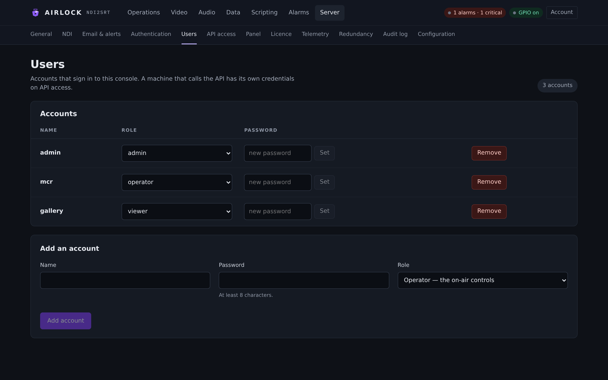
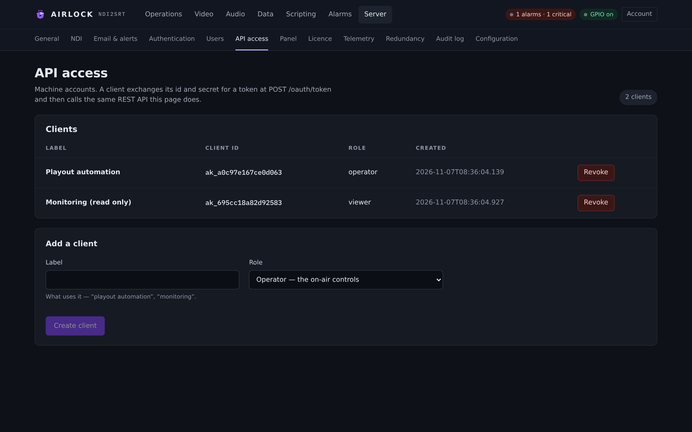

# Users and API access

Two pages, two kinds of credential. **Server › Users** is for people who sign in
to this console. **Server › API access** is for machines that call the REST API.
Both need the `admin` role, and both only matter once
[authentication](auth.md) is on.

## Users

{ .shot }

The **Accounts** table lists every local account: **Name**, **Role**,
**Password** and a **Remove** button. A pill in the header counts them.

An account that must change its password at its next sign-in carries a
**must change password** pill beside its name.

### Add an account

In **Add an account**:

1. **Name** — what they type to sign in.
2. **Password** — at least 8 characters.
3. **Role** — the select spells each one out:
   * *Viewer — can look, cannot touch*
   * *Operator — the on-air controls*
   * *Admin — settings, users and the licence*
4. **Add account**.

What each role may do is in [Roles](auth.md#roles).

!!! warning "No accounts means nobody can sign in"
    The page says so. While authentication is off that does not lock you out —
    turn it on only once an admin account exists here.

### Change a role

Use the **Role** select on the account's row. The change is immediate.

Changing a role **ends that user's sessions**, because a session carries the role
it was opened with. They sign in again and pick up the new one.

You cannot lower your own role from the console.

### Reset a password

Type a new password in the **Password** column and press **Set**. At least 8
characters.

A reset always sets **must change password**: the user's next sign-in can do
nothing but choose a new one. Their existing sessions end.

### Remove an account

**Remove** on the row. Two refusals protect you:

* you cannot delete your own account from the console;
* you cannot delete the last admin.

Removing an account ends its sessions.

### Users over REST

```bash
# list (password hashes are never returned)
curl -s http://host:8090/api/users

# add
curl -s -X POST http://host:8090/api/users \
  -H 'content-type: application/json' \
  -d '{"name":"mcr","password":"correct horse battery","role":"operator"}'

# change a role
curl -s -X POST http://host:8090/api/users/mcr/role \
  -H 'content-type: application/json' -d '{"role":"viewer"}'

# admin reset — the user must change it at the next sign-in
curl -s -X POST http://host:8090/api/users/mcr/password \
  -H 'content-type: application/json' -d '{"password":"a new one"}'

# remove
curl -s -X DELETE http://host:8090/api/users/mcr

# change your own (viewer and up)
curl -s -X POST http://host:8090/api/users/me/password \
  -H 'content-type: application/json' \
  -d '{"current":"old one","new":"new one"}'
```

| Route | Role |
|---|---|
| `GET /api/users` | admin |
| `POST /api/users` | admin |
| `POST /api/users/{name}/role` | admin |
| `POST /api/users/{name}/password` | admin |
| `DELETE /api/users/{name}` | admin |
| `POST /api/users/me/password` | viewer |

Every one of these is written to the [audit log](audit.md) —
`user.create`, `user.role`, `user.password_reset`, `user.delete` — with the
outcome, including refusals and why.

## API access

{ .shot }

A machine account is a **client id** and a **client secret** exchanged for a
bearer token. Automation, monitoring and panels use these; they never use a
person's password.

The **Clients** table lists **Label**, **Client id**, **Role**, **Created** and a
**Revoke** button.

### Create a client

In **Add a client**:

1. **Label** — what uses it. "playout automation", "monitoring".
2. **Role** — the same three.
3. **Create client**.

The response appears once, in an amber banner:

```
ak_3f9c1a07b24e5d81 · as_bGq7…
Copy this secret now — it is shown once and is not stored anywhere you can read it again.
```

Only a hash of the secret is kept, with the same PBKDF2 scheme as a password. If
it is lost, revoke the client and make another.

| Part | Shape |
|---|---|
| Client id | `ak_` + 16 hex characters |
| Client secret | `as_` + 32 random bytes, base64url |

### Revoke a client

**Revoke** on the row. Every token that client holds dies with it, immediately.

### Get a token

RFC 6749 client credentials. Either form fields or HTTP Basic:

```bash
curl -s -X POST http://host:8090/oauth/token \
  -d grant_type=client_credentials \
  -d client_id=ak_3f9c1a07b24e5d81 \
  -d client_secret=as_bGq7...
```

```bash
curl -s -X POST http://host:8090/oauth/token \
  -u 'ak_3f9c1a07b24e5d81:as_bGq7...' \
  -d grant_type=client_credentials
```

```json
{"access_token":"…","token_type":"Bearer","expires_in":28800,"scope":"operator"}
```

`expires_in` is `auth.session_hours` in seconds. Then:

```bash
curl -s http://host:8090/api/state \
  -H "Authorization: Bearer $TOKEN" | jq .alarms
```

A worked loop in bash:

```bash
HOST=http://host:8090
TOKEN=$(curl -s -X POST "$HOST/oauth/token" \
  -d grant_type=client_credentials \
  -d client_id="$AIRLOCK_ID" -d client_secret="$AIRLOCK_SECRET" \
  | jq -r .access_token)

# read the delay state of channel 2
curl -s "$HOST/api/state" -H "Authorization: Bearer $TOKEN" | jq '.channels[] | select(.id==2)'

# dump 5 seconds on channel 2 (needs an operator client)
curl -s -X POST "$HOST/api/channels/2/delay/dump?seconds=5" -H "Authorization: Bearer $TOKEN"
```

### Clients over REST

```bash
curl -s http://host:8090/api/clients
curl -s -X POST http://host:8090/api/clients \
  -H 'content-type: application/json' \
  -d '{"label":"monitoring","role":"viewer"}'
curl -s -X DELETE http://host:8090/api/clients/ak_3f9c1a07b24e5d81
```

| Route | Role | Notes |
|---|---|---|
| `GET /api/clients` | admin | Secrets are never returned. |
| `POST /api/clients` | admin | The response carries the secret **once**. |
| `DELETE /api/clients/{id}` | admin | Kills the client's tokens. |
| `POST /oauth/token` | — | Rate-limited to 10 a minute per address. |

Audited as `client.create` and `client.delete`. Calls made with a bearer token
are audited with origin `rest` and the client id as the principal — so the log
says which automation pressed what.

## Choosing a role for a machine

| It needs to | Give it |
|---|---|
| Scrape state, alarms, the audit log, previews | **viewer** |
| Build, dump, rollout, cough, censor, start and stop blocks | **operator** |
| Save or restore the configuration, manage users, assign a licence seat | **admin** |

Give the smallest role that works. A monitoring poller should never be able to
dump a buffer.

!!! tip "One client per system"
    A separate client for each panel, each automation and each monitor means the
    audit log names the culprit, and revoking one does not take the others down.

## In a primary/backup pair

Users and API clients are **mirrored** from the primary with the rest of the
`auth` section. Create them once, on the primary; the backup takes them with the
next sync. A backup will refuse to create or change one — its controls are
locked.

## Troubleshooting

**`403 {"error":"forbidden","required":"admin"}` on a users call.** The token or
session holds a lower role.

**`invalid_request: authentication is disabled`.** `/oauth/token` refuses while
`auth.enabled` is false — every request is already accepted, so there is nothing
to issue.

**`429` from `/oauth/token`.** Ten token requests a minute per address. Cache the
token for its lifetime instead of asking for a new one per call.

**A client's calls started failing after a restart.** Tokens are in memory. Ask
for a new one on a 401 rather than holding one for ever.

**The secret is lost.** Revoke the client, create another. There is no way to
read it back.
