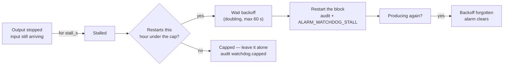

# Watchdog and service

Two things that keep a box on air without anybody watching it: a watchdog that
restarts a wedged block, and a service manager that restarts the process.

## The watchdog

Airlock runs its channels' blocks inside one process, so the thing that can wedge
is a **block** and the remedy is to restart that block.

It is off by default. It *acts*, and a plant should opt in.

### What "stalled" means

A block is stalled when its **input is arriving and its output is not**:

| Block | Input is alive | Output is advancing |
|---|---|---|
| Encoder | NDI source connected | PCRs leaving the muxer |
| Decoder | SRT connected | Decoded pictures sent to NDI |
| Delay | Source connected | Paced frames sent to NDI |

Both halves matter. A source that has gone away is **not** a stall — restarting
the block would not bring it back, and `ALARM_SOURCE_LOST` already says so. A
stopped block is never started.

### What it does



* A restart waits `backoff_s`, **doubled** for each consecutive restart of that
  block, capped at 60 s. The doubling is forgotten as soon as the block produces
  again.
* At most `max_restarts_per_hour` restarts of one block happen in a rolling hour.
  At the cap the watchdog logs it, audits `watchdog.capped` and leaves the block
  alone until the hour rolls off — a block that cannot be fixed by restarting
  must not be restarted for ever.
* Every restart writes `watchdog.restart` to the [audit log](audit.md) and raises
  `ALARM_WATCHDOG_STALL` (warning), which clears when the blocks produce again.
* **A block that feeds another takes its consumer with it.** Restarting the
  decoder restarts a delay whose source is `decoder`; restarting the delay
  restarts an encoder whose source is `delay`.
* Each channel's blocks are supervised separately, with their own backoff and
  their own hourly cap.

The watchdog is independent of the redundancy role. A standalone instance wants
it just as much, and a backup supervises its own blocks — only its alarm
*deliveries* are suppressed.

### Settings

The **Watchdog** card sits on **Server › Redundancy**, under the redundancy
settings.

| Setting | Console label | Config key | Default | Meaning |
|---|---|---|---|---|
| Supervise blocks | Enabled | `watchdog.enabled` | `false` | Off, nothing is restarted and nothing is alarmed. |
| Check interval | Check (s) | `watchdog.check_s` | `1.0` | Seconds between checks. |
| Stall after | Stall (s) | `watchdog.stall_s` | `10.0` | Output stopped this long, with the input still arriving, is a stall. |
| Backoff | Backoff (s) | `watchdog.backoff_s` | `5.0` | Wait before the first restart. Doubled per consecutive restart, capped at 60 s. |
| Restart cap | Max restarts per hour | `watchdog.max_restarts_per_hour` | `6` | Per block, rolling hour. **`0` makes the watchdog alarm-only.** |

```json
"watchdog": { "enabled": false, "check_s": 1, "stall_s": 10,
              "backoff_s": 5, "max_restarts_per_hour": 6 }
```

!!! tip "Start alarm-only"
    Set `max_restarts_per_hour: 0` for the first week. You get the alarm and the
    audit entry with nothing restarted, which tells you whether the thresholds
    suit your plant before it starts acting on them.

### Test it on a live box

```bash
curl -s -X POST http://host:8090/api/watchdog/test/encoder
curl -s -X POST http://host:8090/api/channels/2/watchdog/test/delay
```

`POST /api/watchdog/test/{encoder|decoder|delay}` — and the per-channel form —
treat that block as stalled on the watchdog's next tick, so an installer can
watch the restart, the audit entry and the alarm happen for real. It needs the
`admin` role and is audited as `watchdog.test`.

It refuses when the watchdog is not enabled, when the channel does not exist, or
when that block is not running.

It is the counterpart of **Test email** and **Test webhook** on
[Email and webhooks](../alarms/email.md).

### Troubleshooting

**A block keeps restarting.** Look at the alarm message: it names the block and
how long it was stalled. Restarting is a symptom-level fix — look at that block's
own card for the cause.

**`has hit the restart cap (6/hour) — it needs a look`.** Restarting is not
fixing it. The watchdog has stopped and will try again when the hour rolls off.

**Nothing restarts even though a block is clearly dead.** Its input is probably
dead too, which is `ALARM_SOURCE_LOST`, not a stall. The watchdog deliberately
stays out of it.

**A restart took a second block with it.** Expected when one feeds the other
through an internal tap.

---

## Running as a service

```bash
ndi2srt service install [--config <path>] [--no-start]
ndi2srt service uninstall
ndi2srt service start | stop | status
```

The service runs the headless engine — the web console, TCP control and every
enabled block. The desktop window is not part of a service; open the web console
instead.

### Linux

A systemd unit at `/etc/systemd/system/ndi2srt.service`, written by `sudo`,
enabled at boot:

```ini
[Unit]
Description=ndi2srt
After=network-online.target
Wants=network-online.target

[Service]
Type=simple
ExecStart=/opt/ndi2srt/ndi2srt service run --config /var/lib/ndi2srt/ndi2srt.json
WorkingDirectory=/var/lib/ndi2srt
Environment=HOME=/var/lib/ndi2srt
Restart=always
RestartSec=5
TimeoutStopSec=20
LimitRTPRIO=99
LimitMEMLOCK=infinity
LimitNOFILE=65536

[Install]
WantedBy=multi-user.target
```

`LimitRTPRIO=99` is what lets the pacing threads take `SCHED_FIFO` — see
[process priority](general.md#priority).

!!! warning "There is no `User=` line, and that is deliberate"
    The licence is bound to this machine's hardware id, and on Linux the
    identifier falls back to a non-specific value for anyone who cannot read
    `/sys/class/dmi/id/product_uuid` — which is root-only. A service running as
    an unprivileged user would activate a licence that is not bound to this box,
    and the fault surfaces months later as "the licence works on the wrong
    machine".

### Windows

A service named `ndi2srt`: automatic start, LocalSystem, restarts 5 seconds after
a failure, registered with the Service Control Manager from an administrator
prompt.

`service install` passes `--config <data dir>\ndi2srt.json` explicitly, so the
working directory never matters — Windows services start in `System32`.

### Stopping cleanly

The service stops on SCM Stop, on shutdown, and on **SIGTERM** — which is what
`systemctl stop`, `docker stop` and a plain `kill` send. The blocks stop tidily
and a shutdown script runs.

### Where things live

Everything under the data directory — `%ProgramData%\ndi2srt` on Windows,
`/var/lib/ndi2srt` on Linux:

```
ndi2srt.json                 configuration (written with defaults at install if absent)
config-history/              one snapshot per save
ndi/ndi-config.v1.json       the rendered NDI network configuration
logs/ndi2srt.log             the log, rotated: ndi2srt.1.log … ndi2srt.9.log
audit/audit-YYYY-MM.jsonl    the audit log, one file per month
clips/                       dump clips and their records
admin-initial-password.txt   the first-run admin password, when authentication is on
licence/                     the licence store off Windows (on Windows: the registry)
licence-state.json           sealed licensing state, incl. the backup local-control window
```

### Logs

| Where | What |
|---|---|
| `logs/ndi2srt.log` | Everything a block reports, plus a per-block stats line every `logging.stats_interval_s`. Rotated at `logging.max_mb`, `logging.keep` files. |
| `journalctl -u ndi2srt` | The same lines on Linux, via stdout. |
| Windows Event Log | Service start and stop only. The detail is in the file. |

Settings are on [Server › General](general.md#logging).

### Installers

In `installer/`:

| Platform | Install | Remove |
|---|---|---|
| Windows | right-click **`install.cmd`** → *Run as administrator* | `uninstall.cmd` |
| Linux | `sudo ./install.sh` | `sudo ./uninstall.sh` |

!!! warning "Use the `.cmd`, not the `.ps1`"
    `install.ps1` on its own fails on a stock Windows box with *"running scripts
    is disabled on this system"* — the execution policy blocks unsigned scripts.
    The `.cmd` wrapper launches it past that.

`install.ps1` copies the exe to `Program Files\ndi2srt`, opens the Windows
firewall for the program, and registers and starts the service.
`install.sh` does the same on Linux with `/opt/ndi2srt` and `/var/lib/ndi2srt`.

| Option | Does |
|---|---|
| `-Config site.json` / `--config` | Install with a prepared configuration. |
| `-NoStart` / `--no-start` | Register the service but leave it stopped. |
| `-Serial` / `--serial` | Hand a licence serial to the service. |
| `-PreviousDataDir` / `--previous-data-dir` | Carry an existing licence and its sealed state into a data directory that has moved. |
| `-Purge` / `--purge` | On uninstall: remove the data directory too. Keeps the licence. |
| `--purge-licence` | The explicit, deliberate way to throw the licence away. |

### Upgrading in place

Re-run the installer. It replaces the program and keeps:

* the configuration and its history;
* the logs, the audit log and the clips;
* **the licence**.

`service uninstall` keeps the configuration and logs too, and says so. Removing
the software must never deactivate the box.

### The licence store on upgrade

This is the one that catches people out.

| Platform | Where the licence lives | On uninstall |
|---|---|---|
| Windows | `HKLM\SOFTWARE\CCSystems\AirLock`, value `License` — shared with Airlock, which is what makes one licence cover both products | Never touched by anything. |
| Linux / macOS | `<data dir>/licence/`, mode 700 | Left alone. |

`service install` creates the store **before** the service starts and prints it,
along with this machine's hardware id. It does that because a store the service
cannot write is a licensing fault that reads like a missing library.

!!! danger "An upgrade into a new data directory loses the activation"
    The licence lives in the data directory off Windows. If you move or change
    it, copy `licence/` and `licence-state.json` across — or pass
    `--previous-data-dir` to the installer and let it do it. Releasing a seat is
    a manual, support-side operation; an activation thrown away is not something
    a site can get back by itself.

Record the hardware id, the serial and the box's role for each machine as you go.
The register of what is activated where is the only thing that makes a rebuild
cheap.

### Where the configuration comes from

The window and `--headless` look in this order:

1. `--config <path>`
2. the `NDI2SRT_CONFIG` environment variable
3. `ndi2srt.json` beside the executable
4. the installed service's copy

### Troubleshooting

**The service installs but will not start.** Check the log in the data
directory — it is written before much else. A missing NDI runtime, an
unwritable data directory and a port already in use all show there.

**`licence store: … is NOT writable by this user`.** Printed at install. Fix the
ownership of that directory before starting the service, or the licensing library
will report a fault that reads like a missing library.

**`WARNING: this hardware id is NOT specific to this machine`.** Printed at
install on Linux when `/sys/class/dmi/id/product_uuid` could not be read. Run the
service (and the activation) as root — the unit the installer writes has no
`User=` — or grant read access to that file.

**Two instances fighting.** A desktop run and the service are both using the same
configuration, so the same web port, TCP port and NDI names. Stop one.

**`systemctl stop` takes twenty seconds.** `TimeoutStopSec=20`. The blocks are
stopping tidily; if it hits the timeout every time, note it and tell support.
