# The console

The console is the web page Airlock serves about itself. This tour names every
part of it — the top bar, the main nav, each sub-nav, the Operations dashboard,
the channel settings tabs — so that when the rest of this manual says "open
**Video › Delay** and go to the **Depth & dumps** tab", you know exactly where
that is.

Open it at `http://<host>:8090/`.

## The shape of a page

Every page has the same furniture: a top bar with the brand mark, the main nav
and the status pills; a sub-nav under it when the section has one; a standby
banner when this box is a backup; then the page itself with a title and a short
line saying what it does.

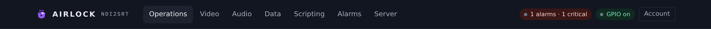{ .shot }

### The top bar

| Part | What it does |
|---|---|
| **AIRLOCK · NDI2SRT** | The brand mark is the home button. Home is **Operations**. |
| Main nav | **Operations · Video · Audio · Data · Scripting · Alarms · Server** |
| Alarms pill | *No alarms*, or *n alarms · n critical*. Click it to open **Alarms**. Green, amber or red. |
| Licence pill | **Unlicensed · output watermarked**, shown only when this box has no valid licence. |
| GPIO pill | **GPIO on** or **GPIO down**, shown only when the GPIO client is enabled. |
| **Account** | Who you are signed in as, and your password. |

### The sub-navs

Three sections carry a sub-nav of their own, and two build one from the page:

| Section | Sub-nav |
|---|---|
| **Video** | Delay · Encoders · Decoders · Fills & schedules |
| **Audio** | Inputs & outputs · Sources · Encoders · Decoders · Delay |
| **Data** | Receivers & routes · Axia GPIO |
| **Scripting** | Scripts · Variables · Live log · Engine settings — Scripts and Variables carry a count |
| **Server** | General · NDI · Email & alerts · Authentication · Users · API access · Panel · Licence · Telemetry · Redundancy · Audit log · Configuration |

**Operations**, **Alarms** and **Account** have no sub-nav.

### The address is the hash

Every view has a hash address, so a link is shareable and the browser's back
button works.

| Address | View |
|---|---|
| `#/` | Operations |
| `#/delay` `#/encoders` `#/decoders` `#/fills` | the Video pages |
| `#/audio-io` `#/audio-sources` `#/audio-encoders` `#/audio-decoders` `#/audio-delay` | the Audio pages |
| `#/data` `#/gpio` | the Data pages |
| `#/scripts` `#/variables` `#/script-log` `#/script-engine` `#/script/<name>` | the Scripting pages |
| `#/alarms` `#/account` | Alarms and Account |
| `#/server/<page>` | a Server page, e.g. `#/server/ndi` |
| `#/delay/<id>/<tab>` | a delay's settings, e.g. `#/delay/2/delay-depth` |
| `#/encoder/<id>/<tab>` `#/decoder/<id>/<tab>` | an encoder's or a decoder's settings |
| `#/channel/<id>/<tab>` | the channel's own settings — name, ad cues, alarms |

An unknown or role-forbidden address falls back to Operations rather than
showing nothing.

!!! tip "Pin a page to a wall screen"
    The hash address is all you need. `#/delay` is the delay controls for every
    channel; `/panel?channel=2` is the big-button panel page for one. See
    [Panel page](../control/panel.md).

## Operations

Home. A view-only dashboard that says what the whole box is doing, with every
tile a button into the page that owns its controls.

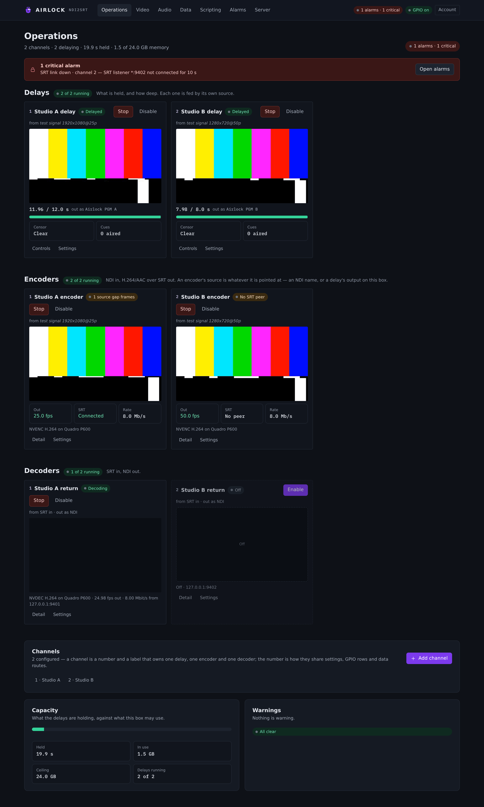{ .shot }

The page header carries the count of channels, how many are delaying, how many
seconds are held and how much memory is in use. Beside it sit the alarm pill and,
when it applies, an **Unlicensed** pill.

Below that, in order:

| Section | What is in it |
|---|---|
| Critical alarms | A red banner with the worst three and a button into **Alarms**, when any are active. |
| **Delays** | One tile per channel delay: its state, what feeds it, a preview, the depth against its target, the censor state, cues aired, and **Enable / Start / Stop / Disable**. |
| **Encoders** | One tile per channel encoder: state, source, preview, output frame rate, SRT peer, transport rate. |
| **Decoders** | One tile per channel decoder: state, preview, and a one-line summary of what it is receiving. |
| **Channels** | Every channel as a button, and **Add channel**. |
| **Capacity** | Memory in use against the ceiling, seconds held, delays running. |
| **Warnings** | Active non-critical alarms. |

Each tile has **Controls** (or **Detail**) and **Settings** buttons: the first
takes you to the page with the live controls, the second to that block's own
settings page.

!!! note "Nothing here draws an arrow the configuration does not have"
    Each tile states what feeds it — an NDI name, a test signal, or this
    channel's own tap. A delay, an encoder and a decoder are three independent
    blocks that happen to share a number, and the dashboard shows them on their
    own terms.

## Video

### Video › Delay

The on-air page. Every channel delay gets a card with the full control set, the
pre and post previews, the meters and the statistics.

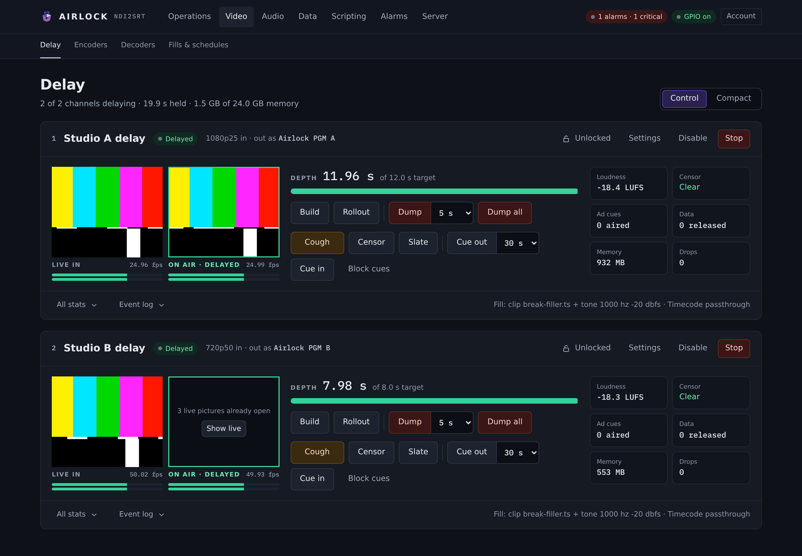{ .shot }

A **Control / Compact** switch in the header changes the density: *Control*
shows every card in full, *Compact* collapses them to one row each that you can
open individually.

The card header carries the channel number, the delay's name, a state pill
(*Live*, *Building*, *Delayed*, *Rolling out*, *Stopped*, *Bypass*, *Off*), the
input format, the NDI name it publishes, and the channel lock. Under it sit two
monitors, **LIVE IN** and **ON AIR · DELAYED**.

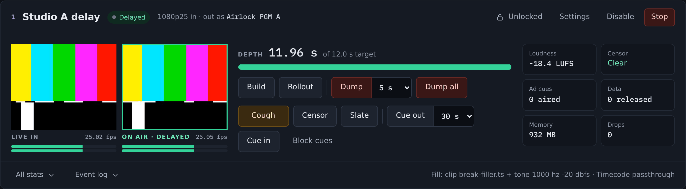{ .shot }

The controls:

| Control | What it does |
|---|---|
| **Build** | Air the fill while the buffer fills to the target, then play delayed. |
| **Dump** | Remove the newest *n* seconds. The seconds box beside it sets *n*. |
| **Dump all** | Empty the buffer; the output goes live. |
| **Rollout** | Jump cut to live and discard the buffer. |
| **Cough** | Held, not toggled — it is live only while the button is down, like the desk switch and the GPIO pin. |
| **Censor** | Cover the output with tone or silence (and optionally mask or slate the picture) for the configured span. |
| **Slate** | Put the slate up until you take it down. |
| **Cue out / Cue in** | Originate an ad cue on this channel. The seconds box sets the break length. |
| **Block cues** | The operator kill switch: cues are decoded, counted and logged, then dropped. |
| Lock | Claim or release the [channel lock](../control/lock.md). |

Below the controls, each card carries expandable **statistics** — Source,
Buffer, Loudness (R128), Depth maintenance — and the block's own log.

### Video › Encoders

One card per channel encoder, in five groups: **Input**, **Encode**,
**Clocks**, **Loudness** and **Transport · SRT** — the last carrying the link's
own peer, packet and retransmission counters. **Enable**, **Start**, **Stop**,
**Disable** and **Settings** are on the card.

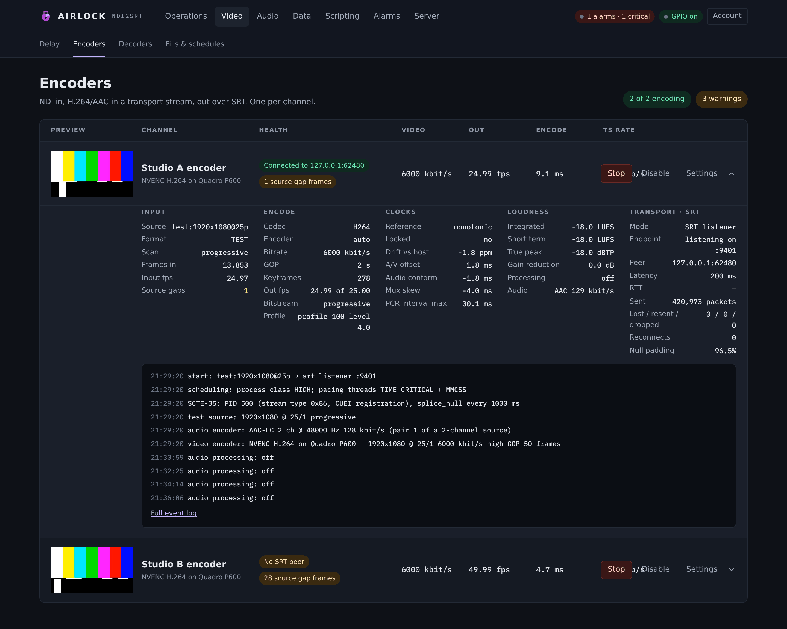{ .shot }

### Video › Decoders

One card per channel decoder: the SRT link, what the stream turned out to be,
decode time, late and dropped frames, output headroom and the A/V offset as it
leaves.

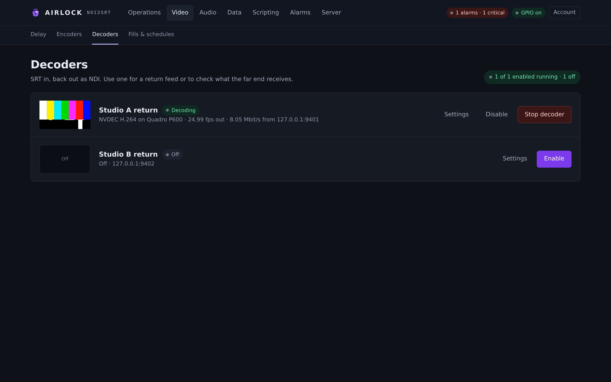{ .shot }

### Video › Fills & schedules

What goes to air while a delay builds or rolls out, and the times of day it
changes. Pick a channel, set its **Default fill**, then add dayparts to the
**Weekly schedule**. The first matching daypart wins; outside every daypart the
default fill airs.

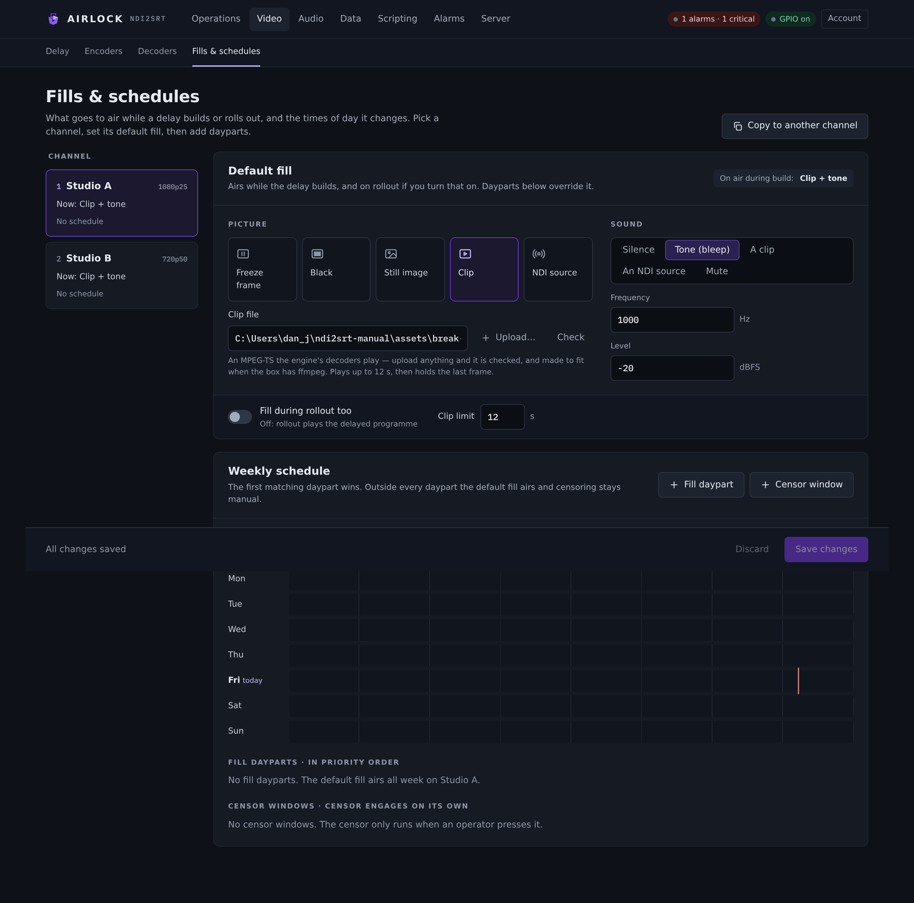{ .shot }

## Channel settings pages

The gear on a card opens that block's settings **page** — not a panel on the
card. The page is titled by the block's own name (or the channel's, when the
block has none), with a line underneath saying what feeds it, and a breadcrumb
back to Video.

A block's tabs are only that block's settings. A delay's settings are the
delay's; an encoder's are the encoder's. The **Channel** page holds only what
the three genuinely share.

| Page | Tabs |
|---|---|
| **Channel** | Name · Ad cues (SCTE) · Alarms |
| **Delay** | Source & output · Depth & dumps · Source loss · Censor & cough · Audio processing |
| **Encoder** | Video & SRT out · Audio processing |
| **Decoder** | SRT in & output |

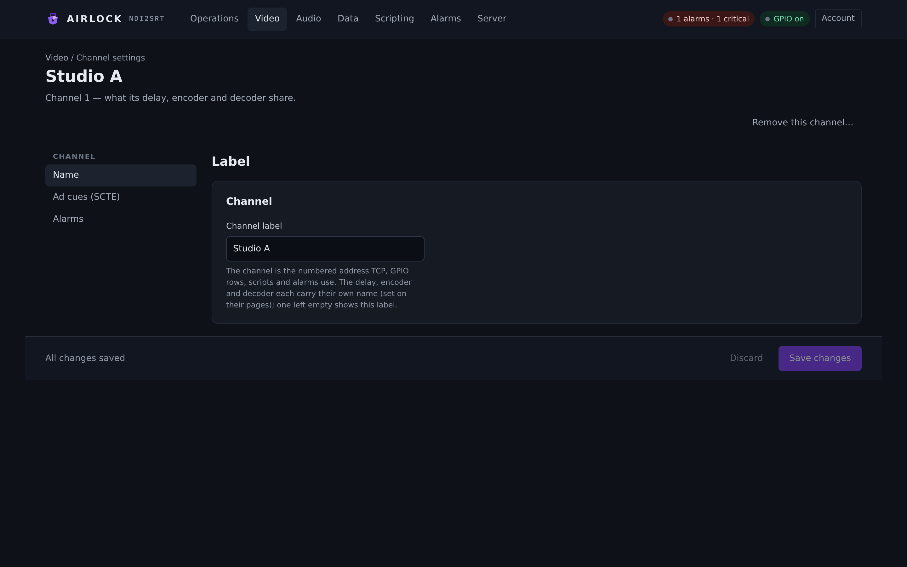{ .shot }

What is on each tab:

| Tab | Covers |
|---|---|
| **Name** | The channel's name, and removing the channel. |
| **Ad cues (SCTE)** | Whether cues are accepted and emitted, on which rails, the cue PID, pre-roll, tier and what to do with an absolute-time cue. |
| **Alarms** | This channel's alarm thresholds and holds. |
| **Source & output** | The delay's own name, its source, the NDI name it publishes, audio-only mode and its output, and extra audio tracks. |
| **Depth & dumps** | Target depth, memory limit, timecode handling, what each dump removes and what happens after one, and the fade length with the seams it applies to (build, rollout, dump). The **Delay on** and **Licence seat** switches are at the top of this tab. |
| **Source loss** | *Protect depth*, what to do while the source is missing (hold or drain), how long a gap is ignored first, whether and how fast to catch up, and when to resync. |
| **Censor & cough** | The sound while censored (tone, silence, fill or nothing, with frequency and level), the picture while censored (nothing, a mask with style and strength, or a slate), and the timing — how long a censor covers, how far before the press it starts, the cough tail, and the safety release for a stuck button. |
| **Audio processing** | Trim, a four-band EQ and a compressor on this block's audio. |
| **Video & SRT out** | The encoder's source, codec and implementation, scan, bitrate, GOP, profile, threads, the audio rail and which pair it carries, every transport-stream field, and the SRT destination. |
| **SRT in & output** | The decoder's SRT source, the NDI name it publishes, output delay, whether audio is decoded, hardware decode and timecode handling. |

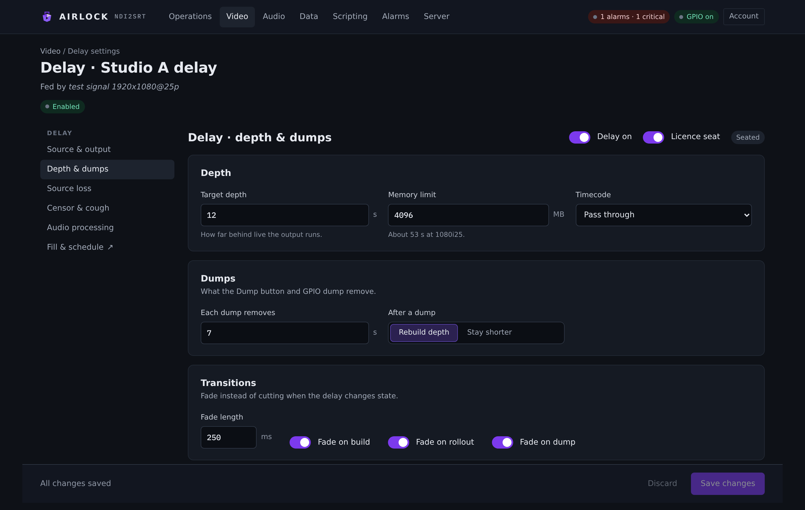{ .shot }

Each tab is covered in full by the chapter that owns it:
[Delay](../video/delay.md), [Censor, cough and slate](../video/censor.md),
[SCTE cues](../video/scte.md), [Encoders](../video/encoders.md) and
[Decoders](../video/decoders.md).

### Saving

A save bar appears at the foot of the page as soon as something changes, with a
count of the changes and a note saying what the save will do:

- *saving restarts the running encoder and decoder* — when a change needs a
  restart and the block is running;
- *delay settings apply when it next starts* — the delay is **never** restarted
  by a save, because that would drop what it holds. The source, the NDI output
  name, the depth and the memory cap wait for its next start.

A block's **name** is display-only and never counts as a change that restarts
anything.

!!! note "A page saves its own page"
    The wire format is still the whole document — every field a page did not
    draw keeps the value it was read with.

## Audio

| Page | What it is for |
|---|---|
| **Inputs & outputs** | This box's audio devices as named inputs and outputs. Name it, pick the device, say how many channels to open (0 = all it has). Each is opened once and shared. |
| **Sources** | Stereo Tool stages. Build a stage on an input and it becomes a new, processed source any encoder can pick — processed once, fanned out. |
| **Encoders** | A source, an optional Stereo Tool, an alignment delay, then a codec on SRT, RTP, a SIP call, RTMP, Icecast or HLS. Only valid bitrates per codec are offered. A SIP encoder has a call card with Dial and Hang up. |
| **Decoders** | Receive a coded audio stream over SRT, decode it, out as NDI audio and/or to an audio output. |
| **Delay** | Broadcast profanity delays — source, delay, output, with their own build, dump, censor and exit. |

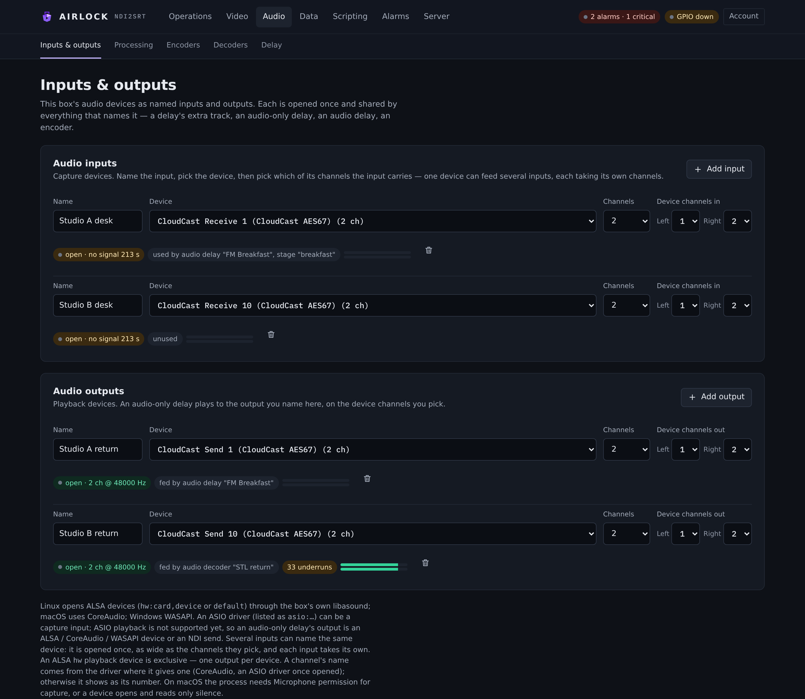{ .shot }

Each of these has its own chapter under [Audio](../audio/io.md).
## Data

**Receivers & routes** is where automation data comes in, is held in a channel's
delay and goes back out. Receivers belong to the server, not to a channel; a
route is what binds one to a channel. The page shows the signal flow, the live
connections, and the messages themselves as they arrive.

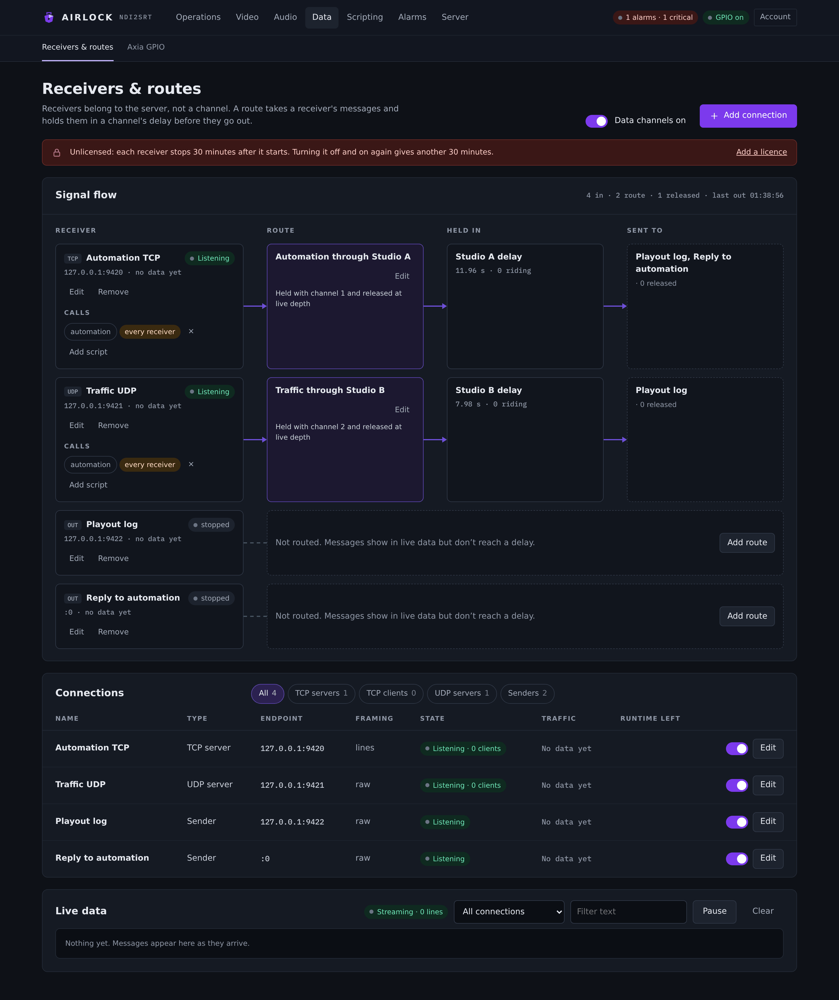{ .shot }

**Axia GPIO** configures one Livewire node: its address, the pin map read from
the node itself, the GPO pins that control the delay, and the GPI pins that
light lamps showing what the delay is doing.

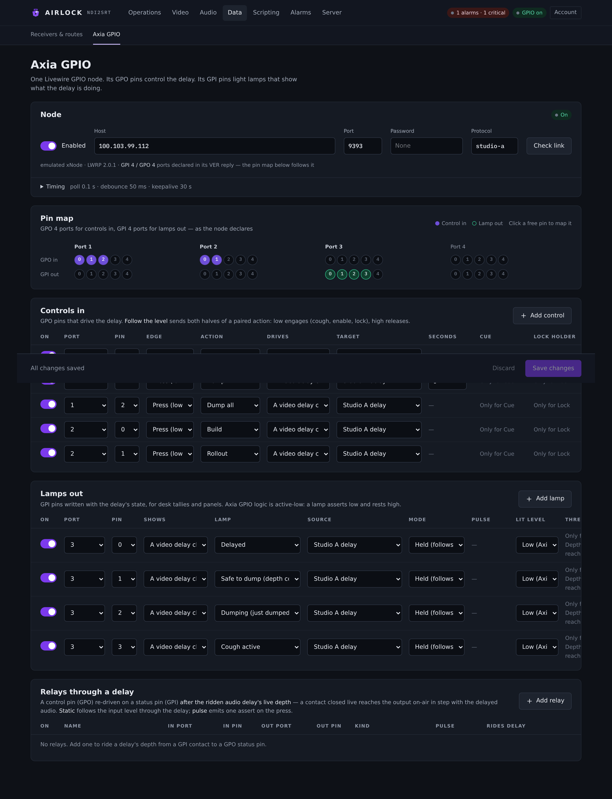{ .shot }

## Scripting

An admin surface: writing, saving and running scripts all need the admin role.

| Tab | What is on it |
|---|---|
| **Scripts** | Every script with its trigger stated in English, and the button to write a new one. |
| **Variables** | The persistent variables scripts read and write, with their types. |
| **Live log** | What the scripts are saying, as they say it. |
| **Engine settings** | The script engine's own configuration. |

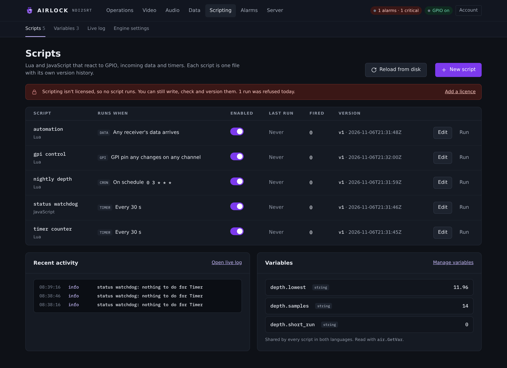{ .shot }
!!! warning "Scripting is a licensed feature"
    Without `SCRIPTING` on the licence, no script runs. You can still write,
    check, save and version them — the page says so as a lock state, with the
    count of refused runs, rather than as an error per trigger.

## Alarms

Everything the box has raised about itself. **Active** at the top, **Cleared**
below.

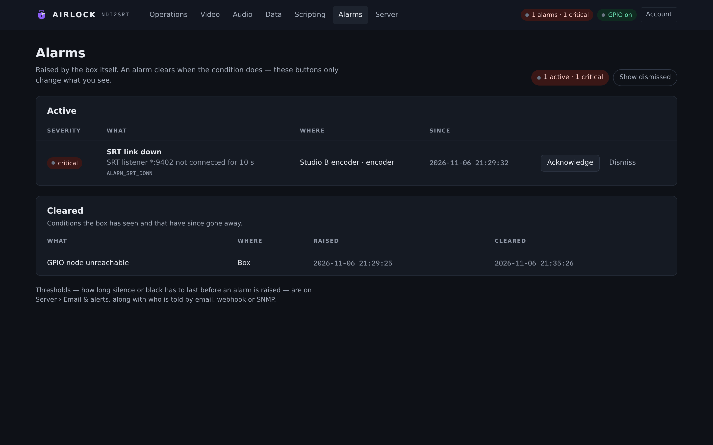{ .shot }

An alarm clears when its condition does. The acknowledge and dismiss buttons on
this page only change **what you see** — they do not stop an email, a webhook or
an SNMP trap, and they do not clear the condition.

## Server

One page per block of configuration. **Saving any of them needs the admin
role**, and some of them need it to read as well.

| Page | What it covers |
|---|---|
| **General** | The console's own listener, process priority, logging, the clock, storage and dump clips. |
| **NDI** | Discovery, groups, adapters and transports for every NDI sender and receiver on this box, with a diagnosis button. |
| **Email & alerts** | SMTP, alarm thresholds and holds, and signed webhooks. |
| **Authentication** | Whether a login is required, session length, and SSO. |
| **Users** | Local accounts and their roles. |
| **API access** | Machine accounts for the REST API (OAuth2 client credentials). |
| **Panel** | The panel control surface and its token. |
| **Licence** | The verdict, the seats, the features, the hardware id, and activation. |
| **Telemetry** | Where this instance reports its health. |
| **Redundancy** | The role, its peer, the shared token, and the Take over / Rejoin buttons. |
| **Audit log** | Everything anyone did, filterable by channel, with retention. |
| **Configuration** | The whole document, its version history, backup and restore. |

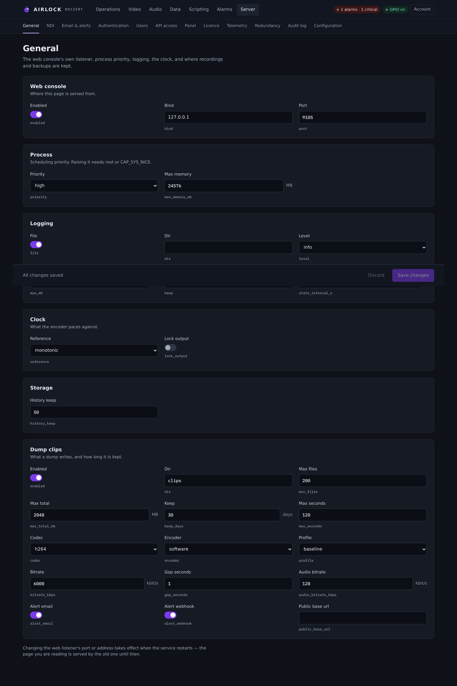{ .shot }
!!! tip "Server pages render what the box has"
    Each Server page is built from the configuration the box actually sent, and
    each row shows its raw `ndi2srt.json` key beside the plain-English label.
    When a box gains a setting, it appears on the next poll — and that key is
    what this manual, the configuration file and a support call all use.

## Account

Who you are signed in as on this box, what your role means, and the one thing
you can change about it — your password.

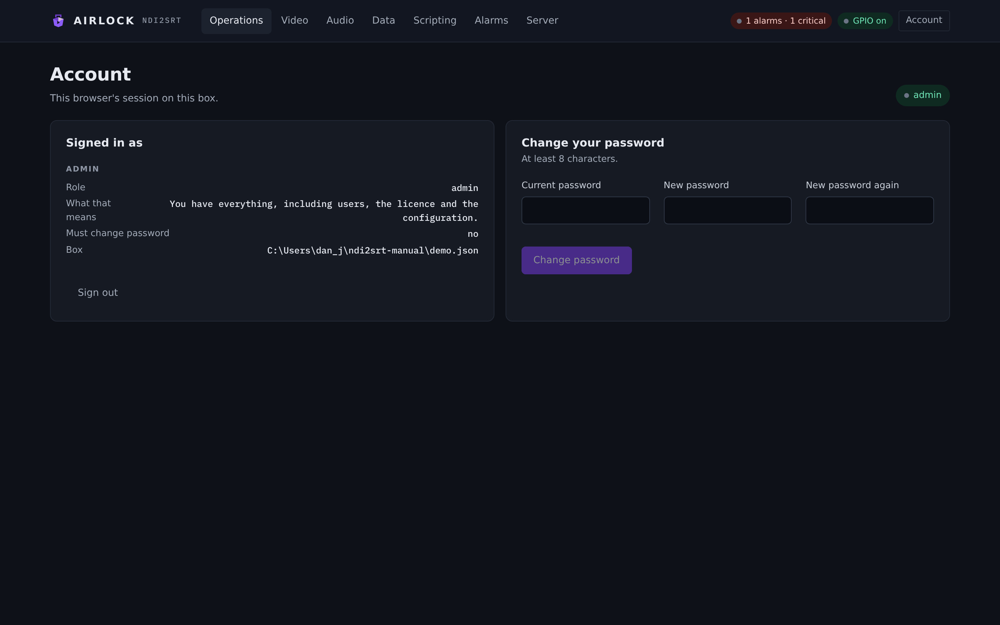{ .shot }

## Roles

With `auth.enabled` on, you sign in before the console shows you anything — no
nav, no data, no control surface until you do. From there, **the server is the
gate**: every endpoint demands a role, so a page you are not entitled to shows
you the refusal rather than the data.

| Role | What it means |
|---|---|
| **viewer** | You can see everything on this box and change nothing. |
| **operator** | You have the on-air controls — build, rollout, dump, censor and cues — but not the settings. |
| **admin** | You have everything, including users, the licence and the configuration. |

In detail:

| | viewer | operator | admin |
|---|---|---|---|
| Read state, previews, meters, the audit log | yes | yes | yes |
| Read the licence page | yes | yes | yes |
| Build, dump, rollout, set depth, dissolves | | yes | yes |
| Enable, disable, start, stop a block | | yes | yes |
| Censor, cough, slate, cues | | yes | yes |
| Take and give back the channel lock | | yes | yes |
| Reset statistics | | yes | yes |
| Save the configuration | | | yes |
| Force-release a lock someone else holds | | | yes |
| Assign or release a licence seat | | | yes |
| Manage users and API clients | | | yes |
| Scripting | | | yes |

!!! note "The licence page is open to a viewer"
    An operator looking at a watermarked output has to be able to see why.

With authentication **off**, everyone is an admin named after their address, and
the Account page says so.

## Previews and meters

- Previews are MJPEG, no more than 480 pixels wide at 6 frames a second.
- A view that leaves the screen has its previews **detached**, so the page never
  keeps six streams open because they are merely scrolled out of sight.
- Meters are stereo peak and RMS with peak-hold. The server reports per-block
  levels; the page does the ballistics.
- The delay card shows two monitors side by side, **LIVE IN** and **ON AIR ·
  DELAYED** — what is about to air against what is airing — each with its own
  frame rate and meters.
- The delay's *output* preview is the one place a watermark is visible on the
  console, deliberately: it shows the operator exactly what is going to air.

## When this box is a standby

A backup carries a banner under the top bar on every page, and the sections
whose controls it refuses — Operations, Video, Audio, Data, Scripting — have
their buttons dimmed, so nothing is clicked only to be turned away. Server,
Alarms and Account keep their buttons: the licence, takeover and rejoin, alarm
acknowledgement and signing in are all allowed on a backup.

| Banner | Means |
|---|---|
| **Standby.** Mirroring the primary; controls are locked here | Normal operation for a backup. |
| **Standby.** The primary is unreachable; controls are locked here | A takeover is decided on the Redundancy page. |
| **This standby has taken the plant.** | Controls are live and the outputs are on air under the primary's names. |
| **The primary is back.** | This standby still holds the plant. **Rejoin** is on the banner, two clicks. |

{ .shot }

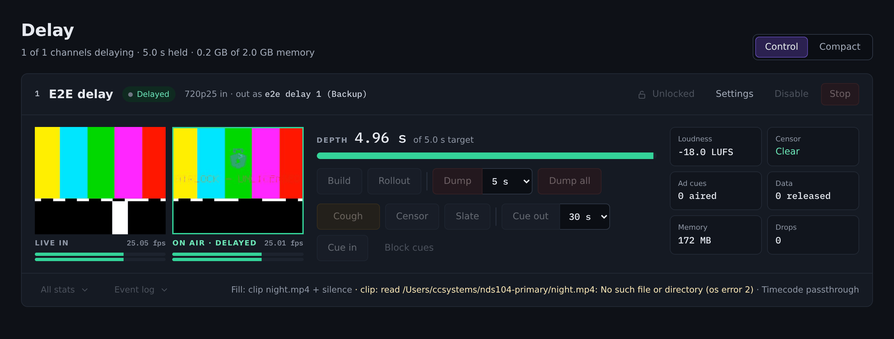{ .shot }

See [Operating a standby](../redundancy/standby.md).

## The panel page

`/panel` is not part of the console nav. It is a separate page for a
wall-mounted touch screen or an operator driving one channel from a hardware
surface: six big high-contrast buttons — Build, Dump, Dump all, Rollout, Cough,
Lock — the state and the depth in very large type, and a strip of source, alarm,
lock and GPIO chips.

`/panel?channel=2` opens straight onto channel 2 and remembers the choice on
that device. See [Panel page](../control/panel.md).

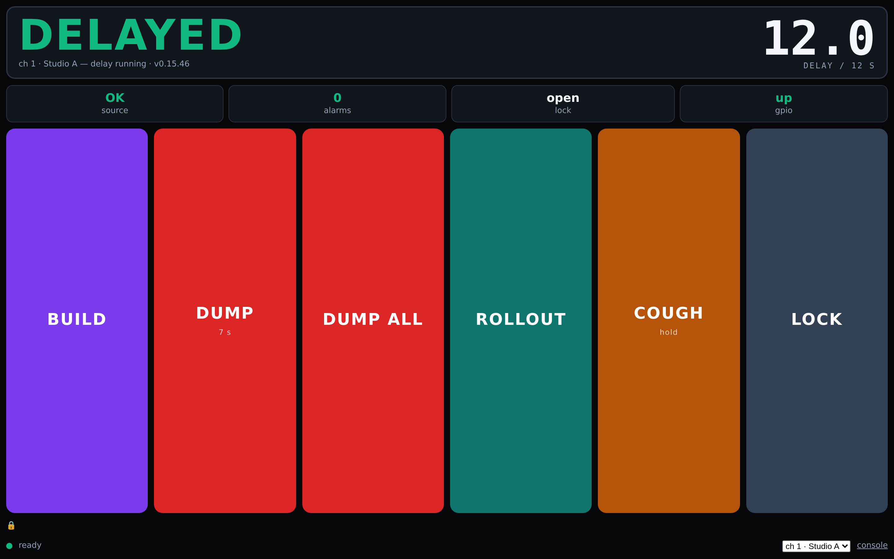{ .shot }
