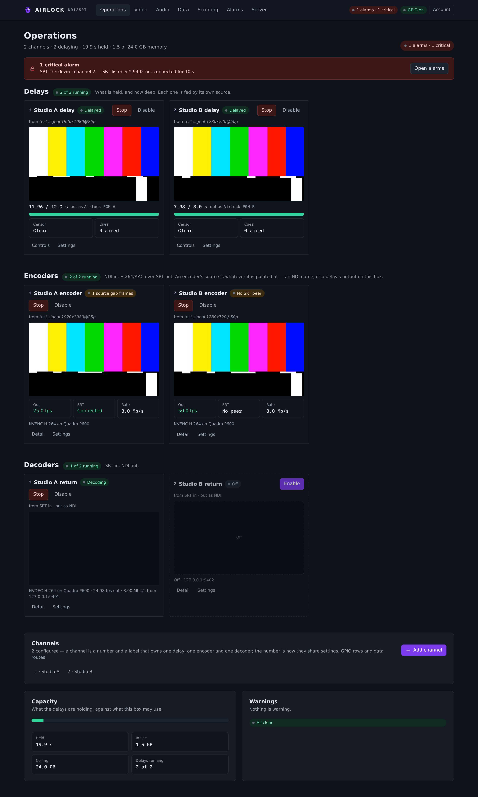
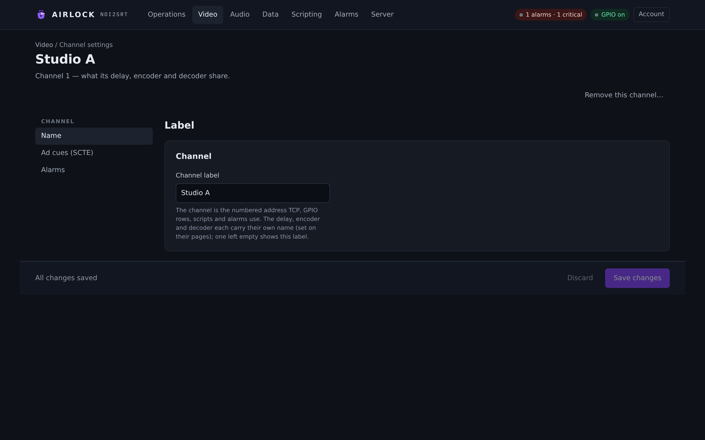
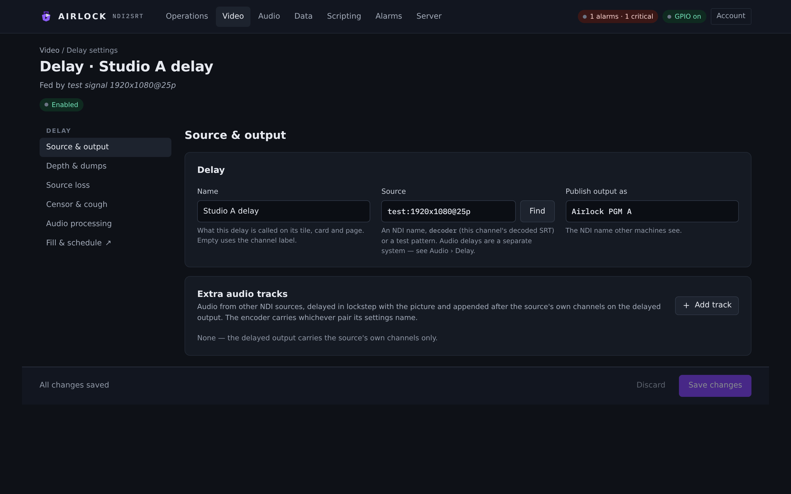
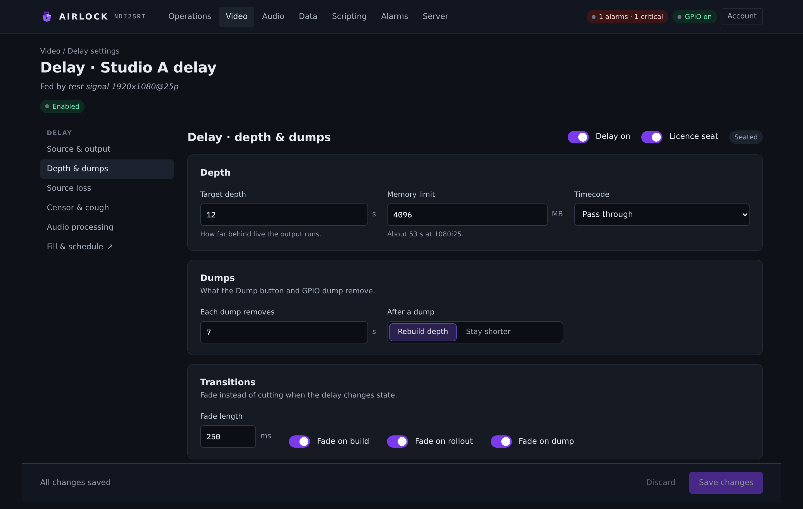
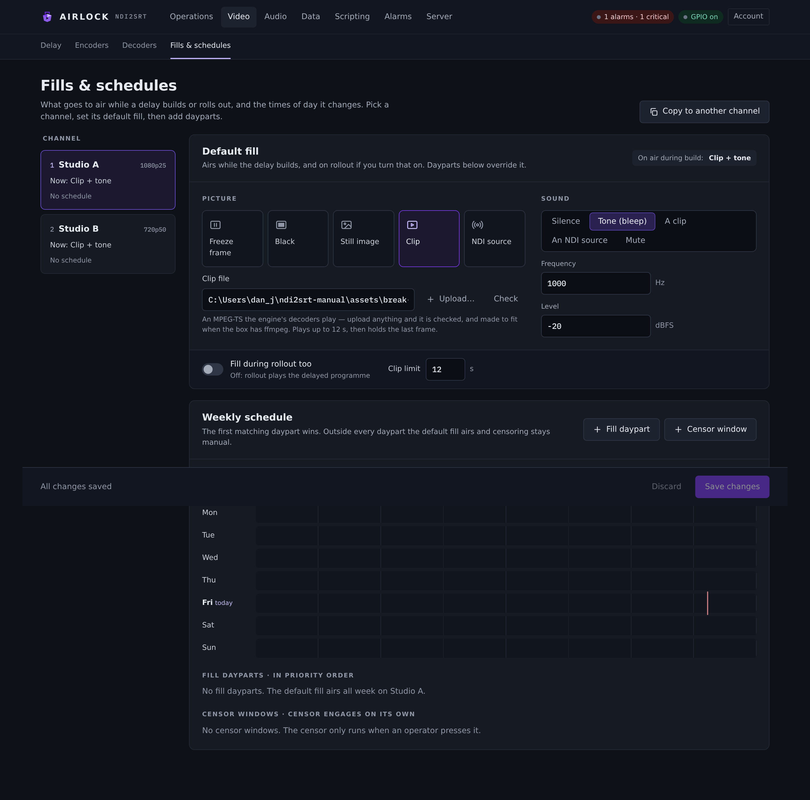
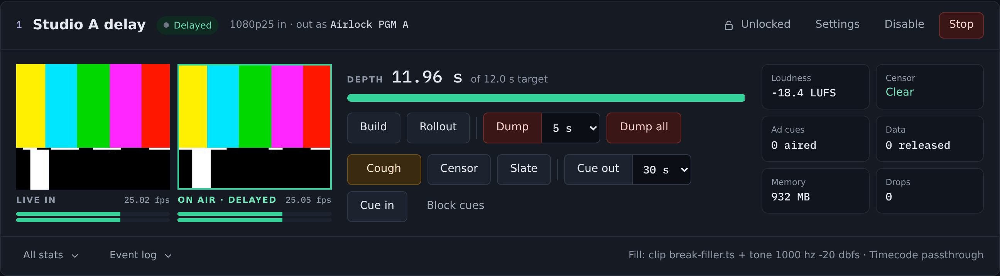
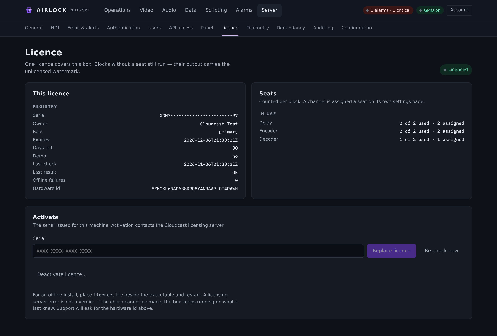

# Install and first run

This page gets Airlock onto a machine, running as a service, with its console
open in your browser. At the end there is a "first ten minutes" walkthrough that
takes you from a bare install to a delay on air.

## Before you start

| | |
|---|---|
| **Operating system** | 64-bit Windows, Linux or macOS. |
| **NDI runtime** | Required on every machine that runs Airlock. Install it from the NDI website before you start the service. |
| **Privileges** | Administrator on Windows, `sudo` on Linux and macOS. The service runs with raised scheduling priority and reads a root-only identifier for licensing. |
| **Network** | TCP 8090 for the console (configurable), TCP 9350 for the control port, plus NDI's own discovery and media ports and whatever SRT ports you configure. |
| **Memory** | Each delay channel holds raw frames: roughly `width × height × 1.5 × fps × depth_s` bytes. 1080p25 at 10 s is about 780 MB. Size the box for the channels you intend to run. |

!!! warning "The NDI runtime is not bundled"
    Airlock loads the NDI library at run time and never ships it. Without it,
    nothing NDI works and the log says so.

    | Platform | What Airlock looks for |
    |---|---|
    | Windows | `Processing.NDI.Lib.x64.dll`, including under `NDI_RUNTIME_DIR_V6` and `NDI_RUNTIME_DIR_V5` |
    | Linux | `libndi.so.6`, `libndi.so`, `/usr/local/lib/libndi.so.6`, `libndi.so.5` |
    | macOS | `libndi.dylib`, `/usr/local/lib/libndi.dylib`, `/Library/NDI SDK for Apple/lib/macOS/libndi.dylib` |

    `ndi2srt --selftest` reports whether the runtime loaded, along with the
    codecs and any GPU it found.

## Installing on Windows

Two ways, both producing the same thing: the `ndi2srt` service with its web
console, and nothing else. There is no desktop application to install.

### The MSI

```bash
msiexec /i ndi2srt-<version>-x64.msi                           # interactive
msiexec /i ndi2srt-<version>-x64.msi WEBPORT=8095 /qn          # unattended, chosen port
msiexec /i ndi2srt-<version>-x64.msi SERIAL=ABCD-1234 /qn      # and hand it a licence serial
msiexec /x ndi2srt-<version>-x64.msi /qn                       # uninstall
```

It installs the executable to `%ProgramFiles%\ndi2srt`, registers the `ndi2srt`
service (automatic start, restarting five seconds after any failure), and opens
the Windows firewall for the web port, the TCP control port and the program
itself (NDI discovery and SRT).

An interactive install asks for the port and an optional licence serial on a
**Configuration** page between the install directory and the confirmation, so
neither is something you have to know to pass on a command line. `WEBPORT` sets
the port the service listens on *and* the firewall rule, with no configuration
file having to exist.

### The zip

`ndi2srt-<version>-win64.zip` carries the same executable with `install.ps1` /
`uninstall.ps1` and their `.cmd` wrappers, for a site that would rather script
it.

Right-click **`install.cmd`** and choose *Run as administrator*. It launches the
PowerShell script past the execution policy, which blocks unsigned scripts on a
stock Windows box — running `install.ps1` on its own fails there with "running
scripts is disabled on this system".

```powershell
.\install.ps1 -Serial ABCD-1234                 # hand the service a serial to activate
.\install.ps1 -Config site.json                 # install with a prepared configuration
.\install.ps1 -NoStart                          # register the service, leave it stopped
.\install.ps1 -NoFirewall                       # don't touch the firewall
.\install.ps1 -DataDir D:\ndi2srt -PreviousDataDir C:\ProgramData\ndi2srt
```

Re-running upgrades in place and keeps the configuration. `uninstall.ps1`
removes the service and the program, keeping the data directory unless you pass
`-Purge`.

!!! danger "Don't mix the zip and the MSI on one machine"
    Both register a service called `ndi2srt`. If the zip's `install.ps1`
    registered it, Windows Installer cannot remove it, `CreateService` fails,
    and Windows reports a permissions problem that it is not. The MSI checks for
    this and tells you what to do: `sc.exe stop ndi2srt` then
    `sc.exe delete ndi2srt`, which leaves the configuration, the licence and the
    logs under `%ProgramData%\ndi2srt` untouched.

## Installing on Linux

```bash
sudo ./install.sh
sudo ./install.sh --serial ABCD-1234            # hand the service a serial to activate
sudo ./install.sh --config site.json            # install with a prepared configuration
sudo ./install.sh --no-start                    # install the unit, leave it stopped
sudo ./install.sh --data-dir /srv/ndi2srt --previous-data-dir /var/lib/ndi2srt
```

The binary goes to `/opt/ndi2srt/ndi2srt`; the configuration, the rendered NDI
network configuration, the licence store and the logs go to `/var/lib/ndi2srt`.
The script writes a systemd unit at `/etc/systemd/system/ndi2srt.service`
(`Restart=always`, enabled at boot, `LimitRTPRIO=99` so the pacing threads can
be raised), then starts it and prints the console's address.

Re-running upgrades in place; the configuration is never overwritten unless you
pass `--config`. `uninstall.sh` removes the unit and the program, keeping the
data directory unless `--purge`.

!!! warning "The unit deliberately has no `User=`"
    The service runs as root. That is not laziness: on Linux the licensing
    hardware identifier is computed from `/sys/class/dmi/id/product_uuid`, which
    is readable only by root. An unprivileged process silently falls back to an
    identifier shared by every host in the same state. See
    [Licensing](licensing.md#the-linux-privilege-trap).

## Installing on macOS

The same binary runs on macOS, with the NDI runtime installed. There is no
installer script and no `service install` for macOS — the service verbs write a
systemd unit, which macOS does not have. Run the engine headless:

```bash
sudo ./ndi2srt --headless --config /var/lib/ndi2srt/ndi2srt.json
```

To keep it up across reboots, wrap that command in a `launchd` job of your own,
with `KeepAlive` set. Point `--config` at a path the job's user can write, and
remember that the licence store lives beside the configuration file.

!!! note "Microphone permission"
    A macOS process that captures audio needs Microphone permission, and a
    process started over SSH has none — an open device then delivers pure
    silence. The Audio › Inputs & outputs page shows `silence_s` climbing when
    that is what has happened.

## Running as a service

On Windows and Linux the binary installs and manages its own service:

```bash
ndi2srt service install [--config <path>] [--no-start]
ndi2srt service uninstall
ndi2srt service start
ndi2srt service stop
ndi2srt service status
```

On Windows that registers a service with the Service Control Manager; on Linux
it writes the systemd unit. The service runs the headless engine — the console,
the TCP control port and every enabled block — and stops cleanly on a Service
Control Manager stop, on shutdown, and on **SIGTERM**, which is what `systemctl stop`, `docker stop` and
a plain `kill` send.

`service install` passes `--config <data dir>/ndi2srt.json` to the service, so
the working directory never matters (Windows services start in `System32`). It
also creates the licence store before the service starts and prints it, together
with this machine's hardware id.

!!! tip "Don't run two at once"
    An operator who double-clicks the installed executable gets the *same*
    configuration the service runs, and the two will fight over the web port,
    the TCP port and the NDI names. Stop the service first, or use a separate
    configuration file.

### Where things live

An installed service keeps everything under the data directory —
`%ProgramData%\ndi2srt` on Windows, `/var/lib/ndi2srt` on Linux:

```
ndi2srt.json                 configuration (written with defaults at install if absent)
ndi/ndi-config.v1.json       the rendered NDI network configuration
assets/                      fills, slates and other files the configuration names
logs/ndi2srt.log             the log, rotated: ndi2srt.1.log … ndi2srt.9.log
audit/audit-YYYY-MM.jsonl    the audit log, one file per month
admin-initial-password.txt   the first-run admin password, when authentication is on
licence/                     the licence store off Windows (on Windows: the registry)
licence-state.json           sealed licensing state
```

## The command line

```bash
ndi2srt --headless                      # run the configuration, stats every 2 s
ndi2srt --config path.json              # use an explicit configuration file
ndi2srt --web-port 8095                 # override the console port for this run only
ndi2srt --example-config [out.json]     # print (or write) every key with its default
ndi2srt --list                          # the NDI sources visible from here
ndi2srt --selftest                      # codecs, GPU and the NDI runtime
ndi2srt --probe "<name>" [--seconds n] [--png out.png]
ndi2srt --analyse "<name>" [--against "<name>"] [--seconds n] [--expect 1280x720@25p]
ndi2srt --testsend "<name>" test:1280x720@25p
ndi2srt --prove-delay "<in>" "<out>" [seconds]
```

| Flag | What it is for |
|---|---|
| `--headless` | Run the engine in the foreground. The console and every enabled block come up; statistics print every two seconds. |
| `--list` | Print the NDI configuration in effect and every source it can see. The first thing to run when a source will not appear. |
| `--selftest` | Exercise the encoders, the decoders, any GPU and the NDI runtime, and say what each one is. |
| `--probe` | Receive one NDI source for a few seconds and report format, timecode continuity, audio presence and level. |
| `--analyse` | The measured version of `--probe`: cadence, timecode, dropped frames, A/V alignment and the delay. With `--against <the delay's input>` the delay is measured by one clock on one machine, which is exact. |
| `--testsend` | Publish Airlock's synthetic test pattern as an NDI source, for bench work without a source. |
| `--example-config` | Write a complete default configuration document, rather than guessing keys from this manual. |

!!! note "`--web-port` is for this run only"
    Nothing is written back to the configuration. The MSI passes it so an
    unattended install can put the console where the site wants it without
    shipping a configuration file, and the firewall rule is opened on the same
    number.

## The configuration file

Airlock reads one JSON document. It looks for it in this order:

1. `--config <path>` on the command line;
2. the `NDI2SRT_CONFIG` environment variable;
3. `ndi2srt.json` **beside the executable**;
4. the installed service's copy under the data directory.

So an operator who runs the installed executable by hand edits the same
configuration the service runs.

Every save is validated, versioned and audited, whether it comes from the
console, from `PUT /api/config`, from a restored backup or from a redundancy
primary. See [Configuration store](../server/config.md).

### The `web` block

```json
"web": { "enabled": true, "bind": "0.0.0.0", "port": 8090 }
```

| Setting | Console label | Config key | Default | Meaning |
|---|---|---|---|---|
| Serve the console | Enabled | `web.enabled` | `true` | Run the web listener at all. With it off there is no console and no REST API. |
| Listen address | Bind | `web.bind` | `0.0.0.0` | Which local address the listener binds. `127.0.0.1` restricts it to the box itself. |
| Port | Port | `web.port` | `8090` | TCP port for the console, the REST API and the previews. |

You will find these on **Server › General**, under *Web console*.

!!! warning "Changing the listener needs a restart"
    A new port or bind address takes effect when the service restarts — the page
    you are reading is still being served by the old listener until then. The
    console offers a restart on **Server › General**.

!!! danger "Authentication is off by default"
    With `auth.enabled` false, the console and the whole REST API are open and
    everyone is an admin named after their address. Put the console behind the
    plant's network, not the internet, or turn authentication on. Airlock warns
    in the log at start when authentication is off and `web.bind` is not
    loopback. See [Authentication and OIDC](../server/auth.md).

## Opening the console for the first time

Browse to `http://<host>:8090/`. You land on **Operations**: a tile for every
block on the box, with its state, its source and a preview.

{ .shot }

A fresh install has one channel, named "Channel 1", with every block off. That
is deliberate — nothing goes to air because you installed software.

!!! tip "Check the NDI configuration early"
    **Server › NDI** shows the NDI network configuration in effect and has a
    diagnosis button. If a sender is in a group other than `public`, behind a
    Discovery Server, or on another subnet, this is the page that fixes it. See
    [Server › NDI](../server/ndi.md).

## Your first ten minutes

A bare install to a delay on air, in order.

### 1. Confirm the box can see your source

```bash
ndi2srt --list
```

This prints the NDI configuration in effect and every source visible from the
machine. If your source is missing, fix that before anything else — **Server ›
NDI** and the [troubleshooting](../reference/troubleshooting.md) page cover
groups, discovery servers, extra IPs and adapters.

### 2. Name the channel

Open **Operations**, click the channel button under *Channels*, and set its
**Name** on the **Name** tab. One to 24 characters.

{ .shot }

### 3. Point the delay at the source

Go to **Video › Delay**, open the channel's settings, and use the **Source &
output** tab:

- **Source** — pick the NDI source, or type `test:1280x720@25p` to work without
  one.
- **NDI out** — the name this delay publishes. It must be unique across every
  delay and decoder in the process.

{ .shot }

### 4. Set the depth

On the **Depth & dumps** tab set:

- **Depth** — how far behind air the output runs, in seconds.
- **Dump** — how many seconds one press of Dump removes.
- **Max memory** — the ceiling on this channel's buffer. The card shows the
  depth that cap allows at the current raster.

{ .shot }

Save. A delay is never restarted by a save — that would drop what it holds — so
the source, the output name and the depth apply when it next starts.

### 5. Choose what airs while it builds

**Video › Fills & schedules.** The default is the frozen last frame and silence;
you can use a still, a clip, or a live NDI source, and put dayparts around it.

{ .shot }

### 6. Enable it and build

Back on **Video › Delay**, press **Enable**, then **Build**. The fill airs while
the buffer fills, then the delayed programme plays. Watch the depth climb to
its target on the card's meter, with *pre* (what is about to air) and *post*
(what is airing) side by side.

{ .shot }

### 7. Prove it

```bash
ndi2srt --probe "<your delay's NDI name>" --seconds 10
```

Or, from another machine, `--analyse "<the delay's output>" --against "<the
delay's input>"`, which measures the delay with one clock and reports it exactly.

### 8. Try a dump

Press **Dump**. The configured number of seconds disappears from the buffer, the
output carries straight on, and (with *rebuild after dump* on) the fill airs
while the depth is regained. Every dump also writes a clip of the removed
seconds and can tell someone — see [Dump clips and alerts](../alarms/clips.md).

### 9. Licence the box

**Server › Licence.** Without a seat the output keeps running but carries a
watermark and a tone burst every thirty seconds. Enter the serial and press
**Activate**. See [Licensing](licensing.md).

{ .shot }

### 10. Lock the door

Turn on **Server › Authentication**, let Airlock create the first admin account,
and add the operators who need the controls. See
[Authentication and OIDC](../server/auth.md) and
[Users and API access](../server/users.md).

## Upgrading

Re-run the installer. It stops the service, replaces the binary and starts it
again.

What an upgrade never touches, on purpose:

- **the configuration** — the service writes a default `ndi2srt.json` on first
  start only if there is none, so an upgrade can never flatten a site's
  settings;
- **the licence**, which is never removed by an upgrade or by an uninstall,
  because releasing a seat is a manual operation with the licensing
  administration.

!!! danger "If the data directory moves, carry the licence with it"
    On Windows there is nothing to do — the licence lives in the registry and
    the registry does not move.

    Off Windows the licence is a **directory**, and two things lose an
    activation: an upgrade into a new versioned path, and a store the service
    cannot write. If the data directory moves, copy **both** `licence/` and
    `licence-state.json`, or the box looks like one that was never activated.

    ```bash
    sudo ./install.sh --data-dir /srv/ndi2srt --previous-data-dir /var/lib/ndi2srt
    ```

    Both installers do it for you when told where the old directory was. The
    better answer for a site that re-versions its install tree is to set
    `licence.store_dir` to a path **outside** it once, and never think about it
    again.

## Uninstalling

| Platform | Command | What it keeps |
|---|---|---|
| Windows (MSI) | `msiexec /x ndi2srt-<version>-x64.msi /qn` | The data directory and the licence. |
| Windows (zip) | `.\uninstall.ps1` (`-Purge` to remove the data directory) | The licence, always — that registry value is shared. |
| Linux | `sudo ./uninstall.sh` (`--purge` to remove the data directory) | The licence store, unless you pass `--purge-licence`. |

An uninstall never removes the licence. What it does remove is the installer's
pending-activation serial, which is only a hand-off slot.
