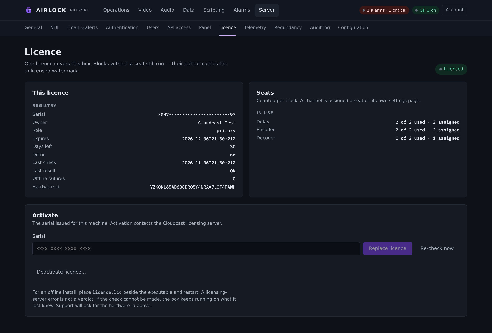

# Licensing

This page tells you what an Airlock licence grants, how to activate a machine,
where the licence is kept on each operating system, and what happens when a box
is unlicensed. Read the whole of it before you request a licence: two of the
traps below cost a support call each if you hit them after the fact.

## What a licence grants

A licence carries a flat list of tokens. `KEY=n` is a count; a bare `KEY` is a
flag, and for a seat pool a bare `KEY` means unlimited.

| Token | Grants |
|---|---|
| `VDELAY=n` | video delay channels |
| `VENCODE=n` | video encoders |
| `VDECODE=n` | video decoders |
| `ADELAY=n` | audio-only delays |
| `AENCODE=n` | audio encoders |
| `ADECODE=n` | audio decoders |
| `AES67=n` | read from the licence and reported; not yet consumed by a block |
| `SCRIPTING` | Lua and JavaScript scripts actually run |
| `PANEL` | the TCP control port accepts acting verbs |
| `PRIMARY` · `BACKUP` · `STANDALONE` | which redundancy role this instance may run |
| `XHEAAC` · `HLSDELAY` | named features |

A licence carrying **none** of the three role flags is a legacy roleless licence
and runs anywhere. Otherwise `PRIMARY` permits primary *and* standalone (a
primary with nothing paired to it is just a standalone), `BACKUP` permits
backup, and `STANDALONE` permits standalone only.

## Seats

!!! info "A seat is one running block, not one channel"
    A channel holds a delay, an encoder and a decoder, and **each one takes its
    own seat from its own pool**. A channel that delays *and* encodes uses one
    `VDELAY` seat and one `VENCODE` seat.

Seats are **resolution-agnostic**: a 4K channel and an SD channel cost the same
seat.

### How seats are handed out

The blocks that hold a seat are the **lowest channel ids first, up to the
licensed count**. It is recomputed from the live configuration on every read and
nothing about *who* is seated is ever stored — so a licence downgrade, or a
channel added, re-marks the newest block by itself rather than needing somebody
to go and un-assign one. A downgrade drops the highest ids and the main channel
keeps running.

Zero seats seats nobody. A bare token (unlimited) seats everyone. **An invalid
licence grants zero seats in every pool**, whatever the licence itself says.

The start-up log says it in one line:

```
licence: seats - VDELAY 2/2 (3 assigned) - VENCODE 1/unlimited (1 assigned) - VDECODE 0/0 (0 assigned); unseated blocks run watermarked
```

### Assigning a seat

Every block carries an assignment flag, all three defaulting to on, so a
single-channel install with a two-seat licence works out of the box:

```json
"channels": [{
  "delay":   { "licence_assigned": true },
  "encoder": { "licence_assigned": true },
  "decoder": { "licence_assigned": true }
}]
```

In the console it is the **Licence seat** switch at the top of each block's
settings page — **Delay › Depth & dumps**, **Encoder › Video & SRT out**,
**Decoder › SRT in & output** — with a pill beside it reading *Seated* or
*Unseated — output watermarked*.

Assigning and releasing is **admin only**, and takes effect **live** — no block
restart, on this box or on a backup mirroring the change.

- **Assigning more blocks than a pool has seats is refused**, naming the pool
  and the count: *no free VDELAY seats (2 of 2 used) — release one, or activate
  a licence with more VDELAY seats.*
- **Releasing is always allowed**, and re-affirming an assignment that is
  already set is never refused — a downgrade can leave a pool over its cap, and
  that is not something an operator should have to unpick before touching
  anything else.
- On a box with **no** licence every pool is zero, so releasing a seat there is
  one-way until a licence is activated.

The seat state shows as a pill beside each block's state badge, and the two
unseated cases read differently because they are different problems:

| Pill | Means |
|---|---|
| *(nothing)* | the block holds a seat |
| `no seat` | assigned, but the pool's seats are taken by lower-numbered channels |
| `unlicensed` | not assigned a seat at all |

## The licence page

**Server › Licence**. A **viewer** can read all of it — an operator looking at a
watermarked output has to be able to see why. Activation on the same page is
**admin only**.

{ .shot }

It shows, from one request:

- the **verdict** and its reason, and when it is bad, what that means on air:
  unseated outputs are watermarked, and Dump and Rollout are never gated;
- the owner, the **masked** serial (the whole serial is never returned by the
  API), the expiry and days remaining, and the licence role;
- **Seats** per pool as *used / total (assigned)*, with `unlimited` where the
  token is bare and over-subscription called out;
- the feature flags, with the two that silently lock a surface spelled out when
  they are **absent**: `PANEL` and `SCRIPTING`;
- the offline-failure counter against its allowance, the last check and what
  came back;
- the **hardware identifier**, with a copy button.

### Activating

| Control | What it does |
|---|---|
| **Serial** | The serial issued for this machine. |
| **Activate** (**Replace licence** once one is held) | Contacts the licensing server and stores what comes back. |
| **Re-check now** | Runs the online re-check immediately. This is what support will ask for first. |
| **Deactivate licence…** | Behind a confirmation: releases the seat with the licensing server, then deletes the local licence. |

A refusal is shown in **the licensing server's own words**. Airlock never
answers "the licence data are invalid", which hides the real cause.

```bash
curl -sX POST localhost:8090/api/licence/activate -d '{"serial":"NOPE"}'
# {"error":"You have entered invalid serial number."}
```

!!! danger "Never confirm a backup-role activation on a test rig"
    If an activation offers to switch this instance into the **backup** role,
    say no unless this machine really is a backup of something.

    - It switches the box into that role, which **locks the console** — every
      mutating control is refused, because a backup's controls belong to its
      primary.
    - A backup-role licence grants nothing on its own: the box mirrors a primary
      it does not have, so it sits locked and unmirrored.
    - Getting out means editing `redundancy.role` back to `standalone` in the
      configuration file on disk and restarting, because the console will not
      let you change it from there.

    The same goes for a serial handed to an installer: it is activated
    unattended, so hand over the serial for the role this box is actually going
    to run.

### Activating without the console

```bash
# activate a serial
curl -sX POST localhost:8090/api/licence/activate -d '{"serial":"ABCD-1234"}'

# pull down a licence already issued to this hardware id (the usual path after a re-install)
curl -sX POST localhost:8090/api/licence/activate-hwid

# ask for a trial
curl -sX POST localhost:8090/api/licence/activate-trial -d '{"email":"you@example.com"}'

# run the online re-check now
curl -sX POST localhost:8090/api/licence/recheck

# release the seat and delete the local licence
curl -sX POST localhost:8090/api/licence/deactivate
```

All five are admin, all five are audited with the licensing server's own
sentence as the detail (with the serial masked out of it), and all five are
allowed on a **locked backup** — a backup that cannot be activated cannot take
over, and discovering that during a failover is the worst possible moment.

### Activating at install time

Activation is deliberately **not** done by the installer, so an offline install
still completes. The installer only writes the serial down:

```powershell
.\install.ps1 -Serial ABCD-1234
```

```bash
sudo ./install.sh --serial ABCD-1234
```

The service consumes it at its next start and on every daily tick while it is
still pending. It is cleared on success, on an idempotent match with the serial
already active (a re-install with the same key), and on a definitive rejection —
a mistyped serial must not be retried daily for ever. It is kept **only** while
the licensing server is unreachable.

## Where the licence lives

| Platform | The licence itself | Also on disk |
|---|---|---|
| **Windows** | The registry: `HKEY_LOCAL_MACHINE\SOFTWARE\CCSystems\AirLock`, value `License`. `licence.store_dir` is unused. | `%ProgramData%\ndi2srt\licence-state.json` (sealed state) |
| **Linux / macOS** | A file store at `licence.store_dir`, by default `<config dir>/licence` — for an installed service, `/var/lib/ndi2srt/licence`. | `/var/lib/ndi2srt/licence-state.json` |

On every read Airlock tries three places, stopping at the first that verifies:

1. `licence.file` from the configuration, if set — verified **in place**, never
   copied into the store, so naming a file cannot overwrite a licence that was
   activated online;
2. the store (the registry on Windows);
3. `licence.lic` beside the executable, so an offline licence file can simply be
   dropped in.

Writes — an activation, or registering a licence string — always go to the
store.

### The `licence` block

```json
"licence": {
  "store_dir": "",
  "file": "",
  "container_serial": "",
  "container_base_url": "https://ccsystems.io",
  "container_renew_hours": 12
}
```

| Setting | Console label | Config key | Default | Meaning |
|---|---|---|---|---|
| Licence store | Store dir | `licence.store_dir` | `""` | Where the licence store lives, off Windows. Empty means `<config dir>/licence`. Set it to a path outside a versioned install tree and an upgrade can never lose the activation. |
| Explicit licence file | File | `licence.file` | `""` | A licence file to read, tried before the store. Empty means none. |
| Container serial | Container serial | `licence.container_serial` | `""` | Turns on hardware-unbound container mode. Empty leaves ordinary licensing unchanged. Also settable as `NDI2SRT_LICENCE_CONTAINER_SERIAL`. |
| Container endpoint | Container base url | `licence.container_base_url` | `https://ccsystems.io` | Where the unbound licence is fetched from. |
| Container renewal | Container renew | `licence.container_renew_hours` | `12` | How often the unbound licence is renewed. The licence itself is stamped 24 hours, so the default renews twice inside its own life. |

Both paths are **machine-local**: a primary never tells a backup where its
licence lives, and a licence is bound to the machine it was activated on anyway.

!!! warning "A store the service cannot write is a deployment fault"
    A root-owned store under an unprivileged service makes the licence call fail
    with a permission error that reads like a missing library. Airlock says so
    explicitly instead — *licensing library cannot reach its store — check
    `<dir>` is writable by the service user* — and logs it as an error at start.

### After a re-install

Nothing is lost. An uninstall never removes the licence, and neither does
`--purge`; only the explicit `uninstall.sh --purge-licence` does, and on Windows
nothing does, because that registry value is shared.

If the box has been rebuilt and the store really is gone, **Find my licence**
(`POST /api/licence/activate-hwid`) pulls down the licence the server has
already issued to this hardware id. That is the usual path after a re-install.

## The hardware identifier

A 32-character string, and the first thing support will ask for. Three ways to
read it:

- the **Server › Licence** page shows it with a copy button;
- `GET /api/licence` → `hardware_id`;
- the log, on every start, whether or not there is a licence.

```
licence: store /var/lib/ndi2srt/licence
licence: not licensed - no licence registered (source none, hardware id 2FIXNOHZ2UXCLCVU5IQ40HPEQECJ4D80)
```

`ndi2srt service install` prints it too, next to the licence store path.

### There are two of them

!!! danger "The most expensive trap in the whole licensing story"
    A box does not have *a* licensing hardware id. It has **two**, and which one
    it reports depends on `NDI2SRT_LICENCE_VMWARE_HWID`.

    Airlock licences are issued in **VMware-distinct** mode, which is the
    default, so leave the variable unset. But a box activated *before* that mode
    existed is bound to the other one, and reads back "invalid on this computer"
    until it is started with `NDI2SRT_LICENCE_VMWARE_HWID=0`.

Verification always recomputes the id from the **licence's own** flag and
ignores the client's setting, so a licensed box works either way — but the
identifier it *reports* can have nothing to do with the licence it needs, and a
licence issued against the wrong one will never validate.

The licence page therefore shows the whole truth: the identifier in the active
mode, the identifier the **other** mode computes behind a disclosure with its
own copy button, and — when a licence is loaded — the identifier the licence
itself is bound to, with a warning when they do not match. The same warning is
logged once at start.

### The Linux privilege trap

`/sys/class/dmi/id/product_uuid` is mode 0400 root. Run unprivileged, the
hardware id **silently falls back to a constant shared by every host in the same
state**. The same binary on the same box:

| Run as | Hardware id |
|---|---|
| root | specific to this machine |
| an ordinary user | **degenerate** — shared by every host in the same state |

Two consequences, both expensive to diagnose months later:

- **A licence activated as root is "invalid on this computer" for a service that
  is not.**
- **A licence activated unprivileged is bound to nothing in particular** — it
  would verify on any box in the same state, which is a licensing hole an
  operator cannot see.

So: **activate as the same user the service runs as.** The systemd unit Airlock
installs has no `User=`, so the service runs as root and is on the good side of
this; activate with `sudo`, or through the web interface of the running service.
Airlock says so out loud — the licence page flags a degenerate identifier, and
`install.sh` warns when it cannot read the file even as root.

If a site insists on an unprivileged service, that user must be given read
access to `product_uuid` — an ACL (`setfacl -m u:ndi2srt:r
/sys/class/dmi/id/product_uuid`, re-applied at boot since sysfs is volatile) or
a udev rule granting a supplementary group — **or every box at that site will
share one identifier**.

For genuinely ephemeral hosts (containers, rebuilt VMs), do not fight it: use
container mode, which is unbound by design.

## Validity

The verdict is evaluated at start, then every 24 hours, in this order:

1. **no licence at all** — invalid, zero grants, immediately. There is **no
   grace period**;
2. a standing verdict from the licensing server (revoked / expired / invalid),
   sticky until a good check or a successful activation clears it;
3. the expiry date is past;
4. the licensing server has been unreachable for more than 30 consecutive daily
   checks;
5. the licence's role flags do not permit this instance's redundancy role;
6. valid.

Every comparison uses the later of now and the highest clock ever seen, recorded
in a sealed state file, so **winding the clock back cannot extend anything**.

A change of verdict writes an audit entry, logs, and raises or clears
`ALARM_LICENCE_INVALID` — so it goes out by email, webhook and SNMP trap like
any other alarm.

### The offline allowance

The licence is re-checked online once a day. It keeps working through **30
consecutive failed checks** — a month of a licensing server the site cannot
reach — and `ALARM_LICENCE_CHECK_FAILING` warns from day 23, naming the day the
watermarks would start.

**An unreachable server means keep running**, deliberately: a customer's outage
must not disable software they paid for. There is no grace period for an
*absent* licence, though: no licence means watermarked immediately.

Activation itself needs the network; an install does not.

## What an unlicensed box does

!!! info "Unlicensed is enforced by output, not by refusal"
    Nothing is blocked. An unseated block keeps delaying, encoding and decoding,
    and what leaves it carries a mark. **Dump and Rollout are never gated** —
    from any origin, with no licence at all, on a backup, with the channel
    locked. An exit from delay must always work.

### What the watermark looks and sounds like

So that a phone call can confirm it in ten seconds:

- **Picture** — the Airlock lock with `AIRLOCK - UNLICENSED` under it, in red,
  centred in the top third of the frame, blended at 45%.
- **Sound** — a **one-second tone burst every thirty seconds**, somewhere
  between 400 Hz and 1 kHz (it moves), at about −12 dBFS over the programme. Not
  a continuous tone, and not silence. If an operator reports "a beep every half
  minute", that is this.

For video channels it is blended at three sites — the delay's output, the
encoder's input tap, and the decoder's NDI output — and **never applied twice**, because a double stamp
would double the tone and read as a fault rather than as enforcement. One blend
on the delay marks the NDI output *and* the SRT output.

The mark goes on **after** the loudness meter, **after** the peak meter the
silence detector reads, and **after** the alarm-facing preview — a tone burst
would otherwise swing the loudness reading and suppress a silence alarm, and the
operator chasing that would be chasing the licence rather than the plant. The
one preview that does show the mark is the delay's *output* preview, so the card
shows the operator exactly what is going to air.

The audio-only blocks carry the tone too, each at the point nothing can take it
off again: an **audio delay** after the delay, the censor and the fill, and on its
post-censor monitor as well; an **audio encoder** after its processing and before
the codec, so every transport carries it; an **audio decoder** on the decoded
audio, before the NDI send and the output. Their seats are taken in the order the
blocks are listed, and each card shows **unlicensed** while it is marked.

It is **live**: activating a licence, an expiry or a seat re-assignment flips
the mark within about two seconds, with no restart. There is deliberately **no
configuration key** for the alpha, the cadence or the level.

Where to see it: a *watermarked* figure on the delay and decoder statistics, a
*watermark source* on the encoder's, and an **Unlicensed mark** row on the card
while it is on air, beside the amber seat pill.

### The 30-minute limit

Two things have no output to watermark, so they get a clock instead: **data
receivers** and **scripts**.

On a box with no valid licence, **each enabled data receiver and each enabled
script runs for 30 minutes**, per enable. When the window lapses the item is
disabled, written to the configuration or the script store, audited, alarmed
(`ALARM_UNLICENSED_RUNTIME_LIMIT`), and actually stopped — a disabled receiver's
socket is closed and unbound, and a disabled script's trigger binding is
dropped.

**Re-enabling grants another 30 minutes**, from the sweep that sees it on again
— a fresh window, never a resumed one. **A valid licence lifts the limit
entirely.** Nothing else is time-limited, and there is deliberately no
configuration key for the window.

### Features that are refused rather than marked

Seats are enforced by output. The **named feature flags** are a different thing
and are enforced by **refusal** — a feature the licence does not carry was never
bought and has no output to degrade.

| Feature | What it gates | What keeps working |
|---|---|---|
| `PANEL` | The TCP control port — the surface a Companion, Stream Deck or wall panel drives. Acting verbs answer `ERR <ch> UNLICENSED …` | Every reporting verb: `STATE`, `ALARMS`, `ROLE`, `LOCKSTATE`, `CHANNELS`, `SUBSCRIBE` and the status lines it pushes. **A dark panel is a worse failure than a refused button**, so the lamps, the depth and the tallies keep flowing and the panel can dim the keys it may not send. |
| `SCRIPTING` | The script dispatcher — triggers, timers, cron, startup, shutdown and the manual Run, all one check. | Everything else. Scripts can still be written, saved, validated and rolled back; they simply do not run. |
| `PRIMARY` / `BACKUP` / `STANDALONE` | The redundancy role. A save that moves this instance **into** a role its licence does not carry is refused, naming the role and what the licence permits. | Everything else. The check is on the *transition*, so a box already in a role keeps saving, and a licence downgrade does not lock the configuration page. |

Not gated, deliberately: **Axia GPIO** (a pin is plant integration, not the
panel product — and a contact closure has nowhere to show a refusal), and the
**web console and its panel page**, which are this box's own UI reached by a
signed-in operator.

On the wire a licence refusal is its own code, so a panel or a page can tell it
from a lock: `403 {"error":"ERR_UNLICENSED",…}` over REST, `ERR <ch> UNLICENSED
…` over TCP. Every refusal is audited with the origin, the principal and the
reason.

## Clearing a licence when the server is unreachable

**Deactivate** releases the seat with the licensing server and deletes the local
licence **only on a confirmed release** — which is right: a network failure must
not leave a site with neither a local licence nor a released seat.

But the licensing server can be the thing that is broken, and a box can be
sitting on a stale or simply wrong licence. For that there is a forced delete:

```bash
curl -sX POST "localhost:8090/api/licence/deactivate?force=true"
```

It deletes the local licence without asking the server anything. The console
offers it only after an ordinary deactivation has failed, and says what it costs
before it sends one: **the seat stays consumed** at the licensing server and can
only be recovered by hand through the licensing administration. The audit entry
records it as forced, with the masked serial, so the site has a record of which
seat needs recovering.

## Two things to plan around

Both are server-side and both are the reason an activation is treated as
precious.

- **Releasing a seat does not work.** A deactivate comes back saying migrations
  are not allowed, so a seat cannot reliably be freed from here. **Seat recovery
  is a manual operation with the licensing administration.**
- **Re-imaging a box burns a seat.** A new hardware id consumes a seat without
  releasing the old one. Plan a re-image, a motherboard swap or a VM rebuild as
  a call to the licensing administration, not as a self-service step.

!!! tip "Keep a register"
    Record the hardware id, the serial and the role for every machine as you
    commission it. Seat recovery is manual, so that register is the only thing
    that makes a rebuild cheap.

## Commissioning checklist

Run this on each box as you hand it over.

| # | Step | What it must do |
|---|---|---|
| 1 | Install as administrator or root | The output names the licence store, prints the hardware id, and warns about nothing. |
| 2 | Look at **Server › Licence** before activating | Invalid, *no licence registered*, every grant 0, the hardware id present — and the blocks still running. |
| 3 | Read the hardware id from the page, the API and the log | All three identical. On Linux, re-read it **as the service user** — they must match. |
| 4 | Activate | Valid, the serial masked, the owner and the features as issued; `licence.valid` in the audit log; `ALARM_LICENCE_INVALID` clears. |
| 5 | Check the seat line in the log | The counts match what was issued; every running block seated. |
| 6 | Add one more delay channel than `VDELAY` allows and start it | The extra channel runs **watermarked**. Check it on the NDI output **and** on the SRT output — one blend covers both. |
| 7 | Confirm the mark is not doubled | Exactly one tone burst per 30 s, one lock in the picture. |
| 8 | Dump and Rollout on the unseated channel | Both work. They are never gated. |
| 9 | Remove the licence, then restore it | Every output marks immediately — no grace period — and clears again on re-activation, with no restart. |
| 10 | Pull the network for an hour with the licence valid | Nothing changes: the daily re-check fails quietly, the licence stays valid, and the offline-failure counter is 1 at the next check. |
| 11 | Set the clock back a month and restart | Still valid; nothing is extended. |
| 12 | Restart the box | Still licensed, no re-activation, the store untouched. |
| 13 | Uninstall, then re-install | Still licensed: the uninstall left the store alone, and the pending serial is gone. |

For a pair, add the two redundancy checks: that a standby's local-control window
carries on across a restart rather than starting again, and that when it expires
the controls refuse with the recovery text while Dump and Rollout still work.
See [Takeover and rejoin](../redundancy/takeover.md).
