# Signal flow

This page draws every path a signal can take through Airlock, so you can decide
how to wire a plant before you touch a setting. Each diagram is a shape you can
build; most installations are two or three of them side by side.

## The video channel

A channel is three blocks that can be used together or entirely apart. Nothing
here is implied by proximity — a block is fed by what you point it at.

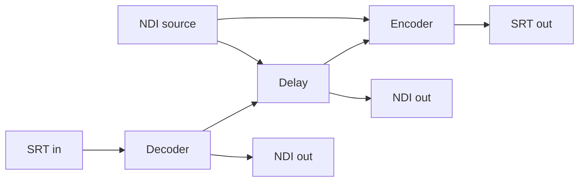

Read it as four separate decisions:

| Decision | Setting |
|---|---|
| What the delay receives | `channels[].delay.source` — an NDI name, a `test:` signal, or `decoder` |
| What name the delay publishes | `channels[].delay.ndi_name` |
| What the encoder receives | `channels[].ndi.source` — an NDI name, or `delay` to tap this channel's delayed output |
| What name the decoder publishes | `channels[].decoder.ndi_name` |

!!! tip "Taps, not hops"
    `encoder.source: "delay"` and `delay.source: "decoder"` both move frames
    **inside the process**. They do not go out and back over NDI, so they do not
    depend on the machine's NDI discovery or transports, and they add no
    network latency. When a delay takes a decoder, start the decoder first.

### Delay to air

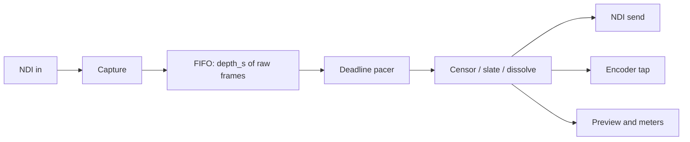

Every slot in the FIFO carries the pictures and the audio captured with them, so
the two rails can never drift apart in the buffer. The output never waits on the
source: a shortfall repeats a frame, a surplus of two drops one, and the depth
holds to within a frame.

Compositing happens once, after the delay and after any dissolve, and **before**
the NDI send, the preview and the encoder tap. That is why a censor covers the
SRT output as well as the NDI output without being applied twice.

### What a dump does to the buffer

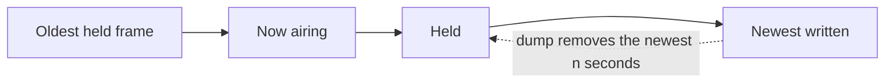

A **Dump** removes the newest *n* seconds — what was just said — and the output
carries on from where it was, so the delay is *n* shorter. **Dump all** empties
the buffer and the output is live. **Rollout** jump-cuts to live and discards
the buffer.

## SRT contribution in

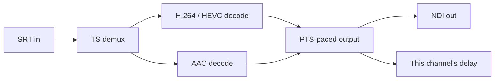

The demultiplexer follows the first program's first H.264 and AAC streams. The
output is paced from the stream's own timestamps on the host clock: the first
picture anchors a timeline `output_delay_ms` ahead of now, and a timestamp jump
(a new source behind the same link) or a stall of three seconds re-anchors it.

## Audio, end to end

Audio has its own graph, sharing nothing with the video channels except the box.

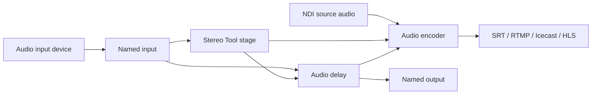

The chain reads left to right:

1. **A named input** (`audio_inputs[]`) is a capture device opened **once**. Every
   consumer that names it gets a copy of the same audio, at the device's own
   rate and channel count.
2. **A stage** (`audio_stages[]`) takes one source in and publishes a new,
   processed source out. Today that is a Stereo Tool instance. Processing runs
   once and fans out to every consumer that picks the stage.
3. **An audio delay** (`audio_delays[]`) takes an input or a stage, holds it, and
   plays the delayed programme to a named output. Its delayed output is itself a
   pickable source.
4. **An audio encoder** (`audio_encoders[]`) takes a source, optionally its own
   Stereo Tool stage and an alignment delay, then codes and sends it.

!!! note "A slow consumer never stalls a device"
    Each consumer holds a bounded queue of about 1.3 seconds. A consumer that
    cannot keep up loses blocks — counted against it and against the input — and
    the device and the other consumers carry on untouched.

### Audio decode

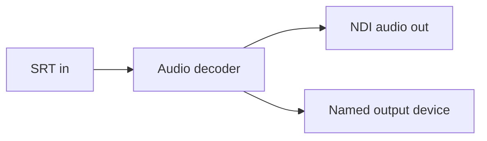

An audio decoder reads the codec, channel count and rate out of the stream
itself. Set an NDI name, an audio output, or both.

## Automation data through the delay

Automation data describes a moment. If the pictures of that moment are two
seconds late, the data has to be too.

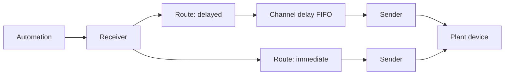

- A **receiver** is a pure input: `tcp_server`, `tcp_client` (we dial out, with
  an on-connect string and a keep-alive) or `udp_server`.
- A **sender** is a pure output: `tcp_client`, `tcp_server` (broadcast to every
  connected client), `udp`, or `receiver` — write back out through an existing
  receiver's own connections, so "receive on A, delay, reply on A" needs no
  second socket.
- A **route** binds one receiver to a channel's delay and to any number of
  senders. One receiver can feed several routes on several channels, so the same
  feed goes out at channel 1's depth on one path and channel 2's on another.

Messages ride the delay's own FIFO: a message is attached to the slot that was
being written when it arrived, and released when that slot airs. Two things
follow for free — a **dump cancels exactly the messages in the dumped span**,
because they were in the removed slots, and the release is **frame-exact**.

A message that arrives while the delay is not running, or not draining, is
dropped and counted rather than sent early.

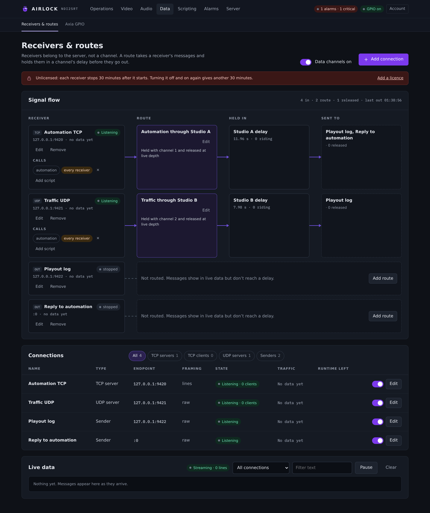{ .shot }

## GPIO

Studio contacts drive the delay over the Livewire Routing Protocol: one
long-lived TCP session to an Axia xNode or IP-Driver on port 93.

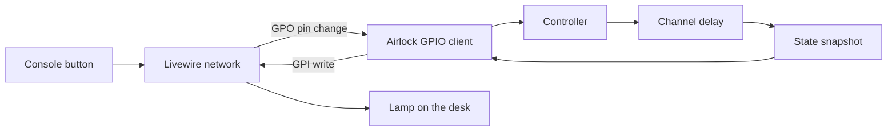

!!! warning "Controls ride GPO; lamps ride GPI"
    GPI and GPO are named from the *Livewire network's* point of view, not
    Airlock's. A GPI is an input **into** that world, so Airlock's tallies are
    written there. A GPO is an output **out of** it, so an operator's button
    press arrives at Airlock as a GPO pin change. Two more that cost bench runs:
    **pins are 0-based**, and **edge words are uppercase** (`L` is a transition
    to low; `l` is a steady low that fires nothing).

Every pin reaches the engine through the same controller every other surface
uses, so the channel lock is consulted and the audit entry is written by
construction. See [Axia GPIO](../control/gpio.md).

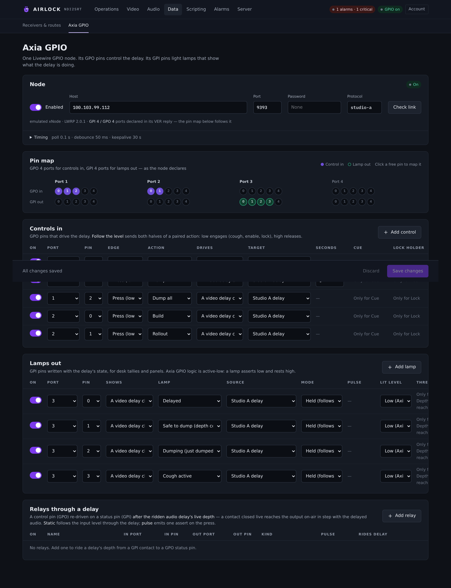{ .shot }

## Control surfaces

All of these reach the same controller, so all of them are locked, licensed and
audited by the same rules.

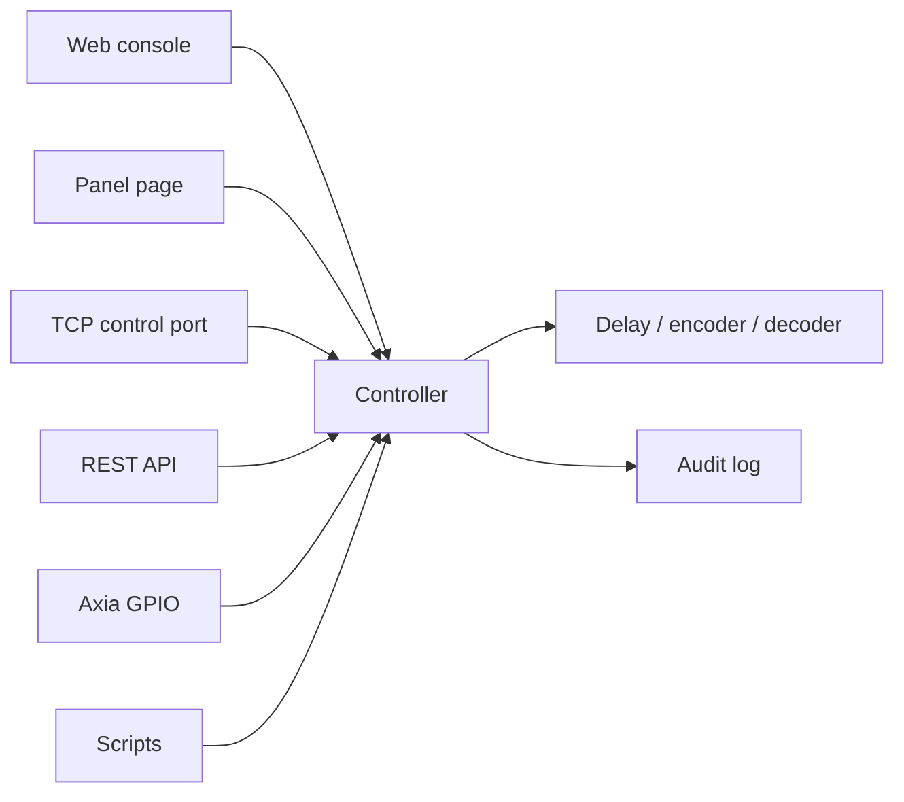

The controller asks three questions before it acts, in this order: is this box a
locked backup, is the channel locked by another holder, and does the licence
carry the feature this surface needs. **Dump and Rollout are taken out before any
of them** — an exit from delay must always work.

## A primary and its backup

A second box mirrors the primary's whole configuration, keeps its own
machine-local settings, runs with its controls locked, keeps its NDI outputs on
air under a suffixed name, and takes over when the primary goes away.

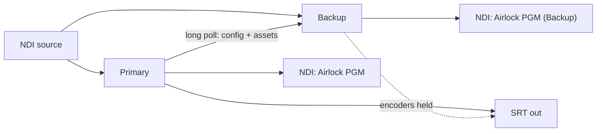

What travels and what stays:

| | |
|---|---|
| Mirrored from the primary | the channel list, delay and encoder settings, cue policy, alarm thresholds, GPIO rows, data routes, scripts, script variables, users, and the files a configuration names (fills, slates, presets) |
| Kept by the backup | web and TCP bind, port and allow-list, the SNMP socket, log and clip paths, NDI adapters and receiver name, GPU/thread/priority choices, the delay's memory limit, the clock reference, and the whole `redundancy` section |

While it is locked the backup is **hot but silent**: its delay keeps receiving
and keeps a full buffer, its NDI outputs stay up under the suffixed name, and
its alarms are raised and visible — but alarm emails, webhooks, traps, telemetry
and every encoder are held, so the pair never double-fires the plant.

At takeover the suffix is dropped, the blocks restart to take the primary's
names, the encoders start and the controls unlock. See
[Primary and backup](../redundancy/overview.md).

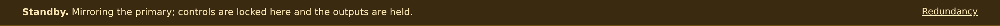{ .shot }

## Putting it together

A common shape: one box delays the studio and feeds both the plant and a remote
site, while a second box decodes the return.

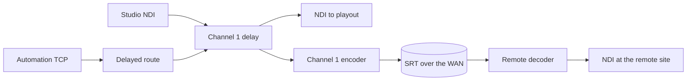

The automation data rides channel 1's delay, so the caption change lands with
the pictures it belongs to at both ends.
