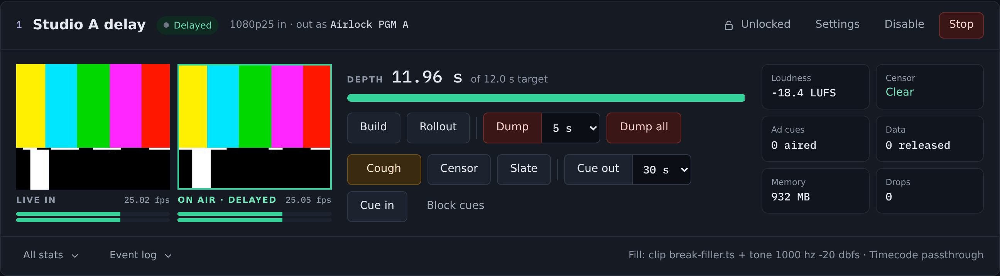
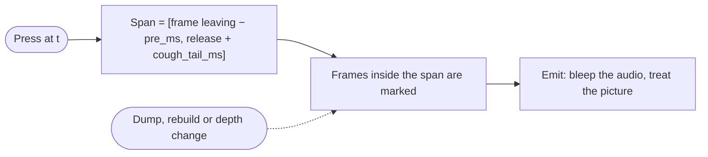
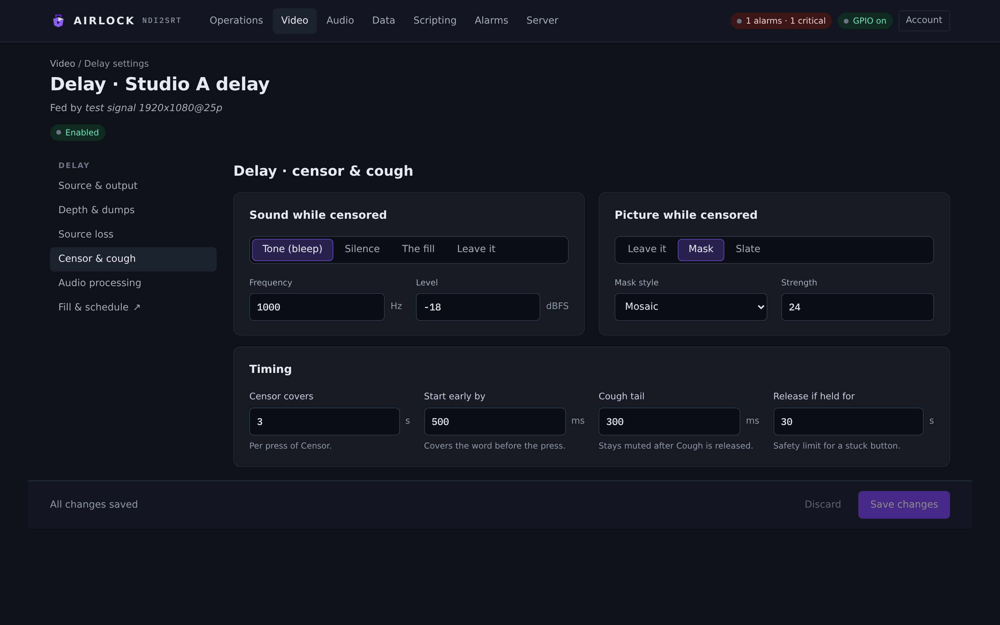

# Censor, cough and slate

The censor covers what is about to air without dumping it: a bleep over the
sound, a mask or a slate over the picture, or both. This page covers the cough
and censor controls, the audio and video censor modes, the lead-in and tail,
scheduled censor dayparts, the safety limits, and what the operator sees while
it is on.

Nothing here changes the output until a censor is pressed or a daypart matches —
the defaults are inert.

## The controls

The on-air row on each Delay card carries three of them.

{ .shot }

| Control | What happens |
|---|---|
| **Cough** | momentary: censors while the button is **held** — mouse, touch or the space bar on the page, held low on a GPIO pin, `COUGH <ch> DOWN` / `UP` over TCP — and the cough tail covers the release |
| **Censor** | the latch: on until it is turned off again, or until the held timeout lets it go |
| **Slate** | covers the output picture with the fill set's picture (or black) and, with **Mute sound under the slate**, mutes the audio. No timeout: a slate is deliberate |

A one-shot of a fixed length is available on the machine surfaces:
`POST /api/channels/{n}/delay/censor?seconds=n`, or `CENSOR <ch> [seconds]` on
TCP. Without a length it uses **Censor covers** from the settings.

!!! tip
    Every press also reaches **back** by the lead-in. The operator is reacting
    to what they have just heard, so the span covers the half second *before*
    the press as well. Set it on the **Censor & cough** tab as **Start early
    by**.

### To bleep something that is about to air

1. Hold **Cough** for as long as the material runs. Release it when it is over —
   the tail covers the release.
2. Or select **Censor** to latch it on, and select it again to release it.

The censor is applied to the finished output frame — after the delay and any
dissolve, before the NDI send, the preview and the encoder tap — so the SRT
branch carries exactly what went to air. A censored content frame keeps its own
timecode: censoring a frame does not turn it into a fill.

## It is a region, not a timer

A press marks a **span of frame indices**: from the frame now leaving the buffer
minus the lead-in, forward to the end of the press plus the tail. A frame is
censored if its index falls inside a span.



Nothing is ever scheduled against the wall clock, so a dump, a rebuild or a depth
change between the press and the frames airing cannot strand it: the frames
marked are the frames bleeped, whatever the buffer did in between. Press a 10 s
censor, dump 2 s and rebuild inside it, and the censor is still on the content
when it comes back — with the right amount of it left.

A latch — a held cough, **Censor** on, a daypart — is treated differently, as an
**output cover**: it replaces whatever is on air, content or fill, for as long as
it is held.

## Settings

Open the delay's **Settings**, then the **Censor & cough** tab.

{ .shot }

### Sound while censored

Pick what replaces the programme audio.

| Option | Config value | What airs |
|---|---|---|
| Tone | `tone` | a sine at **Frequency** and **Level** |
| Silence | `silence` | digital silence |
| Fill | `fill` | the fill set's audio — a bed, a clip or a live source, using the same machinery as [Fills](fills.md), not a second one |
| None | `none` | the audio is left alone and only the picture is treated |

**Frequency** and **Level** are only used by the tone, and the fields grey out
otherwise.

### Picture while censored

| Option | Config value | What airs |
|---|---|---|
| **Leave it** | `none` | only the sound is censored |
| **Mask** | `mask` | the picture is treated in place |
| **Slate** | `slate` | the picture is covered |

With **Mask** selected, two more fields appear:

| Field | Config key | Values | What it does |
|---|---|---|---|
| Mask style | `censor.mask` | `blur`, `mosaic`, `solid` | a box blur, a block pixelate, or video black |
| Strength | `censor.mask_strength` | 2–200 | the blur radius or mosaic block in pixels at 1080-line height, scaled to the raster |

With **Slate** selected:

| Switch | Config key | What it does |
|---|---|---|
| **Use the fill picture as the slate** | `censor.slate_from_fill` | the slate is the fill set's picture; off, it is video black |
| **Mute sound under the slate** | `censor.slate_mute` | a slate mutes the output audio |

A slate always wins over a mask. With a fade length set, a censor dissolves in
and out over that time like the other transitions.

### Timing

| Field | Config key | Default | What it is |
|---|---|---|---|
| **Censor covers** | `censor.censor_seconds` | `3.0` | the length of one **Censor** one-shot, 0–600 s |
| **Start early by** | `censor.pre_ms` | `500` | the lead-in — how much of what was *just* said the press also covers, 0–10000 ms |
| **Cough tail** | `censor.cough_tail_ms` | `300` | how long the output stays covered after **Cough** is released, 0–10000 ms |
| **Release if held for** | `censor.held_timeout_ms` | `30000` ms, shown as 30 s | the safety ceiling: a latch whose release never arrives is let go after this long. `0` disables the ceiling |

!!! warning
    **Release if held for** is the guard against a stuck button or a lost
    release — a held cough on a pin that goes open circuit, a panel that drops
    its connection mid-press. Leave it set unless you have a deliberate reason
    for a censor that can latch for ever.

## Scheduled censor dayparts

Dayparts censor on their own, with nobody pressing anything. They are edited on
**Video › Fills & schedules**, in the **Weekly schedule** card under
**Censor windows · censor engages on its own**.

### To add a censor window

1. Open **Video › Fills & schedules** and select the channel.
2. In **Weekly schedule**, select **Censor window**.
3. Name the row, pick its days, and type the **from** and **to** times.
4. Select **Save changes**.

Rows appear on the week timeline in the censor colour. Operators can still
release the censor by hand while a window is in force.

| Key | Default | What it is |
|---|---|---|
| `enabled` | `true` | a disabled row never matches |
| `days` | `"all"` | `all`, `weekdays`, `weekends`, or a comma list of `mon,tue,wed,thu,fri,sat,sun` |
| `start`, `end` | `"00:00"`, `"24:00"` | local `HH:MM`. `end` is **exclusive**, and an `end` at or before `start` wraps past midnight |
| `kind` | `"both"` | `audio` bleeps without touching the picture, `video` masks or slates without touching the audio, `both` does whatever the censor is configured for |

The first enabled row whose day bit matches the current local weekday and whose
window contains the current local minute wins, exactly as a fill daypart does.
A row going out of force leaves the tail behind, like a release.


## Safety and escape hatches

| Control | Surface | What it does |
|---|---|---|
| **Release if held for** | settings | drops a latch automatically after its ceiling |
| Force off | `POST /api/channels/{n}/delay/censor-force-off`, `FORCECENSOROFF <ch>` | drops the latch **and** every span still queued — the field escape hatch for a censor that will not clear |
| Slate off | **Slate**, `SLATEOFF <ch>` | a slate has no timeout and must be taken off deliberately |

## What the operator sees

| Where | What it shows |
|---|---|
| Delay card, **Censor** figure | `Clear`, or `On` while anything is covering the output |
| **Cough** button | pressed while the cough is down |
| **Censor** button | pressed while the latch is on |
| Compact row | `censor clear` / `censor on` / `censor cough` |
| TCP subscriber | `STATUS CH <ch> CENSOR 0` / `1` and `STATUS CH <ch> SLATE 0` / `1` as the lamps move |
| `STATE <ch>` | appends `censor=` and `slate=` |
| GPIO lamp | `coughActive` follows the engine's own state |
| Audit log | every press, with the depth it landed on |

`GET /api/state` carries the full picture: `censor_active`, `censor_kind`,
`censor_remaining_s`, `censor_held`, `censor_schedule_row`, `censor_presses`,
`censored_s` and `slate_active`.

## The machine surfaces

| Action | REST | TCP |
|---|---|---|
| Cough down / up | `POST /api/channels/{n}/delay/cough?down=true` / `false` | `COUGH <ch> DOWN` / `COUGH <ch> UP` |
| One short cough | `POST …/delay/cough` (no parameter) | `COUGH <ch>` |
| One-shot censor | `POST …/delay/censor?seconds=n` | `CENSOR <ch> [seconds]` |
| Latch on / off | `POST …/delay/censor-on` / `censor-off` | `CENSORON <ch>` / `CENSOROFF <ch>` |
| Force off | `POST …/delay/censor-force-off` | `FORCECENSOROFF <ch>` |
| Slate on / off | `POST …/delay/slate-on` / `slate-off` | `SLATEON <ch>` / `SLATEOFF <ch>` |

`?on=true|false` is accepted as a synonym for `?down=` on the cough, which is
what the panel page and the GPIO client use. On a GPIO row, a `cough` action with
`edge: BOTH` follows the level of a latching switch; a `BOTH` row is never
debounced, so an "off" can never be swallowed and leave the censor latched.

All of these are **transport** controls, so they are refused while another leader
holds the [channel lock](../control/lock.md). Every press is audited —
`delay.cough`, `delay.censor`, `delay.censor_on`, `delay.censor_off`,
`delay.slate` — with the depth it landed on.

Changing any censor **setting** is pushed to a running delay the moment you save,
so the mask style, the tone and the timings can be changed without a restart.

## Reference

```json
"delay": { "censor": {
  "audio": "tone", "tone_hz": 1000.0, "tone_dbfs": -18.0,
  "pre_ms": 500, "cough_tail_ms": 300, "censor_seconds": 3.0,
  "held_timeout_ms": 30000,
  "video_mode": "none", "mask": "mosaic", "mask_strength": 24,
  "slate_from_fill": true, "slate_mute": true,
  "schedule": []
} }
```

| Setting | Console label | Config key | Default | Meaning |
|---|---|---|---|---|
| Sound while censored | Sound while censored | `delay.censor.audio` | `tone` | `tone`, `silence`, `fill` or `none` |
| Frequency | Frequency | `delay.censor.tone_hz` | `1000.0` | 20–20000 Hz |
| Level | Level | `delay.censor.tone_dbfs` | `-18.0` | −90 to 0 dBFS |
| Start early by | Start early by | `delay.censor.pre_ms` | `500` | lead-in in ms, 0–10000 |
| Cough tail | Cough tail | `delay.censor.cough_tail_ms` | `300` | tail after a cough release, ms, 0–10000 |
| Censor covers | Censor covers | `delay.censor.censor_seconds` | `3.0` | one-shot length in seconds, 0–600 |
| Release if held for | Release if held for | `delay.censor.held_timeout_ms` | `30000` | latch ceiling in ms, 0–3600000; `0` is off |
| Picture while censored | Picture while censored | `delay.censor.video_mode` | `none` | `none`, `mask` or `slate` |
| Mask style | Mask style | `delay.censor.mask` | `mosaic` | `blur`, `mosaic` or `solid` |
| Strength | Strength | `delay.censor.mask_strength` | `24` | 2–200 pixels at 1080 lines, scaled to the raster |
| Use the fill picture as the slate | Use the fill picture as the slate | `delay.censor.slate_from_fill` | `true` | off, the slate is video black |
| Mute sound under the slate | Mute sound under the slate | `delay.censor.slate_mute` | `true` | a slate mutes the output |
| Censor windows | Censor window | `delay.censor.schedule[]` | `[]` | dayparts that hold the censor on |

## Troubleshooting

**The censor is stuck on.** Something is holding the latch. Select **Censor** to
toggle it off; if it will not clear, use the force-off control — it drops the
latch *and* every span still queued. Then check **Release if held for** is not
`0`, and look for a GPIO cough pin stuck low or a panel that dropped mid-press.

**The bleep starts late.** Raise **Start early by**. Operators react to what they
have already heard, and half a second is only a starting point.

**The bleep ends too early on a cough.** Raise **Cough tail**.

**The picture is not being treated.** **Picture while censored** is set to
**Leave it**, which is the default. Set it to **Mask** or **Slate**.

**The slate is black when a picture was expected.** **Use the fill picture as the
slate** is off, or the fill's picture is one that does not produce a frame
(`freeze` with nothing captured yet, or `black`). Set the fill set's picture to a
slate image on [Fills and schedules](fills.md).

**A censor daypart is not engaging.** Check the row is switched on, that its days
include today, and that `end` is after `start` unless you meant it to wrap past
midnight. `end` is exclusive.

**Cough and Censor are greyed out.** Another leader holds the
[channel lock](../control/lock.md), or this box is a redundancy backup with its
controls locked out.
