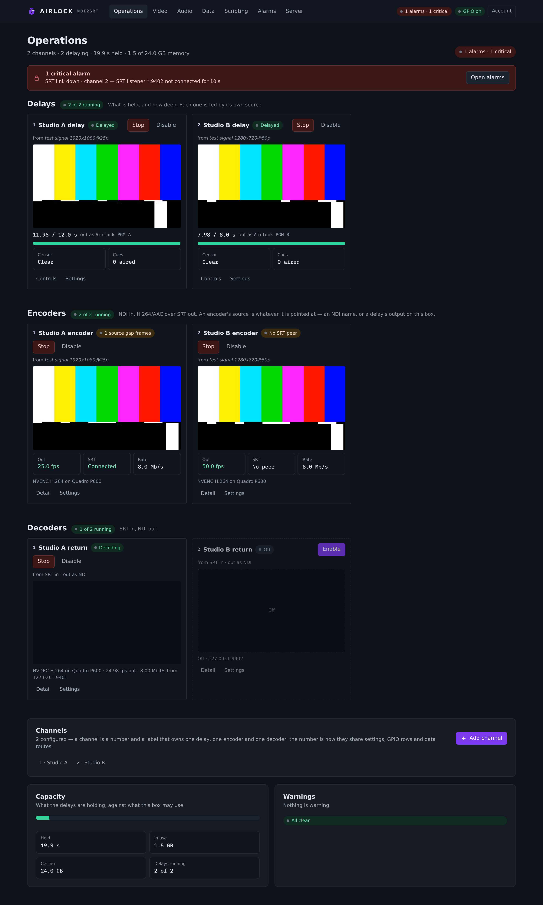
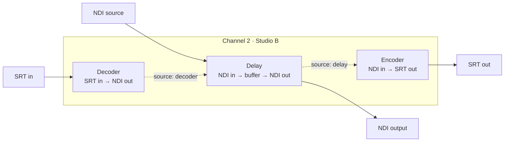
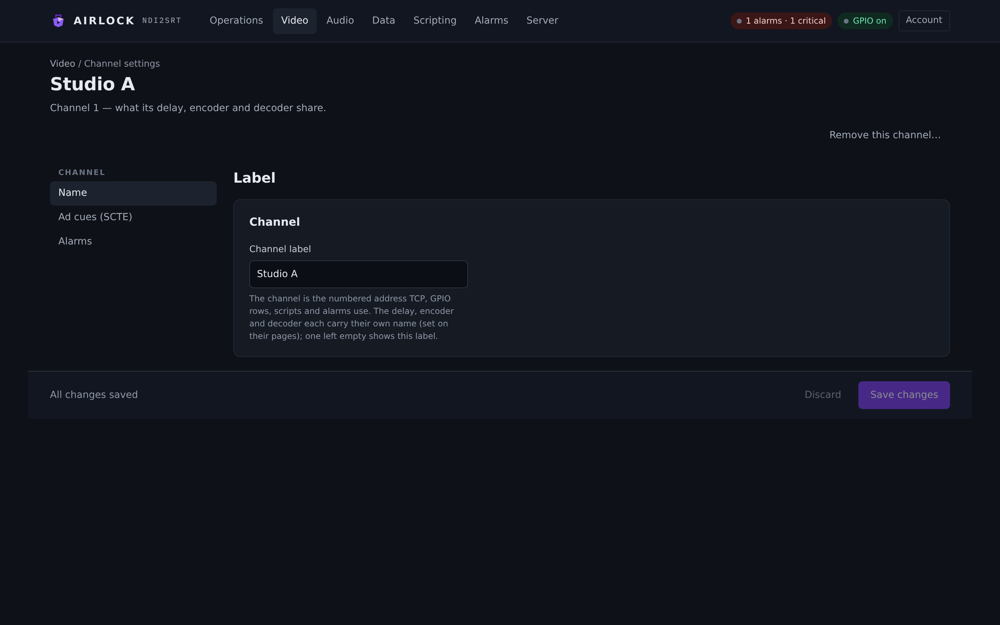
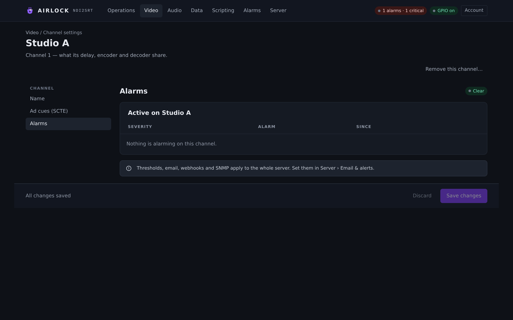

# Channels

A channel is the numbered container everything else hangs off: one delay, one
encoder and one decoder that belong together, plus the ad-cue rails that ride
through them. One Airlock process runs up to 32 channels. This page covers what
a channel owns, how to add, name and remove one, what N channels cost in memory,
and the two channel-level settings tabs — **Name** and **Alarms**.

{ .shot }

## What a channel owns

Three blocks share a channel's number and label. Nothing else does.



Blocks feed each other **inside** a channel and never across one. A delay whose
source is `decoder` takes that channel's decoder; an encoder whose source is
`delay` takes that channel's delayed output. To cross channels, go out over NDI
and come back in.

Everything else in the process is shared by every channel: the web console, the
TCP listener, the SNMP agent, the GPIO client, the alarm centre, the dump-clip
writer, the audit log, the data sockets, authentication, scripting and
redundancy.

| Per channel | Per process |
|---|---|
| Delay, encoder, decoder and their settings | Web console and its port |
| NDI source, NDI output names, SRT endpoints | TCP control listener |
| Depth, dumps, fills, censor, audio processing | NDI network settings and adapters |
| SCTE cue policy | Reference clock and PTP |
| Licence seat assignment per block | Alarm thresholds, email, webhooks, SNMP |
| Alarms raised on that channel | Dump-clip store, audit log, users, scripting |

### Names

A channel has one **label** — 1 to 24 characters of letters, digits, space and
`-` `_` `.` — and each block carries its own optional name:

| Key | What it names |
|---|---|
| `name` | the channel; the label the audit log, SNMP and the TCP `CHANNELS` list use |
| `delay.name` | the delay block in the console |
| `encoder.name` | the encoder block in the console |
| `decoder.name` | the decoder block in the console |

A block name left empty falls back to the channel label, so a single-purpose
channel needs only one name. Renaming a block is display-only: it never restarts
a running block.

!!! note
    The channel **id** is not the label. `id` is a small integer, 1-based and
    unique, and it is the address on every surface: `BUILD 2` on TCP,
    `/api/channels/2/delay/build` on REST, the SNMP channel-table row, a GPIO
    row's `channel: 2`, a data route's `channel`. Ids are allocated as the
    highest in use plus one and are **never reused** — a number that once meant a
    channel must not come back meaning a different one.

## Adding a channel

To add a channel:

1. Open **Operations**.
2. In the **Channels** card, select **Add channel**.
3. Type a name (for example `Studio C`) and select **Create**.

The new channel arrives with the next free id and with everything that would
collide with an existing channel moved out of the way: its own NDI output names
(`ndi2srt delay <n>`, `ndi2srt decoder <n>`), its own SRT ports (the encoder at
`9001 + 10 × (n − 1)`, the decoder at `9002 + 10 × (n − 1)`) and its own
transport-stream service id. Its delay and decoder arrive **disabled** and none
of the three has a source yet, so nothing reaches air until you point each block
at something and enable it.

You can do the same over REST:

```bash
curl -X POST http://airlock.example:8090/api/channels \
     -H 'Content-Type: application/json' \
     -d '{"name":"Studio C"}'
```

Or by editing the `channels` array and sending the whole document with
`PUT /api/config`. A channel that appears in the document gets a runtime; one
that disappears is stopped and dropped.

## Renaming a channel

1. Open **Operations** and select the channel in the **Channels** card, or go to
   the delay's **Settings** and pick the **Channel** page.
2. On the **Name** tab, edit **Channel label**.
3. Select **Save changes**.

{ .shot }

The **Name** tab holds exactly one field — the label the three blocks share. The
delay's, encoder's and decoder's own names live on their own pages
(**Source & output** for the delay, **Video & SRT out** for the encoder,
**SRT in & output** for the decoder).

`POST /api/channels/{n}/name` with `{"name":"…"}` does the same thing.

## Removing a channel

1. Open the channel's settings and select the **Name** tab.
2. Select **Remove this channel…**.
3. Confirm with **Remove channel &lt;n&gt;**.

!!! warning
    Removing a channel stops its blocks and takes its GPIO mapping rows and its
    delayed data routes with it. The last channel cannot be removed — a process
    always has at least one.

The button only appears when the box has more than one channel.
`DELETE /api/channels/{n}` is the REST equivalent.

## Enabling and disabling blocks

Each block has two separate states:

* **Enabled** is the persisted intent (`delay.enabled`, `encoder.enabled`,
  `decoder.enabled`). It survives a restart and decides what the process brings
  up at launch.
* **Running** is what the block is doing right now.

| Button | What it does |
|---|---|
| **Enable** | sets the flag *and* starts the block |
| **Disable** | clears the flag *and* stops the block |
| **Start** | runs the block now; the flag is untouched |
| **Stop** | stops the block now; the flag is untouched |

**Disable is a full stop, not a bypass.** The threads end and the NDI sender
closes. The configuration is untouched and the block still reports itself as
disabled on every surface — a bypass would leave an NDI output publishing
pictures nobody was processing.

Enabling a block that cannot run yet still sets the flag and tells you why, for
example `choose an NDI source`. The flag is the intent, and the intent is also
what the process starts with next time.

Over TCP, `ENABLE`/`DISABLE` take an optional block target:

```
ENABLE 2              the delay on channel 2
DISABLE ENC 2         the encoder on channel 2
STATE DEC 2        →  OK 2 RUNNING | STOPPED | DISABLED
```

Over REST, `POST /api/channels/{n}/{block}/enable|disable|start|stop`, where
`{block}` is `delay`, `encoder` or `decoder`. Every one of them is audited, and
enabling or disabling a delay respects the [channel lock](../control/lock.md).

## Capacity — what N channels cost

A delay buffers **raw** frames, so its memory is arithmetic you can do in
advance:

```
bytes ≈ width × height × 1.5 × fps × depth_s
```

| Format | Per frame | Per second | 10 s depth | 30 s depth |
|---|---|---|---|---|
| 720p50 | 1.4 MB | 69 MB | 0.7 GB | 2.1 GB |
| 1080i25 / 1080p25 | 3.1 MB | 78 MB | 0.8 GB | 2.3 GB |
| 1080p50 | 3.1 MB | 156 MB | 1.6 GB | 4.7 GB |
| 1080p59.94 | 3.1 MB | 186 MB | 1.9 GB | 5.6 GB |
| 2160p25 (UHD) | 12.4 MB | 311 MB | 3.1 GB | 9.3 GB |

Four 1080i25 channels at 10 s is about 3 GB of resident memory, and that is
before the encoders and decoders. Each channel also runs its own capture and
output threads, and its own encode and decode threads when those blocks are
started.

Two settings keep the arithmetic honest:

| Setting | Config key | Default | What it does |
|---|---|---|---|
| Memory limit | `channels[].delay.max_memory_mb` | `4096` | caps **one channel's** buffer, and so its usable depth. When the cap is reached the oldest frame is dropped (and counted) rather than the input being refused. The delay's **Depth & dumps** tab shows the depth the cap allows |
| Process ceiling | `process.max_memory_mb` | `0` (off) | an **admission** ceiling in megabytes. A configuration whose channels' caps add up past it is refused at save, naming the total and the ceiling |

!!! note
    `process.max_memory_mb` decides what may be *configured*; it does not shrink
    a running buffer. It is a statement about this machine's RAM, so it is
    machine-local and it is **not** applied to a configuration mirrored from a
    redundancy primary — that one is applied anyway, with a warning in the log
    and in the audit entry. A backup that refused the plant's channel list over
    its own memory figure would stop mirroring users, alarms and cue policy too,
    which is far worse. Treat the warning as a sign to size the backup before it
    is asked to take over.

The running totals are reported in the console header on **Operations** and on
**Video › Delay** (seconds held, gigabytes in use against the ceiling), in
`GET /api/state` and `GET /api/channels` under `capacity`, as three SNMP scalars,
and once per stats interval in the log when there is more than one channel:

```
[  cap ] 3 channel(s), 3 delaying — 16.0 s / 129 MB buffered (configured 1280 MB of a 16384 MB cap)
```

## Rules the configuration enforces

A save is refused, with a message naming the offender, if any of these do not
hold:

| Rule | Why |
|---|---|
| At least one channel, at most 32 | `channels: []` is a mistake, not an instruction to delete everything |
| Every `id` unique and 1 or more | the id is the address on every surface |
| Every `name` 1–24 characters of letters, digits, space, `- _ .` | it has to be safe in a log line, an SNMP row and a file name |
| Every `delay.ndi_name` and `decoder.ndi_name` unique across the process | two channels publishing one NDI name is an unresolvable clash on the network |
| Every **listening** SRT port unique across the process | two sockets cannot bind one port, and the second would fail at start with an opaque SRT error |
| Every GPIO row's `channel` and every delayed data route's `channel` names a channel that exists | a row pointing at nothing would silently do nothing |
| The per-channel memory caps fit inside `process.max_memory_mb` when it is set | see *Capacity*, above |

Two things are deliberately **not** checked: SRT **caller** ports (two channels
may legitimately dial one ingest with different stream ids) and transport-stream
service ids (each channel carries its own transport stream).

## The Alarms tab

Each channel's settings has an **Alarms** tab showing what is alarming on that
channel right now.

{ .shot }

The pill beside the heading reads **Clear**, or `N active · M critical`. The
table lists **Severity**, **Alarm**, **Since** and the two actions:

* **Acknowledge** marks the row as seen.
* **Dismiss** hides it from the console until it raises again as a new
  occurrence.

!!! warning
    Acknowledge and dismiss are a **display overlay only**. Neither touches the
    raw alarm state: the counts, the SNMP objects, email and webhooks keep
    reporting a dismissed alarm exactly as before. Nothing is persisted — the
    overlay starts empty at every launch.

One alarm is the triple `(block, channel, kind)`, so the same kind can be active
on two blocks or on two channels at once and the notify cooldown of one never
spends another's. Stopping a block clears everything it had on that channel, and
removing a channel clears everything on it. A process-wide alarm — the GPIO node,
redundancy, a watchdog notice — belongs to channel 0 and does not appear here.

Thresholds, email, webhooks and SNMP are process-wide and are set on
**Server › Email & alerts**; see [Alarms](../alarms/alarms.md).

## The Ad cues tab

The channel page's third tab, **Ad cues (SCTE)**, holds the SCTE-104 in /
SCTE-35 out policy that rides through all three blocks. It is covered in
[SCTE cues](scte.md).

## Addressing a channel

| Surface | How the channel is named |
|---|---|
| Console | the channel strip in the header; every card, preview and channel-scoped form follows it |
| TCP | the argument on every verb — `BUILD 2`, `STATE 2`, `COUGH 2 DOWN`. `CHANNELS` lists them, `SUBSCRIBE ALL` follows every one |
| REST | a path segment — `/api/channels/{n}/…`. The single-channel routes (`/api/delay/build`) still work and mean channel 1, and accept `?channel=n` |
| SNMP | a row in the channel table, indexed by the channel id |
| GPIO | a mapping row's `channel` |
| Data routes | a route's `channel` — one receiver can feed several channels at once |
| Panel | `/panel?channel=n`, remembered per device |
| Audit log | every entry carries its channel; 0 means process-wide. `GET /api/audit?channel=2` filters |

Unknown channels answer consistently: `ERR <ch> NOCHAN unknown channel` on TCP,
`404 {"error":"no channel 9 — this process has 1, 2"}` on REST,
`inconsistentName` over SNMP, and a GPIO row naming one is refused at save.

## Upgrading an older configuration

A configuration written before channels existed carries `delay`, `video`,
`audio`, `ts`, `srt`, `decoder`, `ndi`, `encoder` and `scte` at the top level. It
keeps working: those sections are folded into **channel 1** (named "Channel 1")
as the document is read, and the next save writes the `channels` shape. Nothing
is lost and nothing needs editing by hand.

The migration runs on every document that enters from outside — the configuration
file, `PUT /api/config`, an uploaded backup, a configuration-history entry and a
configuration mirrored from a redundancy primary — so a mixed-version pair keeps
working. A document that already has a `channels` array is left alone. A
hand-written `channels` list whose entries carry no `id` is numbered by position.

## Reference: the channel object

```json
"channels": [
  { "id": 1, "name": "Studio A",
    "ndi":     { "source": "DESKTOP (vMix - Output 1)", "receiver_name": "ndi2srt" },
    "encoder": { "enabled": true, "name": "" },
    "video":   { "codec": "h264", "bitrate_kbps": 6000 },
    "audio":   { "enabled": true, "bitrate_kbps": 128, "pair": 1 },
    "ts":      { "service_id": 1, "video_pid": 256 },
    "srt":     { "mode": "caller", "host": "ingest", "port": 9001 },
    "decoder": { "enabled": false, "name": "", "ndi_name": "ndi2srt decoder" },
    "delay":   { "enabled": true, "name": "", "source": "…", "depth_s": 10.0,
                 "ndi_name": "ndi2srt delay", "max_memory_mb": 4096 },
    "scte":    { "enabled": false } }
]
```

| Setting | Console label | Config key | Default | Meaning |
|---|---|---|---|---|
| Channel id | the number on the card | `channels[].id` | `1` | the address on every surface; unique, 1-based, never reused |
| Channel label | Channel label | `channels[].name` | `Channel <id>` | 1–24 characters; what the audit log, SNMP and `CHANNELS` call it |
| Delay name | Name (Source & output) | `channels[].delay.name` | `""` | the delay block's own name; empty uses the channel label |
| Encoder name | Name (Video & SRT out) | `channels[].encoder.name` | `""` | the encoder block's own name; empty uses the channel label |
| Decoder name | Name (SRT in & output) | `channels[].decoder.name` | `""` | the decoder block's own name; empty uses the channel label |
| Delay on | Delay on | `channels[].delay.enabled` | `false` | run the delay at launch |
| Encoder on | Enabled | `channels[].encoder.enabled` | `true` | run the encoder at launch — it still needs a source before it can start |
| Decoder on | Enabled | `channels[].decoder.enabled` | `false` | run the decoder at launch |
| Memory limit | Memory limit | `channels[].delay.max_memory_mb` | `4096` | this channel's buffer cap in MB; minimum 256 |
| Process ceiling | — | `process.max_memory_mb` | `0` | admission ceiling across all channels, MB; `0` is off |
| Maximum channels | — | — | `32` | hard limit in one process |

## Troubleshooting

**"NDI output name … is used by both …" on save.** Two channels are publishing
the same NDI name. Change one channel's `delay.ndi_name` or `decoder.ndi_name`
on its **Source & output** page. A new channel created from the console never
collides; a hand-copied `channels` entry will.

**"SRT listener port … is used by both …" on save.** Two blocks are set to
*listener* on the same port. Change one. Caller ports are allowed to match.

**"the delay buffers add up to … over the process ceiling".** Lower a channel's
**Memory limit**, remove a channel, or raise `process.max_memory_mb` — but only
if the box actually has the RAM.

**A new channel shows no pictures.** A fresh channel has no source on any block,
and its delay and decoder arrive disabled. Set each block's source on its
settings page, then enable the ones you want from the channel's tiles on
**Operations** or with **Enable** on the block's card.

**A channel number is missing from the list.** Ids are never reused, so a gap is
normal after a removal. Address channels by id, not by position.

**A GPIO row or data route vanished.** It belonged to a channel that was removed;
the rows go with the channel by design.
