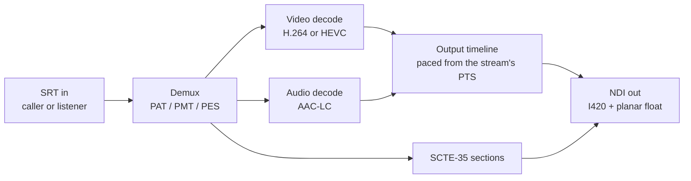
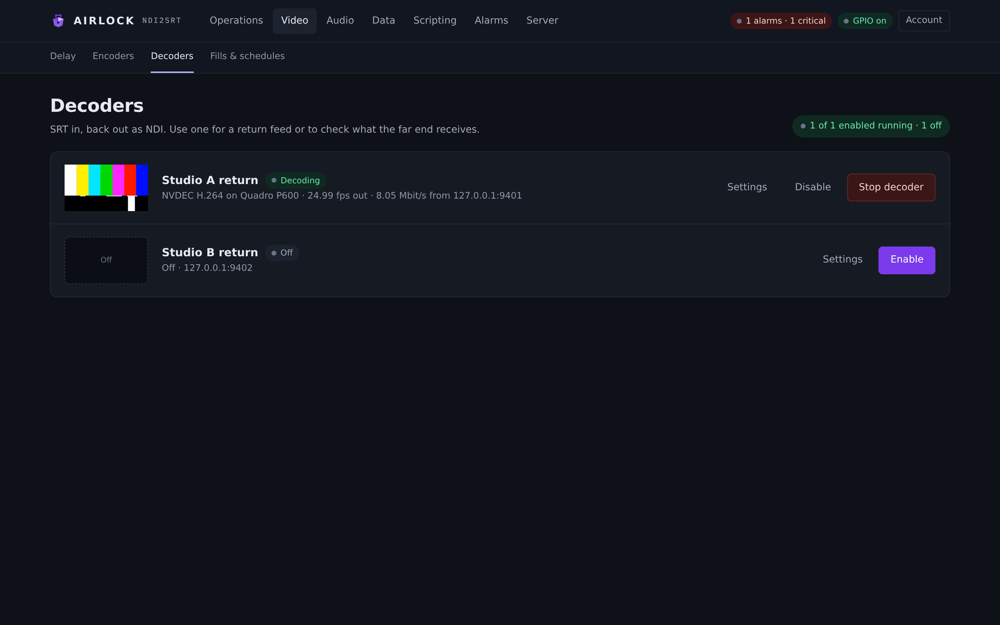
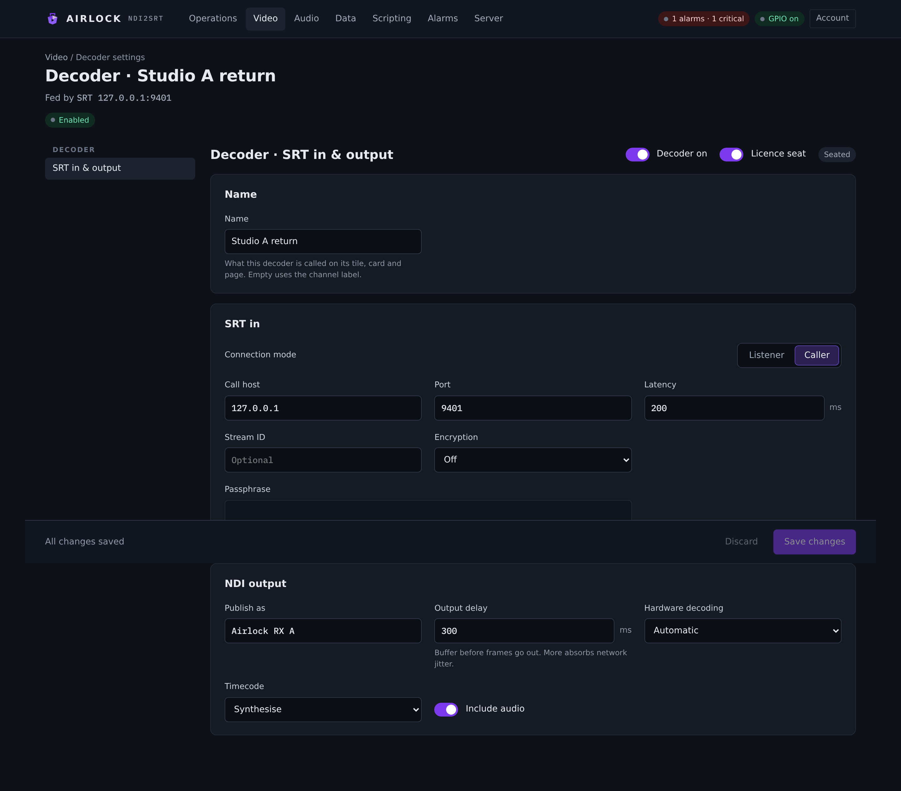
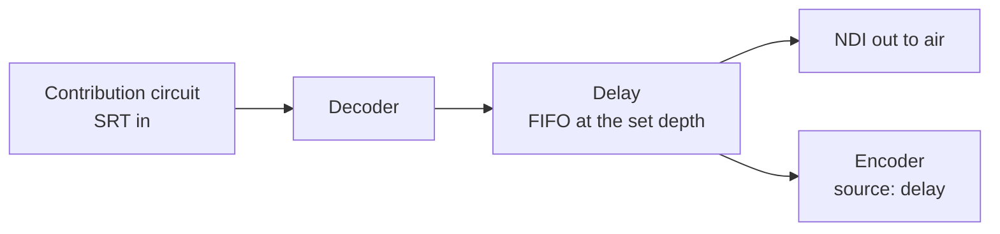

# Video decoders

A decoder is the reverse path: SRT in, transport stream demultiplexed, H.264 or HEVC
and AAC decoded, and the result published as an NDI source on your network. Use one
for a return feed, to bring a contribution circuit into the plant, or simply to see
what the far end is receiving.

## What a decoder does

Each channel has one decoder, and like the encoder it is a block of its own: it has
its own enable flag, its own licence seat, and its own start and stop.



The demultiplexer follows the **first program's first H.264 or HEVC stream and its
first AAC stream**. Anything else in the multiplex is listed on the card as ignored —
MPEG audio, AC-3 and LATM among them — and the block log names them when it finds the
program. Continuity errors and PCR are counted as it goes.

Output is paced from the stream's own PTS on the host clock. The first picture anchors
a timeline `output_delay_ms` ahead of now, and every later picture and audio block is
released when its PTS falls due. Both rails are paced by that one timeline, so lip
sync is whatever the stream says it is. A PTS jump — a new source behind the same
link — re-anchors it, and so does a stall of three seconds.

## The Decoders page

**Video › Decoders** lists every channel's decoder, one card each: a preview, the
decoder's name, a state pill, and a summary line.

{ .shot }

The summary line tells you the state in words:

| Summary | Meaning |
|---|---|
| `Off · listening on :9002` | the block is disabled; the endpoint is where it would listen or call |
| `Stopped · 10.20.4.11:9002` | enabled but not running |
| `Waiting for a sender · listening on :9002` | running, nothing has connected (any SRT error is appended) |
| `… · 25.00 fps out · 8.42 Mbit/s from <peer>` | decoding, with the implementation in use, the output rate and the rate arriving |

The buttons are **Settings**, **Disable**, and **Start decoder** / **Stop decoder**;
a disabled decoder shows **Enable** instead. As with the encoder, *enabled* is the
intent that survives a restart and *running* is what is happening now.

!!! note "Start can be refused"
    The console asks and lets the next poll say what happened. A decoder can refuse to
    start — no licence seat, or the listen port already in use — and the card will
    stay stopped with the reason in its log.

## SRT in and output

{ .shot }

The decoder's settings page has one section, **SRT in & output**, with the block's
on/off and licence-seat switches in its header.

### SRT in

| Setting | Console label | Config key | Default | Meaning |
|---|---|---|---|---|
| Mode | Connection mode | `decoder.srt.mode` | `listener` | **Listener** waits for a sender to dial it; **Caller** dials out. No rendezvous mode. |
| Host | Call host | `decoder.srt.host` | *(empty)* | Caller only. A caller with no host is refused at save. |
| Port | Port / Listen on port | `decoder.srt.port` | `9002` | Two channels cannot listen on the same port, and the configuration refuses it rather than letting the second bind fail obscurely at start. |
| Latency | Latency | `decoder.srt.latency_ms` | `200` | 20–8000 ms. Set it to match or exceed the sender's. |
| Stream ID | Stream ID | `decoder.srt.stream_id` | *(empty)* | Sent on connect in caller mode. A listener ignores it. |
| Encryption | Encryption | `decoder.srt.key_len` | `16` | `16`, `24` or `32` for AES-128/192/256. Shows as Off until a passphrase is set. |
| Passphrase | Passphrase | `decoder.srt.passphrase` | *(empty)* | 10–79 characters, and it must match the sender's exactly. |

The receive buffer is sized automatically. There is no rate to work from on the
receive side, so it sizes for a 25 Mbit/s ceiling.

### NDI output

| Setting | Console label | Config key | Default | Meaning |
|---|---|---|---|---|
| Enabled | Decoder on | `decoder.enabled` | `false` | Starts the block with the process. |
| Name | Name | `decoder.name` | *(empty)* | What this decoder is called on its tile, card and page. Empty uses the channel label. |
| NDI name | Publish as | `decoder.ndi_name` | `ndi2srt decoder` | The NDI source name other machines see. It must be unique across every delay and decoder output in the process; the configuration refuses a clash. |
| Output delay | Output delay | `decoder.output_delay_ms` | `300` | 0–5000 ms. How far the output timeline sits behind the first picture — it covers demultiplexing and decode timing. More absorbs more jitter. |
| Audio | Include audio | `decoder.audio` | `true` | Off publishes picture only. |
| Hardware | Hardware decoding | `decoder.hw` | `auto` | `auto` (NVDEC when present, else software), `nvdec` (required) or `software`. |
| Timecode | Timecode | `decoder.timecode` | `synthesize` | `synthesize` lets the NDI runtime stamp the send time; `pts` derives the stamp from the stream's own PTS. See [Timecode and clocking](timecode.md). |
| Licence seat | Licence seat | `decoder.licence_assigned` | `true` | Unseated decoders run watermarked. |

!!! tip "Prefer `pts` when anything downstream has to align"
    Under `synthesize` the NDI runtime anchors once and then advances each rail by its
    own nominal duration, so the picture and audio stamps become independent counters
    that say nothing about the real relationship between them. Under `pts` both come
    from one anchor and carry the stream's own relationship, so alignment survives the
    hop. Full reasoning in [Timecode and clocking](timecode.md).

### What comes out

The decoded output is an NDI source carrying I420 video and planar float audio, at
**whatever the stream contains**. There is no scaler and no frame-rate conversion: the
raster, the frame rate and the scan come out as they were coded. A field-coded H.264
stream decoded by NVDEC is woven and flagged interlaced on NDI, so 1080i goes in and
1080i comes out. (OpenH264 and the software HEVC decoder do not decode field pictures.)

| | H.264 | HEVC |
|---|---|---|
| NVIDIA present | NVDEC | NVDEC |
| No GPU | OpenH264, built in | libde265 if installed on the box |

Audio comes out at the stream's own rate and channel count. SCTE-35 sections on the
cue PID are checked for CRC, the heartbeat is ignored, and real cues are re-emitted as
SCTE-104 on the decoded NDI output — see [SCTE cues](scte.md).

### The delay budget

What a decoder holds between decoding a picture and putting it on the wire is
**`decoder.output_delay_ms` + `decoder.srt.latency_ms`**, and the queue is sized from
exactly that. The block logs both at start:

```
output delay 300 ms + SRT latency 250 ms = 550 ms held, queue 49 frames / 60 audio blocks
```

That line is worth reading when frames go missing and every other indicator looks
healthy — this is the pair that explains it. Raising either knob raises the memory the
block holds: at 1080p a frame is about 3 MB, at 2160p about 12 MB.

## Feeding a delay from a decoder

A decoder can feed its own channel's delay directly, with no NDI round trip. On the
delay's **Source & output** tab, set **Source** to `decoder` (the source picker offers
it). The delay then takes the decoder's frames inside the process.



Blocks feed each other only **within** a channel: a channel's `delay.source: "decoder"`
takes that channel's decoder, and an encoder's source `delay` takes that channel's
delayed output. To cross channels, go out and back over NDI.

## Checking what you received

### The quick look

```bash
ndi2srt --probe "<ndi source name>" --seconds 10
```

Receives one NDI source for a few seconds and reports the video format, the audio
format, timecode continuity (gaps, repeats, backward steps against the nominal
period), the frame-counter stripe if the source carries one, any SCTE cues on the
metadata rail, and the audio level. `--png out.png` writes a settled frame to a file.
Point it at a decoder's NDI output and you know in ten seconds whether the picture,
the sound, the cadence and the cues all arrived.

### The measured look

```bash
ndi2srt --analyse "<ndi source name>" --seconds 30 --expect 1920x1080@25i
ndi2srt --analyse "<output>" --against "<input>" --seconds 30 --json report.json
```

The analyser answers two questions: is this NDI stream healthy, and how far behind is
it. It checks the signal is present, the format matches `--expect`, the frame cadence
against the declared rate with its interval spread and worst gap, timecode continuity,
dropped frames counted from the test pattern's counter stripe, audio presence and
level, and A/V alignment from the two rails' own timestamps — so it reports the
*sender's* lip sync, not the analysing machine's polling. The exit code is non-zero if
any check failed, so a script can gate on it.

!!! warning "Receiving two full streams at once can itself drop frames"
    With `--against`, loss on the stream under test cannot be told apart from loss on
    the receive path, so the dropped-frames check drops to a warning rather than
    blaming the stream. Judge a stream's own health from a single-source run; use
    `--against` for the delay number.

### What the sender actually emitted

When the question is about the stream rather than the output, ask the sending side.

```bash
curl -s http://<encoder-host>:8090/api/channels/1/encoder/bitstream
```

The encoder reads back its own bitstream — profile, level, raster, and whether it coded
fields or frames — so "the affiliate says it is not 1080i" has an answer that is not an
echo of the configuration. It reads H.264 only. See
[Video encoders](encoders.md#interlaced-delivery-1080i).

## Troubleshooting

| Symptom | Likely cause | What to do |
|---|---|---|
| **Waiting for a sender**, nothing arrives | mode mismatch, or UDP blocked | Two listeners never meet and neither do two callers. Confirm the far end's mode, and that the port is open for UDP in both directions — SRT needs the return path for its control packets. |
| Connects, then drops immediately | wrong passphrase, or a key-length mismatch | The passphrase must match exactly and be 10–79 characters. Check **Encryption** is the same AES length at both ends. The card's error line names a rejected handshake. |
| Ingest routes the stream nowhere | missing or wrong **Stream ID** | The stream id is sent only when this decoder is the **Caller**. A listener cannot send one. |
| Picture starts with errors, then settles | you joined mid-GOP | Every access unit before the first IDR fails to decode, by design. With a one-second GOP that is at most a second. It is only a fault if it keeps happening. |
| Audio missing, video fine | the audio stream is a codec this decoder does not take | Check the block log's program line and its "unsupported stream ignored" entries. AAC-LC is decoded; MPEG audio, AC-3 and LATM are listed and ignored. |
| Audio or video stops after the far end reconfigured | the sender changed its program and the PMT with it | Some multiplexers bump the PMT version when a stream is added or removed, which makes a demultiplexer restart the program. Stop and start the decoder to pick the new program up cleanly. This product's own encoder never changes its PMT version, so it does not cause this. |
| Late or dropped frames with the link clean | the output timeline is too tight for the jitter | Raise **Output delay**. Check the held-budget line in the log and the card's headroom figure. |
| A/V offset at the output drifts | the sender's clock and this one disagree, or the sender re-anchored | Steady drift is trimmed by a couple of milliseconds at a time rather than stepped. A real jump re-bases both rails together. Persistent drift is a question for the sender. |
| Published NDI name not visible to other machines | a discovery or group problem, not a decode problem | Check **Server › NDI**: groups, discovery server, extra addresses and the adapter allow-list. `ndi2srt --list` prints the configuration in effect and the sources it can see. |
| Output watermarked and a tone bursts over the audio | the decoder has no licence seat | Turn **Licence seat** on, or free a seat elsewhere. See [Licensing](../start/licensing.md). |

Relevant alarms: `ALARM_SRT_DOWN` (the link is down), `ALARM_DECODER_STALL` (the output
has stopped moving), `ALARM_AV_SYNC` (the output's A/V offset is outside its threshold
for longer than its hold time).
