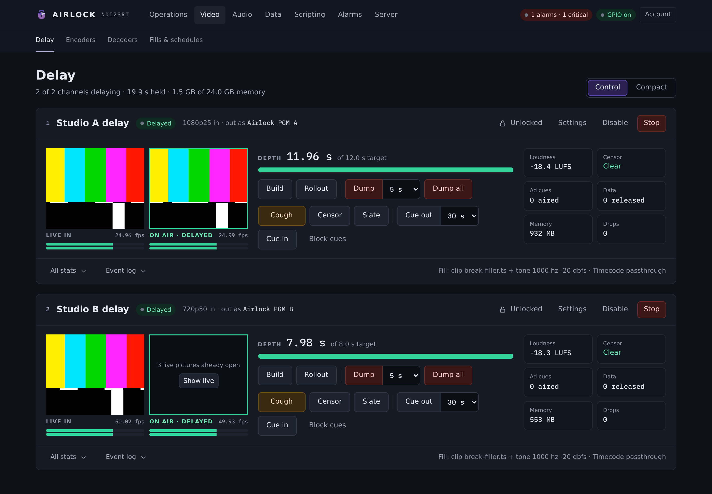
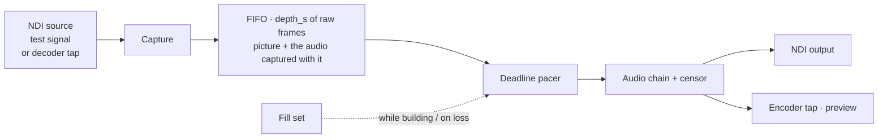
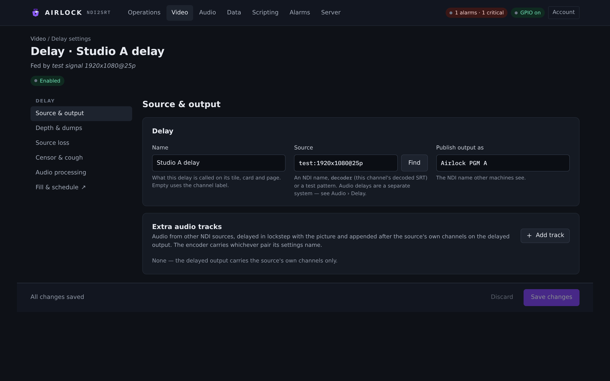
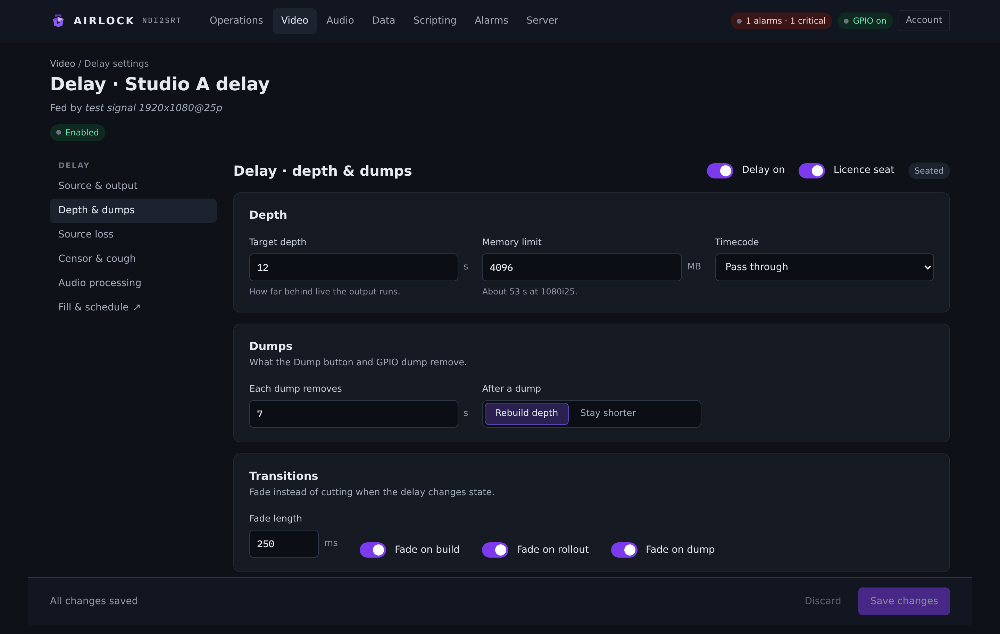
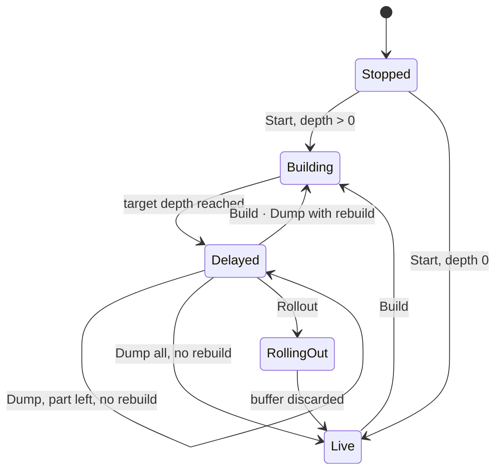
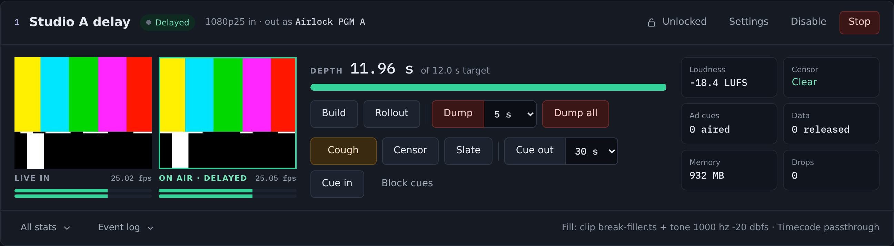
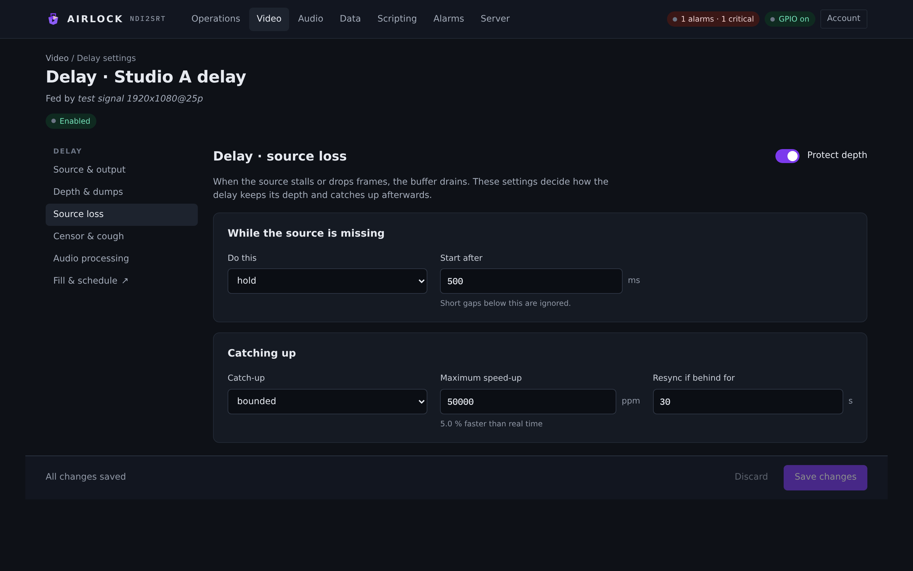
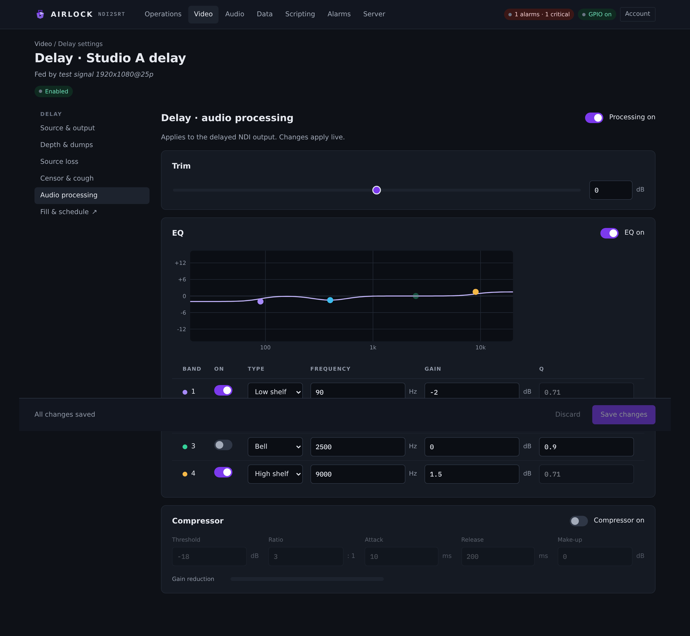

# The video delay

The delay is a broadcast profanity delay: NDI in, a buffer of raw frames with the
audio captured beside each one, NDI out on a deadline pacer at the source's
nominal rate. This page covers the source and output, depth and dumps, the state
machine, the controls on the **Delay** page, what happens when the source goes
away, depth maintenance, and the audio chain the delay runs on its output.

{ .shot }

## How it works



The output never waits on the source. A shortfall repeats a frame, a surplus of
two drops one, so the depth holds to within a frame. The outgoing frames carry
the original capture timecode, so a probe of the delayed source reads the real
delay through the chain.

!!! note
    Storage is raw, and raw is the trade. 1080i25 is about 3.1 MB a frame, so
    10 s of it is roughly 780 MB. The arithmetic and the memory ceilings are in
    [Channels](channels.md#capacity-what-n-channels-cost).

## Source and output

Open the delay's **Settings**, then the **Source & output** tab.

{ .shot }

### To set the source

1. On **Source & output**, in the **Delay** card, type the **Source**, or select
   the picker beside it and choose a source the box can see.
2. Select **Save changes**.
3. Restart the delay (**Stop**, then **Start**) — the source applies when the
   delay next starts.

**Source** takes one of four things:

| Source | Example | What it is |
|---|---|---|
| An NDI name | `DESKTOP (vMix - Output 1)` | any sender this box can discover or reach |
| A test signal | `test:1920x1080@25i` | an internally generated pattern, for commissioning |
| `decoder` | `decoder` | **this channel's** decoder output — an SRT contribution feed delayed and published as NDI with no NDI hop in between. Start the decoder first |
| An audio input | `input:<name>` | sound only, with `delay.audio_only` set — see the note below |

!!! note
    A sound-only delay is a different system with its own page and its own
    build/dump behaviour. Use **Audio › Delay** for profanity delay on audio
    feeds; see [Audio delay](../audio/delay.md). The `delay.audio_only` key on a
    video channel is the older single-block form of the same idea.

### To set the output name

In the **Delay** card, edit **Publish output as**. This is the NDI name other
machines see, and it must be unique across every channel in the process — the
save is refused if it is not.

Setting a channel's encoder source to `delay` streams the delayed output over
SRT instead of the live source. That is the standard way to get a delayed
contribution feed out of the box.

### Extra audio tracks

The **Extra audio tracks** card adds audio-only tracks to the delay. Each one is
delayed in lockstep with the picture and appended, in order, after the source's
own channels on the delayed NDI output.

To add one, select **Add track**, then fill in:

| Field | Config key | What it is |
|---|---|---|
| Name | `aux[].name` | what the card calls the track |
| From | `aux[].kind` | **NDI source** (`ndi`) or **Audio input** (`input`) |
| NDI source | `aux[].ndi_source` | the sender whose audio is taken; its video is never received |
| Audio input | `aux[].input` | one of this box's named audio inputs, defined once on **Audio › Inputs & outputs** and shared by everything that names it |
| From channel | `aux[].first_channel` | the first of the input's channels the track takes (shown 1-based, stored 0-based) |
| Channels | `aux[].channels` | how many channels the track carries: 1, 2, 4, 6 or 8 |
| Offset | `aux[].offset_ms` | how much later than its picture the track's audio arrives — a capture path's latency. The track is read that much later so it lands with the picture. Negative for audio that arrives early |
| While a fill airs | `aux[].fill` | **The fill's own audio** (`parent`) or **Silence** |

Tracks apply when the delay next starts. A track whose source stops raises an
aux-source-lost alarm and airs silence until it returns.

## Depth and dumps

Open the delay's **Settings**, then **Depth & dumps**.

{ .shot }

### To set the depth

1. On **Depth & dumps**, in the **Depth** card, set **Target depth** in seconds.
2. Select **Save changes**.
3. Restart the delay for the new target to take effect.

To change the depth of a **running** delay without a restart, use the REST
control instead — it is live, and it behaves the way the controls do: a deeper
target builds, a shallower one trims the newest surplus like a dump.

```bash
curl -X POST 'http://airlock.example:8090/api/channels/2/delay/depth?seconds=6'
```

**Memory limit** caps this channel's buffer and so its usable depth. The hint
under the field converts it: roughly 78 MB per second at 1080i25. The card shows
the maximum depth the cap allows at the raster actually arriving. When the cap is
reached the oldest frame is dropped and counted — the input is never refused.

**Timecode** picks what the delayed NDI output carries:

| Value | What the output carries |
|---|---|
| `passthrough` (default) | each content frame keeps exactly the timecode it arrived with; fill and hold frames continue from the last emitted one by the nominal period |
| `synthesize` | the NDI runtime stamps the send time |

### To set what a dump removes

In the **Dumps** card (`What the Dump button and GPIO dump remove.`):

* **Each dump removes** — `dump_seconds`, the default 5 s. This is what the TCP
  `DUMP` verb and a GPIO dump pin take out. The **Dump** button on the Delay page
  has its own 2 / 5 / 10 s picker beside it and uses whichever is selected.
* **After a dump** — **Rebuild depth** or **Stay shorter**.

| After a dump | Config | What the output does |
|---|---|---|
| **Rebuild depth** | `rebuild_after_dump: true` | the fill airs while the buffer refills to the target, then delayed content resumes |
| **Stay shorter** | `rebuild_after_dump: false` | the output continues at the shorter depth — live, if everything went — until the next **Build**. Depth maintenance then holds *that* depth rather than growing it back |

`rebuild_after_dump` is one of the settings a save pushes to a **running** delay,
so it takes effect without a restart.

### Transitions

The **Transitions** card turns cuts into dissolves. **Fade length** is
`fade_ms`, and the three switches turn it on per seam.

| Switch | Config key | What dissolves |
|---|---|---|
| Fade on build | `fade_build` | live (or the last delayed frame) into the fill at the start of a build, and the fill into delayed content when the depth is reached |
| Fade on rollout | `fade_rollout` | the delayed output into live before the buffer is discarded |
| Fade on dump | `fade_dump` | across the splice where the removed seconds were, and from the hold frame to live after a **Dump all** with no rebuild |

Dissolves cross-fade picture and ramp audio across every sample of a frame,
continuing from where the previous frame left off — a fade is a ramp, never a
staircase, and it never shortens the timeline. The removed material is never
shown: a dump dissolve runs between the frame *before* the gap and the frames
after it.

All four settings are live. Save them and a running delay takes them at once;
`POST /api/channels/{n}/delay/fades?ms=&rollout=&build=&dump=` does the same.

## The states



| State | Console | TCP | What is on air |
|---|---|---|---|
| Live | **Live** | `LIVE` | the source, with no delay |
| Building | **Building** | `BUILDING` | the fill, while the buffer fills to the target |
| Delayed | **Delayed** | `DELAYED` | buffered content, `depth_s` behind the source |
| Rolling out | **Rolling out** | `ROLLOUT` | live, after a jump cut or a dissolve; with `rollout_fill`, the fill for what was the depth first |
| Stopped | **Stopped** | `STOPPED` | nothing — the block is not running |

A delay that is configured off shows as **Off** with an **Enable** button in its
place.

`STATE <ch>` over TCP reports the state, the depth, the protection window, the
censor and the lock holder in one line:

```
OK 1 DELAYED depth=3.96 protection=3.98 censor=audio lock=studio-a
```

## The Delay page

**Video › Delay** carries one card per channel. The page header counts the
channels delaying, the seconds held and the memory in use against the ceiling.
The **Control** / **Compact** toggle in the top right switches between the full
card and one row per channel; a compact row still has **Cough**, **Dump** and
**Open**.

{ .shot }

The card shows **LIVE IN** (the source as it arrives) and **ON AIR · DELAYED**
(what is going out) side by side with their own meters, and the depth against its
target as a figure and a bar.

### Delay actions

| Control | What happens |
|---|---|
| **Build** | the output airs the fill while the buffer fills to the target, then plays delayed content |
| **Rollout** | jump cut to live and discard the buffer. With **Fill during rollout too** the fill airs for the remaining depth first; with **Fade on rollout** the delayed output dissolves into live |
| **Dump** | removes the newest *n* seconds — what was just said. The picker beside the button offers 2, 5 and 10 s. The output continues from where it was, so the delay is *n* shorter |
| **Dump all** | the whole buffer goes and the output is live |

A dump during a build keeps building; a dump during a rollout keeps rolling out;
a dump while live changes nothing.

### On-air actions

| Control | What happens |
|---|---|
| **Cough** | momentary — censors while the button is held (mouse, touch or the space bar), with a tail covering the release |
| **Censor** | the latch: on until it is turned off |
| **Slate** | covers the output picture with the fill set's picture, and mutes the audio if the slate is set to |
| **Cue out** / **Cue in** | originate an ad-break cue, with a 15 / 30 / 60 / 120 s picker on **Cue out** |
| **Block cues** | stop cues from the source being re-emitted |

Cough, Censor and Slate are covered in
[Censor, cough and slate](censor.md); the cue controls in [SCTE cues](scte.md).

### Card header

The header carries the channel number and the block's name, a state pill, the
input format and the NDI name the output is published under, and:

| Button | What it does |
|---|---|
| **Locked** / **Unlocked** | claims or releases the [channel lock](../control/lock.md) |
| **Settings** | opens the delay's settings pages |
| **Disable** | stops the block and clears its run flag |
| **Start** / **Stop** | runs or stops the block now, leaving the flag alone |

Everything except **Settings** is refused while another leader holds the lock.

## What a dump leaves behind

Every dump writes the removed seconds to a **dump clip** for compliance review
and tells someone — email and webhook alerts, if those are configured. The clip
is written on a separate writer thread, so the flush itself is never delayed by
the disk: if the writer is still busy with an earlier dump the job is dropped
with a logged warning, and the dump still happens on time.

The clip is H.264 baseline with AAC by default, deliberately — that is exactly
what the engine's own decoder reads back, so a dump clip can be used as a
[fill](fills.md) with nothing in between. See
[Dump clips and alerts](../alarms/clips.md).

## Source loss and depth maintenance

Open the delay's **Settings**, then **Source loss**.

{ .shot }

When the source stalls or disappears, something has to give. A frame the source
never sent costs one of three things — the protection window, timeline drift, or
output continuity — and this policy chooses which.

### To protect the depth through an outage

1. On **Source loss**, turn on **Protect depth**.
2. In **While the source is missing**, set **Do this** to `hold`.
3. Set **Start after** to how long the input must be silent first (default
   500 ms, so short gaps are ignored).
4. In **Catching up**, choose a **Catch-up** mode and, for `bounded`, a
   **Maximum speed-up**.
5. Select **Save changes** — the policy is pushed to a running delay at once.

| **Do this** | Config | What the output does |
|---|---|---|
| `drain` | `maintain.mode: "drain"` | keeps consuming the buffer. The picture freezes on the last frame, the buffer drains, and when the source returns the delay is gone — a 4 s protection window quietly spent by a 4 s outage. This is also what happens with **Protect depth** off |
| `hold` | `maintain.mode: "hold"` | stops consuming after **Start after** and airs the **fill** instead. The buffer is untouched, so every second of protection is still there when the source returns |

`hold` pays for the window with drift: air is now that gap later than real time,
and the hole in the content passes through the output over the next `depth`
seconds. **Catch-up** decides how that surplus is given back.

| **Catch-up** | Config | What happens |
|---|---|---|
| `none` | `catchup: "none"` | nothing: the deeper delay stands |
| `bounded` | `catchup: "bounded"` | the output clock is slewed by at most **Maximum speed-up** until the surplus is gone. No frame is dropped or repeated — the second is just slightly short |
| `free` | `catchup: "free"` | the surplus is cut in one go: the oldest unaired frames are discarded, dissolved across if **Fade on dump** is on |

`bounded` works the other way too. A depth that has *eroded* — a source quietly
delivering a few frames a minute short of nominal — is grown back by running the
clock up to the same bound **slow**, which costs neither a duplicate nor a drop.
Either way a surplus bigger than **Resync if behind for** (`resync_s`) is cut
rather than slewed; slewing 40 s away at 5 % would take 13 minutes. `resync_s: 0`
never cuts. A ±2 frame deadband keeps normal jitter off the clock.

!!! note
    Maintenance runs in the **Delayed** state only. A build is already airing
    fill, a rollout is *meant* to drain (and ends maintenance), and Live has no
    window to hold. A dump during a gap works as always.

### Depth against protection

The card keeps two different numbers honest:

* **depth** is what the buffer holds.
* **protection** is the window actually in force — how long ago the frame about
  to air was captured.

They are the same on a healthy source. After a maintained gap, protection is
`depth` plus the gap until the hole has aired: the drift made visible.
`maintain_state` reads `ok`, `holding`, `catching up` or `regrowing`, and
`maintained_s`, `catchup_s`, `regrown_s` and `source_gaps` count what the policy
has done.

A maintained gap still raises the source-lost alarm through the normal detector.
The depth-erosion alarm stays clear, because the depth is exactly what is being
held. A maintenance fill continues the outgoing timecode from the last emitted
frame by the nominal period, like every other fill.

## Fills

What the output airs while it is **not** playing buffered content — during a
build, during a maintained gap, and during a rollout if `rollout_fill` is on —
is the fill set: a freeze frame, black, a slate, a looped clip or a live NDI
source, with silence, a tone, the clip's own audio, the NDI source's audio, or no
audio frames at all. Fills have their own page in the console
(**Video › Fills & schedules**) and their own chapter:
[Fills and schedules](fills.md).

The sidebar on every delay settings page carries a **Fill & schedule ↗** link
straight to it.

## Audio processing and loudness

Open the delay's **Settings**, then **Audio processing**.

{ .shot }

The chain is **input trim → parametric EQ → stereo-linked compressor**, and on
the delay it is applied to the audio **as emitted** — post-delay, so a ride is on
air at once and the card's post meter shows what went out. Everything is off and
unity by default, so nothing changes until you switch it on.

### To ride the delay's audio

1. On **Audio processing**, turn on **Processing on**.
2. Set **Trim** with the slider or the number field.
3. For EQ, turn on **EQ on**, then drag a band's dot on the response curve, or
   type the values in the table below it. Double-click a dot to put its gain back
   to 0 dB.
4. For the compressor, turn on **Compressor on** and set **Threshold**,
   **Ratio**, **Attack**, **Release** and **Make-up**.
5. Select **Save changes** — the chain is saved *and* pushed to the running
   delay.

| Setting | Console label | Config key | Default | Meaning |
|---|---|---|---|---|
| Chain on | Processing on | `delay.audio_processing.enabled` | `false` | master switch; off, the audio path is not touched at all |
| Trim | Trim | `delay.audio_processing.gain_db` | `0.0` | input trim ahead of the EQ and compressor, −24 to +24 dB |
| EQ on | EQ on | `delay.audio_processing.eq_enabled` | `false` | runs the band list |
| Band on | On | `delay.audio_processing.bands[].enabled` | `false` | a band that is off or flat is skipped |
| Band type | Type | `delay.audio_processing.bands[].kind` | `low_shelf`, `peaking`, `peaking`, `high_shelf` | `low_shelf`, `peaking` (shown as **Bell**) or `high_shelf` |
| Frequency | Frequency | `delay.audio_processing.bands[].hz` | 100 / 400 / 2500 / 8000 | 20–20000 Hz |
| Gain | Gain | `delay.audio_processing.bands[].gain_db` | `0.0` | −18 to +18 dB |
| Q | Q | `delay.audio_processing.bands[].q` | 0.71 / 0.9 / 0.9 / 0.71 | 0.1–12 |
| Compressor on | Compressor on | `delay.audio_processing.compressor.enabled` | `false` | feed-forward, on the stereo-linked sample peak |
| Threshold | Threshold | `…compressor.threshold_db` | `-18.0` | −60 to 0 dB |
| Ratio | Ratio | `…compressor.ratio` | `3.0` | 1–20 ( `1` is no compression ) |
| Attack | Attack | `…compressor.attack_ms` | `10.0` | 0.1–200 ms |
| Release | Release | `…compressor.release_ms` | `200.0` | 10–2000 ms |
| Make-up | Make-up | `…compressor.makeup_db` | `0.0` | 0–24 dB, applied after the compressor |

Up to six bands are allowed. The bands are standard shelving and bell biquads;
the curve drawn on the page is approximate and for the eye — the engine's filters
are the ones that run.


!!! note
    The delay's chain and the **encoder's** chain are separate. The delay's is
    `delay.audio_processing` and shapes the delayed NDI output; the encoder's is
    `audio.processing` and shapes the PCM that goes into AAC. Changing one never
    moves the other.

**Loudness** is measured on the audio *after* the chain: momentary (400 ms),
short-term (3 s), gated integrated LUFS, a 4× oversampled true-peak estimate, and
the compressor's gain reduction. The figures are on the delay and encoder cards
and in `GET /api/state` under `delay.loudness` and `encoder.loudness`.
`POST /api/channels/{n}/delay/reset` restarts a block's counters and its
measurement, integrated figure included.

The integrated figure is computed incrementally into a fixed histogram, so the
measurement costs the same on day eight as on second eight.

## The figures on the card

The strip under the controls carries six figures:

| Figure | What it is |
|---|---|
| **Loudness** | integrated LUFS, after the processing chain |
| **Censor** | `Clear`, or `On` while a cough, censor or daypart is covering the output |
| **Ad cues** | cues aired out of the buffer |
| **Data** | delayed data messages released at air |
| **Memory** | megabytes this channel's buffer is holding |
| **Drops** | frames dropped because the memory cap was reached |

The footer says what fill a build would air (`Fill: …`, with the problem beside
it if the asset is unusable) and which timecode mode is in force. **All stats**
expands four more groups:

| Group | Rows |
|---|---|
| Source | Input raster, Frames in, Audio (channels, rate, and each extra track's state) |
| Buffer | Frames held, Max depth the memory cap allows, Dumps and the seconds dumped |
| Loudness (R128) | Integrated, True peak, Processing chain summary |
| Depth maintenance | Policy, Source gaps, Regrown seconds |

**Event log** expands the delay's own log lines for that channel.

## Long runs

The delay is built to sit on air for months. Every byte clock and PTS-to-time
conversion is 128-bit, so nothing wraps on a long run, and the output pacer
re-anchors its clock if it ever finds itself more than 2 s behind — a machine
that slept or a link that stalled is absorbed rather than chased with a flood.
The count of re-anchors is on the card.

The loudness meter's storage is constant for ever, and the alarm detectors read
figures the blocks already keep, so nothing on the frame path grows with uptime.

## Reference: delay settings

```json
"delay": {
  "enabled": false, "name": "", "source": "", "depth_s": 10.0,
  "ndi_name": "ndi2srt delay", "max_memory_mb": 4096,
  "dump_seconds": 5.0, "rebuild_after_dump": true,
  "fade_ms": 500, "fade_rollout": true, "fade_build": true, "fade_dump": true,
  "timecode": "passthrough", "licence_assigned": true,
  "aux": [], "fill": { }, "censor": { }, "maintain": { }, "audio_processing": { }
}
```

| Setting | Console label | Config key | Default | Meaning |
|---|---|---|---|---|
| Delay on | Delay on | `delay.enabled` | `false` | run the delay at launch |
| Name | Name | `delay.name` | `""` | the delay's own name; empty uses the channel label |
| Source | Source | `delay.source` | `""` | NDI name, `test:…`, `decoder`, or `input:<name>` for a sound-only delay |
| Publish output as | Publish output as | `delay.ndi_name` | `ndi2srt delay` | the NDI name the delayed output is published under; unique across the process |
| Target depth | Target depth | `delay.depth_s` | `10.0` | seconds behind live, 0–600. Applies at next start; the REST depth control is live |
| Memory limit | Memory limit | `delay.max_memory_mb` | `4096` | buffer cap in MB, minimum 256. Caps the usable depth |
| Each dump removes | Each dump removes | `delay.dump_seconds` | `5.0` | what TCP `DUMP` and a GPIO dump pin remove |
| After a dump | After a dump | `delay.rebuild_after_dump` | `true` | **Rebuild depth** (`true`) or **Stay shorter** (`false`). Live |
| Fade length | Fade length | `delay.fade_ms` | `500` | dissolve length in ms, 0–5000. Live |
| Fade on build | Fade on build | `delay.fade_build` | `true` | dissolve into and out of the fill on a build. Live |
| Fade on rollout | Fade on rollout | `delay.fade_rollout` | `true` | dissolve delayed → live on a rollout. Live |
| Fade on dump | Fade on dump | `delay.fade_dump` | `true` | dissolve across a dump splice. Live |
| Timecode | Timecode | `delay.timecode` | `passthrough` | `passthrough` or `synthesize` |
| Licence seat | Licence seat | `delay.licence_assigned` | `true` | competes for a video-delay seat. Unseated, the delay still runs — watermarked |
| Audio-only | — | `delay.audio_only` | `false` | sound-only delay with no video |
| Audio output | — | `delay.output` | `""` | the named audio output a sound-only delay plays to; empty is NDI send only |
| Extra audio tracks | Extra audio tracks | `delay.aux[]` | `[]` | see *Extra audio tracks*, above |

### Depth maintenance

| Setting | Console label | Config key | Default | Meaning |
|---|---|---|---|---|
| Protect depth | Protect depth | `delay.maintain.enabled` | `false` | master switch for the policy |
| While missing | Do this | `delay.maintain.mode` | `hold` | `hold` airs the fill and keeps the buffer; `drain` consumes it |
| Start after | Start after | `delay.maintain.fill_after_ms` | `500` | silence from the source before the output stops consuming, 0–60000 ms |
| Catch-up | Catch-up | `delay.maintain.catchup` | `bounded` | `none`, `bounded` or `free` |
| Maximum speed-up | Maximum speed-up | `delay.maintain.catchup_max_ppm` | `50000` | the slew bound in ppm; 50000 is 5 %. 1–200000 |
| Resync if behind for | Resync if behind for | `delay.maintain.resync_s` | `30.0` | a surplus bigger than this is cut rather than slewed; `0` never cuts. 0–600 s |

## Troubleshooting

**The depth never reaches the target.** The memory cap is the usual answer — the
card's **Max depth** row says what the cap allows at the arriving raster. Raise
**Memory limit**, or lower **Target depth**.

**Depth creeps down over hours.** The source is delivering slightly short of
nominal. Turn on **Protect depth** with **Catch-up** `bounded`: the regrow slew
covers a small frame deficit without a duplicate or a drop. The depth-erosion
alarm tells you when it is happening.

**The protection figure is bigger than the depth.** That is the drift a
maintained gap bought. It comes back as the hole passes through the output, or
sooner if **Catch-up** is on.

**Changing the depth in the console did nothing.** **Target depth**, **Source**,
**Publish output as** and **Memory limit** apply when the delay next starts. The
save bar says so. Use the REST depth control for a live change, or stop and start
the delay.

**The output went live on its own after a dump.** **After a dump** is set to
**Stay shorter** and the dump took everything. Press **Build** to get the window
back, or set **Rebuild depth**.

**No picture during a build.** That is the fill. Check **Fill:** in the card
footer — if it says the source is unavailable, the slate, clip or NDI fill is
missing and the delay has fallen back to the frozen frame. See
[Fills and schedules](fills.md).

**The delay will not start.** It needs a source and an output name. The refusal
names which: `delay: choose a source` or
`delay: NDI source name is required`.

**Every control is refused.** Either another leader holds the
[channel lock](../control/lock.md), or this box is a redundancy backup with its
controls locked out.
