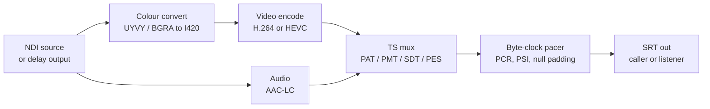
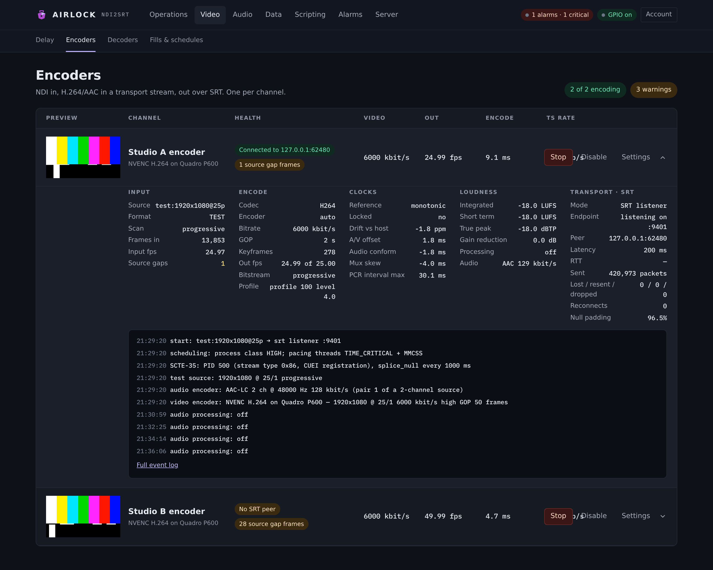
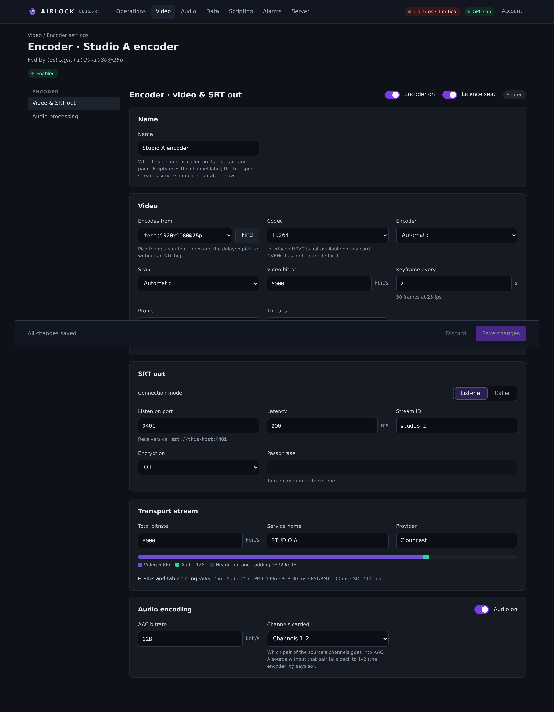
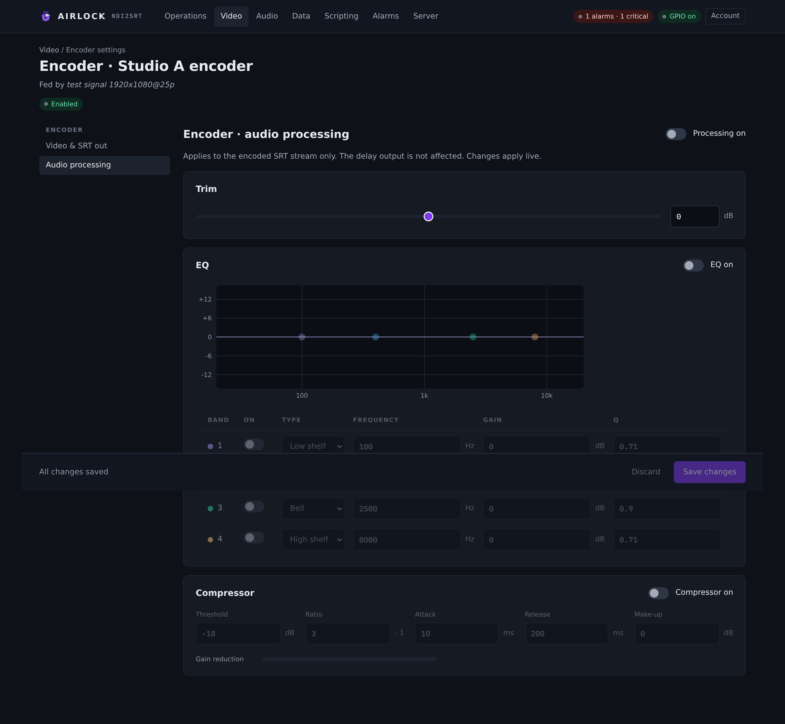

# Video encoders

An encoder takes a picture — the channel's delayed output or any NDI source on the
network — and sends it out as H.264 or HEVC with AAC audio in an MPEG-2 transport
stream over SRT. This page covers the Encoders page, every setting on the
**Video & SRT out** and **Audio processing** tabs, the transport-stream detail an
engineer is asked for, and how to read the numbers on the card.

## What an encoder is

Each channel has one encoder, and it is a block in its own right: it starts, stops
and is licensed separately from the channel's delay and decoder. Nothing couples it
to the delay except the source you choose for it.

Two sources are useful:

- **This channel's delay output** — the encoder taps the delayed picture inside the
  process, with no NDI hop and no second copy of the frames. This is the normal
  choice when you are delaying to air and contributing the same feed off site.
- **Any NDI source** — the encoder receives it like any other receiver. Use this to
  contribute a feed the channel is not delaying.

The encoder never scales or rate-converts. It opens at whatever raster and frame
rate the source presents, and if the source changes format the encoder closes and
re-opens at the new one (the card's **Format** row and the block log both say so).
Pick the raster at the sender.



The pacer is the part worth knowing about. The transport stream leaves at exactly the
transport bitrate you configure, the PCR is stamped from the pacer's own byte clock,
and the PSI tables go out on a schedule rather than when the mux happens to feel like
it. That is why PCR accuracy and table repetition hold up under a receiver's analyser.

## The Encoders page

**Video › Encoders** lists every channel's encoder, one row each.

{ .shot }

The columns are **Preview**, **Channel**, **Health**, **Video**, **Out**, **Encode**
and **TS rate**. The header carries a pill counting how many encoders are running,
and pills for any that are not connected or are carrying warnings.

Each row has these buttons:

| Button | What it does |
|---|---|
| **Enable** | turns the block on in the configuration and starts it |
| **Start** / **Stop** | runs or stops the block now, leaving the configuration alone |
| **Disable** | turns it off in the configuration and stops it |
| **Settings** | opens that encoder's settings page at **Video & SRT out** |
| chevron | expands the detail panel — Input, Encode, Clocks, Loudness, Transport · SRT, and the block's recent log |

!!! note "Enabled and running are two different things"
    `enabled` is the intent that survives a restart: the process starts the block with
    it. **Start** and **Stop** act on what is running right now and do not change it.
    A block that is disabled keeps all its settings.

If an encoder is receiving an interlaced source but coding it as progressive frames,
a banner appears under the table naming the channel, with an **Open encoder settings**
button. See [Interlaced delivery](#interlaced-delivery-1080i).

## Setting up an encoder

1. Go to **Video › Encoders** and press **Settings** on the channel you want.
2. On **Video & SRT out**, set **Encodes from** — pick *This channel's delay output*,
   or use the source picker to choose an NDI source.
3. Set **Codec**, **Encoder**, **Video bitrate** and **Keyframe every**.
4. In **SRT out**, choose **Connection mode**, then the host and port (caller) or the
   listen port (listener). Set **Latency**, and **Encryption** with a passphrase if
   the far end expects one.
5. In **Transport stream**, set **Total bitrate** — it must clear video + audio with
   at least 5 % to spare — and the **Service name** the receiver will display.
6. In **Audio encoding**, set the **AAC bitrate** and **Channels carried**.
7. Save. If the encoder is running, the Save button reads **Save and restart
   encoder** — source, codec, bitrate and transport only take effect when the block
   starts, so the console restarts it for you. If it is not running, the note tells
   you the settings apply at its next start.

## Video & SRT out

{ .shot }

### Name

What this encoder is called on its tile, card and page. Leave it empty and it uses the
channel's label. The transport stream's service name is a separate field, in
**Transport stream** below.

### Video

| Setting | Console label | Config key | Default | Meaning |
|---|---|---|---|---|
| Source | Encodes from | `ndi.source` | *(empty)* | The NDI source name, or `delay` for this channel's delayed output. A channel's blocks feed each other only within the channel — to cross channels, go out and back over NDI. |
| Codec | Codec | `video.codec` | `h264` | `h264` or `h265`. HEVC goes out as stream type 0x24; the mux is codec-agnostic. |
| Implementation | Encoder | `video.encoder` | `auto` | `auto`, `nvenc`, `software` or `x264`. See [The GPU](#the-gpu). |
| Scan | Scan | `video.scan` | `auto` | `auto` follows the source's NDI flag, `interlaced` forces field coding, `progressive` never codes fields. |
| Video bitrate | Video bitrate | `video.bitrate_kbps` | `6000` | 100–100000 kbit/s. CBR with a one-second VBV. |
| GOP | Keyframe every | `video.gop_seconds` | `2.0` | 0.25–10 s, converted to frames from the source rate. An IDR goes out on that period with VPS/SPS/PPS in front of it. |
| Profile | Profile | `video.profile` | `high` | `baseline`, `main` or `high`. Baseline forbids interlaced tools. |
| Threads | Threads | `video.threads` | `0` | Software encoder threads; `0` is automatic (the machine's parallelism, capped at 8). Ignored by NVENC. |
| Receiver name | Receiver name | `ndi.receiver_name` | `ndi2srt` | What this receiver advertises to the sender. |
| Extra source IPs | Extra source IPs | `ndi.extra_ips` | *(empty)* | Comma-separated addresses to probe when mDNS discovery cannot see the sender. |

**Receiver name** and **Extra source IPs** are behind the **NDI receive options**
disclosure, which shows their current values in its summary line.

The encoder uses no B-frames, writes an access unit delimiter per access unit, and
codes 4:2:0 8-bit. BT.709 is used at HD rasters and BT.601 at SD.

### Interlaced delivery (1080i)

An affiliate that takes 1080i needs a **field-coded** stream, not a progressive frame
with the fields woven in — the latter decodes as 1080p25 with combing and the wrong
field cadence on their SDI output.

Field coding is **H.264 only**, by one of two routes:

| Route | How it codes fields | Availability |
|---|---|---|
| **NVENC** | field pictures: each field is its own coded picture, `field_pic_flag = 1` — what broadcast contribution conventionally means by 1080i | NVIDIA cards of the Pascal generation and older. NVIDIA dropped interlaced encoding with Turing and every architecture since. |
| **x264** | MBAFF: the sequence allows fields and macroblock pairs are coded as fields, but every picture is still a frame picture | `libx264` installed on the machine. |

Both are legal interlaced H.264 and both sit inside Main and High. They are not the
same stream, though, so a plant that specifies field-coded 1080i needs the NVENC route.
A card without the capability refuses at start and names x264 as the alternative,
rather than quietly sending progressive.

Interlaced **HEVC** does not exist here by any route: NVENC has no field mode for it
and no software HEVC encoder in this product codes fields.

The **Scan** field checks the machine as you set it and tells you underneath what will
actually happen — "x264 is installed and can code fields", "There is no NVENC card
here", and so on.

!!! tip "What came out, not what was asked for"
    The encoder reads back its own bitstream — the sequence parameter set's
    `frame_mbs_only_flag` and `mb_adaptive_frame_field_flag`, the raster, profile and
    level, and every slice header's `field_pic_flag` — and reports what it actually
    emitted. It is the **Bitstream** and **Profile** rows on the card, and
    `GET /api/channels/{n}/encoder/bitstream` returns the whole object:

    ```json
    { "channel": 1, "running": true,
      "encoder": "NVENC H.264 interlaced (field pictures, TFF) on Quadro P600",
      "interlaced": true,
      "verdict": "interlaced — field pictures (TFF) · 1920x1080 · profile 100 level 4.0",
      "bitstream": { "profile_idc": 100, "level_idc": 40, "width": 1920, "height": 1080,
                     "fields_allowed": true, "mbaff": false, "field_order": "TFF" } }
    ```

    It reads H.264 only. For HEVC it reports `null` rather than guess.

### The GPU

`video.encoder` chooses the implementation:

- `auto` — NVENC when an NVIDIA GPU and driver are present, otherwise software.
- `nvenc` — required; the block refuses to start without it.
- `software` — OpenH264 (built in) for H.264, x265 (run-time library, optional) for
  HEVC.
- `x264` — libx264 if it is installed on the box, for progressive work as well as
  interlaced.

NVENC uses the P4 preset with low-latency tuning and CBR, and talks to the driver
directly — no CUDA toolkit and no FFmpeg. Any driver from the 520 series up is enough.
x264 and x265 are loaded at run time only; nothing of either ships inside the binary,
and the loader verifies a library's layout before using it rather than encoding
through one it has guessed at. Install them the usual way for the platform.

The implementation actually in use is on the card's **Encoder** row and in the header's
GPU pill. The console greys out `x264` and `nvenc` in the picker when this machine
does not have them, naming what it found instead.

### SRT out

The same connection fields serve the encoder's output and the decoder's input.

| Setting | Console label | Config key | Default | Meaning |
|---|---|---|---|---|
| Mode | Connection mode | `srt.mode` | `caller` | **Caller** dials the far end; **Listener** waits to be dialled. There is no rendezvous mode. |
| Host | Call host | `srt.host` | `127.0.0.1` | Caller only. A caller with no host is refused at save. |
| Port | Port / Listen on port | `srt.port` | `9001` | Two channels cannot listen on one port — the configuration refuses it. Caller ports may repeat. |
| Latency | Latency | `srt.latency_ms` | `200` | 20–8000 ms. The recovery window: how long SRT will keep trying before a packet is given up. |
| Stream ID | Stream ID | `srt.stream_id` | *(empty)* | Sent on connect in caller mode, for an ingest that routes by it. A listener ignores it. |
| Encryption | Encryption | `srt.key_len` | `16` | `16`, `24` or `32` for AES-128/192/256. The console shows Off until a passphrase is set. |
| Passphrase | Passphrase | `srt.passphrase` | *(empty)* | 10–79 characters. Empty means no encryption. |

The send buffer is **not** a setting. It is sized from the configured latency and the
transport bitrate — a latency window in each direction plus half a second of slack,
floored at 1 MiB and capped at 64 MiB — because a latency window is worth nothing if
the send buffer has already evicted the packet by the time the NAK arrives. See
[Long links](#long-links).

### Transport stream

| Setting | Console label | Config key | Default | Meaning |
|---|---|---|---|---|
| Transport bitrate | Total bitrate | `ts.transport_bitrate_kbps` | `8000` | The rate the whole transport stream leaves at, null-padded to fill. `0` makes it VBR: paced to content time, no nulls. Must be at least video + audio + 5 %. |
| Service name | Service name | `ts.service_name` | `ndi2srt` | The service name in the SDT — what a receiver displays. |
| Provider | Provider | `ts.provider_name` | `Cloudcast` | The provider name in the SDT. |
| Service ID | Service ID | `ts.service_id` | `1` | The program number. Channels need not differ — each carries its own transport stream. |
| Video PID | Video PID | `ts.video_pid` | `256` | 32–8186, distinct from the others. |
| Audio PID | Audio PID | `ts.audio_pid` | `257` | 32–8186, distinct from the others. |
| PMT PID | PMT PID | `ts.pmt_pid` | `4096` | 32–8186, distinct from the others. |
| PCR interval | PCR every | `ts.pcr_interval_ms` | `30` | 10–40 ms. DVB requires 40 ms or less. |
| PAT/PMT interval | PAT/PMT every | `ts.pat_pmt_interval_ms` | `100` | 50–500 ms. |
| SDT interval | SDT every | `ts.sdt_interval_ms` | `500` | How often the service description table repeats. |
| Decoder delay | Decoder delay | `ts.decoder_delay_ms` | `400` | How far PTS sits ahead of PCR — the receiver's buffering allowance. |

The PIDs and the table timings are behind the **PIDs and table timing** disclosure,
which summarises them in its own line. Above them, a **Bitrate budget** bar shows the
video and audio allocations against the total and calls out the headroom left for
padding, or refuses in red when video and audio do not fit.

What goes on the wire:

- **PAT, PMT and SDT** on their own schedules, every table complete from the first one.
- **PES** with PTS and DTS, an access unit delimiter per access unit, and the
  random-access indicator set on IDR frames.
- **One PMT version, ever.** The PMT is written complete at the start and its version
  never changes, so a receiver that restarts a program on a version bump has nothing
  to restart.
- **Adaptation-only PCR packets** stamped from the byte clock, so PCR accuracy is a
  statement about position on the wire rather than about when the mux got around to it.
- **Null padding** to hold CBR. At a generous transport bitrate with easy content,
  most of the stream can be padding — this is normal and is why a loss figure measured
  on bars understates what the same loss does to real content.
- **A SCTE-35 cue PID** (stream type 0x86 with the CUEI registration descriptor) when
  cues are enabled — see [SCTE cues](scte.md).

### Audio encoding

| Setting | Console label | Config key | Default | Meaning |
|---|---|---|---|---|
| Audio on | Audio on | `audio.enabled` | `true` | Off leaves a video-only transport stream. |
| AAC bitrate | AAC bitrate | `audio.bitrate_kbps` | `128` | 32–320 kbit/s, AAC-LC in ADTS, strict CBR. Codec delay is compensated in the PTS. |
| Pair | Channels carried | `audio.pair` | `1` | Which pair of the source's channels AAC carries: 1 is channels 1–2, 2 is 3–4, and so on. A source without that pair falls back to 1–2 and the encoder log says so. |

## Audio processing

The **Audio processing** tab is the encoder's own trim, EQ and compressor, applied to
the PCM that goes into AAC — so the loudness figures on the encoder card are the ones
the transport stream carries. It does not affect the delay's NDI output; the delay has
its own identical chain on its own tab.

{ .shot }

The chain runs **trim → EQ → compressor**.

| Card | Controls | Config key |
|---|---|---|
| *(header)* | **Processing on** | `audio.processing.enabled` (default `false`) |
| **Trim** | a slider and a number, −24 to +24 dB | `audio.processing.gain_db` (default `0.0`) |
| **EQ** | **EQ on**, a draggable response curve, and a table of bands: **On**, **Type**, **Frequency**, **Gain**, **Q** | `audio.processing.eq_enabled`, `audio.processing.bands[]` |
| **Compressor** | **Compressor on**, **Threshold**, **Ratio**, **Attack**, **Release**, **Make-up**, and a gain-reduction meter | `audio.processing.compressor.*` |

Band types are **Low shelf**, **Bell**, **High shelf**, **High pass** and **Low pass**
(`low_shelf`, `peaking`, `high_shelf` in the configuration). Up to six bands; a band
that is unticked or flat is skipped. Shelves ignore Q; the pass filters ignore gain.
The curve is drawn for the eye — drag a dot left and right for frequency, up and down
for gain, double-click to put the gain back to zero. The engine's filters are the
source of truth.

The compressor is feed-forward on the linked stereo peak, so the image never shifts
when one side digs, with make-up gain after it. Defaults are threshold −18 dB,
ratio 3:1, attack 10 ms, release 200 ms, make-up 0 dB.

Changes here apply **live** to a running encoder as well as being saved.

Loudness is measured after the chain, to ITU-R BS.1770-4 / EBU R128: momentary (400 ms),
short-term (3 s), gated integrated LUFS, a 4× oversampled true-peak estimate, and the
compressor's gain reduction.

## Reading the card

Expand a row to get five groups of figures.

**Input** — **Source**, **Format**, **Scan**, **Frames in**, **Input fps**,
**Source gaps**. A source gap is a frame the sender never delivered: the timeline
leaves a hole rather than drifting, and this counts the holes. Anything above zero is
flagged.

**Encode** — **Codec**, **Encoder** (the implementation actually in use), **Bitrate**,
**GOP**, **Keyframes**, **Out fps** (shown as "out of" the nominal rate),
**Bitstream** and **Profile** (read back from the stream itself).

**Clocks** — **Reference**, **Locked**, **Drift vs host**, **A/V offset**,
**Audio conform**, **Mux skew**, **PCR interval max**.

!!! info "A/V offset is lip sync; audio conform is not"
    **A/V offset** is the two rails compared *as the multiplexer has them* — the last
    video PTS against the last audio PTS, smoothed — so it is what a receiver will see,
    and it is the number to judge lip sync by. **Audio conform** answers a different
    question: how well the audio rail is tracking its own source. Conform can sit at a
    few milliseconds while the muxed rails walk minutes apart, so do not read it as lip
    sync. `ALARM_AV_SYNC` raises when the muxed figure stays outside its threshold. For
    reference, EBU R37 allows +40/−60 ms at an output and ITU-R BT.1359-1 +90/−185 ms
    end to end.

**Loudness** — **Integrated**, **Short term**, **True peak**, **Gain reduction**,
**Processing** (the chain in force) and **Audio** (codec and rate).

**Transport · SRT** — **Mode**, **Endpoint**, **Peer**, **Latency**, **RTT**,
**Sent**, **Lost / resent / dropped**, **Reconnects**, **Null padding**.

**Lost** is packets the link lost. **Resent** is retransmissions SRT sent to cover
them — a healthy long link shows many resends and few drops. **Dropped** is packets the
sender gave up on because their latency window expired; anything here is flagged red,
because those never reached the far end.

The health pills at the left of the row lead with the real condition: *Off*,
*Stopped*, *Held · standby* (this box is a locked backup), *Connected to …* or the
SRT error, dropped and lost counts, source gaps, an A/V offset past 40 ms, and
*Unlicensed — watermarked* when the encoder has no licence seat.

Every figure is in `GET /api/state` as well, and the per-block **reset** endpoint
(`POST /api/channels/{n}/encoder/reset`) zeroes the counters without touching the
stream.

## Long links

SRT latency buys recovery time, and on a long link it must be set with the round trip
in mind: a NAK cannot be answered until the packet has travelled back, so a latency
window shorter than a couple of round trips recovers nothing.

- Set **Latency** to at least three or four times the measured RTT, and 1000 ms is a
  reasonable starting point for an intercontinental link.
- The send buffer follows the latency and the transport bitrate automatically. You do
  not size it, and you should not need to think about it.
- Watch **Lost / resent / dropped** together. Lost climbing with resent climbing and
  dropped at zero is the system working. Dropped climbing means the latency window is
  too short for the link.
- **Reconnects** counts how often the socket had to be rebuilt. A caller retries on
  its own, about once a second.

!!! warning "Loss measured on bars is not loss measured on content"
    At a generous transport bitrate, colour bars encode to a tiny fraction of the
    stream and the rest is null padding. Lost packets then land on padding and the
    picture survives. On real content at the same rate, the same loss lands on the
    picture. Judge a link with content, or treat a bars figure as the link's residual
    loss and nothing more.

## Troubleshooting

| Symptom | Likely cause | What to do |
|---|---|---|
| Health says **No SRT peer** or names a connect error | nothing is listening at the far end, or a firewall is in the way | Check the mode: two callers never meet, and neither do two listeners. Check the port is open for UDP. |
| Connected, but **Dropped** climbing | the latency window is shorter than the link needs | Raise **Latency**. Compare with **RTT** on the same card. |
| **Lost** climbing, **Resent** stuck near zero | the far end is not sending NAKs, or the link lost the control path | Check the return path is open; SRT needs both directions. |
| Encoder will not start | no source, or a setting the receiver would refuse | The block log names it. A caller with no host, a transport bitrate below video + audio + 5 %, and colliding PIDs are all refused. |
| **Out fps** below the nominal rate | the machine cannot encode fast enough, or the source is dropping frames | Compare **Input fps** and **Source gaps** first — if the input is short, it is not the encoder. Then check **Encode** time and consider NVENC. |
| Picture is interlaced but goes out progressive | the chosen implementation cannot code fields | The banner on the Encoders page says so. Install libx264, or use a Pascal-generation or older NVIDIA card, then set **Encoder** accordingly. |
| Receiver shows no service name | the SDT is not reaching it, or the receiver reads the PMT only | Confirm **SDT every** is set and **Service name** is not empty. |
| Audio silent at the far end | the wrong pair is carried, or audio is off | Check **Channels carried** against the source's channel layout — the encoder log says when it fell back to channels 1–2. |
| Output is watermarked and a tone bursts over the audio | the encoder has no licence seat | Turn **Licence seat** on for this encoder, or free a seat elsewhere. See [Licensing](../start/licensing.md). |

