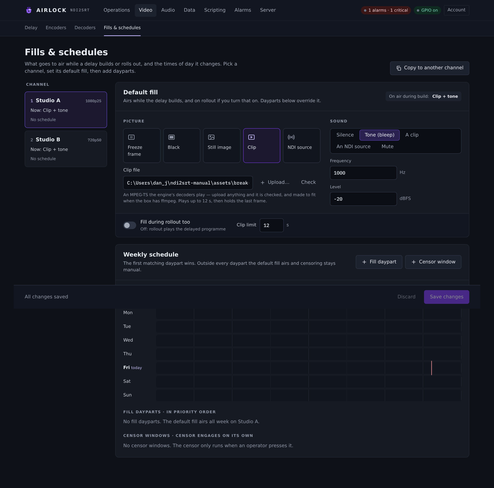
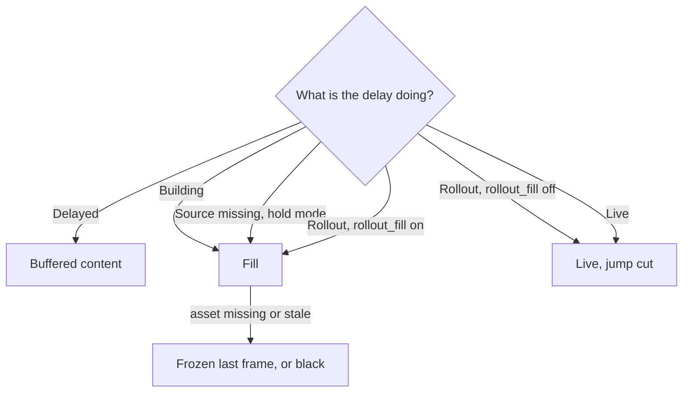

# Fills and schedules

A fill is what the output airs while the delay is **not** playing buffered
content: during a build, during a maintained source gap, and during a rollout if
you ask for it. This page covers the fill kinds, the **Fills & schedules** page,
uploading and checking an asset, dayparted fill schedules, and what a fill does
on a dump or a source loss.

{ .shot }

## When a fill airs



A fill is chosen as a pair: a **picture** and a **sound**, independently. A slate
with a tone, a clip with its own audio, or a live NDI picture with silence are
all valid configurations.

The fill is conformed to the delay's output raster — a different size is
letterboxed or pillarboxed on black and bilinearly scaled, audio is resampled and
channel-mapped — so the output never changes format when a fill starts.

## The Fills & schedules page

Open **Video › Fills & schedules**. The channel list down the left shows what
each channel is airing now and how many dayparts and censor windows it has.
Select a channel to edit it.

To copy a whole fill set and schedule to another channel, select **Copy to
another channel**, pick the target and select **Copy**, then **Save changes**.

### To set the default fill

1. Select the channel in the left-hand list.
2. In the **Default fill** card, pick a tile under **Picture**.
3. Choose what the tile asks for: an uploaded image or clip from the list (or
   **Upload…** one), or an NDI source from the ones this box can see.
4. Pick a **Sound**, and set **Frequency** and **Level** if you chose the tone.
5. Select **Save changes**.

| Picture tile | Config value | What airs |
|---|---|---|
| **Freeze frame** | `freeze` | holds the last good frame from the source |
| **Black** | `black` | plain black at the channel's raster |
| **Still image** | `image` | a PNG or JPEG, decoded once and letterboxed to the output raster |
| **Clip** | `clip` | a looped MPEG-TS file, decoded in full at start |
| **NDI source** | `ndi` | a live NDI source, scaled to the raster |

| Sound | Config value | What airs |
|---|---|---|
| Silence | `silence` | digital silence |
| Tone | `tone` | a sine at `tone_hz`, `tone_dbfs` |
| Clip | `clip` | the clip's own audio |
| NDI | `ndi` | the fill source's audio |
| Mute | `mute` | no audio frames at all |

The card's footer carries two more:

* **Fill during rollout too** (`rollout_fill`) — a rollout airs the fill for what
  was the depth and *then* cuts or dissolves to live, instead of jump-cutting
  straight away. The buffered content is discarded either way.
* **Clip limit** (`clip_max_s`) — how many seconds of a clip are kept decoded.

!!! warning
    Clips are decoded **once, in full**, to raster-conformed pictures held in
    memory, so the loop is seamless and costs nothing at play time. Memory is
    roughly *width × height × 1.5 × fps × seconds*: 20 s of 1080p25 is about
    1.5 GB. A longer file is cut at **Clip limit** and the cut is logged.

## Clips: what the engine will play

The built-in H.264 decoder takes **constrained baseline** only — a High-profile
file with B-frames loses two pictures in three and would air as a slideshow — and
the only audio the engine decodes is **AAC-LC**. HEVC clips go through a
different decoder and have no such profile limit.

A clip whose pictures the decoder refuses more than a tenth of is **refused as a
fill**. A clip whose audio the engine cannot decode is marked on this page when
**Sound** is set to the clip, and airs silent.

### To upload and check a clip or slate

1. Choose **Clip** or **Still image** under **Picture**.
2. Select **Upload…** beside the list and pick the file. It is streamed into the
   box's [asset library](../assets/library.md) and selected.
3. Read the verdict under the field.
4. Select **Save changes**.

To check a file already in the library, select it and press **Check**.

The verdict is the engine's own probe — the file read the way the player reads
it, so what it says will play, plays:

| Verdict | Meaning |
|---|---|
| **Will play** | the pictures decoded and the file is fit as a fill |
| **Will not play as it is** | the problems are listed under the pill |

Beside the pill, the probe reports the video codec, raster and rate, how many of
the offered pictures decoded, and the audio codec. A file that is not a transport
stream at all — an MP4 or MOV — comes back as *not a transport stream*.

### To make a file fit

When a clip will not play and the box has ffmpeg, select **Make it fit**. The
engine re-encodes the file on the box at the channel's frame rate into
`<name>-fill.ts`, shows the progress, and switches the path to the result. Select
**Save changes** to use it.

ffmpeg is never shipped with Airlock. The engine uses one it finds at the
`tools.ffmpeg` path, beside the executable, or on the system PATH; without one
the page shows the recipe for you to run yourself:

```bash
ffmpeg -i IN -c:v libx264 -profile:v baseline -level 4.0 -bf 0 \
       -pix_fmt yuv420p -r 25 -g 25 \
       -c:a aac -ar 48000 -b:a 192k -f mpegts OUT.ts
```

Set `-r` and `-g` to the channel's frame rate.

!!! tip
    A **dump clip** is written as H.264 baseline with AAC on purpose — exactly
    what this decoder reads back. A dump clip can be pointed at as a fill with
    nothing in between.

## Dayparted fill schedules

The **Weekly schedule** card replaces the default fill by time of day. The first
matching daypart wins; outside every daypart the default fill airs.

### To add a fill daypart

1. In the **Weekly schedule** card, select **Fill daypart**.
2. Name the row, pick its days with the day buttons, and type the **from** and
   **to** times as `HH:MM`.
3. Choose its **Picture** and, for an image or clip, pick one from the
   [asset library](../assets/library.md) (or **Upload…**). A daypart's clip has
   the same **Check** and **Make it fit** as the default fill. For an NDI fill,
   pick the source from the list of the ones this box can see. A saved source
   that is not on the network right now stays selected and says so.
4. Choose its **Sound**.
5. Select **Save changes**.

Rows are listed under **Fill dayparts · in priority order** and drawn on the
week timeline above, with a marker on the current time. Use the switch at the
left of a row to turn it off without deleting it, and the bin icon to delete it.

| Key | Default | What it is |
|---|---|---|
| `enabled` | `true` | a disabled row never matches |
| `days` | `"all"` | `all`, `weekdays`, `weekends`, or a comma list of `mon,tue,wed,thu,fri,sat,sun`. `weekdays` and `weekends` are whole-word aliases and cannot appear *inside* a list |
| `start`, `end` | `"00:00"`, `"24:00"` | local time `HH:MM`. `end` is **exclusive**, and an `end` at or before `start` wraps past midnight (`22:00`–`02:00`) |

Each row also carries a whole fill set of its own — `video`, `image_path`,
`clip_path`, `ndi_source`, `audio`, `tone_hz`, `tone_dbfs`.

**How a row is picked.** Every second the schedule is walked in order and the
first enabled row whose day bit matches the current local weekday *and* whose
window contains the current local minute wins. The day test is on the moment, so
a row that wraps past midnight belongs to the day it starts. When a boundary
passes, the assets swap and a fill that is playing follows it on the very next
frame — a cut, not a dissolve. The card and the log name the row that is in
force, for example `image slate.png + tone 1000 Hz -18 dBFS (schedule row 1)`.


### Censor windows

The same card carries **Censor windows · censor engages on its own** — dayparts
that hold the censor on without anyone pressing anything. They use the same row
shape and the same first-match rule. They are covered in
[Censor, cough and slate](censor.md#scheduled-censor-dayparts).

## The asset library

Every file a fill or a censor plays comes from the box's **asset library** — the
`assets` folder beside the configuration — and every image and clip setting on
this page is a list of what is in it, with **Upload…** beside it. The top-level
**Assets** page uploads several files at once, previews them, lists the settings
that use each one, and deletes what nothing uses. A save that names a file
outside the library is refused. See [The asset library](../assets/library.md).

## Dissolves

Dissolves apply to fills exactly as they do to the freeze frame:

* **Fade on build** dissolves live → fill at the start of a build, and fill →
  delayed content when the depth is reached.
* **Fade on rollout**, with **Fill during rollout too** on, dissolves into the
  fill and then out of it into live.
* **Fade on dump** dissolves from the hold frame to live after a **Dump all**
  with no rebuild.

Audio ramps run across every sample of a frame, continuing from where the
previous frame left off, and keep the content's own block length — a fade is a
ramp, never a staircase, and it never shortens the timeline. The fade length and
the three switches are on the delay's **Depth & dumps** tab; see
[The video delay](delay.md#transitions).

## What a fill does on a dump, a rollout and a source loss

| Event | What the fill does |
|---|---|
| **Build** | airs from the first frame until the target depth is reached |
| **Dump** with **Rebuild depth** | airs while the buffer refills to the target |
| **Dump** with **Stay shorter** | does not air — the output continues at the shorter depth, or goes live if everything went |
| **Dump all** with **Stay shorter** | does not air; the output is live |
| **Rollout**, `rollout_fill` off | does not air; the output jump cuts (or dissolves) to live |
| **Rollout**, `rollout_fill` on | airs for what was the depth, then live |
| **Source lost**, maintain `hold` | airs while the source is missing, and the buffer is untouched |
| **Source lost**, maintain `drain` | does not air — the picture freezes on the last frame as the buffer drains |

## The fill never stalls the output

Assets are prepared on a background thread: the slate is decoded and conformed,
the clip is decoded through the engine's own demux and decoders, and an NDI fill
receiver is kept running and warm while that fill is effective. A build therefore
starts its fill on the first frame.

Anything missing, still loading or stale — a deleted slate, an undecodable clip,
an NDI source that went away — falls back to the frozen last frame (black if
there is none), logs one line saying so and one when it comes back, and the Delay
card shows **Fill: source unavailable**.

!!! note
    A missing asset is refused when you **save** the configuration, but it never
    stops the delay from **starting**. The first build immediately after start-up
    can show the fallback for up to a second while the asset is conformed to the
    raster the first frame reveals.

Changing any fill setting applies immediately to a running delay — saving pushes
it, and the background thread re-prepares whatever changed.

## Reference: the fill set

```json
"delay": { "fill": {
  "video": "freeze", "image_path": "", "clip_path": "", "ndi_source": "",
  "audio": "silence", "tone_hz": 1000.0, "tone_dbfs": -18.0,
  "rollout_fill": false, "clip_max_s": 20.0,
  "schedule": []
} }
```

| Setting | Console label | Config key | Default | Meaning |
|---|---|---|---|---|
| Picture | Picture | `delay.fill.video` | `freeze` | `freeze`, `black`, `image`, `clip` or `ndi` |
| Image | Image | `delay.fill.image_path` | `""` | the slate; an uploaded PNG or JPEG from the asset library, letterboxed to the output raster |
| Clip | Clip | `delay.fill.clip_path` | `""` | the loop; an uploaded MPEG-TS of H.264 constrained baseline or HEVC, with AAC audio |
| NDI source | NDI source | `delay.fill.ndi_source` | `""` | the live fill source, chosen from the NDI sources this box sees |
| Sound | Sound | `delay.fill.audio` | `silence` | `silence`, `tone`, `clip`, `ndi` or `mute` |
| Frequency | Frequency | `delay.fill.tone_hz` | `1000.0` | tone frequency, 20–20000 Hz |
| Level | Level | `delay.fill.tone_dbfs` | `-18.0` | tone level, −90 to 0 dBFS peak |
| Fill during rollout too | Fill during rollout too | `delay.fill.rollout_fill` | `false` | a rollout airs the fill for the remaining depth before going live |
| Clip limit | Clip limit | `delay.fill.clip_max_s` | `20.0` | seconds of a clip kept decoded, 0–600 |
| Dayparts | Fill dayparts | `delay.fill.schedule[]` | `[]` | rows that replace the set above by time of day |

### What the state feed reports

| Field | What it says |
|---|---|
| `fill_active` | a fill is on air now |
| `fill_kind` | what it is |
| `fill_source_ok` | the asset or source is delivering |
| `fill.effective` | what a build started now would air |
| `fill.error` | why the configured asset is unusable, when it is |

The log records `fill start` and `fill end`, the daypart in force, a clip's
decode, and every fallback.

## Troubleshooting

**"This fill will not air as asked" on the Fills page.** The engine's probe found
a problem — the listed items say which. For a clip, select **Make it fit**, or
run the recipe yourself.

**The clip plays as a slideshow.** It is High profile with B-frames. Re-encode it
as constrained baseline with `-profile:v baseline -bf 0`.

**The clip plays but is silent.** Its audio is not AAC-LC — ffmpeg writes MP2
into a `.ts` unless told otherwise. Re-encode with `-c:a aac`.

**The slate airs but the picture is the frozen frame instead.** The asset is
missing or could not be decoded. The card shows **Fill: source unavailable** and
the delay log has one line saying so.

**A daypart is not taking over.** Check it is switched on, that its days include
today, and that `end` is after `start` unless you meant it to wrap past midnight.
Remember `end` is exclusive: a row ending `12:00` stops airing at 11:59:59.

**The clip is cut short.** It is longer than **Clip limit**. Raise the limit — and
check the memory arithmetic first — or shorten the file.

**Make it fit is not offered.** The box has no ffmpeg. Install one, or point
`tools.ffmpeg` at it. `GET /api/tools` says which one the engine found.
