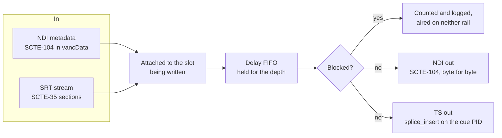
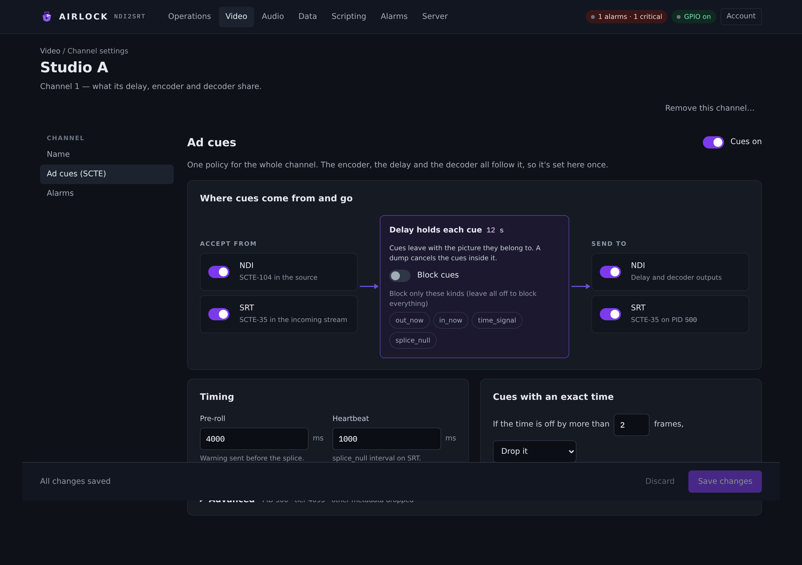

# SCTE cues

An ad break is signalled, not pictured, and a delay that carries the pictures has to
carry the signal with them. Airlock takes **SCTE-104 off the NDI input's metadata**,
holds each cue on the exact frame it arrived with, and re-emits it on NDI and as
**SCTE-35 on the transport stream** when that frame airs — and on the decoder, reads
SCTE-35 back off a received stream and turns it into SCTE-104 on the decoded output.

!!! note "Everything is off until you turn it on"
    With cues disabled, a cue on the input is ignored and nothing is added to the
    transport stream. An existing stream has exactly the PMT it always had.

## How a cue travels



A cue arrives as the NDI `vancData` metadata document — SMPTE ST 2010's DID 0x41 /
SDID 0x07, carrying base64 of the SCTE-104 message — either on the frame's own
metadata or as a standalone metadata frame. Both rails are read, and the same cue
arriving twice is deduplicated on its event id and insert type within two frames.

The cue is attached to the slot being written and **airs with that slot**. It is late
by exactly the delay depth, never by a scheduler tick.

As it airs:

- the **NDI rail** sends the SCTE-104 message back out byte for byte as it arrived,
  stamped with the frame's own timecode;
- the **TS rail** builds a `splice_insert` section whose splice instant is that frame's
  PTS plus **the upstream's own pre-roll**, and hands it to the multiplexer beside the
  picture.

!!! warning "A pass-through cue keeps the upstream's pre-roll"
    Substituting the four-second floor would move the transport-stream break up to four
    seconds away from the NDI break — two rails, two splice points, one broken ad
    break. A short upstream pre-roll is logged and counted, never rewritten. The floor
    (SCTE 104 §11.3, SCTE 35 §9.9.2.1, and the rule is one-sided: earlier is fine,
    later is not) applies only to cues this program originates.

Four more rules worth knowing before you operate it:

- **A dump cancels the cues in the dumped span.** They rode the removed slots, so they
  leave with them, and the delay counts them as cancelled. A rollout's jump cut is the
  same: the buffered material never airs, so neither do its cues.
- **A fill, a freeze or a repeated frame never re-emits a cue.** The payload is moved
  off the slot as it airs, so a hold cannot spray a splice every frame period.
- **An absolute-time cue is dropped once the delay has moved it.** A cue with
  SCTE-104 `time_type != 0` names an instant, and a delay has invalidated it. At or
  near zero depth it still stands — the test is the real gap, not the mere existence of
  a delay channel.
- **A frame shed rather than dumped keeps its cue.** The memory budget, a surplus trim
  and depth-maintenance catch-up all drop the *oldest* frame while the programme
  continues; the cue moves to the frame that airs in its place, one frame late rather
  than lost.

## On the transport stream

The cue PID is announced in the PMT with **stream type 0x86** and, in its ES info loop,
the **registration descriptor carrying `CUEI`** (SCTE 35 §8.1). A receiver that does
not see CUEI is entitled to ignore the PID, so a multiplexer that labels cues 0x06
private data is not conformant and this one does not.

Sections are carried **as sections**, not PES: pointer field 0, the section, then
stuffing. Between breaks a 20-byte `splice_null` heartbeat goes out on the interval you
set, because an idle section PID that never carries a packet reads as dead to some
analysers.

On the way back in, the decoder reads the PID with its own demultiplexer, checks each
section's CRC (a section that fails is counted, never aired), ignores the heartbeat,
and re-emits the cue as SCTE-104 on the decoded NDI output — so a downstream delay sees
a cue again.

## Originating a cue

A cue you originate is injected into the live buffer as if it had just arrived with the
newest frame. It therefore **airs one depth later** and a dump cancels it like any
other.

### From the console

The channel's card on **Video › Delay** has the transport controls:

- **Cue out** with a break-length select beside it — 15 s, 30 s, 60 s or 120 s.
- **Cue in** to end the break.
- **Block cues**, a toggle — the operator kill switch described below.

The card shows **Ad cues** (how many have aired) among its stats, and a **Last cue**
line underneath when there is one.

<!-- SHOT: video/delay-cue-controls.png — the Cue out / break length / Cue in / Block cues
     group on a delay card, with the Last cue line visible underneath. -->

### Over REST

```bash
curl -X POST "http://<host>:8090/api/channels/1/scte/cue?type=out&event_id=4242&duration_s=30"
curl -X POST "http://<host>:8090/api/channels/1/scte/cue?type=in&event_id=4242"
curl -X POST "http://<host>:8090/api/channels/1/scte/cue?type=out_now"
curl -X POST "http://<host>:8090/api/channels/1/scte/cue?type=cancel&event_id=4242"
curl -X POST "http://<host>:8090/api/channels/1/scte/cue?type=time_signal&seg_type=provider_ad_start&duration_s=30&upid=BREAK1"
curl -X POST "http://<host>:8090/api/channels/1/scte/block?on=true"
```

`/api/scte/cue` without a channel segment means channel 1.

| Parameter | Meaning |
|---|---|
| `type` | `out`, `in`, `out_now`, `in_now`, `cancel` or `time_signal`. The `_now` forms are `splice_immediate`. |
| `event_id` | The splice event id. Use the same one for the `in` that ends an `out`. |
| `duration_s` | Break length for an `out`. |
| `pre_roll_ms` | Override the configured pre-roll for this cue; the 4000 ms floor still applies. |
| `seg_type`, `upid` | `time_signal` only — the segmentation type (a word such as `program_start`, `break_end`, `provider_ad_start`, or a number) and the UPID. |

`type=time_signal` emits a `time_signal` carrying one `segmentation_descriptor`. It is
the TS rail only — there is no SCTE-104 document to put on NDI for it.

### Over TCP

```
CUE 1 OUT 30 4242     → OK 1 operator splice out id 4242 pre-roll 4000 ms break 30.0 s
CUE 1 IN
CUE 1 OUTNOW | INNOW | CANCEL
SCTEBLOCK 1 ON | OFF
```

### From a script

```lua
air.cue(1, { type = "out", duration_s = 30, event_id = 4242 })
air.After(30, function() air.cue(1, { type = "in", event_id = 4242 }) end)
air.scte_block(1, true)
```

`air.cue(channel, options)` takes `type`, `duration_s`, `pre_roll_ms`, `event_id`,
`program_id`, `avail`, `avails`, `auto_return`, `seg_type` and `upid`; a bare string is
the type. Two triggers fire on the cue rails: **`scteReceived`** when a cue is taken
off an input, and **`scteAired`** when one leaves on the delayed output.

Originating a break and blocking one are **transport, not configuration**: both are
audited, and both are held by the channel lock.

## Blocking cues

**Block cues** drops every cue: it is still decoded, counted and logged, it just
reaches neither rail. It is live — the button, the TCP verb and the REST call all act
at once — and it is also a saved setting, so a channel can be configured to start
blocked.

For finer control, **Block only these kinds** blocks one kind and not another. The kinds
are:

| Kind | What it covers |
|---|---|
| `out` | break start |
| `in` | return |
| `cancel` | a cancellation |
| `other` | anything with no splice request — a `time_signal` |

Leave the list empty and nothing is blocked beyond the master **Block cues** switch.

!!! warning "Use the kind names the server validates"
    `scte.block_kinds` accepts `out`, `in`, `cancel` and `other` only, as a comma list.
    A save carrying anything else is refused with the list in the error.


## The Ad cues (SCTE) tab

Cue policy is one setting for the whole channel — the encoder, the delay and the
decoder all follow it — so it lives on the channel's own settings page rather than on a
block's. Open any channel's settings and choose **Ad cues (SCTE)**.

{ .shot }

The tab opens with **Cues on** in its header, then a **Where cues come from and go**
card drawn as a flow: the **Accept from** switches on the left, the delay in the middle
showing the depth each cue will be held for, and the **Send to** switches on the right.

| Setting | Console label | Config key | Default | Meaning |
|---|---|---|---|---|
| Enabled | Cues on | `scte.enabled` | `false` | The master switch. Nothing happens without it, and the PMT gains no cue PID. |
| Accept from NDI | NDI | `scte.accept_from_ndi` | `true` | Read SCTE-104 off the NDI input's metadata. |
| Accept from SRT | SRT | `scte.accept_from_srt` | `true` | Read SCTE-35 off a received transport stream (the decoder). |
| Emit to NDI | NDI | `scte.emit_to_ndi` | `true` | Re-emit the delayed cue as NDI metadata on the delay and decoder outputs. |
| Emit to SRT | SRT | `scte.emit_to_srt` | `true` | Re-insert the delayed cue on the encoder's transport stream. |
| Block | Block cues | `scte.block` | `false` | Drop every cue; it is still decoded, counted and logged. |
| Block kinds | Block only these kinds | `scte.block_kinds` | *(empty)* | Comma list of `out`, `in`, `cancel`, `other`. Empty blocks nothing beyond **Block cues**. |
| Pre-roll | Pre-roll | `scte.pre_roll_ms` | `4000` | Pre-roll for cues *this program originates*. 4000–60000 ms; the floor is enforced. A pass-through cue is unaffected. |
| Heartbeat | Heartbeat | `scte.null_interval_ms` | `1000` | `splice_null` interval on the cue PID. `0` turns it off; otherwise 100–30000 ms. |
| Absolute tolerance | *(frames, in the sentence)* | `scte.absolute_tolerance_frames` | `2` | How many frames of real delay count as having moved an absolute-time cue. 0–300. |
| Absolute action | *(action, in the sentence)* | `scte.absolute_action` | `drop` | `drop` or `pass` for an absolute-time cue the delay has invalidated. |
| PID | SCTE-35 PID | `scte.pid` | `500` | 32–8186, and it must not collide with the video, audio or PMT PID. |
| Tier | Tier | `scte.tier` | `4095` | The section's `tier`, 12 bits. 4095 (0xFFF) means unused. |
| Pass other metadata | Pass other metadata through | `scte.pass_other_metadata` | `false` | Relay non-SCTE NDI metadata documents through the delay as well. |

The **Timing** card holds pre-roll and heartbeat. The **Cues with an exact time** card
reads as a sentence: *if the time is off by more than N frames, drop / pass*. PID, tier
and the other-metadata switch are behind the **Advanced** disclosure, which summarises
them in its own line.

## Verifying it works

Counters are on every card and in `GET /api/state`:

| Where | What it shows |
|---|---|
| Delay card (**Video › Delay**) | `cues_in`, `cues_aired`, `cues_blocked`, `cues_dropped`, `cues_cancelled`, the last cue in and the last aired |
| Encoder card | the cue PID, sections and heartbeats muxed, and the last cue |
| Decoder card | the PID it found, sections in, bad CRCs, and how many it re-emitted on NDI |

A practical check, end to end:

1. Turn cues on and set a depth you can watch — a couple of seconds is enough.
2. Press **Cue out** on the delay card, or post one over REST with a known `event_id`.
3. Watch `cues_in` go up at once and `cues_aired` go up one depth later. The **Last
   cue** line names it.
4. Probe the delayed NDI output and confirm the cue appears there exactly once:

    ```bash
    ndi2srt --probe "<the delay's NDI name>" --seconds 10
    ```

    The report ends with a metadata line — `metadata documents 1, SCTE cues 1 (first:
    ndi splice out id 6161 pre-roll 4000 ms break 8.0 s)`. The upstream's pre-roll and
    break length survive the delay.

5. On the receiving side, probe the decoder's NDI output the same way to close the
   round trip: NDI in → delay → SCTE-35 on SRT → SCTE-104 on NDI out.

6. Dump a span that holds a cue and confirm `cues_cancelled` goes up while
   `cues_aired` does not. Turn **Block cues** on and confirm `cues_blocked` goes up
   while `cues_aired` does not.

!!! tip "Checking the multiplex with a third-party analyser"
    Look for stream type **0x86** on your configured PID in the PMT, with a
    **registration descriptor whose format identifier is `CUEI`**. If your analyser
    sees the PID but calls it private data, you are looking at a different multiplexer.
    A PID carrying only `splice_null` between breaks is correct — that is the heartbeat.

## Troubleshooting

| Symptom | Likely cause | What to do |
|---|---|---|
| No cue PID in the PMT at all | cues are off, or **Emit to SRT** is off | Both must be on. The PMT is written at the start of the stream, so restart the encoder after turning cues on. |
| Cues counted in, none aired | **Block cues** is on, or a kind filter is catching them | Check `cues_blocked`. Check **Block only these kinds**. |
| Cues in, none counted at all | the source is not sending SCTE-104 where this reads it, or **Accept from NDI** is off | Probe the *input* source and look at its metadata line. The message must be in a `vancData` document with DID 0x41 / SDID 0x07. |
| Breaks land in the wrong place on the transport stream, but right on NDI | the pre-roll was substituted somewhere upstream | A pass-through cue must keep the upstream's pre-roll. Check the cue's reported pre-roll on the delay card against what the upstream says it sent. |
| Absolute-time cues disappear | they are being dropped as invalidated, which is the default | That is normal behaviour for a delayed chain. Set **action** to `pass` if the downstream really does want them. |
| A cue arrives twice downstream | the source puts it on both the frame metadata and a standalone metadata frame | Deduplication already covers this within two frames and the same event id. If it is further apart, it is two genuinely different cues. |
| Decoder reports bad CRCs | the stream is damaged, or something is rewriting sections in transit | Compare with the encoder card's muxed section count. Sections that fail CRC are counted and never aired. |
| Save refused: *scte: pid … collides* | the cue PID is the same as the video, audio or PMT PID | Pick another PID in 32–8186. |
| Save refused: *pre_roll_ms must be >= 4000* | you set a pre-roll below the standard's floor | 4000 ms is the minimum for a cue this program originates. Pass-through cues are not affected. |
