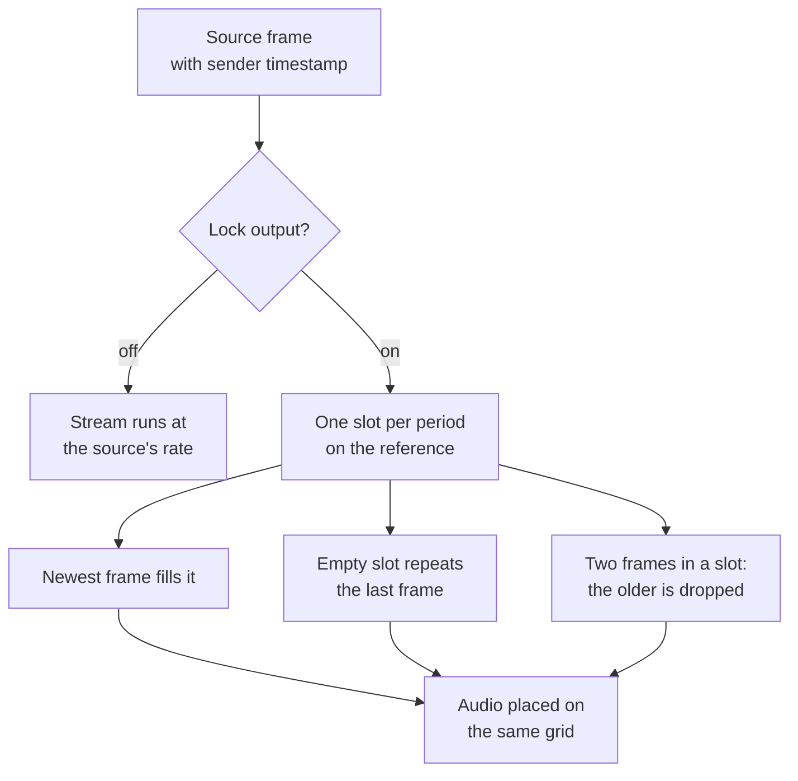

# Timecode and clocking

Four clocks run in an Airlock channel, and each has exactly one owner: the **content
clock** that places a picture in time, the **audio rail** that is conformed to it, the
**PCR** the pacer stamps on the transport stream, and the **reference** everything is
paced against. This page explains what each one does, what the settings change, what
the delay and the decoder write into NDI timecode, and how to prove a delay is
frame-exact.

## The content clock

A picture's place in the timeline is **its slot on the sender's own clock**: the
sender's timestamp for that frame, snapped to the exact rational frame period, starting
at one hour.

That matters more than it sounds. The obvious alternative is to count the frames this
receiver was *given* — but a frame lost before it ever arrived is then a frame period
the clock never advanced, while the audio rail, which conforms to the sender's
timestamps whatever turns up, keeps time regardless. At 28.5 fps of a 30 fps source
that is a 5 % error: three seconds of lip sync per minute, with nothing reporting it.

So a frame that never arrived leaves a **gap** in the timeline, which is the truth. It
is counted on the card as **Source gaps**. A source whose clock restarts or changes
rate re-anchors the grid rather than carrying a nonsense jump into the PTS, and a
source that stamps nothing at all falls back to the frame index.

The **audio rail** is placed on that timeline from the sender's own timestamps, zeroed
at the first picture's. Audio from before the first picture is dropped, the first block
snaps into place, and from then on the rail is corrected only when its averaged error
(over 16 blocks) exceeds one AAC frame — so block jitter never triggers a correction,
but a real offset is taken out within a second.

The **PCR** is placed by the pacer from the byte clock, so its accuracy is true by
construction rather than by estimate.

## Clock settings

The clock is process-wide, on **Server › General** in the **Clock** card. Its subtitle
is *What the encoder paces against*.

| Setting | Console label | Config key | Default | Meaning |
|---|---|---|---|---|
| Reference | Reference | `clock.reference` | `monotonic` | What paces the byte clock and the PCR: `monotonic` (the host's free-running timer) or `system` (the OS wall clock). |
| Lock output | Lock output | `clock.lock_output` | `false` | Genlock the output to the reference: one frame slot per period, source frames repeated or dropped to fit. |

### Reference

| `reference` | What paces the stream | PCR frequency |
|---|---|---|
| `monotonic` | the host's free-running timer | the host crystal, typically 10–100 ppm off |
| `system` | the OS wall clock | whatever disciplines it — with PTP, the plant reference |

A wall-clock **step** (as distinct from a slew) is absorbed into an offset and counted
on the card as clock steps, so a badly behaved NTP cannot burst or stall the stream.
The card's **Drift vs host** figure is the reference clock's rate measured against the
raw crystal; with a disciplined clock, that *is* the crystal's error.

!!! note "Linux and Windows differ here"
    On Linux, `CLOCK_MONOTONIC` is itself rate-disciplined by NTP and PTP — it only
    never steps — so `monotonic` already runs at the disciplined rate and `system`
    mostly adds step protection. On Windows the two really do differ, and `system` is
    the one that follows the PTP client.

### PTP

There is no PTP stack inside Airlock, and there does not need to be one. Discipline the
machine's clock with the platform's own PTP client — `ptp4l` with `phc2sys` on Linux, a
PTP client service on Windows — and then set **Reference** to `system`. The stream is
then paced by the plant reference.

### Lock output

With **Lock output** on, the output is genlocked: one frame slot per period on the
reference, anchored half a period after the first frame so source frames land
mid-interval rather than on a slot edge. The newest source frame fills the slot; a slot
with nothing new repeats the last frame; a slot with several drops the older ones. The
audio rail is placed on the same grid — each block's sender timestamp mapped through
the video's measured timestamp-to-reference offset, so lip sync is still whatever the
sender's timestamps say.

The stream then runs at **exactly** the reference rate. The source's rate error shows up
as a "source vs reference" ppm figure and as repeat and drop counts, instead of as
drift in the stream. That is what a plant with a house reference wants from a
contribution feed.

Leave it off when the source *is* the reference — a production switcher on a
free-running PC feeding one decoder. Locking that to an unrelated house clock only adds
repeats and drops for nothing.



## Timecode on the delay

Every NDI frame carries a timecode — UTC in 100 ns units. What the delay puts there is
a policy, not an accident. It is on the delay's **Depth & dumps** tab, in the **Depth**
card.

| Setting | Console label | Config key | Default | Meaning |
|---|---|---|---|---|
| Timecode | Timecode | `delay.timecode` | `passthrough` | `passthrough` or `synthesize`. |

### `passthrough`

The delay moves pictures in time without rewriting their identity. A receiver can
therefore tell when a frame was *captured*, every output frame can be matched
one-for-one to its input, and probing the delayed output tells you the real delay
through the chain.

In detail:

- A content frame leaves with **exactly** the timecode it arrived with, and the audio
  sent with it carries the same value — the audio is slot-paired with the picture it
  was captured with, so the two rails never disagree.
- A **repeated or fill frame** — the hold while building, a starved output tick, the
  freeze when the buffer runs dry — has no content of its own, so it **continues from
  the last emitted timecode by one nominal frame period**. That is a deliberate choice:
  resending the held frame's own timecode would hand the receiver a run of identical
  timecodes, which NDI receivers may legitimately read as "the frame I already have",
  while stamping the wall clock would break the one guarantee passthrough exists for.
  Continuing by the period keeps the output strictly monotonic and uniquely stamped
  while the picture is frozen.
- A **dissolve** stamps the frame whose *content* the output is becoming — the delayed
  frame through a build-end, dump-splice or rollout cross-fade, and the live frame while
  dissolving live into the hold at build start.
- The **seams are inherent and deliberately not rebased**. Building into delayed steps
  the timecode *backwards* by about the depth that was built — that is what a delay is.
  Rollout, and dump into live, step it *forwards*.
- Before any content frame has been emitted, and for an input frame whose own timecode
  is absent, the fill rule applies. With no last value at all, the NDI runtime stamps.

### `synthesize`

Every frame is handed to the NDI runtime to stamp with the send time. Use it when a
downstream device insists on timecode that matches its own now.

## Timecode on the decoder

The SRT-to-NDI path has no NDI timecode to pass through — a transport stream carries
PTS only — so the decoder's choice is different.

| Setting | Console label | Config key | Default | Meaning |
|---|---|---|---|---|
| Timecode | Timecode | `decoder.timecode` | `synthesize` | `synthesize` lets the runtime stamp the send time; `pts` derives the stamp from the stream. |

`pts` anchors on the wall clock at the first picture and stamps every frame
`anchor + (PTS − PTS₀)`. The anchor includes the output delay, so the stamp is the
instant the frame is due. The result moves with the **sender's** clock rather than with
this machine's send jitter: monotonic, gap-for-gap the stream's, re-anchored only when
the output timeline itself re-bases. Audio is stamped from the same anchor, so both
rails agree.

!!! tip "Prefer `pts` on a decoder whose output anything downstream has to align"
    NDI's own guidance is that the timecode values for audio packets must accurately
    represent the audio timing relative to the video frame. Under `synthesize` the
    runtime anchors once from UTC and then advances *each rail by its own nominal
    duration* — so the two stamps become independent counters that say nothing about
    the real relationship between them, and any misalignment on the way out is
    unrecoverable: a receiver, a frame synchroniser, or a downstream delay has nothing
    to re-align from. Under `pts` both stamps come from one anchor and carry the
    stream's own relationship, so the alignment survives the hop.

!!! warning "End to end is not frame-exact yet"
    Nothing carries NDI timecode *through* the transport stream, so NDI in → SRT → NDI
    out cannot be frame-exact end to end. Only the delay can be. A decoder's `pts`
    timecode is stable, monotonic and correctly related between the rails, but it is
    not the originating camera's timecode.

## A/V sync behaviour

### On the encoder

Two figures on the encoder card answer two different questions, and they are easy to
confuse.

**A/V offset** is the two rails compared *as the multiplexer has them* — the last video
PTS against the last audio PTS, smoothed. It is what a receiver will see, and it is the
number to judge lip sync by.

**Audio conform** is how well the audio rail is tracking its own source. It is useful,
but it is not lip sync: conform can sit at a few milliseconds throughout a run while the
muxed rails walk minutes apart.

### On the decoder

Both output rails are paced by one shared timeline and neither has a policy of its own.

- A unit whose moment has passed goes out **immediately** and is counted as late.
  Pacing must never add to lateness.
- A unit more than a second from its deadline **in either direction** means the grid no
  longer describes the stream, so the grid is re-based for *both* rails together rather
  than one rail quietly going its own way. This is the rule a hardware transport decoder
  follows when a PCR discontinuity makes it reload the video STC, the audio STC and its
  own together.
- Steady drift between the sender's clock and this one is corrected by trimming the
  anchor by at most 2 ms per 2 s window, never by stepping it.
- The reported A/V figure is the two rails' clocks read at one instant, and it reads
  `n/a` — not a number — when either rail has been quiet for more than a second.

### The alarm

| Config key | Default | Meaning |
|---|---|---|
| `alarms.av_offset_ms` | `100` | How far the muxed A/V offset may stray. |
| `alarms.av_offset_s` | `5` | How long it may stay there before `ALARM_AV_SYNC` raises. |

For reference, EBU R37 allows +40/−60 ms at an output and ITU-R BT.1359-1 +90/−185 ms
end to end.

### Grid trim

The decoder card carries a **grid trim** figure: what the output timeline's servo has
done to the deadlines. Negative pulls them earlier (the stream is arriving faster than
it leaves); positive pushes them later. A healthy chain sits near zero, and a real
source offset parks it at a small steady figure. One that walks in one direction for
ever is the servo chasing something it cannot reach — which is how a runaway source rate
can hide for weeks behind nothing worse than a queue that looks full. The queue depth
says the same thing, more slowly; this says it in milliseconds.

## Proving a delay frame-exact

Three command-line tools work together. Run them from any machine that can see the NDI
sources — they need the NDI runtime and nothing else.

```bash
ndi2srt --testsend "TEST 25p" test:1280x720@25p   # publish a synthetic source
ndi2srt --probe "<ndi name>"                      # 5 s look: formats, timecode, counter
ndi2srt --prove-delay "<in>" "<out>" [seconds]    # match input to output, frame by frame
```

### The test source

`test:WxH@RATE[p|i]` draws colour bars, a block moving at half a frame width per
second, 1 kHz at −18 dBFS, and — the important part — a **16-bit frame counter** as a
stripe of black and white bins under the bars, so every frame is individually
identifiable. `--testsend` publishes it as a real NDI source, so a delay has something
to receive whose frames can be told apart.

Rates such as `test:1920x1080@25i`, `test:1280x720@59.94p` and `test:1920x1080@29.97i`
all work. In interlaced mode the two fields are rendered half a period apart, so
field-coded output moves smoothly and anything that treated the frame as progressive
shows the comb.

### Running the proof

1. On a machine that can reach the delay, publish the test source:

    ```bash
    ndi2srt --testsend "TEST 25p" test:1280x720@25p
    ```

2. Point the channel's delay at `TEST 25p`, set a depth, and build it. Let it settle at
   the target depth.
3. Run the proof for long enough to cover a few seconds of steady state:

    ```bash
    ndi2srt --prove-delay "TEST 25p" "<the delay's NDI name>" 30
    ```

It receives both streams at once, reads the counter back out of both pictures, matches
each output frame to the input frame with the same counter, and reports:

- the delay **by arrival** — min, mean, max and spread, measured by one clock on one
  machine;
- the delay **by timecode age** at the output;
- how many input frames inside the evaluated window never came out (**missing**);
- how many output frames repeated — a hold or fill, the same counter twice — which are
  judged by the fill rule instead: their timecode must continue forwards;
- whether **timecode in equals timecode out** on every matched content frame, with
  examples when it does not.

```
prove: matched 744 output frames to input frames (744 input frames in the evaluated window, …)
prove: delay by arrival: min 4973.1 ms  mean 4973.9 ms  max 4975.0 ms  (spread 1.9 ms)
prove: delay by timecode age at the output: min 4984.2 ms  mean 4985.7 ms  max 4987.0 ms
prove: frames missing in the window: 0 · output frames repeated (holds / fills): 0
prove: timecode in == timecode out on 744/744 matched frames
prove: PASS — frame-exact and timecode-preserving through the delay
```

It exits **0 only** when the chain is frame-exact: every match carries its input's
timecode exactly, nothing missing, nothing repeated. That makes it a **steady-state**
proof — dump a span or rebuild the buffer inside the window and it will correctly fail,
with the figures then describing what the dump removed and how long the output held.

!!! note "A dissolve is never mistaken for a counter"
    The counter reader returns "no counter" for any picture whose bins are neither
    clearly black nor clearly white — a mid-dissolve blend, a different picture, too
    small a raster — so blended frames are excluded rather than misread.

### Measuring across two machines

When the input and the output cannot be received in one place, use the analyser:

```bash
ndi2srt --analyse "<output>" --against "<input>" --seconds 30
ndi2srt --analyse "<output>" --seconds 30 --expect 1280x720@25p
```

With `--against`, the delay is two arrival times measured by **one clock on one
machine** — exact, and owing nothing to how well two machines agree about the time.
It is reported as a PASS with a number.

Without it, the delay is the age of the sender's timecode against this machine's clock,
and it is reported as **UNKNOWN** with the number and its spread — because the *mean* is
only as good as the clock agreement between the two machines, while the *spread* is
trustworthy either way and tells you the stability of the chain. In one measured run
across two machines the counter-matched figure was 4973.94 ms with a 59.7 ms spread and
the timecode age on the same chain read 4985.70 ms with a 13 ms spread: the two agree to
12 ms, which is as much a statement about the two machines' clocks as about the delay.

## Troubleshooting

| Symptom | Likely cause | What to do |
|---|---|---|
| Lip sync walks away over hours | the source is dropping frames and something downstream is counting arrivals rather than timestamps | Check **Source gaps** on the encoder card. A gap is the honest answer; a gap count climbing steadily is a source or network problem. |
| **A/V offset** fine, picture and sound still out at the far end | the receiver is re-timing, or there is a second path | A/V offset is the muxed truth at this end. Compare it with the decoder's own A/V figure. |
| **Audio conform** small, **A/V offset** large | the two rails have walked apart in the multiplexer | Trust A/V offset. Conform only says the audio rail tracks its own source. |
| `--prove-delay` fails with repeats | a dump, a rebuild or a starved output happened inside the window | That is a correct failure. Re-run over a window of steady state. |
| `--prove-delay` reports timecode mismatches | the delay's timecode mode is `synthesize` | Set `delay.timecode` to `passthrough` if frame-exactness matters. |
| `--prove-delay` finds no counter-stamped frames | the source is not the synthetic test pattern, or the raster is too small to read the stripe | Use `--testsend` to publish the test source, and a raster of at least 720 lines wide enough to resolve the bins. |
| Clock steps counted on the card | NTP is stepping the wall clock | Steps are absorbed, not passed on, so the stream is safe — but a stepping clock means the time service needs attention, and `system` plus a disciplined clock is the fix. |
| Output runs slightly fast or slow against house | the stream is running at the source's rate | Turn **Lock output** on and set **Reference** to `system` with the machine disciplined by PTP. |
| Repeats and drops appear as soon as **Lock output** is turned on | the source rate genuinely differs from the reference | That is the lock doing its job: the error is now visible as repeats and drops instead of hidden as drift. Fix the source's rate, or leave the lock off if the source is the reference. |
| Decoder output timecode jumps | the output timeline re-anchored | A PTS jump (a new source behind the same link) or a stall of three seconds re-anchors by design. Repeated re-anchoring points at the link or the sender. |
